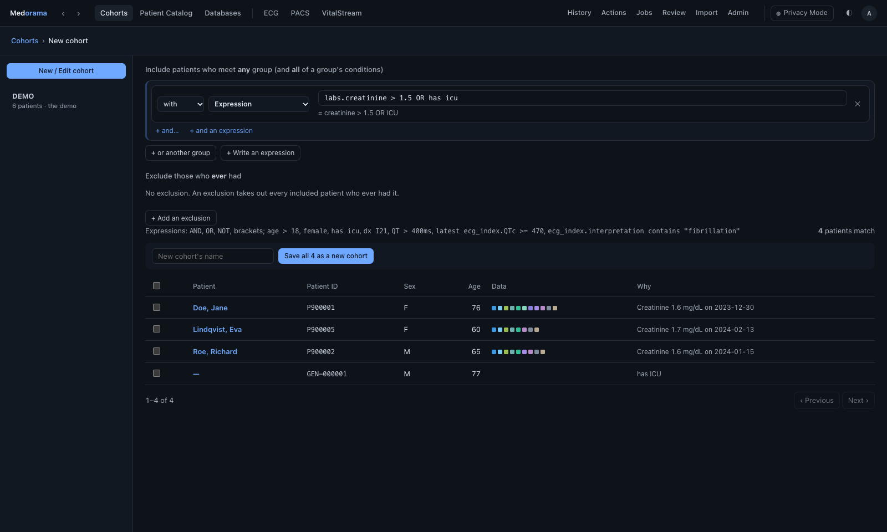
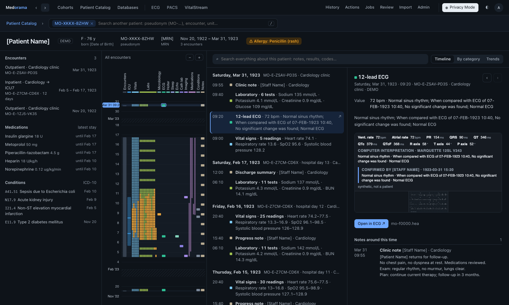
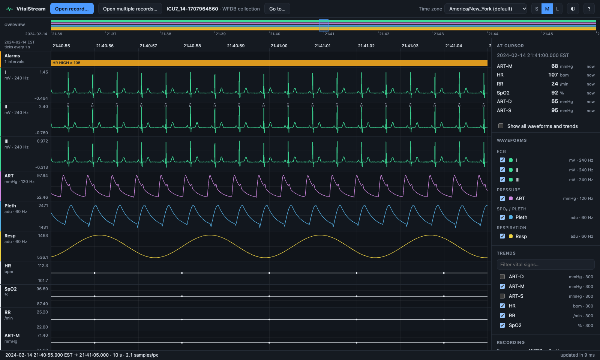
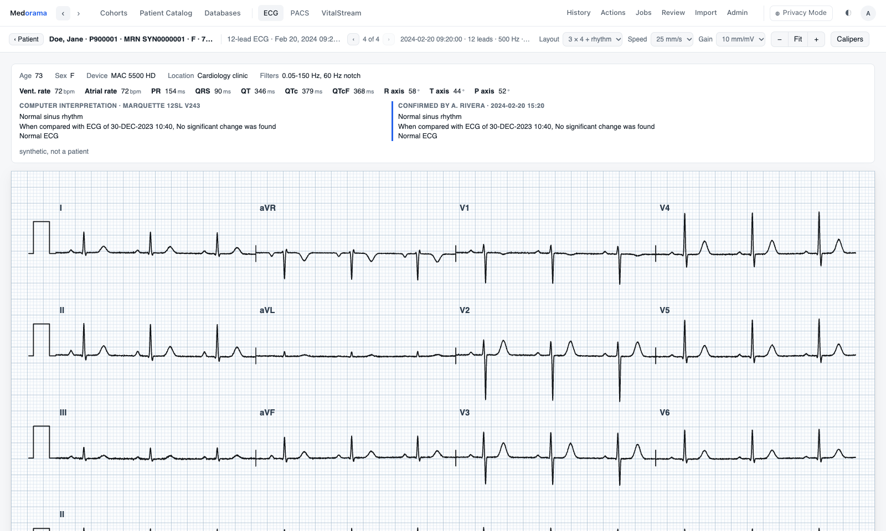
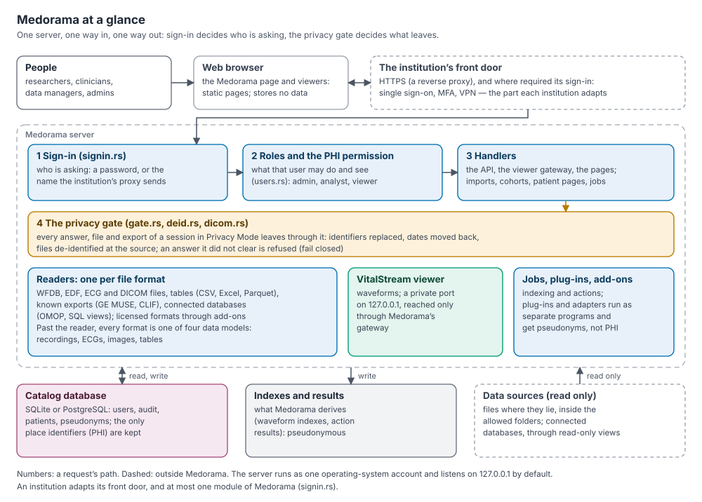

# Medorama

**Medorama: A unified patient-journey research platform linking EHR data, physiological
waveforms, imaging and laboratory results across databases.**

[](LICENSE)

[Install](docs/install.md) ·
[Get started](docs/getting-started.md) ·
[User's manual](docs/user-manual/medorama-user-manual.pdf) ·
[Documentation](docs/README.md) ·
[Security review](docs/security.md) ·
[Source code](https://github.com/alphanumericslab/medorama)


*A patient's page: the Patient Journey (left), the report of every entry (center) and the
selected ECG (right). Every picture on this site shows synthetic data made by
`tools/make-demo-data.py`.*

## Why Medorama

A patient's story is scattered across a hospital's systems. The electronic health record holds
admissions, diagnoses, medications, notes and laboratory results; bedside monitors record days
of waveforms and vital signs; the ECG management system holds the 12-lead ECGs; the PACS holds
echocardiograms, angiograms and radiology studies. Research that relates them, such as how the
QT interval changed after a drug, what the monitor showed in the hours before a deterioration,
or which patients with a given echo finding later developed an arrhythmia, usually takes weeks
of data extracts, file conversions and one-off scripts, and each step copies identified data
somewhere new.

Medorama brings these sources together without moving them:

- **It links each patient's records across databases** into one time line, the *Patient
  Journey*, with the waveforms, ECGs and images beside the rest of the record.
- **It finds cohorts across every source at once**, with criteria such as
  `QTc > 470ms AND female`, and refreshes them as new data arrive.
- **It runs inside the institution**, on its own servers, reads the data where they already
  live, and hides identifiers from everyone who is not allowed to see them.

> **Research use only.** Medorama is research software, not a medical device. It is not cleared
> for diagnosis or treatment and must not be used to make clinical decisions.

## What it does

- **One patient, one page.** Admissions, bed stays, laboratory results, vital signs,
  medications, conditions, notes, ECGs, imaging and bedside-monitor recordings from every
  database appear on one time line, beside a searchable report of every entry
  ([user guide](docs/user-guide.md)).
- **Cohorts across every database.** Researchers find patients by results, ECG and imaging
  measurements, diagnoses, medications, stays, age, sex and text, see why each patient matched,
  and then keep, refresh, combine and export the cohort ([user guide](docs/user-guide.md)).
- **Viewers for long recordings, ECGs and images.** VitalStream shows weeks of ICU monitoring,
  Holter or sleep recordings down to single samples; the ECG viewer draws 12-lead ECGs on
  standard paper; the PACS viewer plays DICOM studies. They open as tabs of the patient's page,
  and each also works on its own ([the viewers](viewers/README.md)).
- **Privacy by design.** Users without the permission to see identifiers never receive them:
  the server de-identifies every answer and every file before it leaves, and refuses any answer
  it did not clear ([protecting patient data](docs/protecting-patient-data.md)).
- **Institutional sign-in.** Medorama can rely on the institution's single sign-on,
  multi-factor authentication or VPN, through configuration alone ([sign-in](docs/sign-in.md)).
- **Open formats and existing databases.** WFDB, EDF, EDF+ and BDF, GE MUSE XML, DICOM, CLIF,
  OMOP and tables in CSV, Excel or Parquet are read directly, and OMOP or any SQL database can be
  connected in place ([databases](docs/databases.md), [importing](docs/importing.md)).
- **From one laptop to many users.** The same program runs on one computer with SQLite, or on
  several servers with PostgreSQL for a whole department ([administration](docs/administration.md)).
- **An audit trail.** Sign-ins, views and searches of identifiers, imports, exports and changes
  are logged in a tamper-evident log ([security](docs/security.md#12-audit-logging)).
- **Light and dark themes**, in Medorama's page and in every viewer.

## See it

| | |
|---|---|
|  |  |
| **Build a cohort** across every database, and see why each patient matched. | **Work in Privacy Mode**: names become placeholders, IDs become pseudonyms, and dates move back. |
|  |  |
| **Read an ICU recording** in VitalStream, from days down to single samples. | **Read a 12-lead ECG** on standard paper, here in the light theme. |

The ECG and PACS viewers run [live on this website](viewers/README.md#try-them), on synthetic
examples or on your own files, which are read in your browser and never leave your computer.

## Who it is for

| You are | Medorama gives you | Start with |
|---|---|---|
| A researcher or clinician-scientist | Every patient's data on one page, and cohorts across all of it, without writing queries | [Get started](docs/getting-started.md), the [user guide](docs/user-guide.md) |
| A data manager | One place to bring EHR extracts, OMOP databases, monitoring archives, ECG and imaging exports together, with the columns and checks they need | [Databases](docs/databases.md), [importing](docs/importing.md) |
| An IT security or privacy office | A deployment that stays inside your network, with documented trust boundaries, controls and tests | [Security and privacy](docs/security.md), [architecture](docs/architecture.md) |
| An administrator | A single program to install, with users, roles, backups and institutional sign-in | [Install](docs/install.md), [administration](docs/administration.md) |
| A developer or integrator | Readers for new formats, add-ons for licensed ones, and an HTTP API | [Readers](docs/readers.md), [adapters](docs/adapters.md), [HTTP API](docs/api.md), [developing](docs/developing.md) |
| Someone who only needs a viewer | VitalStream, the ECG viewer or the PACS viewer, on your own computer | [The viewers](viewers/README.md), [install](docs/install.md#vitalstream-on-its-own) |

The [documentation index](docs/README.md) lists every page, and the
[user's manual](docs/user-manual/medorama-user-manual.pdf) covers everything in one book.

## How it fits into an institution



Medorama is one server that the institution runs on its own hardware, behind its own front door
(HTTPS, single sign-on, VPN). Every request passes through sign-in and the user's roles, and
every answer to a session in Privacy Mode leaves through the *privacy gate*. The data sources
are only read: recordings, ECGs and images stay in their folders, and connected databases are
queried through read-only views. Formats under a vendor's license, such as BedMasterEx `.Stp`
monitoring files, are read by separate *add-ons* that institutions obtain under agreement
([adapters](docs/adapters.md)). The [architecture](docs/architecture.md) page describes each
part and its trust boundaries.

## Privacy and security

Medorama is designed to be deployed inside an institution's network, on servers the institution
controls. It listens only on the local machine by default and sends nothing to any host other
than the institution's own databases.

- **Identifiers stay in one place.** Names, medical record numbers and dates of birth are kept
  only in Medorama's own database, the *catalog*. Only users who hold the *PHI permission* and
  switch *Privacy Mode* off can see them, and every such access is audited.
- **Privacy Mode is the default** for every user except administrators. Identifiers become
  placeholders and pseudonyms (`MO-XXXX-XXXX`), dates move back while intervals are kept, and
  WFDB, EDF, GE MUSE XML and DICOM files are de-identified before they leave the server.
- **The gate fails closed.** Any answer to a session in Privacy Mode that the gate did not
  clear is refused, so a new feature cannot leak identifiers by omission; an end-to-end test
  checks every answer, file and export.

Medorama is designed to support HIPAA and GDPR safeguards. It is not certified against any
standard, and the deploying institution remains responsible for its deployment.

| Read | For |
|---|---|
| [Security and privacy](docs/security.md) | The review document for IT security offices: trust boundaries, threat model, controls, regulatory mapping, deployment checklist and known limitations. |
| [Protecting patient data](docs/protecting-patient-data.md) | How the privacy gate, Privacy Mode and pseudonyms hide identifiers, and how files are de-identified at the source. |
| [Sign-in](docs/sign-in.md) | How to connect institutional sign-in (SSO, MFA, VPN) through an authenticating proxy. |
| [PRIVACY.md](PRIVACY.md) and [SECURITY.md](SECURITY.md) | Where identifiers may appear; how to report a vulnerability. |

## Install

Medorama and each viewer install from source on Linux, macOS and Windows, in your user account.
[Install](docs/install.md) gives the commands for each system. On Linux or macOS, with Git,
Python 3.9 or later and a C compiler present, these lines install Medorama with six invented
demo patients and start it:

```bash
git clone https://github.com/alphanumericslab/medorama.git && cd medorama
tools/install-medorama.sh --viewer rs --demo   # Medorama, a waveform viewer and the demo (a few minutes)
source .venv/bin/activate
medorama init --results ~/medorama-results    # once: creates the catalog; asks for the admin password
medorama serve                                # then open http://127.0.0.1:8090 and sign in as admin
```

[Get started](docs/getting-started.md) continues with a guided tour of the demo, and how to
remove it before loading real data.

## License and commercial use

Medorama is free for noncommercial use: research, teaching, personal study, and use by
universities, public research and public health organizations and other noncommercial
organizations. It is licensed under the
[PolyForm Noncommercial License 1.0.0](LICENSE). Commercial use, including by companies and in
commercial products and services, needs a commercial license from the author
([COMMERCIAL.md](COMMERCIAL.md)). Contributions are accepted under the
[Contributor License Agreement](CLA.md).

Medorama's programs include third-party components under their own licenses, listed in
[THIRD_PARTY_LICENSES.md](THIRD_PARTY_LICENSES.md). WFDB records are read with
[wfdb-x](https://github.com/alphanumericslab/wfdb-x), a separate open-source project under its
own license; every program can also be built without WFDB support, and then contains no wfdb-x
code ([building](docs/building.md#without-wfdb)).

## Citation, author and contributing

Medorama is written by [Reza Sameni](https://sameni.info). To cite it, use
[CITATION.cff](CITATION.cff); GitHub's **Cite this repository** button reads it.

Contributions are welcome. The source code is at
[github.com/alphanumericslab/medorama](https://github.com/alphanumericslab/medorama);
[developing](docs/developing.md) explains the code, the tests and the releases, and
[CONTRIBUTING.md](CONTRIBUTING.md) and the [code of conduct](CODE_OF_CONDUCT.md) explain how to
take part. The repository holds no patient data, and checks on every commit keep it that way
([PRIVACY.md](PRIVACY.md)).

Product and company names on this site (GE, MUSE, Marquette, Unity, Carescape, BedMasterEx,
Philips, Viridia, DICOM, Epic, Cerner, Oracle, SQL Server, Snowflake, BigQuery and others) are
trademarks of their respective owners. They are used only to name the systems and formats
Medorama reads or connects to; Medorama is not affiliated with or endorsed by them.
