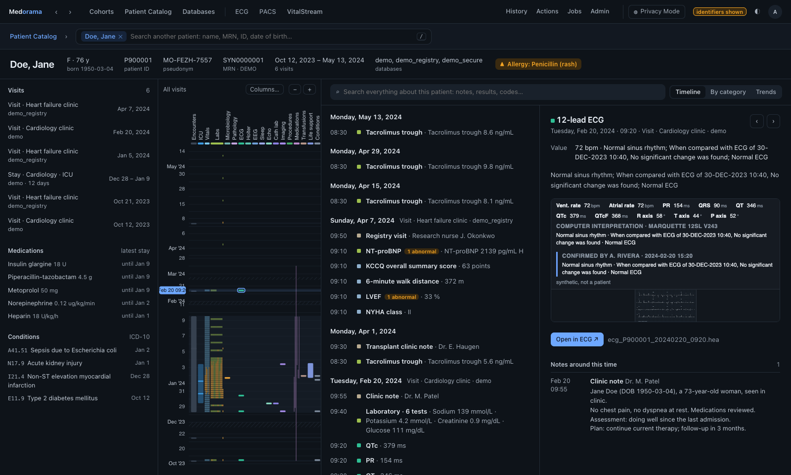
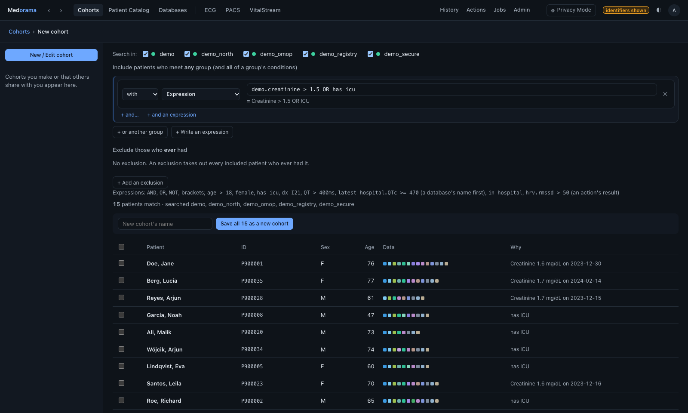
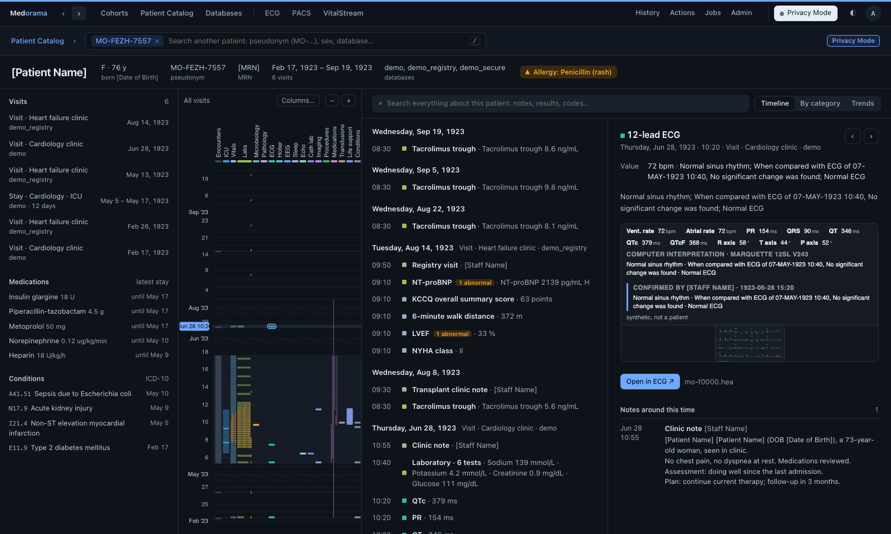
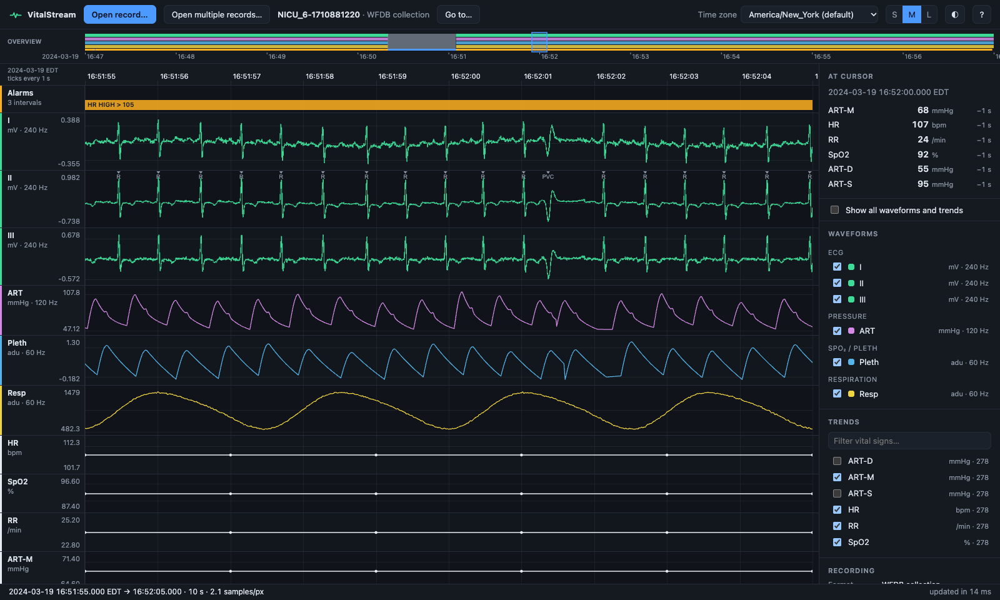
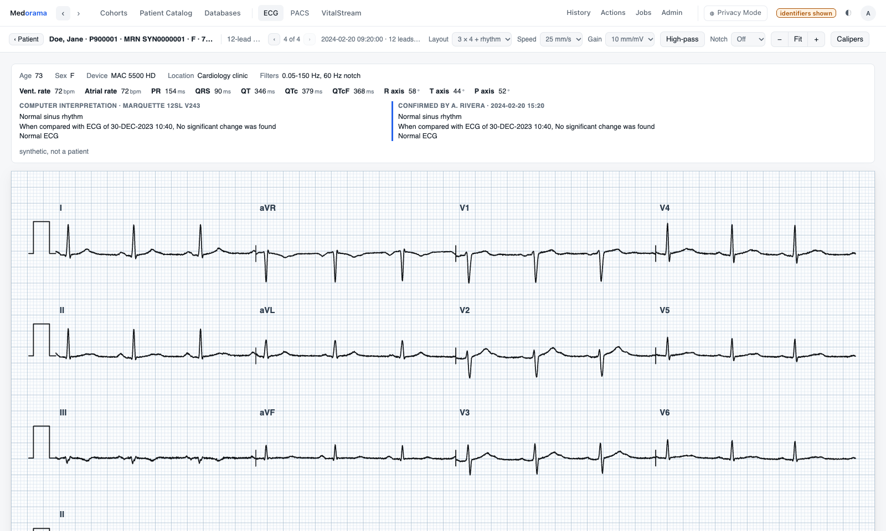
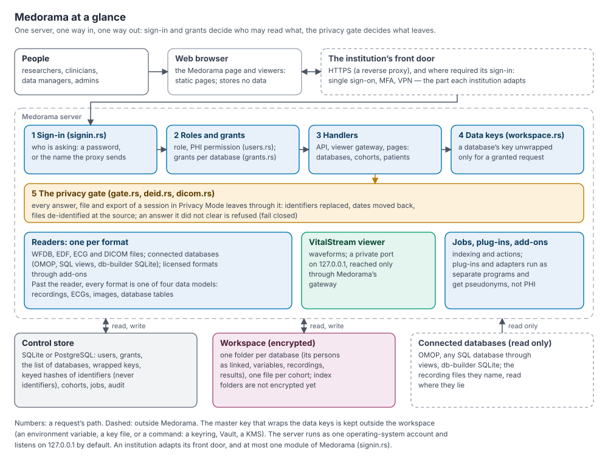

# Medorama

**Medorama: A unified patient-journey research platform linking EHR data, physiological
waveforms, imaging and laboratory results across databases.**

[](LICENSE)


**Version 0.4.0 (pre-release, November 2026).** A recording database may hold its recordings'
indexes, made ahead of time with `db-builder indexes`, which Medorama takes instead of indexing
the recordings itself, and may list each recording's signals by name, so that `has icu-bp-ART`
finds the patients with a recording of arterial pressure
([databases.md](docs/databases.md#indexes-and-signals-a-recording-database-holds)); the installers
no longer print setuptools' "Compat editable installs" warning, and a 0.3.3 installation updates
in place. In 0.3.3, opening a patient stopped making the server
print "database is locked" (the page's simultaneous requests wrote the same workspace file), and
`medorama serve` warns when the workspace is on a network file system
([administration.md](docs/administration.md#the-control-store-and-the-workspace)). A
measurement's dates are sent to the database, and a search's reasons are written out for the
page shown only ([performance.md](docs/performance.md#what-a-criterion-reads)). The installers
check Python (and for a Rust build `make` and Perl) before they build anything, and say what to do; the VitalStream
tab, opened directly, asks for a recording from a patient's page instead of showing the last
one the viewer opened, and a cohort search under way shows *Searching… please wait* in an amber
pill. 0.3.2 made searches read less of each database: a threshold sent to the
database, an optional `has` view for `has ecg`, answers kept while a database's data stay the
same, and criteria read in parallel, with the same results. It gave a patient's page's detail
the most room, with columns you can resize, the allergies first in its left column, the
databases at the end of the patient bar, ↑ ↓ through what was done, and the next entries read
ahead; and it put the demo on its own port, 8095, beside a site's installation. 0.3.1 made a patient's page
of four columns that names what was done and shows each fact once, comparing each ECG with the
patient's previous one ([patient-page.md](docs/design/patient-page.md)); made the demo an
installation of its own ([demo.md](docs/design/demo.md)); let criteria read databases of
millions of rows and a database give the dates of each person's first and latest data; and added
`medorama databases views`, which replaces a database's views. Since 0.3.0, Medorama keeps of each connected database only
its subjects (their identities and encounters) and the names and units of its variables, and
reads the rest from the database when it is asked: connecting a database of millions of rows
takes minutes, not hours ([connected-databases.md](docs/design/connected-databases.md)). 0.2.1
added strict reading of GE MUSE ECGs, with their median beats. Since 0.2.0, Medorama connects
databases instead of
importing data: OMOP, SQL views, or a SQLite database built with the new
[db-builder](db-builder/README.md). Each database's workspace and indexes are encrypted with that
database's own key, and access is granted per database. The release also has a full synthetic
demo of 40 patients in six databases, and the fixes of a senior engineering, clinical and
privacy review. A 0.1.0 installation is set up again rather than updated
([upgrading from 0.1.0](docs/install.md#upgrading-from-010)); every change is in the
[changelog](medorama/CHANGELOG.md).

[Install](docs/install.md) ·
[Get started](docs/getting-started.md) ·
[User's manual](docs/user-manual/medorama-user-manual.pdf) ·
[Documentation](docs/README.md) ·
[Security review](docs/security.md) ·
[Source code](https://github.com/alphanumericslab/medorama)



*A patient's page: the visits, the Patient Journey, what was done (one line per thing done) and
the selected ECG in detail. Every picture on this site shows synthetic data made by
`tools/make-demo-data.py`.*

## Why Medorama

A patient's story is scattered across a hospital's systems. The electronic health record holds
admissions, diagnoses, medications, notes and laboratory results; bedside monitors record days
of waveforms and vital signs; the ECG management system holds the 12-lead ECGs; the PACS holds
echocardiograms, angiograms and radiology studies. Research that relates them, such as how the
QT interval changed after a drug, what the monitor showed in the hours before a deterioration,
or which patients with a given echo finding later developed an arrhythmia, usually takes weeks
of data extracts, file conversions and one-off scripts, and each step copies identified data
somewhere new.

Medorama brings these sources together without moving them:

- **It links each patient's records across databases** into one time line, the *Patient
  Journey*, with the waveforms, ECGs and images beside the rest of the record.
- **It finds cohorts across every source at once**, with criteria such as
  `QTc > 470ms AND female`, and refreshes them as new data arrive.
- **It runs inside the institution**, on its own servers, connects the databases where they
  already live, read-only, imports nothing, and hides identifiers from everyone who is not
  allowed to see them.

> **Research use only.** Medorama is research software, not a medical device. It is not cleared
> for diagnosis or treatment and must not be used to make clinical decisions.

## What it does

- **One patient, one page.** Visits, laboratory results, vital signs, medications, conditions,
  notes, ECGs, imaging and bedside-monitor recordings from every connected database appear on one
  time line, beside a searchable list of what was done and the detail of the one chosen, each
  fact once; an ECG is compared with the patient's previous one
  ([user guide](docs/user-guide.md)).
- **Cohorts across the databases you choose.** Researchers tick the databases to search and find
  patients by results, ECG and imaging measurements, diagnoses, medications, stays, age, sex,
  text, the signals of their recordings (`has icu-bp-ART`) and the results of actions, see why each patient matched and which databases were
  searched and which left out, and then keep, refresh, combine and export the cohort
  ([user guide](docs/user-guide.md)).
- **Viewers for long recordings, ECGs and images.** VitalStream shows weeks of ICU monitoring,
  Holter or sleep recordings down to single samples; the ECG viewer draws 12-lead ECGs on
  standard paper; the PACS viewer plays DICOM studies. They open as tabs of the patient's page,
  and each also works on its own ([the viewers](viewers/README.md)).
- **Privacy by design.** Users without the permission to see identifiers never receive them:
  the server de-identifies every answer and every file before it leaves, and refuses any answer
  it did not clear ([protecting patient data](docs/protecting-patient-data.md)).
- **Institutional sign-in.** Medorama can rely on the institution's single sign-on,
  multi-factor authentication or VPN, through configuration alone ([sign-in](docs/sign-in.md)).
- **Existing databases and open formats.** OMOP databases and any SQL database (through views)
  are connected in place. Tables in CSV, Excel or Parquet, GE MUSE and CLIF exports and folders of
  WFDB, EDF, EDF+ and BDF recordings become an open SQLite database with
  [db-builder](db-builder/README.md), which Medorama then connects. GE MUSE XML and DICOM files
  open in the viewers ([databases](docs/databases.md)).
- **Access by database.** Each user is granted the databases they may search, view, see the
  identifiers of, or manage; what Medorama generates for a database is kept encrypted with that
  database's own key, and removing a database removes every trace of it from Medorama
  ([administration](docs/administration.md)).
- **From one laptop to many users.** The same program runs on one computer with its control
  store in SQLite, or with PostgreSQL for a whole department ([administration](docs/administration.md)).
- **An audit trail.** Sign-ins, views and searches of identifiers, grants, databases connected
  and removed, exports and changes are logged in a tamper-evident log ([security](docs/security.md#12-audit-logging)).
- **Light and dark themes**, in Medorama's page and in every viewer.

## See it

| | |
|---|---|
|  |  |
| **Build a cohort** across every database, and see why each patient matched. | **Work in Privacy Mode**: names become placeholders, IDs become pseudonyms, and dates move back. |
|  |  |
| **Read an ICU recording** in VitalStream, from days down to single samples. | **Read a 12-lead ECG** on standard paper, here in the light theme. |

The ECG and PACS viewers run [live on this website](viewers/README.md#try-them), on synthetic
examples or on your own files, which are read in your browser and never leave your computer.

## Who it is for

| You are | Medorama gives you | Start with |
|---|---|---|
| A researcher or clinician-scientist | Every patient's data on one page, and cohorts across all of it, without writing queries | [Get started](docs/getting-started.md), the [user guide](docs/user-guide.md) |
| A data manager | One place to connect EHR databases, OMOP databases, monitoring archives, ECG and imaging exports, with the columns and checks they need | [Databases](docs/databases.md), [db-builder](db-builder/README.md) |
| An IT security or privacy office | A deployment that stays inside your network, with documented trust boundaries, controls and tests | [Security and privacy](docs/security.md), [architecture](docs/architecture.md) |
| An administrator | A single program to install, with users, roles, backups and institutional sign-in | [Install](docs/install.md), [administration](docs/administration.md) |
| A developer or integrator | Readers for new formats, add-ons for licensed ones, and an HTTP API | [Readers](docs/readers.md), [adapters](docs/adapters.md), [HTTP API](docs/api.md), [developing](docs/developing.md) |
| Someone who only needs a viewer | VitalStream, the ECG viewer or the PACS viewer, on your own computer | [The viewers](viewers/README.md), [install](docs/install.md#vitalstream-on-its-own) |

The [documentation index](docs/README.md) lists every page, and the
[user's manual](docs/user-manual/medorama-user-manual.pdf) covers everything in one book.

## How it fits into an institution



Medorama is one server that the institution runs on its own hardware, behind its own front door
(HTTPS, single sign-on, VPN). Every request passes through sign-in, the user's roles and their
grants on each database, and every answer to a session in Privacy Mode leaves through the
*privacy gate*. The data sources are only read: connected databases are queried through
read-only views, and the recordings, ECGs and images they name stay in their folders. Formats under a vendor's license, such as BedMasterEx `.Stp`
monitoring files, are read by separate *add-ons* that institutions obtain under agreement
([adapters](docs/adapters.md)). The [architecture](docs/architecture.md) page describes each
part and its trust boundaries.

## Privacy and security

Medorama is designed to be deployed inside an institution's network, on servers the institution
controls. It listens only on the local machine by default and sends nothing to any host other
than the institution's own databases.

- **Identifiers stay in the databases.** Medorama's own database, the *control store*, holds no
  patient data; what Medorama keeps of each connected database (its patient links, variables,
  results) is in its *workspace*, encrypted with that database's own key. Only users who hold
  the *PHI permission* and the database's `phi` grant, and switch *Privacy Mode* off, can see
  identifiers, and every such access is audited.
- **Privacy Mode is the default** for every user except administrators. Identifiers become
  placeholders and pseudonyms (`MO-XXXX-XXXX`), dates move back while intervals are kept, and
  WFDB, EDF, GE MUSE XML and DICOM files are de-identified before they leave the server.
- **The gate fails closed.** Any answer to a session in Privacy Mode that the gate did not
  clear is refused, so a new feature cannot leak identifiers by omission; an end-to-end test
  checks every answer, file and export.

Medorama is designed to support HIPAA and GDPR safeguards. It is not certified against any
standard, and the deploying institution remains responsible for its deployment.

| Read | For |
|---|---|
| [Security and privacy](docs/security.md) | The review document for IT security offices: trust boundaries, threat model, controls, regulatory mapping, deployment checklist and known limitations. |
| [Protecting patient data](docs/protecting-patient-data.md) | How the privacy gate, Privacy Mode and pseudonyms hide identifiers, and how files are de-identified at the source. |
| [Sign-in](docs/sign-in.md) | How to connect institutional sign-in (SSO, MFA, VPN) through an authenticating proxy. |
| [PRIVACY.md](PRIVACY.md) and [SECURITY.md](SECURITY.md) | Where identifiers may appear; how to report a vulnerability. |

## Install

Medorama and each viewer install from source on Linux, macOS and Windows, in your user account.
[Install](docs/install.md) gives the commands for each system. On Linux or macOS, with Git,
Python 3.9 or later, Perl and a C compiler present, these lines install Medorama with the
[demo](#demo) (about 40 invented patients in six databases) and start it:

```bash
git clone https://github.com/alphanumericslab/medorama.git && cd medorama
tools/install-medorama.sh --viewer rs --demo   # shows the license terms (type y to accept), then builds Medorama, db-builder, a viewer and the demo
source .venv/bin/activate
medorama --home ~/medorama-demo init --workspace ~/medorama-demo-workspace --demo   # once: asks for the admin password; a demo installation
medorama --home ~/medorama-demo serve    # port 8095: open http://127.0.0.1:8095 and sign in as admin
```

The demo runs as an installation of its own (its own home, workspace and port); real databases
go into a site's installation, set up apart with `medorama init --workspace DIR`.
[Get started](docs/getting-started.md) continues with a guided tour of the demo, and how to set
up a site's installation for real data. Coming from 0.1.0? See
[upgrading from 0.1.0](docs/install.md#upgrading-from-010).

## Demo

The demo is a complete, invented hospital world for trying, showing and teaching every feature
of Medorama. The installers' `--demo` option makes it, and `medorama init --demo` makes a **demo
installation** that connects it: an installation of its own, which connects demo databases only
(each is marked, by a `medorama_demo` table), as a site's installation never connects one. A band
on every page says that every patient there is invented; its cohort exports are named
`demo-cohort-…`; it comes with five example cohorts (*ICU stays*, *Long QTc*, *Long QTc since 2022*, *Women over 65 with
an ECG*, *Sepsis*) ([design/demo.md](docs/design/demo.md)).

**What it holds.** About 40 invented patients (pseudo names such as Jane Doe, MRNs starting with
`SYN`, dates of birth and every date in an invented period), in six databases:

| Database | Kind | What it shows |
|---|---|---|
| `demo` | db-builder | The main hospital: visits, ICU and bed stays, laboratory results with ranges and flags, vital signs, medications, transfusions, life support, procedures, ICD-10 diagnoses, assessments, microbiology, pathology, allergies, notes; ICU recordings (WFDB collections with alarms, markers, a break and a stretch without stated time), Holter ECGs, sleep studies (EDF+), routine EEGs (BDF+), 12-lead ECGs (WFDB, MUSE XML, DICOM, PDF, PNG), echo loops and reports, CT series, chest radiographs and coronary angiography |
| `demo_north` | db-builder | A second hospital sharing some patients by MRN (one written in lower case), one identity conflict, rewrite rules and a moved folder |
| `demo_omop` | OMOP | A third hospital's OMOP CDM database |
| `demo_registry` | SQL views | A research registry's own tables, read through canonical views |
| `demo_muse` | SQL views | An ECG archive: older MUSE XML files of eight of the patients, and an ECG metadata database of them, read through its views as it is ([databases.md](docs/databases.md#a-muse-ecg-metadata-database)); one ECG at 250 Hz, one without its sampling rate |
| `demo_secure` | db-builder, encrypted | A clinic's database encrypted with SQLCipher, its demo key in a file |

**Real-looking, yet no one's.** The ECGs are built from heart-beat templates, and the CT series
and two chest radiographs from slices of public CT collections, all transformed from real
recordings and pictures so that they represent no particular person (beats re-timed to new heart
rates, blended and their leads mixed; slices re-sliced, deformed and re-mapped) and checked
against re-identification by a maintainer-only tool kept outside this repository. Only the
transformed pieces ship, in [`tools/demo/library`](tools/demo/README.md), with the public
collections' attributions. Everything else, and every identifier and text, is invented.

**Try each feature:**

| To try | Do |
|---|---|
| Patient search, the Patient Journey, trends | Open **Patient Catalog**, search `Doe` or a pseudonym, open a patient; switch **What was done** to **Trends** |
| An ECG compared with the previous one | Open a patient of `demo_muse` (every one has two ECGs or more) and click a **12-lead ECG** line: the statements new and no longer said, each measurement's change and trend; ‹ › step from ECG to ECG |
| An ECG archive without visits | `demo_muse`'s patients are listed by the date of their latest ECG (its persons view's `earliest` and `latest`); its one test ECG, whose patient ID is a word, is left out by its views |
| Patients linked across databases | Jane Doe (`demo`, `demo_registry`, `demo_muse`, `demo_secure`); Eva Lindqvist and Richard Roe (`demo`, `demo_north`, `demo_omop`) |
| Identity conflicts | **Databases** › `demo_north` › **Identity conflicts**, or `medorama databases conflicts demo_north` |
| Cohorts | **Cohorts**: the five example cohorts; `demo.creatinine > 1.5 OR has icu`, `female AND age > 70`, `demo.troponin > 100`, `demo_muse.QRS > 100 ms`, `has eeg`; after ticking a page of matches, **Tick all** |
| Searches sent to a database | `demo_muse.QTc > 450 ms` asks `demo_muse` only for the QTc values over 450 (served by its index on the QTc column), and `has ecg` reads its `has` view; the same search again is answered from what was read, while its data stay the same ([performance.md](docs/performance.md#what-a-criterion-reads)) |
| Signals of the ICU recordings, indexes made ahead | **Cohorts**: `has icu-bp-ART` (or `has icu-ecg`) finds the patients with an ICU recording that holds it; open one: the recording's detail lists its signals by group. The sleep studies' and EEGs' indexes are in `demo` already ([databases.md](docs/databases.md#indexes-and-signals-a-recording-database-holds)) |
| Privacy Mode | Turn **Privacy Mode** on: names become `[Patient Name]` (in notes too), dates move, the patient over 89 shows as `90+` |
| Recordings and viewers | A patient's ICU monitoring, Holter, sleep study or EEG opens VitalStream; a 12-lead ECG opens the ECG viewer (a MUSE ECG with its median beats; Eva Lindqvist's 2019 ECG of `demo_muse`, without its sampling rate, by sample number); CT, radiographs, echo and angiography open PACS |
| Actions and jobs | **Actions**: run **Index** or the example plug-in **Recording summary** on all recordings; watch **Jobs** |
| History | Open a few patients, then **History** |

[Administration, The demo](docs/administration.md#the-demo) explains how it is built, run beside
a site's installation, and removed; [tools/README.md](tools/README.md#the-demo) lists which feature each part of it
demonstrates. Every new feature of Medorama extends the demo.

## License and commercial use

Medorama is free for noncommercial use: research, teaching, personal study, and use by
universities, public research and public health organizations and other noncommercial
organizations. Commercial use, including by companies, in commercial products and as a service
to customers, needs a commercial license from the author ([COMMERCIAL.md](COMMERCIAL.md)).

| Part | License |
|---|---|
| The software: Medorama, db-builder, the viewers, the libraries, the tools | [PolyForm Noncommercial License 1.0.0](LICENSE) |
| The documentation (the `docs/` folders), the user's manual, the figures and screenshots | [CC BY-NC-ND 4.0](docs/LICENSE.md): shared unchanged, noncommercially, with credit; the commands, settings and code they show are under the software's license |
| The demo library and the viewers' examples (data) | [CC BY-NC 4.0](LICENSES/CC-BY-NC-4.0.txt); the demo's CT series and radiographs are adapted from images under CC BY 3.0 and 4.0 ([THIRD_PARTY_LICENSES.md](THIRD_PARTY_LICENSES.md#the-demo-library-toolsdemolibrary)) |

[REUSE.toml](REUSE.toml) gives the license of every file, and [LICENSES/](LICENSES/) holds the
texts; CI checks that no file lacks one ([REUSE](https://reuse.software)). The installers show
these terms and ask you to accept them before they build anything
([building, License terms](docs/building.md#license-terms)). Contributions are accepted under the
[Contributor License Agreement](CLA.md).

Medorama's programs include third-party components under their own licenses, listed in
[THIRD_PARTY_LICENSES.md](THIRD_PARTY_LICENSES.md). WFDB records are read with
[wfdb-x](https://github.com/alphanumericslab/wfdb-x), a separate open-source project under its
own license; every program can also be built without WFDB support, and then contains no wfdb-x
code ([building](docs/building.md#without-wfdb)).

## Citation, author and contributing

Medorama is written by [Reza Sameni](https://sameni.info). To cite it, use
[CITATION.cff](CITATION.cff); GitHub's **Cite this repository** button reads it.

Contributions are welcome. The source code is at
[github.com/alphanumericslab/medorama](https://github.com/alphanumericslab/medorama);
[developing](docs/developing.md) explains the code, the tests and the releases, and
[CONTRIBUTING.md](CONTRIBUTING.md) and the [code of conduct](CODE_OF_CONDUCT.md) explain how to
take part. The repository holds no patient data, and checks on every commit keep it that way
([PRIVACY.md](PRIVACY.md)).

Product and company names on this site (GE, MUSE, Marquette, Unity, Carescape, BedMasterEx,
Philips, Viridia, DICOM, Epic, Cerner, Oracle, SQL Server, Snowflake, BigQuery and others) are
trademarks of their respective owners. They are used only to name the systems and formats
Medorama reads or connects to; Medorama is not affiliated with or endorsed by them.
