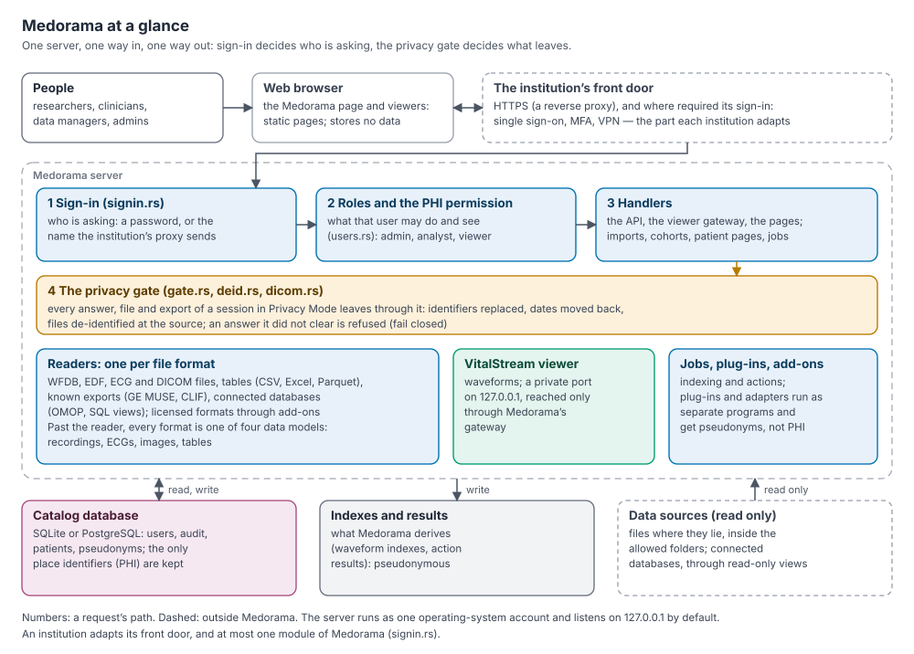
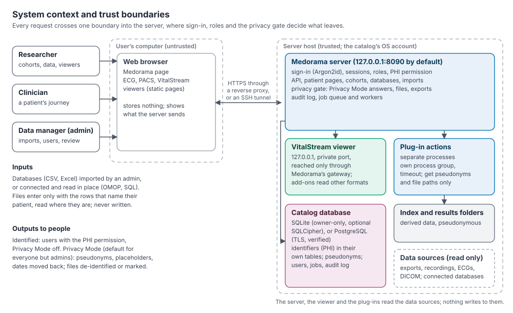
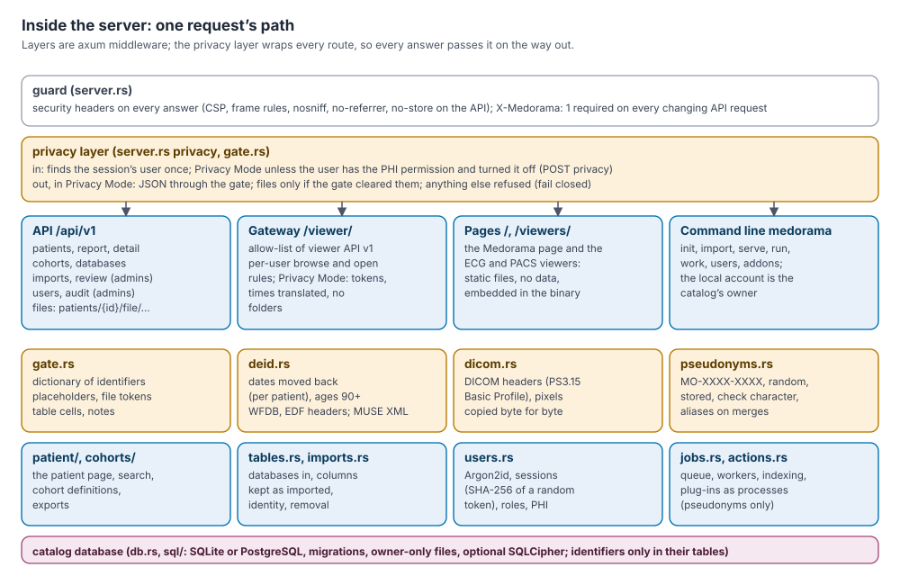
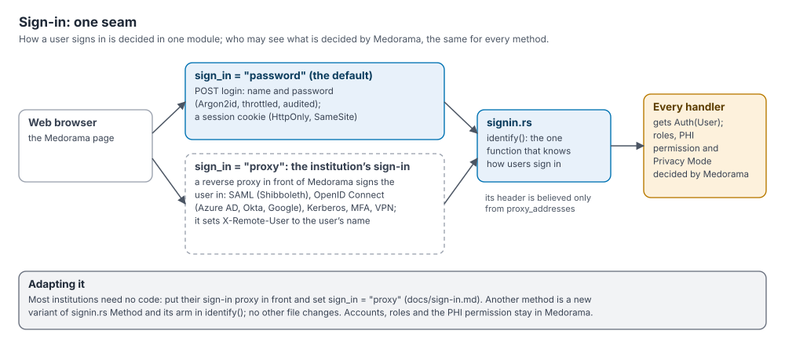
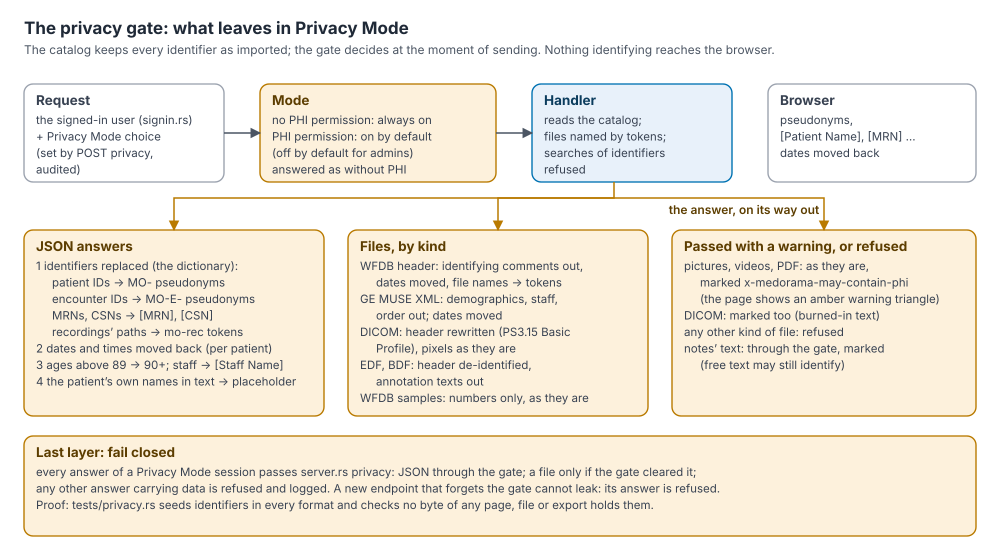
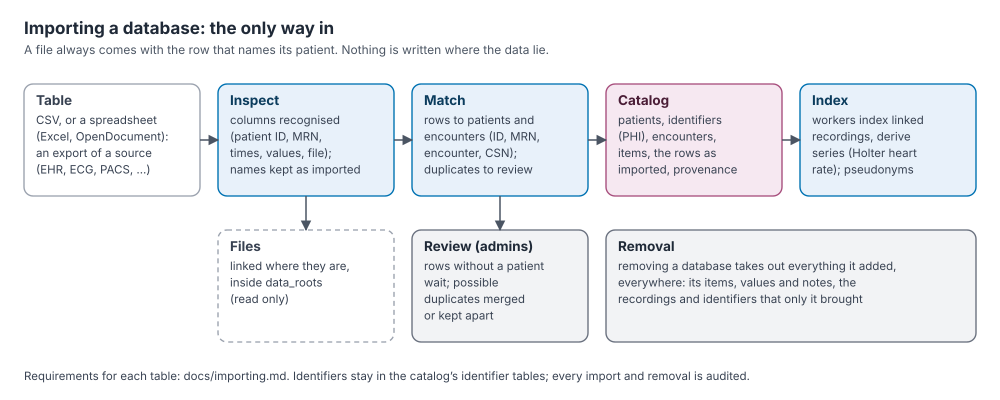
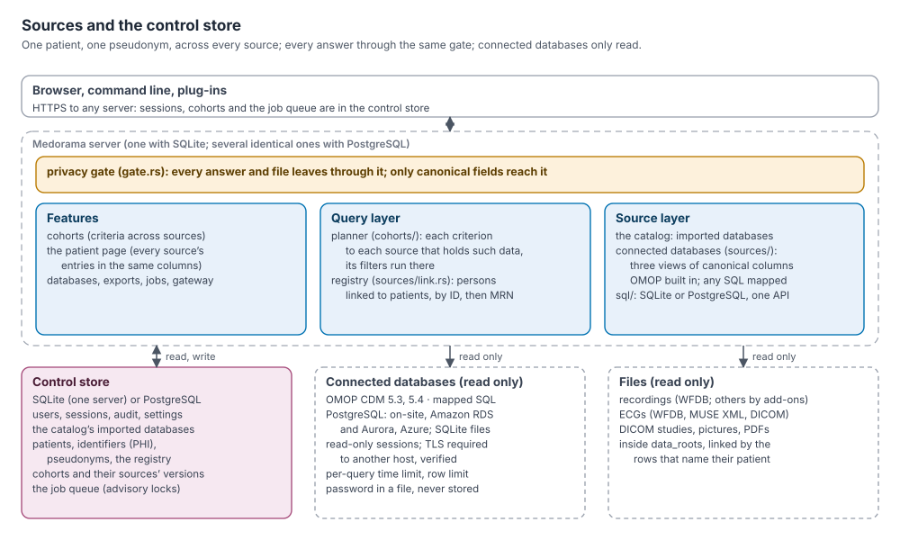
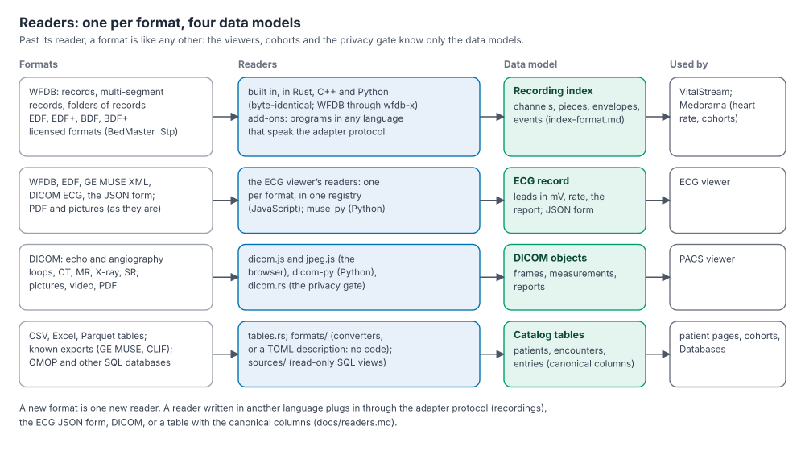

# Architecture

This page describes how Medorama is built: its parts, where each one runs, how a request
travels through the server, how data come in, and where the system can be adapted. It is
written for institutional IT security reviewers, for integrators who deploy Medorama, and for
contributors. The security controls are reviewed in detail in [security.md](security.md), and
the protection of patient identities is explained in
[protecting-patient-data.md](protecting-patient-data.md).

## Contents

- [Overview](#overview)
- [Design principles](#design-principles)
- [The parts](#the-parts)
- [Trust boundaries and deployment](#trust-boundaries-and-deployment)
- [A request's path through the server](#a-requests-path-through-the-server)
- [Sign-in](#sign-in)
- [Protecting patient data](#protecting-patient-data)
- [The gateway](#the-gateway)
- [Data flow](#data-flow)
- [Readers and data models](#readers-and-data-models)
- [Extension points](#extension-points)
- [Contracts between the parts](#contracts-between-the-parts)
- [Technology and dependencies](#technology-and-dependencies)
- [Code map](#code-map)
- [Status](#status)

## Overview

Medorama is a research system that gathers each patient's data from many sources (admissions,
laboratory results, vital signs, medications, notes, ECGs, imaging and bedside-monitor
recordings) into one **catalog**, shows each patient's journey on one page, lets researchers
build cohorts across all sources, and opens recordings and images in its own viewers. It is one
server program that an institution runs on its own hosts. Users reach it with a web browser.
Every request passes Medorama's sign-in, and every answer to a user who may not see identifiers
leaves through the **privacy gate**, which replaces identifiers and moves dates back.

## Design principles

1. **Separate programs, joined by written contracts.** Each part builds, runs and is tested on
   its own, and parts meet only through a documented contract: a file format, an HTTP API, a
   command-line protocol or a folder layout ([Contracts](#contracts-between-the-parts)).
2. **One way in.** When Medorama fronts the viewers, every request passes its sign-in, roles
   and rules. The viewers stay simple and read only what Medorama hands them.
3. **One way out.** The catalog keeps every identifier as imported. In Privacy Mode, every
   answer the server sends (JSON, files, exports, the waveform viewer's answers) passes the
   privacy gate, and the server's last layer refuses any answer the gate did not clear, so a new
   endpoint cannot forget the rule.
4. **Sources are only read.** No part of Medorama writes into a data folder or a connected
   database. Derived data (indexes, results) go to their own folders or to the catalog.
5. **The server decides, the page draws.** What a user may see, and how data are matched,
   merged and searched, is decided on the server. The pages draw what they are sent, with no
   build step and no third-party code.
6. **Open formats inside, licensed formats outside.** The repository reads open formats (WFDB,
   EDF, DICOM, GE MUSE XML, tables). A format under a vendor's license is read by an
   **add-on**, a separate program installed by an administrator and distributed under its own
   terms; nothing licensed is compiled into Medorama or a viewer.
7. **Recordings are read identically three times.** The VitalStream viewer has three
   independent implementations (Rust, C++ and Python) that write the same index byte for byte
   and answer the same API, checked against each other, so that a misread recording does not go
   unnoticed.

## The parts

| Part | Folder | Language | Runs as |
|---|---|---|---|
| **Medorama server** | [`medorama/`](../medorama) | Rust | One program, `medorama serve`, on the institution's host; also the `medorama` command line for administration |
| **Medorama's web page** | [`medorama/web/`](../medorama/web) | HTML, CSS, JavaScript | Static files embedded in the server and run in the user's browser; light and dark themes |
| **VitalStream** (waveforms: ICU monitoring, Holter, EEG, sleep) | [`viewers/vitalstream/`](../viewers/vitalstream) | Rust, C++, Python (three viewers); a shared page | Alone: a local program with its own page. Inside Medorama: a child process on a private loopback port, behind the gateway |
| **ECG viewer** (12-lead ECGs on standard paper) | [`viewers/ecg/`](../viewers/ecg) | JavaScript; `muse-py` in Python | A web page: opened from disk, served by `muse-py serve`, or served by Medorama as a tab |
| **PACS viewer** (DICOM studies: echo and angiography loops, CT, MR, X-ray, reports) | [`viewers/pacs/`](../viewers/pacs) | JavaScript; `dicom-py` in Python | A web page, like the ECG viewer (`dicom-py serve` alone) |
| **Engine** | [`libs/engine/`](../libs/engine) (`recording-engine`), [`libs/signal-core/`](../libs/signal-core) | Rust | A library used by Medorama and the Rust viewer: readers, the index, queries, the adapter protocol. WFDB through [wfdb-x](https://github.com/alphanumericslab/wfdb-x) |
| **Add-ons (adapters)** | Outside this repository | Any | Programs in the adapter folder, run as child processes; for example stp-adapter for BedMasterEx `.Stp` files (private, available to institutions under agreement) |
| **Plug-in actions** | An administrator's `actions_dirs` | Any | Programs run as child processes by the job queue ([actions.md](actions.md)) |
| **Catalog database** | The catalog's home folder, or a PostgreSQL server | SQLite or PostgreSQL | Medorama's own data: users, sessions, audit log, settings, patients and identifiers, pseudonyms, cohorts, the job queue |
| **Indexes and results** | `index_dir`, `results_dir` | Files | Waveform indexes (the viewers' format) and the outputs of actions |
| **Data sources** | `data_roots`; connected databases | Files; SQL | Exported tables, recordings, ECGs, DICOM studies and documents, read where they lie; OMOP or other databases read through views |

The viewers are programs of their own. Each is useful alone and never depends on Medorama;
Medorama opens them as tabs, by an address that names the file to show
([viewers/README.md](../viewers/README.md)).

## Trust boundaries and deployment

The browser and the network are untrusted: every request is authenticated and authorized on
the server, and the page decides nothing about access. The server host is trusted: one
operating-system account, the catalog's owner, runs Medorama, its viewer and its plug-ins. The
zones and their trust are tabulated in [security.md, Architecture and trust
boundaries](security.md#2-architecture-and-trust-boundaries).

### What listens where

| Program | Listens on (default) | Reached by |
|---|---|---|
| `medorama serve` | 127.0.0.1:8090 (`host`, `port`) | Browsers, through a TLS reverse proxy or an SSH tunnel |
| VitalStream under Medorama | 127.0.0.1, a free port chosen at start | Medorama's gateway only, with requests signed by a key only Medorama knows |
| VitalStream alone | 127.0.0.1:8050 (Python), 8060 (Rust), 8070 (C++) | A browser on the same computer, or through an SSH tunnel |
| `muse-py serve`, `dicom-py serve` | 127.0.0.1:8080, 127.0.0.1:8081 | The same |
| Adapters and plug-ins | Nothing | Medorama and the viewers start them and talk over pipes and files |

Medorama listens on the loopback address by default so that nothing on the network can reach
it until an administrator puts a TLS proxy in front of it. If it is bound to another address
without `secure_cookies = true`, it prints a warning at start. It opens outgoing connections
only to its PostgreSQL catalog and to connected databases, always over verified TLS to another
host; it sends nothing else anywhere.

### What is read and what is written

| Data | Lives in | Written by |
|---|---|---|
| Recordings, ECGs, images, documents, exported tables | Their own folders, inside `data_roots` | Nobody: only read |
| Connected databases | The institution's database servers | Nobody: read through read-only sessions |
| Patients, encounters, entries, identifiers, pseudonyms, users, sessions, jobs, audit log | The catalog database | Medorama |
| Waveform indexes | `index_dir` (may be shared with standalone viewers' `cache_dir`) | The engine, the viewers, adapters |
| Results of actions | `results_dir` | Plug-ins, through the job queue |

### Deployment topologies

- **One server with SQLite.** The default: `medorama init` creates a home folder with
  `medorama.toml` and the SQLite database (owner-only, optionally encrypted with SQLCipher).
  One `medorama serve` process answers requests and runs jobs in worker threads. Suited to a
  team or a department.
- **Several servers with PostgreSQL.** Identical servers share one catalog in PostgreSQL
  (`database_url`), with the same `data_roots` and with the index and results folders on
  shared storage. Any server answers any request; sessions, cohorts and the job queue are in
  the database, and work that must happen once takes an advisory lock. A load balancer or
  reverse proxy spreads requests ([administration.md](administration.md)).
- **Behind a TLS reverse proxy.** nginx, Apache httpd or a load balancer terminates HTTPS and
  passes requests to Medorama on 127.0.0.1; `secure_cookies = true`. Users sign in with
  Medorama's passwords.
- **Behind the institution's sign-in.** An authenticating proxy (oauth2-proxy, Apache httpd
  with mod_auth_openidc, Shibboleth or Kerberos, nginx with `auth_request`) signs users in with
  single sign-on and multi-factor authentication and names them to Medorama in a header
  (`sign_in = "proxy"`; [sign-in.md](sign-in.md)).
- **Viewers alone on a workstation.** A researcher runs a VitalStream viewer, or opens the ECG or
  PACS viewer page, on their own computer, with no Medorama and no catalog. The viewer reads
  files under a root folder fixed when it was built, and may ask for a password
  ([Running separately and together](#running-separately-and-together)).

### Running separately and together

**Separately**, each viewer runs on its own: the VitalStream viewers on their ports with their
own page and optional password (`viewers/vitalstream/install.sh`); the ECG and PACS viewers as
pages opened from disk or served by `muse-py serve` and `dicom-py serve`. Medorama runs on its
port and may link to a VitalStream viewer running elsewhere (`viewer_url`).

**Together** (`tools/install-medorama.sh --viewer cpp|rs|py|none`), Medorama is installed with
one VitalStream viewer; the ECG and PACS viewers are built into Medorama. Medorama's supervisor
(`viewer.rs`) starts the VitalStream viewer on first use, on 127.0.0.1 and a free port, with a
settings file and a private password file that Medorama writes, restarts it if its process
ends or if a request cannot reach it and it then fails a health check, and stops it when
Medorama stops. A request to a running viewer waits for no other request and costs no check,
so a viewer busy with a large recording is never taken for a dead one. Add-ons are installed into the adapter folder that Medorama and
the viewers share (`medorama addons install PROGRAM`).

In Medorama's page, the top bar offers **Cohorts**, **Patient Catalog** and **Databases** (three
ways to the patients), then the viewers' tabs **ECG**, **PACS** and **VitalStream**, and at the
right **History**, **Actions**, **Jobs**, **Review**, **Import**, **Admin** and the **Privacy
Mode** switch. A patient's recordings open in the VitalStream tab at the chosen moment, and
their ECGs and images in the viewers' tabs.

## A request's path through the server

Every HTTP request passes the same layers (axum middleware, [server.rs](../medorama/src/server.rs)
`router`):

1. **Guard** (`guard`). The server refuses any API request that changes something unless it
   carries the header `X-Medorama: 1`, which a page on another site cannot add. On the way out,
   it sets security headers on every answer: a Content Security Policy, framing rules,
   `nosniff`, `no-referrer`, and `no-store` on the API.
2. **Sign-in** ([signin.rs](../medorama/src/signin.rs), `identify`). The privacy layer asks the
   sign-in module who the request comes from, once per request: the account of a session
   cookie, or the account an authenticating proxy names.
3. **Privacy layer, inbound** (`privacy`). The server decides whether the session is in Privacy
   Mode. In Privacy Mode, the user is replaced by a copy without the PHI permission.
4. **Handler.** The route's handler receives the user as `Auth(User)` (HTTP 401 without one),
   checks the role and permission it needs, and reads the catalog through the core modules. A
   handler that knows its data de-identifies them itself (files, table cells, notes).
5. **Privacy layer, outbound: the gate.** For a session in Privacy Mode, every JSON answer
   passes the privacy gate; a file passes only if its handler cleared it; any other answer
   carrying data is refused. The answer then leaves through the guard.

The handlers are thin: the rules live in modules that the command line, the background workers
and the tests also use.

## Sign-in

How users sign in is decided in one module, [signin.rs](../medorama/src/signin.rs), chosen by
the setting `sign_in`:

- **`password`** (the default): Medorama's own accounts, with Argon2id password hashes,
  throttling, and session cookies holding a random token that is stored hashed.
- **`proxy`**: the institution's authenticating reverse proxy signs the user in (single sign-on
  through OpenID Connect or SAML, Kerberos, multi-factor authentication) and names the user in
  a header, which Medorama believes only on connections from the proxy's addresses.

Either way, accounts, roles and the PHI permission live in Medorama, and every handler receives
the signed-in user in the same form. Supporting another method means changing the sign-in
module only. Configuration, proxy examples and the code changes for a new method are in
[sign-in.md](sign-in.md).

## Protecting patient data

Identifiers (names, medical record numbers, dates of birth, account numbers, imported IDs) are
kept only in the catalog database, in their own tables. What leaves the server is decided at
the moment of sending: a session is in **Privacy Mode** unless its user has the PHI permission
and has switched Privacy Mode off, and in Privacy Mode the privacy gate
([gate.rs](../medorama/src/gate.rs), [deid.rs](../medorama/src/deid.rs),
[dicom.rs](../medorama/src/dicom.rs), [pseudonyms.rs](../medorama/src/pseudonyms.rs)):

- replaces identifiers with placeholders (`[Patient Name]`, `[MRN]`) and random pseudonyms
  (`MO-XXXX-XXXX`);
- moves every date back by the catalog's offset plus each patient's own days, so that a
  patient's intervals are kept;
- de-identifies files at the source (WFDB headers, GE MUSE XML, DICOM headers following PS3.15's
  Basic Profile, EDF and BDF headers and annotations), passes pictures, videos and PDF documents
  with a warning, and refuses any other file;
- refuses searches of identifiers;
- applies to exports, to the VitalStream viewer through the gateway, and to connected
  databases' data; plug-ins receive pseudonyms only.

The full explanation is [protecting-patient-data.md](protecting-patient-data.md); the controls,
their code and their tests are in [security.md, Privacy Mode and the privacy
gate](security.md#7-privacy-mode-and-the-privacy-gate).

## The gateway

When Medorama runs a VitalStream viewer, the browser never talks to the viewer directly. Medorama
passes the viewer's requests through `/viewer/` ([gateway.rs](../medorama/src/gateway.rs)) and
decides each one.

- **Default deny.** Only the listed endpoints of the viewer's API (version 1) pass; anything
  else, including endpoints a newer viewer may add, is refused until it is given a rule.
- **Medorama's sign-in.** A signed-in Medorama user is required. The viewer runs with a private
  password generated by Medorama; Medorama signs each request it passes on and never forwards
  the user's own cookie. Users never see the viewer's sign-in, and the viewer's port is of no
  use to anyone else on the host.
- **Rules per user:**

| Viewer request | Administrators | Analysts and viewers |
|---|---|---|
| The Open dialog (`browse`, `complete`, places and the start folder in `config`) | Folders inside `data_roots` (everything when it is empty) | Only folders that hold recordings in the catalog, showing only those recordings |
| `scan` a folder and `open` a recording | Any recording inside `data_roots` | Only recordings in the catalog |
| `cancel` an index being built; `datasets/{key}…` (windows, vital signs, markers) | Only datasets they opened through the gateway | The same |
| In Privacy Mode (anyone) | Browsing and scanning refused; recordings opened by token (`mo-rec:<n>`); times translated both ways; paths and names replaced; the viewer's error texts (which name files) replaced by a fixed sentence, and the records of a folder it left out named by number | The same |

- **Changes are JSON.** A request that changes something (`open`, `cancel`) must be sent as
  `application/json`, which another site's page cannot send unasked.
- **The page's policy.** The viewer's page is served with a Content Security Policy of its own
  scripts and styles only (`default-src 'self'; script-src 'self'; img-src 'self' data:;
  object-src 'none'; base-uri 'none'; frame-ancestors 'self'`).
- **Audit.** Each opened recording is written to the audit log (`view`).
- **Paths** are compared after symbolic links are resolved, as the viewers do.
- **Settings.** The viewer starts with a settings file that Medorama writes (its index and adapter
  folders among them), so a user's own `vitalstream.toml` cannot conflict with the gateway's
  rules.

The ECG and PACS viewers need no gateway: they are pages that Medorama serves, and they read only
an entry's files through `patients/{id}/file/{item}`, which Medorama checks like every other
request ([api.md](api.md)).

## Data flow

### Importing databases

Data enter the catalog as databases. An administrator imports a table (CSV, Excel, OpenDocument
or Parquet) exported from a source system, from the page or the command line. Medorama
recognizes its columns (patient ID, MRN, times, values, file), keeps the column names as
imported, matches each row to a patient and an encounter, and stores the identifiers in the
identifier tables. Rows it cannot place wait in the Review tab. Files are linked where they lie,
by the rows that name their patient, and only inside `data_roots`. Known exports (GE MUSE, CLIF)
are converted by import formats ([formats/](../medorama/src/formats)). Removing a database takes
out everything it added. The table requirements are in [importing.md](importing.md) and
[databases.md](databases.md).

### Connected databases

A **connected database** (an OMOP CDM instance, or any SQL database described by views) is read
in place at each request, read-only, through three views of canonical columns: persons, visits
and entries ([sources/](../medorama/src/sources)). Each person is linked to a catalog patient
by the import rules (patient ID, then MRN of the same authority), so a person in several sources
is one patient with one pseudonym. Cohort criteria are answered by every source that holds such
data, and the patient page shows every source's entries in the same columns. Everything leaves
through the same gate. How to connect one: [databases.md](databases.md); the design:
[design/sources.md](design/sources.md).

### Recordings and indexing

A recording (a WFDB record, an EDF file, a folder of records, or a licensed format read by an
add-on) is imported by path and never copied. Background workers index it: the engine, or the
add-on, reads the recording once and writes an **index** (channels, pieces, envelopes, vital
signs, events) in the shared format of
[index-format.md](../viewers/vitalstream/docs/index-format.md), into `index_dir`. The viewers
then open the recording quickly from its index. Workers also derive series (for example a
Holter's heart rate) and run plug-in actions from the job queue ([jobs.rs](../medorama/src/jobs.rs)).
The built-in `identify` action reads the identifiers a recording's own file states (for example
an EDF header's patient field) into the identifier tables, so that an administrator can check
that the file belongs to its patient.

### Files read in place

ECGs, DICOM studies, pictures and documents are served from where they lie, one entry at a time,
through `patients/{id}/file/{item}`. Medorama never writes to them; in Privacy Mode, it
de-identifies them as they are sent.

## Readers and data models

Each file format has its own **reader**, and every reader produces one of four **data models**:

| Data model | Produced by | Used by |
|---|---|---|
| Recording index | The engine's readers (WFDB, EDF/BDF) in Rust, C++ and Python; adapters for other formats | VitalStream; Medorama's indexing and cohorts |
| ECG record | The ECG viewer's readers (WFDB, GE MUSE XML, DICOM ECG, EDF, its JSON form) | The ECG viewer |
| DICOM objects | The PACS viewer's DICOM reader; `dicom-py`; the privacy gate's `dicom.rs` | The PACS viewer |
| Catalog tables (canonical columns) | `tables.rs`, import formats, connected databases' views | Patient pages, cohorts, the Databases tab |

Past its reader, a format is like any other: the viewers, cohorts and the privacy gate know only
the data models. A new format is one new reader. Where readers live and how to add one is
described in [readers.md](readers.md); EDF's reading rules in [edf.md](edf.md).

### The engine, adapters and the toolbox

**The engine** ([libs/engine](../libs/engine)) holds what is needed to read a recording quickly:
the readers (WFDB records, multi-segment records, folders of records read as one session,
[WFDB collections](wfdb-collection.md), EDF, EDF+, BDF and BDF+), the index, the dataset queries
the viewer's API answers (windows, envelopes, vital signs, markers), and a sample reader with
which Medorama derives a Holter's heart rate. The Rust viewer is a thin HTTP layer over it;
the C++ and Python viewers have their own engines that write the same index.

**Adapters** read formats the engines do not. An adapter is a program named `<name>-adapter` in
the adapter folder; the engine asks it to `describe` itself, `detect` the files it reads,
`index` a recording (writing the shared index format) and `serve` samples over a pipe, and
Medorama also asks it to `identify` a file's identifiers. It may be written in any language
([adapters.md](adapters.md)).

**The toolbox** (planned) will hold processing on waveforms (filters, beat detection, signal
quality, machine-learning inference), each tool available as a Medorama action, on the command
line, from Python and as tracks in the viewer ([todo.md](todo.md#d2-the-toolbox-and-the-results-format)).

## Extension points

An institution adapts Medorama at a few documented places, without changing the rest.

| To adapt | Where | Contract |
|---|---|---|
| How users sign in | Configuration only, for an authenticating proxy (`sign_in = "proxy"`); or, in code, a new variant of `signin::Method` and its arm in `signin::identify` ([signin.rs](../medorama/src/signin.rs)) | [sign-in.md](sign-in.md) |
| A new recording format | A reader in the engine ([libs/engine/src/sources/mod.rs](../libs/engine/src/sources/mod.rs)), or an add-on in any language | [adapters.md](adapters.md), [index-format.md](../viewers/vitalstream/docs/index-format.md), [readers.md](readers.md) |
| A new ECG format in the ECG viewer | A reader registered in `viewers/ecg/readers.js` | [readers.md](readers.md) |
| A new export to import | A TOML description in `formats_dirs` (no code), or a converter in [medorama/src/formats/](../medorama/src/formats) | [importing.md](importing.md), [administration.md](administration.md) |
| An existing database, read in place | A connection of kind `omop`, or `sql` with views that give the canonical columns ([medorama/src/sources/](../medorama/src/sources)) | [databases.md](databases.md) |
| An analysis on recordings | A plug-in action: a folder with `action.toml` in `actions_dirs` | [actions.md](actions.md) |
| Scripts and other clients | The HTTP API | [api.md](api.md), [`medorama/openapi.yaml`](../medorama/openapi.yaml) |

## Contracts between the parts

| Contract | Specification | Between | Checked by |
|---|---|---|---|
| Index (folder layout, key, arrays) | [index-format.md](../viewers/vitalstream/docs/index-format.md) | The engines and add-ons, Medorama, the viewers sharing an index folder | `tests/parity/index_parity.py` (byte for byte) |
| VitalStream's API, version 1 | [viewer-api.md](../viewers/vitalstream/docs/viewer-api.md) | VitalStream's page and Medorama's gateway, and the three viewers | `tests/parity/viewer_parity.py`; `medorama/tests/gateway.rs` |
| Adapter protocol, version 1 | [adapters.md](adapters.md) | The engines and Medorama, and add-ons | The engines' adapter tests; `medorama/tests/sources.rs`; each add-on's conformance tests |
| EDF reading rules | [edf.md](edf.md) | The three engines and the ECG viewer | The engines' EDF tests, parity tests |
| WFDB collection | [wfdb-collection.md](wfdb-collection.md) | The engines, and the tools that write long recordings as WFDB records | The viewers' tests, parity tests |
| Viewer addresses (`#src`, `#list`, `#path`) | [viewers/README.md](../viewers/README.md) | Medorama and every viewer | The viewers' tests, Medorama's tests |
| Tables to import, connected databases' views | [importing.md](importing.md), [databases.md](databases.md) | Source systems and Medorama | `medorama/tests/catalog.rs`, `medorama/tests/connections.rs` |
| Medorama's HTTP API, version 1 | [api.md](api.md), [`openapi.yaml`](../medorama/openapi.yaml) | Medorama and its page, scripts | `medorama/tests/openapi.rs` |
| Plug-in actions | [actions.md](actions.md) | Medorama and plug-ins | Medorama's tests |
| The catalog on SQLite and PostgreSQL | [administration.md](administration.md) | Medorama and its database | Every test, on both (`MEDORAMA_TEST_POSTGRES`) |
| Names of programs and packages | [naming.md](../viewers/vitalstream/docs/naming.md) | Everything | Review |

## Technology and dependencies

- **Medorama** is written in Rust: axum and tokio for HTTP, rusqlite for SQLite (SQLCipher in
  encrypted builds), tokio-postgres with rustls for PostgreSQL, argon2 for passwords, calamine
  and parquet for spreadsheets and Parquet files. Versions are pinned by `Cargo.lock` and checked
  by `cargo deny`.
- **The web page and the ECG and PACS viewers** are plain HTML, CSS and JavaScript modules, with
  no build step and no third-party code, embedded in the server's binary.
- **VitalStream** has three implementations: Rust (over the engine), C++20 (CMake) and Python.
  All three read WFDB through wfdb-x, a public WFDB library.
- **The Python tools** `muse-py` and `dicom-py` build databases of GE MUSE ECGs and DICOM studies
  to import, and serve the ECG and PACS viewers alone.

Every third-party component and its license is listed in
[THIRD_PARTY_LICENSES.md](../THIRD_PARTY_LICENSES.md). Building is described in
[building.md](building.md).

## Code map

The main modules of the Medorama server (`medorama/src/`). A guide for contributors is in
[developing.md](developing.md).

| Module | Responsibility |
|---|---|
| `server.rs` | Routes, the guard and privacy layers, files in Privacy Mode, background workers |
| `signin.rs` | Sign-in methods: password and proxy |
| `users.rs` | Accounts, roles, the PHI permission, sessions |
| `gate.rs`, `deid.rs`, `dicom.rs`, `pseudonyms.rs` | The privacy gate: identifier dictionary and placeholders; dates, ages, WFDB, MUSE and EDF headers; DICOM; pseudonyms |
| `gateway.rs`, `viewer.rs` | The VitalStream gateway; the viewer's supervisor |
| `patient/`, `cohorts/`, `expr.rs`, `search.rs`, `query.rs` | The patient pages; cohorts, their criteria and exports; criteria written as text; search |
| `tables.rs`, `imports.rs`, `bulk.rs`, `typed.rs`, `formats/`, `parquet_rows.rs` | Importing databases; import formats |
| `linkage.rs`, `identity.rs`, `review.rs`, `ehr.rs` | Matching rows to patients and encounters; identity; the Review tab; clinical entries |
| `databases.rs` | The Databases tab and database exports |
| `sources/` | Connected databases: views, read-only pools, the person registry |
| `recordings.rs`, `identify.rs`, `derived.rs`, `categories.rs` | Recordings; identifiers stated in files; derived series; recording categories |
| `jobs.rs`, `actions.rs`, `addons.rs` | The job queue, plug-in actions, installed adapters |
| `audit.rs`, `db.rs`, `sql/`, `schema/`, `config.rs` | The sealed audit log; the database and migrations; SQLite and PostgreSQL behind one interface; settings |
| `demo.rs` | The demo's invented patients |

## Status

Built: everything above except the toolbox and its results format. The remaining work, item by
item, with designs and tests, is in [todo.md](todo.md). Next: per-study access lists; more of
connected databases on the page; the toolbox and the engine's streaming reader; viewing
recordings while they are being recorded. Later: server-side decoding of codecs that browsers
do not decode (JPEG-LS, JPEG 2000, MPEG); DICOM Holter in VitalStream; free-text
de-identification; FHIR, HL7 v2 and DICOMweb sources; ONNX inference.
