# The patient page

This document records how Medorama shows one patient, and why: the decisions made while
designing the patient page, the split between backend and frontend, and what comes next. It is
written for contributors and for reviewers who want to understand the design. How to use the page
is described in
[user-guide.md, The Patient Catalog and the patient page](../user-guide.md#the-patient-catalog-and-the-patient-page);
how data reach it, in [databases.md](../databases.md) and
[design/databases-only.md](databases-only.md).

## Contents

- [What it is for](#what-it-is-for)
- [Layout](#layout)
- [The journey](#the-journey)
- [The report and the detail](#the-report-and-the-detail)
- [Each fact once](#each-fact-once)
- [An ECG](#an-ecg)
- [Three ways to the patients](#three-ways-to-the-patients)
- [Light and dark](#light-and-dark)
- [Databases](#databases)
- [Backend and frontend](#backend-and-frontend)
- [Next](#next)

*All screenshots show synthetic data made by `tools/make-demo-data.py`: invented people,
values, signals and pictures.*

## What it is for

Data about a patient live in many systems: bedside monitors (ICU waveforms), the laboratory,
ECG carts, EEG and sleep laboratories, imaging, pharmacy, notes. Each is connected as a
**database**, read where it is: an OMOP instance, a warehouse through SQL views, or a SQLite file
that db-builder made from exported tables, files and folders of recordings. Medorama links the
databases' persons into patients by exact identifiers (an identifier and its issuer), reads each
database's data for the patient when the page opens, keeps everything in time order, and shows a
patient's whole journey on one page. Connecting a database adds its data to every patient page;
removing it takes it out of all of them.

## Layout

From left to right, in four columns, the page shows the patient's current status, where and when
their data are (as a picture), what was done for them (by name), and the one thing done chosen,
in full. Each fact is shown once on the page ([Each fact once](#each-fact-once)).

| Part | Width | Content |
|---|---|---|
| Search line | full | The patients' search. On a patient page, the patient as a chip (✕ closes it) and a search for another one. |
| Patient bar | full | Who the patient is: name, sex, age and date of birth, patient ID, MRNs (from the databases granted `phi`), the dates of their first and latest data; at the row's end, apart, where the data come from: the databases, and those not answering. |
| 1. Visits | 340 px | The current status: the allergies first (amber; the section only when a database of the patient can hold allergies: "No allergy recorded" then means what it says), visits, each with its database (click one to show only it), medications of the latest stay, conditions (labelled by the vocabularies of their codes: ICD-10-CM, ICD-9 …). A section with nothing is left out, and the column itself when every one is (a patient of an ECG archive alone: the journey and the report get its room). |
| 2. Journey | 400 px | The picture of the patient's data, newest on top; a click selects the newest thing done there in column 3. |
| 3. What was done | about a third of the rest | One line per thing done, by name (an ECG with its measurements is one line, a laboratory panel one, a day of vital signs one); no values, no flags. A long name is cut with "…", all of it on hover. |
| 4. Detail | the rest | Everything about the thing done chosen in column 3 or the journey: it has the most room. |

**Widths.** The dividers between the columns are dragged to set their widths (focused, ← and →
by 24 pixels; double-click or Home: the default), kept in the browser (`localStorage`, per
browser: no setting on the server). Below 1500 pixels the defaults are narrower (290 px, 340 px);
below 1100 pixels the page has two rows and no dividers.

**The keyboard.** ↑ and ↓ move to the line above or below in column 3, and the detail follows;
Enter or Space selects the line that has the focus; Escape clears the selection. The page's
address holds the selection (`?item=…`), so that reloading, back and a shared link keep it.

**While a detail is read** (a database that answers slowly), its outline is shown, not the
detail before. The previous and next thing done of the same kind are read ahead, so that ‹ › and
↑ ↓ step through them at once; a detail read in the last 30 seconds is not read again.

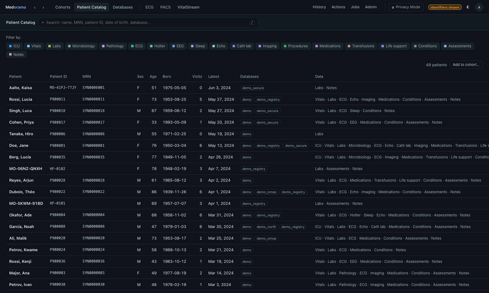

**The front page** is the list of all patients. The search line keeps its place on a patient
page, so another patient is always one search away, and no other patient is shown while one is
open.

## The journey

- **Time runs up**, newest on top, as in the report.
- **One column per category**, with a fixed color per category. Laboratory results, vital signs
  and medications are split into a thin column per test, sign or drug, so that a stay reads as a
  heatmap. Single categories get 12 px, enough for their name written vertically.
- **Categories a physician reads by**, not the databases: ICU, Vitals, Labs, Microbiology,
  Pathology, ECG, Holter, EEG, Sleep, Echo, Cath lab, Imaging, Procedures, Medications,
  Transfusions, Life support, Conditions, Assessments, Notes (and Allergies, with the patient).
  They follow the usual sections of a chart (HL7 v2 diagnostic service sections, FHIR resources
  and observation categories). One database may fill several columns (an imaging index holds
  imaging and echo), and several databases one; only the categories that some database provides
  are shown. The list is [categories.rs](../../medorama/src/categories.rs)
  ([importing.md, Categories](../importing.md#categories), db-builder's input).
- **ICU is the stay, not the monitor:** the column shows the whole time spent in an
  intensive-care unit (from the ICU visits, start to end) as a light bar, and each recording
  made during it as a solid bar over it, from its first sample to its last (known once it is
  indexed; before that, an hour is shown, dashed). Each bar opens its entry, however short: its
  target is at least 8 px tall. A Holter recording, an EEG and a sleep study each have a column
  of their own, with a bar as long as the recording.
- **Six-hour cells.** Every item fills its cell; stays, drugs and recordings are bars.
- **Abnormal values** are amber and **critical** ones orange, in every column, and no category
  takes either color. Red is reserved for alarms. The warning on viewer tabs whose file may show
  identifiers in Privacy Mode is an amber triangle.
- **Folding.** Quiet stretches shrink to a hatched band, so that busy days get the room. Choosing
  a visit (in the left column) shows only it, unfolded, with − and + to zoom; its chip above
  the journey (✕) shows all of them again.
- **A long history scrolls.** A busy day keeps at least 12 px. When years of care no longer fit,
  the journey scrolls vertically under fixed column names. It opens at the top (the newest), and
  choosing an entry in the report scrolls it into sight.
- **Interaction.** Hovering tells what a mark is; a click opens the entry in the report and the
  detail; a column's name hides or shows that category.

## The report and the detail

- **Three views:** **Timeline** (by day, with the visit, hospital day and unit), **By
  category**, or **Trends** (every measurement as a sparkline). Laboratory results of one moment
  form one panel, named by its tests; vital signs form one entry a day; an ECG and its
  measurements form one entry.
- **Names only.** A line says what was done (its time, its category's colour, its name), never a
  value or a flag: values are the detail's, and whether one is abnormal is the database's to say,
  shown in the detail with the range it is judged by.
- **Search** covers every text the patient has, notes included: literal (any part of a word, any
  case) or fuzzy for misspelled words. Words are alternatives (`ecg icu`). The search shortens
  the report; it does not change the journey. It reads the patient's own items only, and in
  Privacy Mode their text as the session is shown it (no name, identifier or staff name the gate
  replaces). **Trends** keep a series per name and unit: values in mg/dL and in mmol/L are two
  lines, not one.
- **Answers that arrive late are dropped.** Every answer the page waits for (the summary and the
  journey, the report, the trends, the detail, the suggestions of another patient) is drawn only
  if it is still for the patient and the address shown: a slow answer for a patient left behind
  never overwrites the one opened since.
- **The detail** shows what the entry is: a panel's values with ranges, flags, the previous value
  and the trend; a note or report; an ECG ([below](#an-ecg)) or image; a recording at a glance
  (length, gaps, waveforms; for ICU recordings, the main vital signs). Notes written around that
  time follow, since notes belong to their visit.

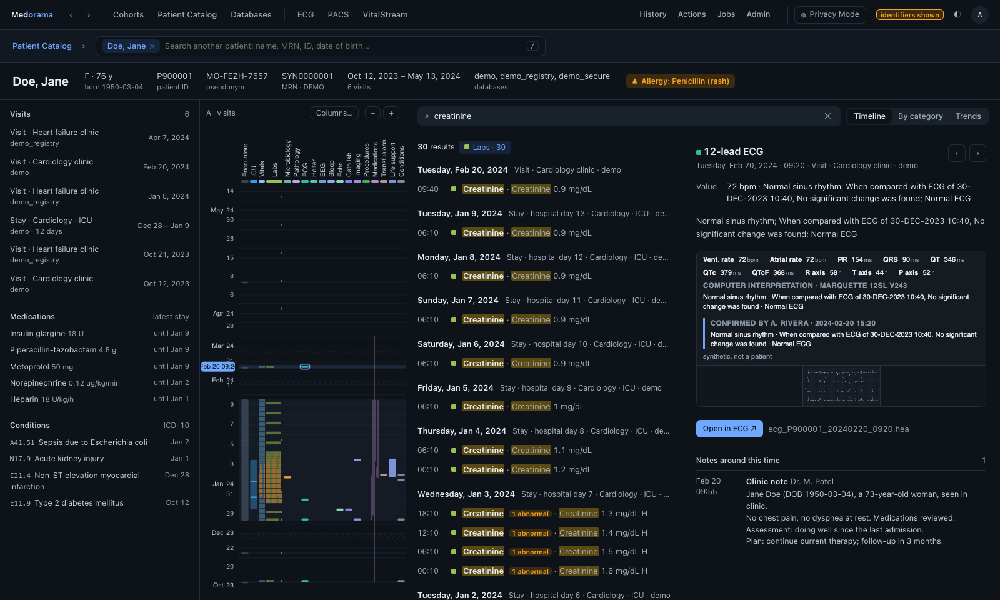

**Viewers keep their own pages.** Each kind of data has a viewer of its own, in its own folder
([`viewers/`](../../viewers/README.md)), with its own design, and useful alone. The patient page
opens them as tabs at the file to show, and the ‹ › arrows bring the patient page back as it was:
- An ICU, Holter, EEG or sleep recording opens in **VitalStream** at the moment clicked.
- A 12-lead ECG is drawn on paper in the detail itself (the ECG viewer, framed), and opens in the
  **ECG** tab for layouts, gain and calipers. PNG, JPEG and PDF ECGs are shown as they are.
- Echo loops, angiography runs, images and DICOM series open in the **PACS** tab.

Every viewer, like the page itself, has a light and a dark theme and follows the system setting.

**A viewer always says whose file it shows.** Inside Medorama a file's name is of no use, so the
viewer's title says whose file it is: the patient (as the user may see them: identifiers only
with the PHI permission, placeholders and the pseudonym in Privacy Mode), never cut short, then
what the file is, when, and in which visit. ‹ Patient returns to its entry on the patient's
page, and ‹ 3 of 4 › steps through the patient's files of that kind. The title row is the patient
bar, so the viewer keeps its full width and height. Clinical systems keep such a banner against
wrong-patient errors. Standalone, a viewer shows its file's name.

Medorama passes this context in the viewer's address (`who`, `what`, `pos`, `nav`;
[viewers/README.md](../../viewers/README.md)). The viewer only reports a button press to the
page, which navigates; the viewer never sees patient IDs or addresses.

The ECG and PACS tabs are always in the top bar, dimmed until something is opened in them.

**A Holter's heart rate.** A Holter recording has no monitor-reported vital signs. Its heart
rate is found from the ECG after indexing (per minute, with the beat-to-beat range), and the
detail shows it over the whole recording, with its mean and range; a click opens VitalStream at
that moment.

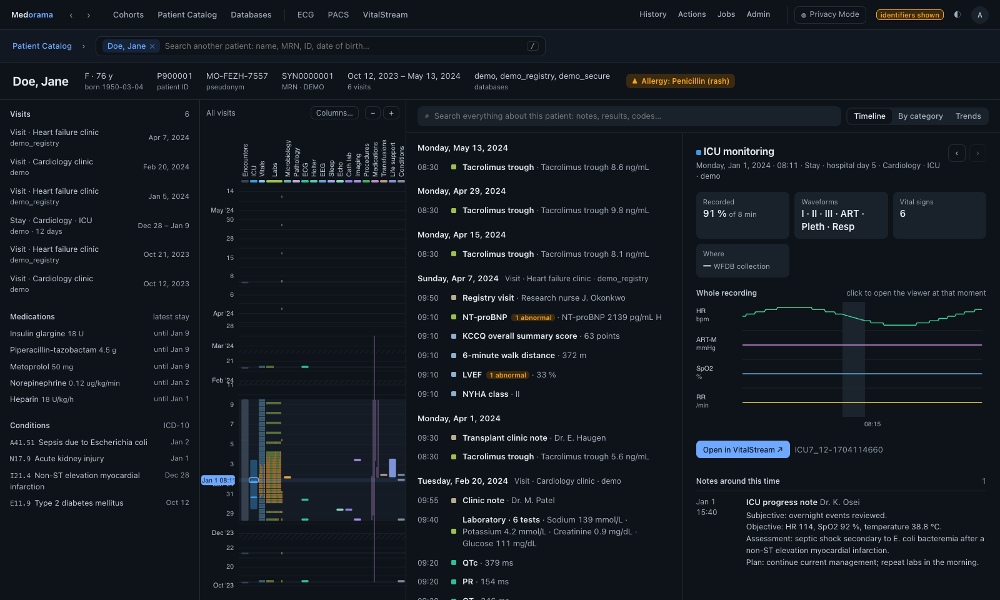

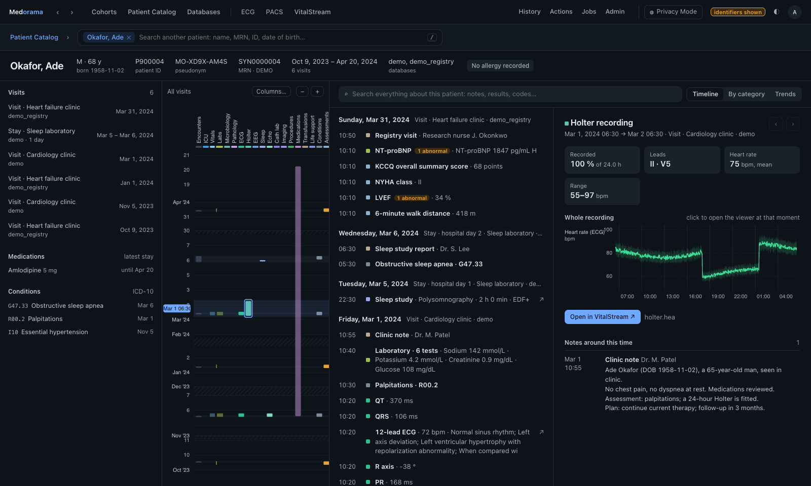

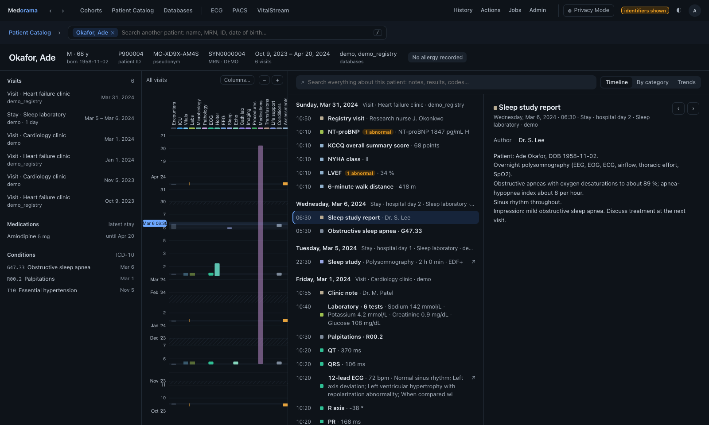

| ECG | PACS: an echo loop | PACS: a CT series |
|---|---|---|
| 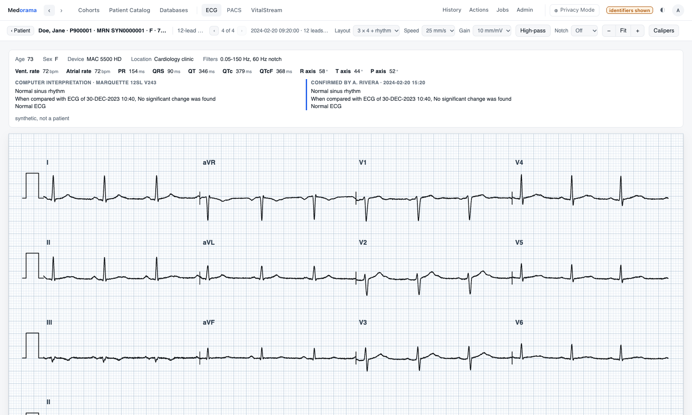 | 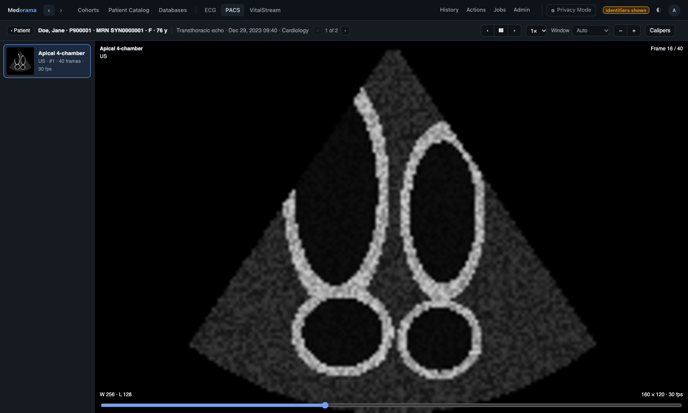 | 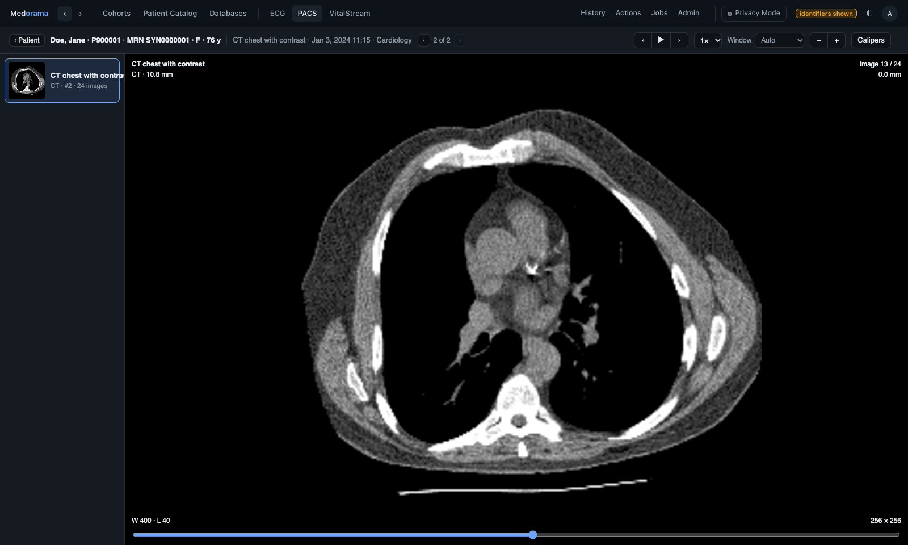 |

## Each fact once

Agreed with the project lead, 2026-11-17 (Medorama 0.3.1): each piece of information appears once
on a patient's page.

- **A value is the detail's.** Column 3 names what was done; its values (an ECG's QT interval, a
  panel's potassium) are in column 4 only.
- **A count is where it belongs:** the number of visits is column 1's, not the patient bar's.
- **No flags in column 3** for now (abnormal, high): to come back to with laboratory results.
- **Conditions and medications** are in column 1 as the current status (the latest stay's
  medications, the conditions) and in column 3 as their history, on their dates: two facts, the
  status and the record.

The report groups a patient's entries into things done
([items.rs](../../medorama/src/patient/items.rs), `entry_key`):

| Thing done | Its entries | Its key | Its line's name |
|---|---|---|---|
| A laboratory panel | The patient's results at one moment | `labs:<patient>:<time>` | Its tests' names (`Lactate, Sodium, Potassium`; past three, `+N more`) |
| A day of vital signs | The day's readings (in Medorama's time zone) | `vit:<patient>:<day>` | `Vital signs · N readings` |
| An ECG | A database's ECG entries at one time: the ECG (with its file and statements) and each measurement | `ecg:<database>:<token>` (the ECG's token) | The ECG's name (`12-lead ECG`) |
| Anything else | The entry | `live:<database>:<token>` | Its name (a condition with its code) |

An entry's `names` (what it holds) are not shown: the journey's sub-columns find its line by
them. The journey counts an ECG once, not once more for each of its measurements.

## An ECG

[detail.rs](../../medorama/src/patient/detail.rs) (`ecg_of`), drawn by
[detail.js](../../medorama/web/js/patient/detail.js).

- **The ECG** is the entry with a file, else the one without a number; the others are its
  measurements.
- **Its drawing** first: the ECG viewer's own, of its file.
- **Its statements**, one a line (an ECG database writes them separated by new lines). Those not
  in the previous ECG's are marked **new**; the previous ECG's statements this one no longer says
  follow (**no longer**). Compared as written: a statement reworded is new.
- **Its measurements**, each once, as a tile: its value and unit; its **change** since the
  previous ECG (▲ 25, ▼ 3, = unchanged; none when the previous ECG has no such value), in neutral
  colours, as a change is neither good nor bad here; and its **trend** over the patient's ECGs,
  this one marked. The previous ECG's date is said once, above the tiles.
- **The previous ECG** is the patient's latest ECG before this one, from any database; ‹ and ›
  step from ECG to ECG.
- In Privacy Mode an ECG's statements are free text, withheld when notes' text is (Admin ›
  Privacy Mode, *The text of notes and reports*); nothing is then compared.

Everything compared is on the page already (the report reads every entry of the patient at once):
nothing more is read from the databases for it.

## Three ways to the patients

**Cohorts** (first, since a researcher's work is the cohorts they build), the **Patient
Catalog** (each patient's journey) and **Databases** sit together on the left of the top bar. The
viewers follow a separator. The work tabs (History, Actions, Jobs, Admin) sit, quieter, at the
right, by the theme switch.

- **Databases** lists the connected databases granted to the user, each with its status (a
  green dot online, a grey one offline; red is for alarms) and what it holds; a database's page
  shows its variables, who may use it and its identity conflicts. Its Recordings subtab lists the
  recordings of the recording databases. Databases are the only way in: a file always comes with
  its patient.
- **Cohorts:** criteria build a structured query (the same one an NLP engine will write), sent
  to the databases ticked; the matches show with the reason they match and the databases
  searched and left out, and a cohort keeps them until it is refreshed.
- Connecting, refreshing and removing databases show in every open page within seconds.

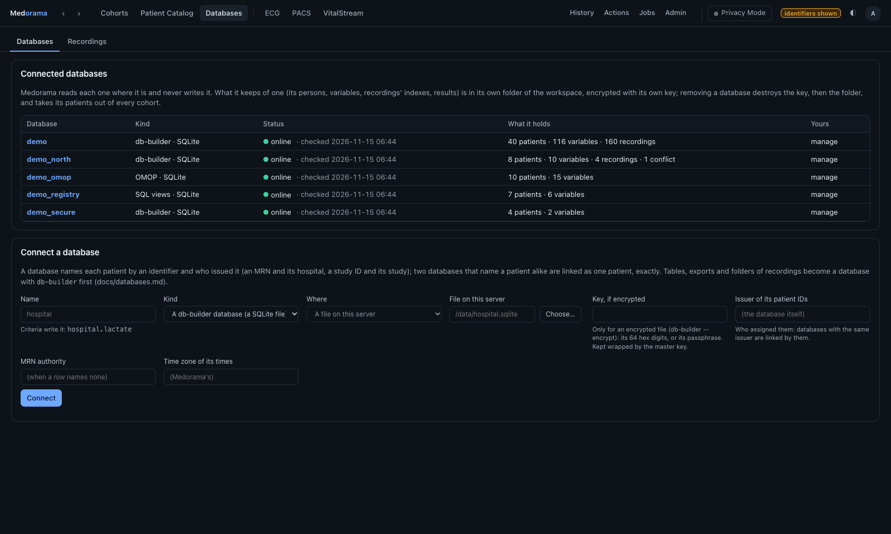

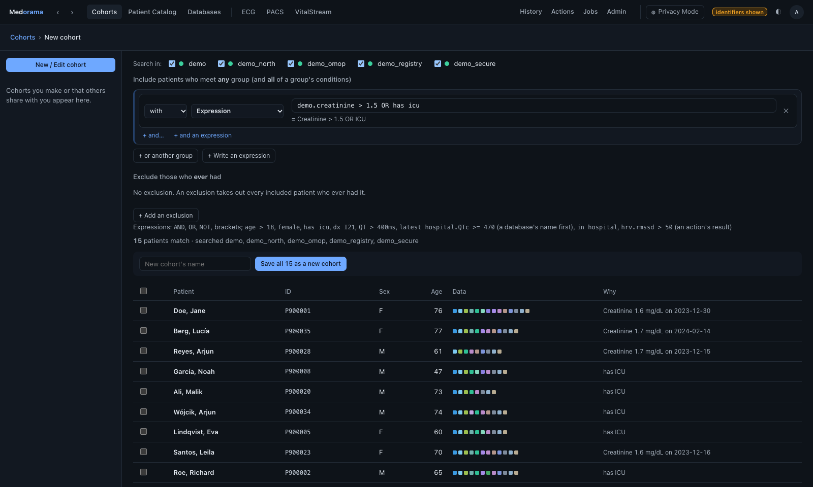

## Light and dark

The page has a light and a dark theme, and follows the system setting unless the user chooses
one. Both themes use the same tokens (`medorama/web/style.css`), tuned per theme so that each
keeps its contrast; dense columns (vital signs, medications) are softened so that they do not
outweigh sparse ones. The hues come from palettes made for color-vision deficiencies (Okabe-Ito,
Paul Tol), in families: monitoring blues, cardiology greens and teals, imaging violets,
laboratory olives, treatment plums and slates, record grays. Red means an alarm, amber and orange
abnormal and critical values, and blue a low value; no category takes those colors. Monitored
parameters keep the colors VitalStream draws them in (heart rate as the ECG, pressures violet,
saturation blue, respiration yellow). VitalStream and the ECG viewer follow the same rule (the
ECG paper's grid is blue-gray). The page allows no inline styles (its content security policy),
so every color is a class or an SVG attribute.

## Databases

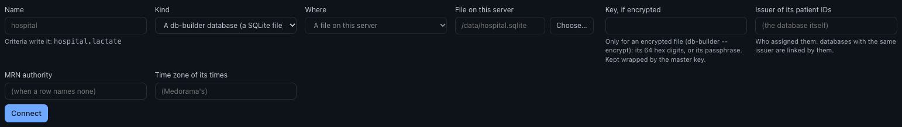

Medorama imports nothing: every source is a connected database, read where it is, whose rows
fill the same canonical columns (persons, visits, entries, recordings). OMOP and other SQL
databases stay where they are ([databases.md](../databases.md)). Tables (CSV, Parquet,
spreadsheets) and folders of recordings are made into a database by db-builder first
([db-builder/README.md](../../db-builder/README.md)): it recognizes the columns from the headers
(or a mapping), guesses a table's category from its file name, and lets rows describe patients,
visits, entries, recordings or attached files in any combination, so that a laboratory export,
an ECG index pointing to pictures and an ICU index pointing to recordings are all the same kind
of thing.

## Backend and frontend

The backend decides what is shown; the frontend only draws it.

| Backend (`medorama/src`) | Does |
|---|---|
| `sources/` | reads each connected database through its views: OMOP's, a site's, db-builder's tables |
| `persons.rs`, `grants.rs` | the patient index (exact identifiers and their issuers); who may see each database's data and identifiers |
| `recordings.rs` | the recordings of recording databases, their presence and indexes |
| `categories.rs` | the categories, their names and words; which are recordings (ICU, Holter, EEG, Sleep); ICU units |
| `derived.rs` | series found from waveforms: a Holter's heart rate (QRS detection) |
| `patient/` | the patient list, summary, journey (already binned), report and search, details, trends, recordings' overviews from the index and derived series, attached files and the viewer for each |
| `server.rs` | the HTTP API (with an attachment's own files only); permissions and the audit log; the viewers' pages |

| Frontend (`medorama/web/js`) | Does |
|---|---|
| `core.js`, `router.js`, `main.js` | the API, formatting, addresses (back and forward), sign-in |
| `views/*.js` | one module per screen (cohorts, patients, patient, databases, recordings, viewer, …); `apps.js`: the ECG and PACS viewers' tabs |
| `patient/journey.js`, `report.js`, `detail.js`, `charts.js` | the patient page's parts |

Identifiers are sent only to users with the PHI permission who have left Privacy Mode, and only
from the databases granted to them with `phi`. In Privacy
Mode, the text of notes is sent with the patient's own names and date of birth replaced, or
withheld, as the administrator chooses. The page cannot show what it is not sent
([security.md](../security.md)). There is no build step: the modules are served as they are.

## Next

- **Flags in column 3**, once laboratory results say what is abnormal by the database's ranges.
- **ECG statements compared by meaning** (their codes, where an ECG database gives them).
- **Tuning on real data:** real 12-lead ECGs and Holter recordings, read by the ECG viewer's
  readers ([readers.md](../readers.md)).
- **Imaging:** a PACS (DICOMweb) as a source.
- **Real databases** replace the synthetic ones without any change: they are databases like the
  others.
