# The patient page

This document records how Medorama shows one patient, and why: the decisions made while
designing the patient page, the split between backend and frontend, and what comes next. It is
written for contributors and for reviewers who want to understand the design. How to use the page
is described in
[user-guide.md, The Patient Catalog and the patient page](../user-guide.md#the-patient-catalog-and-the-patient-page);
how data reach it, in [databases.md](../databases.md) and [importing.md](../importing.md).

## Contents

- [What it is for](#what-it-is-for)
- [Layout](#layout)
- [The journey](#the-journey)
- [The report and the detail](#the-report-and-the-detail)
- [Three ways to the patients](#three-ways-to-the-patients)
- [Light and dark](#light-and-dark)
- [Databases](#databases)
- [Backend and frontend](#backend-and-frontend)
- [Next](#next)

*All screenshots show synthetic data made by `tools/make-demo-data.py`: invented people,
values, signals and pictures.*

## What it is for

Data about a patient live in many systems: bedside monitors (ICU waveforms), the laboratory,
ECG carts, EEG and sleep laboratories, imaging, pharmacy, notes. Each can be exported as a table,
with or without links to files, or connected as a database. The catalog loads each table as a
**database**, merges the databases over the patients (by patient ID, MRN and issuing authority,
and encounter), keeps everything in time order, and shows a patient's whole journey on one page.
Adding a database adds its data to every patient page; removing it takes it out of all of them.

## Layout

From left to right, the page shows who the patient is, what happened (as a picture), and what it
was (as text).

| Part | Width | Content |
|---|---|---|
| Search line | full | The patients' search. On a patient page, the patient as a chip (✕ closes it) and a search for another one. |
| Patient bar | full | Name, sex, age and date of birth, patient ID, MRNs, the span of the data, and allergies (amber; "not recorded" when no database holds allergies). |
| Patient column | 320 px | Encounters (click one to show only it), medications of the latest stay, conditions. |
| Journey | 330 px | The picture of the patient's data, newest on top. |
| Report | the rest | The entries (left) and the selected entry's detail (right). |

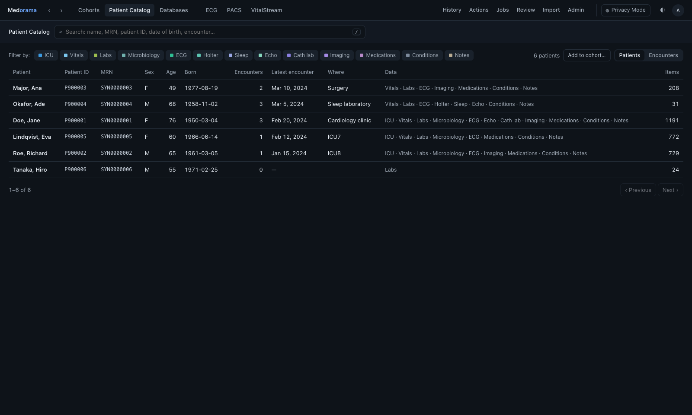

**The front page** is the list of all patients. The search line keeps its place on a patient
page, so another patient is always one search away, and no other patient is shown while one is
open.

## The journey

- **Time runs up**, newest on top, as in the report.
- **One column per category**, with a fixed color per category. Laboratory results, vital signs
  and medications are split into a thin column per test, sign or drug, so that a stay reads as a
  heatmap. Single categories get 12 px, enough for their name written vertically.
- **Categories a physician reads by**, not the databases: ICU, Vitals, Labs, Microbiology,
  Pathology, ECG, Holter, EEG, Sleep, Echo, Cath lab, Imaging, Procedures, Medications,
  Transfusions, Life support, Conditions, Assessments, Notes (and Allergies, with the patient).
  They follow the usual sections of a chart (HL7 v2 diagnostic service sections, FHIR resources
  and observation categories). One database may fill several columns (an imaging index holds
  imaging and echo), and several databases one; only the categories that some database provides
  are shown. The list is [categories.rs](../../medorama/src/categories.rs)
  ([importing.md, Categories](../importing.md#categories)).
- **ICU is the stay, not the monitor:** the column shows the whole time spent in an
  intensive-care unit (from the bed stays, start to end) as a light bar, and each recording
  made during it as a solid bar over it, from its first sample to its last (known once it is
  indexed; before that, an hour is shown, dashed). Each bar opens its entry, however short: its
  target is at least 8 px tall. A Holter recording, an EEG and a sleep study each have a column
  of their own, with a bar as long as the recording.
- **Six-hour cells.** Every item fills its cell; stays, drugs and recordings are bars.
- **Abnormal values** are amber and **critical** ones orange, in every column, and no category
  takes either color. Red is reserved for alarms. The warning on viewer tabs whose file may show
  identifiers in Privacy Mode is an amber triangle.
- **Folding.** Quiet stretches shrink to a hatched band, so that busy days get the room. Choosing
  an encounter (in the left column) shows only it, unfolded, with − and + to zoom; its chip above
  the journey (✕) shows all of them again.
- **A long history scrolls.** A busy day keeps at least 12 px. When years of care no longer fit,
  the journey scrolls vertically under fixed column names. It opens at the top (the newest), and
  choosing an entry in the report scrolls it into sight.
- **Interaction.** Hovering tells what a mark is; a click opens the entry in the report and the
  detail; a column's name hides or shows that category.

## The report and the detail

- **Three views:** **Timeline** (by day, with the encounter, hospital day and unit), **By
  category**, or **Trends** (every measurement as a sparkline). Laboratory results of one moment
  form one panel; vital signs form one entry a day.
- **Search** covers every text the patient has, notes included: literal (any part of a word, any
  case) or fuzzy for misspelled words. Words are alternatives (`ecg icu`). The search shortens
  the report; it does not change the journey. It reads the patient's own items only, and in
  Privacy Mode their text as the session is shown it (no name, identifier or staff name the gate
  replaces). **Trends** keep a series per name and unit: values in mg/dL and in mmol/L are two
  lines, not one.
- **Answers that arrive late are dropped.** Every answer the page waits for (the summary and the
  journey, the report, the trends, the detail, the suggestions of another patient) is drawn only
  if it is still for the patient and the address shown: a slow answer for a patient left behind
  never overwrites the one opened since.
- **The detail** shows what the entry is: a panel's values with ranges, flags, the previous value
  and the trend; a note or report; an ECG or image; a recording at a glance (length, gaps,
  waveforms; for ICU recordings, the main vital signs). Notes written around that time follow,
  since notes belong to their encounter.

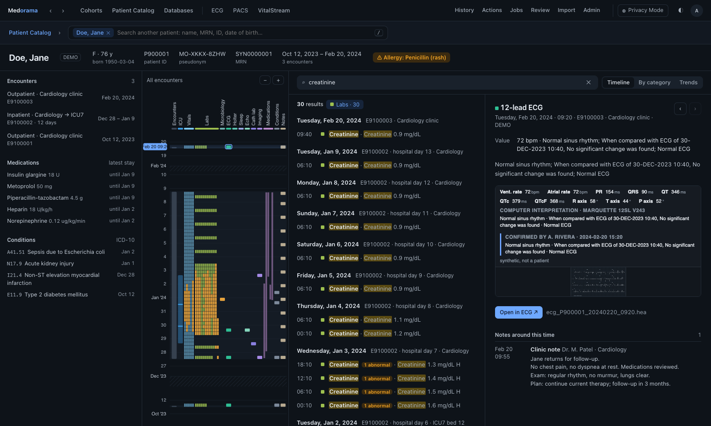

**Viewers keep their own pages.** Each kind of data has a viewer of its own, in its own folder
([`viewers/`](../../viewers/README.md)), with its own design, and useful alone. The patient page
opens them as tabs at the file to show, and the ‹ › arrows bring the patient page back as it was:
- An ICU, Holter, EEG or sleep recording opens in **VitalStream** at the moment clicked.
- A 12-lead ECG is drawn on paper in the detail itself (the ECG viewer, framed), and opens in the
  **ECG** tab for layouts, gain and calipers. PNG, JPEG and PDF ECGs are shown as they are.
- Echo loops, angiography runs, images and DICOM series open in the **PACS** tab.

Every viewer, like the page itself, has a light and a dark theme and follows the system setting.

**A viewer always says whose file it shows.** Inside Medorama a file's name is of no use, so the
viewer's title says whose file it is: the patient (as the user may see them: identifiers only
with the PHI permission, placeholders and the pseudonym in Privacy Mode), never cut short, then
what the file is, when, and in which encounter. ‹ Patient returns to its entry on the patient's
page, and ‹ 3 of 4 › steps through the patient's files of that kind. The title row is the patient
bar, so the viewer keeps its full width and height. Clinical systems keep such a banner against
wrong-patient errors. Standalone, a viewer shows its file's name.

Medorama passes this context in the viewer's address (`who`, `what`, `pos`, `nav`;
[viewers/README.md](../../viewers/README.md)). The viewer only reports a button press to the
page, which navigates; the viewer never sees patient IDs or addresses.

The ECG and PACS tabs are always in the top bar, dimmed until something is opened in them.

**A Holter's heart rate.** A Holter recording has no monitor-reported vital signs. Its heart
rate is found from the ECG after indexing (per minute, with the beat-to-beat range), and the
detail shows it over the whole recording, with its mean and range; a click opens VitalStream at
that moment.

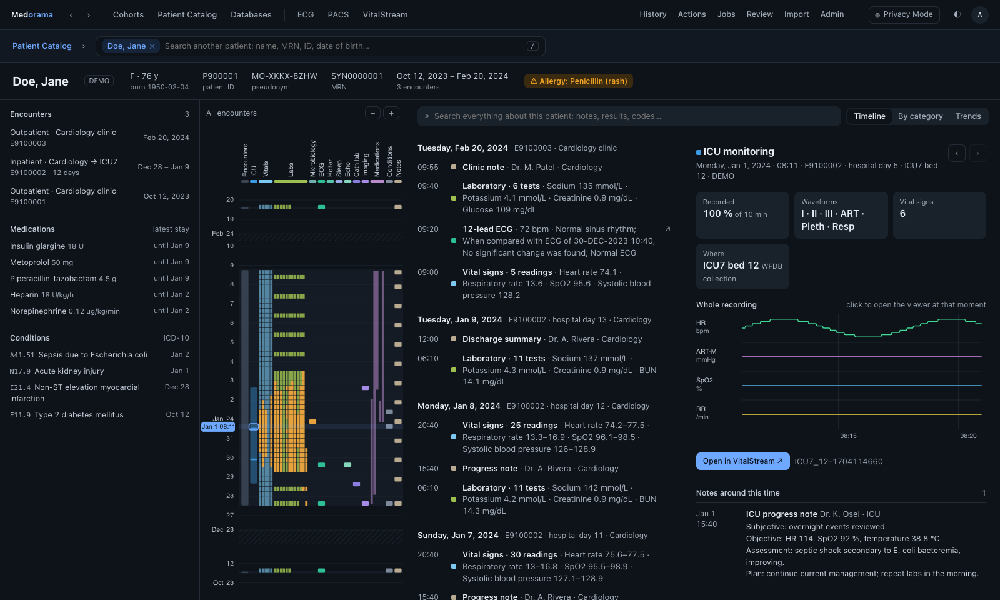

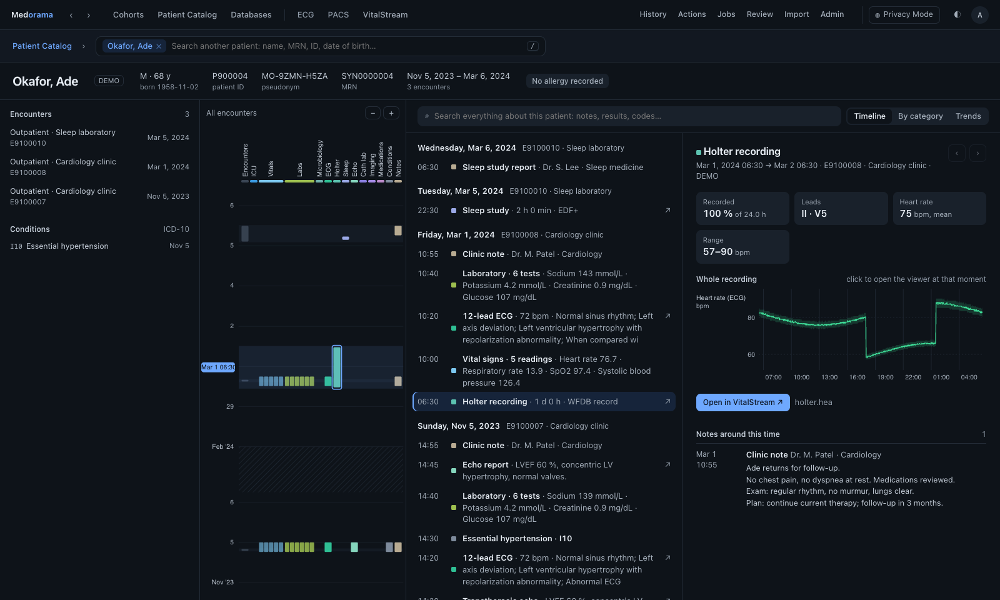

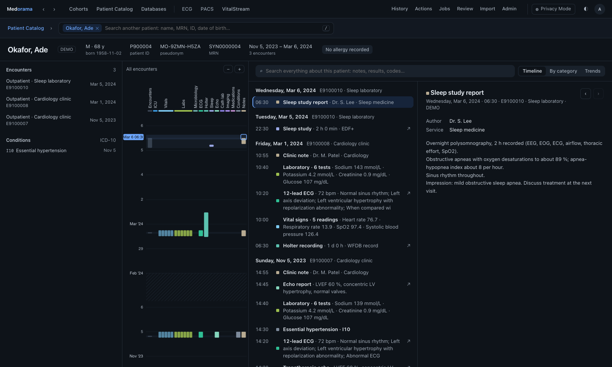

| ECG | PACS: an echo loop | PACS: a CT series |
|---|---|---|
| 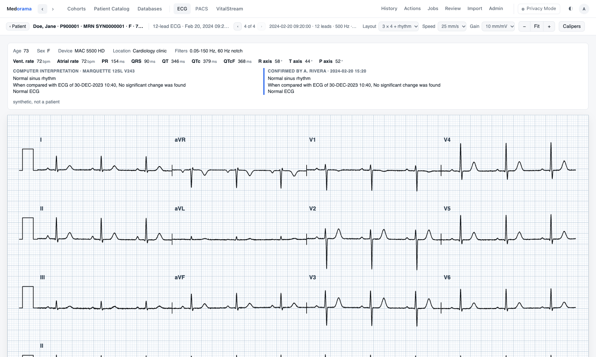 | 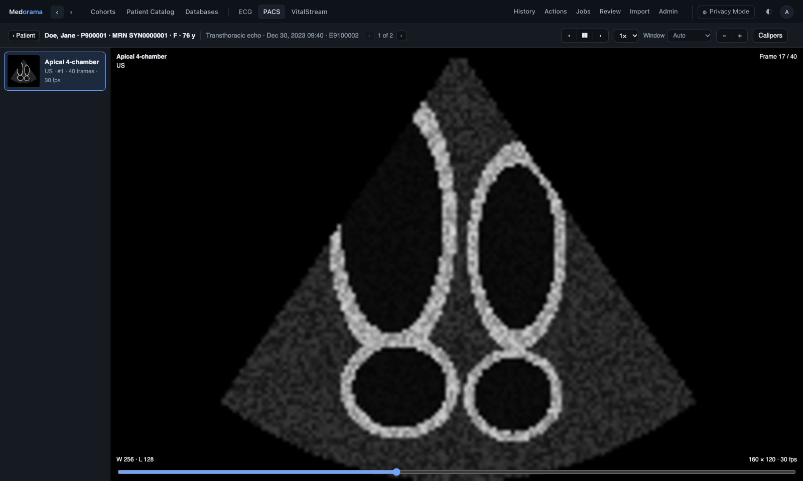 | 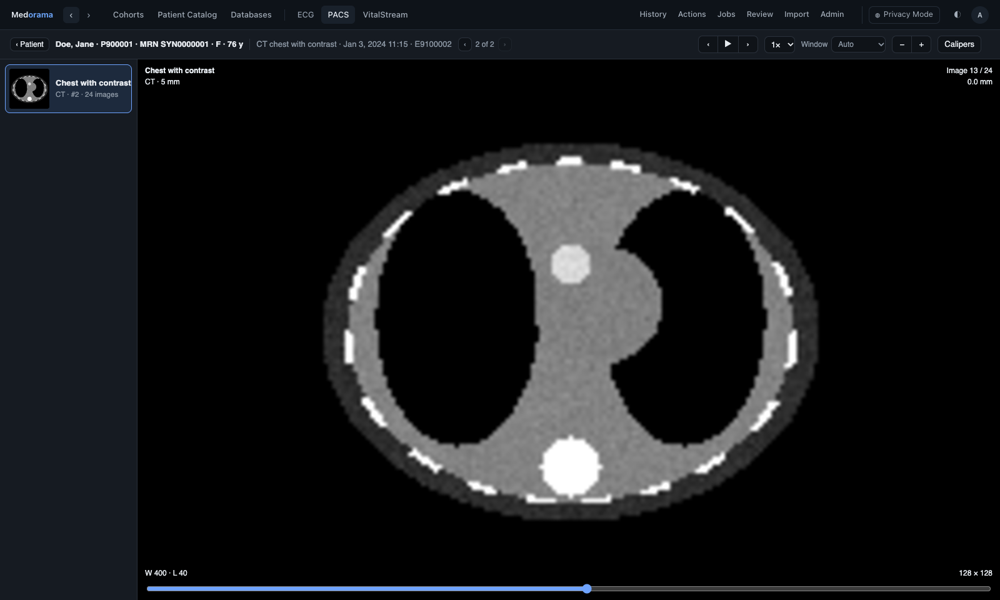 |

## Three ways to the patients

**Cohorts** (first, since a researcher's work is the cohorts they build), the **Patient
Catalog** (each patient's journey) and **Databases** sit together on the left of the top bar. The
viewers follow a separator. The work tabs (History, Actions, Jobs, Review, Import, Admin) sit,
quieter, at the right, by the theme switch.

- **Databases** shows the same data organized by database. A database can be large, so the list
  folds: ▸ unfolds one table in place, as imported, with each row's patient and its file linked to
  its viewer. Databases are the only way in: a file always comes with its patient.
- **Cohorts:** criteria build a structured query (the same one an NLP engine will write), the
  matches show with the reason they match, and a cohort keeps them until it is refreshed.
- Imports and deletions show in every open page within seconds.

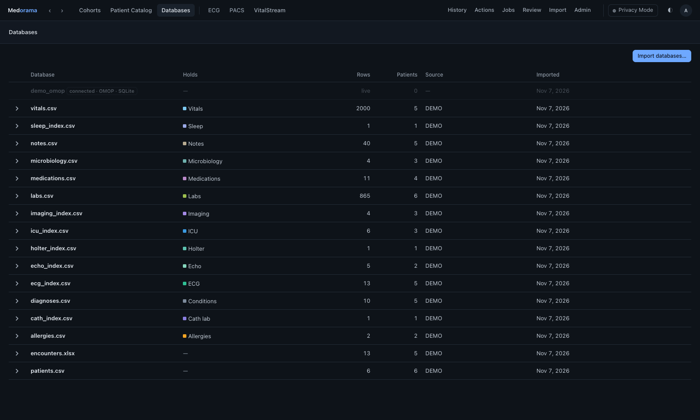

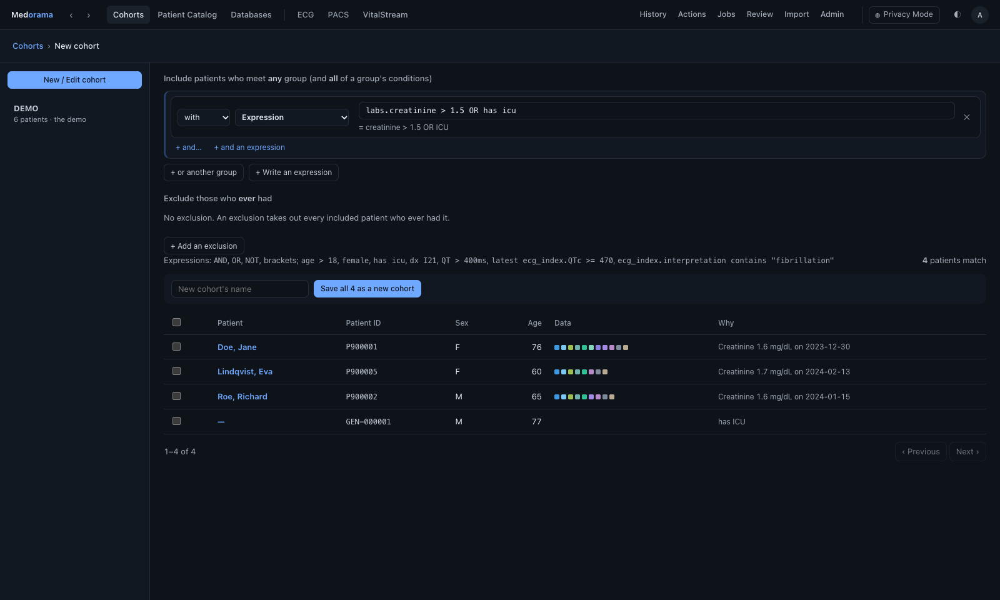

## Light and dark

The page has a light and a dark theme, and follows the system setting unless the user chooses
one. Both themes use the same tokens (`medorama/web/style.css`), tuned per theme so that each
keeps its contrast; dense columns (vital signs, medications) are softened so that they do not
outweigh sparse ones. The hues come from palettes made for color-vision deficiencies (Okabe-Ito,
Paul Tol), in families: monitoring blues, cardiology greens and teals, imaging violets,
laboratory olives, treatment plums and slates, record grays. Red means an alarm, amber and orange
abnormal and critical values, and blue a low value; no category takes those colors. Monitored
parameters keep the colors VitalStream draws them in (heart rate as the ECG, pressures violet,
saturation blue, respiration yellow). VitalStream and the ECG viewer follow the same rule (the
ECG paper's grid is blue-gray). The page allows no inline styles (its content security policy),
so every color is a class or an SVG attribute.

## Databases

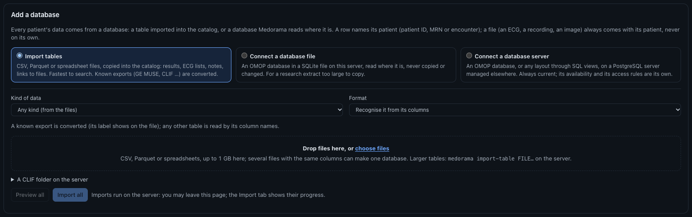

There is one kind of import for every source: a table (a CSV file, a Parquet file or a
spreadsheet). Each column is mapped once onto the catalog's columns (patient, encounter,
location, item, file); the mapping is guessed from the headers and can be saved. The table's
category ("Items are…") is guessed from its file name. Rows may describe patients, encounters,
items, recordings or attached files, in any combination, so a "linkage table", a laboratory
export, an ECG index pointing to pictures and an ICU index pointing to recordings are all the
same kind of thing. Databases that stay where they are (OMOP, other SQL databases) are connected
instead, and their entries fill the same columns ([databases.md](../databases.md)).

## Backend and frontend

The backend decides what is shown; the frontend only draws it.

| Backend (`medorama/src`) | Does |
|---|---|
| `tables.rs` | reads CSV, Parquet and spreadsheets, guesses mappings and categories, imports rows |
| `linkage.rs`, `identity.rs` | patients and encounters, identity rules, held-back rows |
| `ehr.rs` | items: matching to encounters and patients, duplicates, provenance |
| `categories.rs` | the categories, their names and words; which are recordings (ICU, Holter, EEG, Sleep); ICU units |
| `derived.rs` | series found from waveforms: a Holter's heart rate (QRS detection) |
| `patient/` | the patient list, summary, journey (already binned), report and search, details, trends, recordings' overviews from the index and derived series, attached files and the viewer for each |
| `server.rs` | the HTTP API (with an attachment's own files only); permissions and the audit log; the viewers' pages |

| Frontend (`medorama/web/js`) | Does |
|---|---|
| `core.js`, `router.js`, `main.js` | the API, formatting, addresses (back and forward), sign-in |
| `views/*.js` | one module per screen (patients, patient, recordings, viewer, sources, review, …); `apps.js`: the ECG and PACS viewers' tabs |
| `patient/journey.js`, `report.js`, `detail.js`, `charts.js` | the patient page's parts |

Identifiers are sent only to users with the PHI permission who have left Privacy Mode. In Privacy
Mode, the text of notes is sent with the patient's own names and date of birth replaced, or
withheld, as the administrator chooses. The page cannot show what it is not sent
([security.md](../security.md)). There is no build step: the modules are served as they are.

## Next

- **Tuning on real data:** real 12-lead ECGs and Holter recordings, read by the ECG viewer's
  readers ([readers.md](../readers.md)).
- **Imaging:** a PACS (DICOMweb) as a source.
- **Real databases** replace the synthetic ones without any change: they are databases like the
  others.
