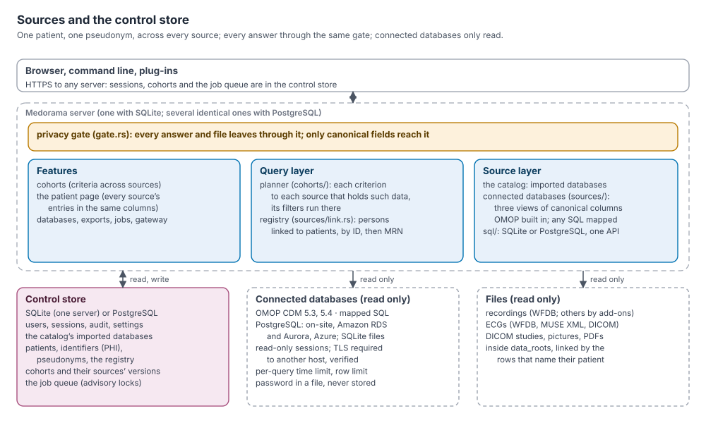

# Sources: the catalog, connected databases, and the control store

This document explains the design behind where Medorama's data come from: its own catalog, the
live databases it connects to (an OMOP instance, a research warehouse), and the store that holds
its own data (users, cohorts, pseudonyms, the job queue) in SQLite or PostgreSQL. It shows how one
person is known across all of them, and how every answer passes the privacy gate. It is written
for contributors and reviewers.

How to connect a database, with worked examples and the column-by-column specification of the
canonical views, is in [databases.md](../databases.md). The settings are summarized in
[administration.md](../administration.md), and the security design in
[security.md](../security.md).

## Contents

- [The picture](#the-picture)
- [The control store: SQLite or PostgreSQL](#the-control-store-sqlite-or-postgresql)
- [Sources](#sources)
- [The canonical model](#the-canonical-model)
- [Connected databases](#connected-databases)
- [OMOP](#omop)
- [The person registry](#the-person-registry)
- [Cohorts across sources](#cohorts-across-sources)
- [The patient page](#the-patient-page)
- [Privacy](#privacy)
- [Limits and failures](#limits-and-failures)
- [What is not there yet](#what-is-not-there-yet)

## The picture



```
  browser (Medorama page · VitalStream · ECG · PACS)      CLI      plug-ins
                              │ HTTPS
┌─────────────────────────────▼───────────────────────────────────────────────────┐
│ Medorama server   (one, or several identical ones on PostgreSQL)                 │
│  HTTP layer      sign-in, sessions, roles, the PHI permission, CSRF, audit      │
│  ══ privacy gate ══ every answer and every file leaves through it               │
│  features        cohorts · patient page · databases · exports · jobs · gateway  │
│  query layer     criteria, planner (cohorts/) · registry (sources/link.rs)      │
│  source layer    the catalog (built in) · connected databases (sources/)        │
└──────┬─────────────────────────┬───────────────────────────────┬───────────────┘
       │ read/write              │ read only                      │ read only
  control store             connected databases                  files
  SQLite or PostgreSQL      OMOP · mapped SQL (PostgreSQL,       recordings, ECGs,
  (sql/, db.rs)             SQLite files), on-site or cloud      DICOM, documents
```

## The control store: SQLite or PostgreSQL

Medorama's own database, the **catalog** (users, sessions, the audit log, settings, imported
databases, patients and their identifiers, cohorts, pseudonyms, the job queue), is SQLite by
default and PostgreSQL when `database_url` is set.

- **One interface** ([`medorama/src/sql`](../../medorama/src/sql/mod.rs)). The code writes SQL
  once, in SQLite's dialect kept to what both databases understand, through one API
  (`Connection`, `prepare`, `query_row`, `params!`). On PostgreSQL each statement is translated
  once (`sql/dialect.rs`: parameters, `INSERT OR IGNORE`, case-insensitive `LIKE`,
  `group_concat`, SQLite's order of NULLs, subquery names), then prepared and cached; values are
  converted both ways (`sql/pg.rs`). The few queries without a common form (the text search, a
  JSON cell, a numeric sort) ask the connection for its dialect.
- **Two schemas, kept equal.** Each database has one schema file with the same tables
  (`schema/sqlite/001_schema.sql`, `schema/postgres/001_schema.sql`); every later version comes
  as a pair of files, one for each.
- **The same tests on both.** `MEDORAMA_TEST_POSTGRES=postgres://…` runs every test again with
  the catalog in PostgreSQL, each test in a schema of its own. CI does so on PostgreSQL 14 and 17.
- **Several servers.** On PostgreSQL, several Medorama servers can share one catalog. Sessions,
  cohorts, pseudonyms and the queue are in the database, so any server answers any request. Work
  that only one server at a time may do takes an advisory lock (`sql::Lock`): bringing the schema
  up to date, taking a job from the queue, and queuing automatic indexing.
- **Moving from one to the other.** `medorama copy-database --to postgres://…` copies a SQLite
  catalog, every table and row, into an empty PostgreSQL database, in one transaction.
- **Choosing.** SQLite suits one server: there is nothing to run, and the file can be encrypted
  with SQLCipher. PostgreSQL suits several servers, many users, large catalogs, and institutions
  that run it already. Encryption at rest is then the server's (disk or cloud volume
  encryption); TLS to a server on another host is required and verified (`database_ca_file` adds
  certificate authorities).

## Sources

A **source** is where patient data come from. There are two kinds:

| | The catalog | A connected database |
|---|---|---|
| What | The databases imported into Medorama (tables, recordings, files) | A live database Medorama reads: an OMOP instance, a warehouse |
| Where the data are | In the control store | In that database, read at each request |
| Identity | Its rows name patients by ID or MRN ([importing.md](../importing.md#how-rows-find-their-patients)) | Its persons, linked to Medorama's patients (the registry) |
| Added by | An administrator importing a table | An administrator connecting it (`medorama connections add`) |
| Code | `src/cohorts/in_catalog.rs`, `src/patient/` | `src/sources/`, `src/cohorts/in_sources.rs` |

Both kinds answer the same questions: which persons meet a criterion (and why), what a person's
entries and visits are, and who a person is. The catalog answers them in process; a connected
database answers them with queries run in it. Every connected database is also a batch of the
catalog (an import of kind `connection`): what linking added (patients, MRNs, values) has its
provenance, and disconnecting removes it, as removing an imported database does.

## The canonical model

A connected database is read through three **views**, SQL queries that return canonical
columns. They are the contract between Medorama and any database. OMOP has them built in; for
any other layout, an administrator writes them. The column-by-column specification, with types,
is in [databases.md, Canonical views reference](../databases.md#canonical-views-reference).

| View | Columns |
|---|---|
| `persons` | `person_key`, `patient_id`, `mrn`, `mrn_authority`, `last_name`, `first_name`, `birth_date`, `sex` |
| `visits` | `visit_key`, `person_key`, `start_time`, `end_time`, `unit`, `icu` |
| `entries` | `entry_key`, `person_key`, `visit_key`, `category`, `time`, `end_time`, `name`, `code`, `vocabulary`, `value_num`, `value_text`, `unit`, `ref_low`, `ref_high`, `flag`, `author`, `text` |

Three design decisions follow from it:

- **Keys stay on the server.** `person_key`, `visit_key` and `entry_key` are the database's own
  keys, of any type. They never leave the server: persons are shown by pseudonym, entries by a
  token.
- **Categories are the journey's.** An entry's category is a key of
  [categories.rs](../../medorama/src/categories.rs). An unrecognized one becomes `lab`, or `vit`
  when the entry's name or LOINC code is a vital sign's (`of_entry`).
- **Only these columns are read.** Medorama selects the canonical columns by name from each view,
  so a view's other columns are ignored, and a mapping cannot add a field the privacy gate does
  not know.

Each column has a privacy class, which decides what the gate does with it:

| Class | Columns | In Privacy Mode |
|---|---|---|
| Key | `person_key`, `visit_key`, `entry_key` | Never sent: persons by pseudonym, entries by a token |
| Identifier | `patient_id`, `mrn`, `last_name`, `first_name`, `birth_date` | Kept in the catalog's identifier tables; shown as placeholders |
| Date | every time | Moved back by the session's offset |
| Free text | `text` | The notes rule: withheld, or shown with the patient's names replaced |
| Staff | `author` | `[Staff Name]` |
| Clinical | the rest | As is |

## Connected databases

A connection is a row of the control store's `connections` table: a name, a kind, the
database's URL without its password, the password's file, and settings
([medorama/src/sources/mod.rs](../../medorama/src/sources/mod.rs)).

- **Kinds.** `omop` is an OMOP CDM 5.3 or 5.4 database, with its views built in. `sql` is any
  layout, with its views given as SQL in the settings.
- **Databases.** PostgreSQL (on-site, Amazon RDS and Aurora, Azure Database for PostgreSQL, or
  anything that speaks its protocol) and SQLite files. Other engines (SQL Server, Oracle,
  Snowflake, BigQuery) are not read yet; a PostgreSQL foreign-data wrapper reaches them in the
  meantime.
- **Read-only access is enforced.** PostgreSQL connections are opened with
  `default_transaction_read_only = on` and SQLite files are opened read-only, so Medorama cannot
  write there even with an account that could. The account should be read-only too.
- **Secrets.** The password is read from a file (or from `$MEDORAMA_SOURCE_PASSWORD_<NAME>`). It
  is never stored in the database, in a settings file, or in the audit log, and a URL that holds
  one is refused.
- **Settings.** `schema`, `vocabulary_schema`, `timezone`, `identifier`, `mrn_authority`,
  `timeout_s` and `max_rows` ([databases.md, Connection settings](../databases.md#connection-settings)).
  When no time zone is given, the command and the page write the catalog's time zone into the
  connection as it is added, so that a later change of the catalog's `timezone` does not move a
  connection's times.
- **Commands.** `medorama connections add|list|check|sync|remove`. Administrators also add
  connections in the page (Import › Add a database › **Connect a database server**, or **Connect
  a database file**) and see them in the Databases tab (`GET connections`).
- **Checked when added.** Each view must answer with its canonical columns, and the version
  query with a value; otherwise the connection is refused.

## OMOP

The OMOP views read `person`, `visit_occurrence`, `visit_detail`, `care_site`, `measurement`,
`observation`, `condition_occurrence`, `drug_exposure`, `procedure_occurrence`, `note`,
`provider`, `concept` and `cdm_source` ([medorama/src/sources/omop.rs](../../medorama/src/sources/omop.rs)).
Every one of these tables must exist, even empty, because a view that names a missing table fails
its check and the connection is refused. What each column becomes is listed in
[databases.md, What Medorama reads](../databases.md#what-medorama-reads). In short:

| Canonical | From OMOP |
|---|---|
| A person's sex | `gender_concept_id` (8532 female, 8507 male) |
| Birth date | `birth_datetime`, else `year_of_birth`, `month_of_birth`, `day_of_birth` |
| MRN or patient ID | `person_source_value`, as the `identifier` setting says |
| Visits | `visit_occurrence`; an intensive-care stay when a `visit_detail` is an intensive-care one (concept 32037), or when its unit is named like an intensive-care unit |
| `lab` (`vit` for vital signs) | `measurement`: the concept's name and code, `value_as_number`, the unit's UCUM code, `range_low` and `range_high` |
| `obs` | `observation` |
| `dx` | `condition_occurrence`, with the source concept's code (ICD-10-CM) and vocabulary |
| `med` | `drug_exposure` |
| `proc` | `procedure_occurrence` |
| `note` | `note`: its title, text and type, and the provider as its author |

Times are read as the database's local times, in the connection's `timezone`.

## The person registry

One person may appear in several sources: imported tables, an OMOP instance, a warehouse. The
**registry** is the catalog's patients: each has a random pseudonym, its identifiers, its merges
and its reviewed pairs. A connected database's persons are **linked** to them (the
`source_persons` table: connection, person key, patient), in
[medorama/src/sources/link.rs](../../medorama/src/sources/link.rs).

- **When.** A person is linked the first time a source names them (in a cohort search or a
  sync), so a large database does not have to be copied in. `medorama connections sync NAME`
  links every person at once, reading them in one query within `max_rows`; a database with more
  persons than `max_rows` fails to sync.
- **How.** A person's identifiers form a linkage row, applied by the same rules as an imported
  table's row ([importing.md](../importing.md#how-rows-find-their-patients)): by patient ID (and
  its merges), else by MRN of the same authority, else as a new patient. A person with neither
  identifier becomes a patient of its own, `<connection>:<person key>`. A person whose patient ID
  and MRN name two different patients is held for Review, as an imported row is.
- **Merges** move the links with the rest of the patient.
- **Never across sources by a guess.** Two sources' persons are the same patient only by an
  identifier both hold, or by a reviewer's merge. Columns are never mixed between sources.

## Cohorts across sources

A criterion is answered by every source that holds such data, and a person meets it when any of
them says so: `lactate > 4` finds the lactate results of the imported laboratory tables and
those of the OMOP instance. A criterion can name one source, as it names one database:
`omop.lactate > 4`.

- **The planner** (`cohorts/evaluate.rs`, `cohorts/in_sources.rs`). For each criterion, each
  connected database runs one query over its views, with the filters it can apply itself (the
  category, the name, the code, the text). Values in other units, `latest`, dates and stays are
  tested by Medorama. The persons found are linked to the registry, and then the groups (`AND`,
  `OR`, `NOT`) combine patients. Each criterion is asked once per search.
- **The registry's criteria.** Sex, age and "in that database" are answered by the catalog for
  every linked person (linking copied those values into the connection's batch). They do not
  read the connected database, so `female` alone does not link a million persons. `NOT` applies
  among the patients the registry knows; `medorama connections sync` makes that every person.
- **Linked as found.** When a search links new persons, it is evaluated again among all the
  patients: the connected databases' answers are kept from the first pass, the catalog's are
  found again (a person linked now has the registry's sex and age), so that `A AND NOT B` is right
  for a patient `A` just linked, and `female AND omop.troponin > 100` finds the same patients as
  `omop.troponin > 100 AND female`, the first time.
- **`latest`.** A measurement's latest value is each patient's latest across every source that
  holds it (the catalog's and the connected databases' values together), of the name written in
  full: `latest QT` never reads a QTc.
- **Dates in Privacy Mode.** Criteria dates written in Privacy Mode are dates as shown
  (`privacy_dates`): a connected database is read within the widest range any patient's offset
  allows, its persons linked, then each row tested with its patient's own offset.
- **Names.** Words in criteria text name what a source holds. The measurement names of each
  connected database are read once and kept for ten minutes. A word names the one name that
  contains it (`omop.lactate` for `Lactate [Moles/volume] in Blood`); a word that names several
  is refused with the names to choose from. A name held by two databases (the catalog's labs and
  OMOP) asks which, as for two imported databases: data are never merged across sources by a
  name.
- **Versions.** A cohort records the version of each source when it was made or refreshed (the
  catalog's data version, OMOP's `cdm_source` release dates), so that a refresh says what
  changed.

## The patient page

A patient's page shows the entries of every source the patient is linked to, in the same
columns: the journey (a category that only a connected database holds still gets its column),
the report and its search, the trends, and each entry's detail. The connected databases' stays
and visits appear under Encounters, their conditions with the others, and the dates in the banner
come from all of them.

A connected database's entries are read when the page is opened; nothing is copied. What was
read is kept for 30 seconds, because one page reads it for its summary, journey and report.
Each entry is named by a token (`live:<connection>:<token>`, a keyed hash) that holds neither its
key nor its time. A source that does not answer leaves the page with what the others gave, and
the banner names it. The Patient Catalog names each patient's connected databases.

## Privacy

- **The same gate.** A connected database's data become the same answers as the catalog's, and
  leave through the same privacy gate. A person's identifiers, once linked, are in the catalog's
  identifier tables, and so in the gate's dictionary of identifiers to replace.
- **Searching by identifier** needs the PHI permission, in any source, as in the catalog.
- **Audit.** Searches with identifiers, linking and syncing are written to the audit log.
- **Failing closed.** A source's value of a type the model does not have is not read, and an
  answer the gate did not clear does not leave.

## Limits and failures

- Each query of a connected database has a time limit (`timeout_s`). A criterion that would read
  more than `max_rows` rows is refused with a message saying to narrow it.
- A cohort search over a source that does not answer fails with that source's name, because a
  result silently missing a source would be wrong.
- Connections are pooled per server; a connection the server closed is replaced.

## What is not there yet

Each of these has a design and the steps to build it in [todo.md](../todo.md#connected-databases).

- FHIR servers, and SQL Server, Oracle, Snowflake and BigQuery read directly.
- Files held by a connected database (images, documents): its entries carry no attachment yet.
- Pushing value thresholds down to the database when units agree (values are tested by
  Medorama).
- A connected database's visits as encounters of their own (to filter the page by one), and its
  data counted in the Patient Catalog's columns.
- Notes of a connected database among the notes shown near an entry (those are the catalog's).
