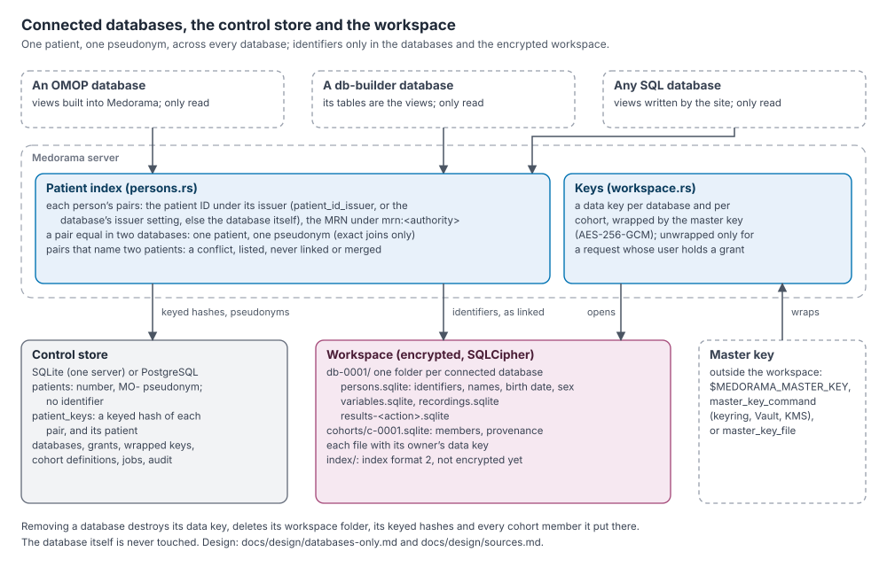

# Sources: connected databases, the patient index, and the control store

This document explains the design behind where Medorama's data come from: the databases it
connects (an OMOP instance, a research warehouse, a db-builder SQLite file), read in place and
read-only, and the store that holds Medorama's own data (users, grants, cohorts, pseudonyms, the
job queue) in SQLite or PostgreSQL. It shows how one patient is known across databases, how
cohorts search them, and how every answer passes the privacy gate. It is written for contributors
and reviewers.

Medorama imports nothing: every patient datum is read from a connected database when it is
needed. Why, and what Medorama keeps of each database (its workspace folder, its keys, its
removal), is in [databases-only.md](databases-only.md). How to prepare and connect a database,
with worked examples and the column-by-column specification of the canonical views, is in
[databases.md](../databases.md). The security design is in [security.md](../security.md).

## Contents

- [The picture](#the-picture)
- [The control store: SQLite or PostgreSQL](#the-control-store-sqlite-or-postgresql)
- [Connected databases](#connected-databases)
- [The canonical model](#the-canonical-model)
- [OMOP](#omop)
- [The patient index](#the-patient-index)
- [Cohorts across databases](#cohorts-across-databases)
- [The patient page](#the-patient-page)
- [Privacy](#privacy)
- [Limits and failures](#limits-and-failures)
- [What is not there yet](#what-is-not-there-yet)

## The picture



```
  browser (Medorama page · VitalStream · ECG · PACS)      CLI      plug-ins
                              │ HTTPS
┌─────────────────────────────▼───────────────────────────────────────────────────┐
│ Medorama server (one)                                                            │
│  HTTP layer      sign-in, sessions, roles, the PHI permission, CSRF, audit      │
│  ══ privacy gate ══ every answer and every file leaves through it               │
│  features        cohorts · patient page · databases · exports · jobs · gateway  │
│  access          grants per database and cohort (grants.rs)                     │
│  query layer     criteria, planner (cohorts/) · patient index (persons.rs)      │
│  source layer    connected databases (sources/), status (databases.rs)          │
└──────┬─────────────────────┬────────────────────────┬─────────────────────────┘
       │ read/write          │ read/write (encrypted)  │ read only
  control store          workspace/                connected databases, and the
  SQLite or PostgreSQL   one folder per database,  recording files they name
  (sql/, db.rs)          one file per cohort       (OMOP · views · db-builder)
```

## The control store: SQLite or PostgreSQL

Medorama's own database, the **control store** (users, sessions, grants, the audit log, settings,
the list of connected databases, patient numbers and pseudonyms, keyed hashes of identifiers,
cohort definitions, wrapped keys, the job queue), is SQLite by default and PostgreSQL when
`database_url` is set. It holds no identifier, name or value of a patient; its tables are listed
in [databases-only.md, The control store](databases-only.md#the-control-store).

- **One interface** ([`medorama/src/sql`](../../medorama/src/sql/mod.rs)). The code writes SQL
  once, in SQLite's dialect kept to what both databases understand, through one API
  (`Connection`, `prepare`, `query_row`, `params!`). On PostgreSQL each statement is translated
  once (`sql/dialect.rs`: parameters, `INSERT OR IGNORE`, case-insensitive `LIKE`,
  `group_concat`, SQLite's order of NULLs, subquery names), then prepared and cached; values are
  converted both ways (`sql/pg.rs`). The few queries without a common form ask the connection for
  its dialect.
- **Two schemas, kept equal.** Each database has one schema file with the same tables
  (`schema/sqlite/001_schema.sql`, `schema/postgres/001_schema.sql`), a fresh version 1; every
  later version comes as a pair of files, one for each.
- **The same tests on both.** `MEDORAMA_TEST_POSTGRES=postgres://…` runs the tests again with the
  control store in PostgreSQL, each test in a schema of its own.
- **One server.** This version runs one server: the workspace is a local folder, and the
  database checks and the job queue run in that server. Work that only one process at a time may
  do takes an advisory lock (`sql::Lock`) on PostgreSQL.
- **Moving from one to the other.** `medorama copy-database --to postgres://…` copies a SQLite
  control store, every table and row, into an empty PostgreSQL database, in one transaction.
- **Choosing.** SQLite needs nothing to run, and its file can be encrypted with SQLCipher
  (`key_file`, `$MEDORAMA_KEY`). PostgreSQL suits institutions that run it already. TLS to a
  server on another host is required and verified (`database_ca_file` adds certificate
  authorities).

## Connected databases

A connected database is a row of the control store's `databases` table: a name, a kind, the URL
without its password, how its password is given, its settings and its status
([medorama/src/sources/mod.rs](../../medorama/src/sources/mod.rs),
[medorama/src/databases.rs](../../medorama/src/databases.rs)).

- **Kinds.** `omop` is an OMOP CDM 5.3 or 5.4 database, with its views built in. `views` is any
  layout, with its views given as SQL by the site. `dbb` is a db-builder SQLite file, whose
  tables are the views ([db-builder/docs/schema.md](../../db-builder/docs/schema.md)).
- **Engines.** PostgreSQL (on-site, Amazon RDS and Aurora, Azure Database for PostgreSQL, or
  anything that speaks its protocol) and SQLite files. Other engines (SQL Server, Oracle,
  Snowflake, BigQuery) are not read yet; a PostgreSQL foreign-data wrapper reaches them in the
  meantime.
- **Read-only access is enforced.** PostgreSQL connections are opened with
  `default_transaction_read_only = on` and a statement time limit; SQLite files are opened
  read-only, with `query_only`. Medorama cannot write there even with an account that could. The
  account should be read-only too.
- **Secrets.** A password given to Medorama (the page, or `--password-stdin`) is sealed by the
  master key in the control store and never shown; or it is read from a file, or from
  `$MEDORAMA_SOURCE_PASSWORD_<NAME>`, which takes precedence. A URL that holds a password is
  refused.
- **Files.** A SQLite file must lie inside `data_roots` (when set), and may be neither the
  control store nor a file of the workspace.
- **Settings** (JSON, `databases.settings`): `schema`, `vocabulary_schema`, `timezone`,
  `identifier` (OMOP), `issuer`, `mrn_authority`, `files_root`, `timeout_s`, `max_rows`, and for
  `views` the views themselves ([databases.md, Connection settings](../databases.md#connection-settings)).
- **Connecting** checks that each view answers with its canonical columns, then makes the
  database's data key and workspace folder, grants it to the admin who connected it, reads its
  variables, links its persons and lists its recordings.
- **Status.** Each database is checked at start, every 60 seconds and on demand: online (a green
  dot) when its SQLite file is there and each view answers, otherwise offline (grey), with the
  time and the error. A new data version reads its variables, persons and recordings again.
- **Commands.** `medorama databases connect|list|check|refresh|variables|conflicts|grants|grant|revoke|remove`,
  and the page's **Databases** tab.

## The canonical model

A connected database is read through **views**, SQL queries that return canonical columns. They
are the contract between Medorama and any database. OMOP has them built in, db-builder's tables
have them, and for any other layout the site writes them. The column-by-column specification is
in [databases.md, Canonical views reference](../databases.md#canonical-views-reference).

| View | Required | Columns |
|---|---|---|
| `persons` | Yes | `person_key`, `patient_id`, `patient_id_issuer`, `mrn`, `mrn_authority`, `last_name`, `first_name`, `birth_date`, `sex`; optional `earliest`, `latest` (the times of the person's first and latest data, 0.3.1) |
| `visits` | No | `visit_key`, `person_key`, `start_time`, `end_time`, `unit`, `icu` |
| `entries` | Yes | `entry_key`, `person_key`, `visit_key`, `category`, `time`, `end_time`, `name`, `code`, `vocabulary`, `value_num`, `value_text`, `unit`, `ref_low`, `ref_high`, `flag`, `author`, `text` |
| `recordings` | No (a recording database) | `recording_key`, `person_key`, `visit_key`, `file`, `format`, `start_time`, `end_time`, `label`, `category`, `size`, `fingerprint` |
| `version` | No | One value that changes when the data do |

Design decisions that follow from it:

- **Keys stay on the server.** `person_key`, `visit_key`, `entry_key` and `recording_key` are the
  database's own keys, of any type. They never leave the server: patients are shown by
  pseudonym, visits and entries by tokens, recordings by number.
- **Identity is a pair.** `patient_id` is named with `patient_id_issuer`, and `mrn` with
  `mrn_authority` ([The patient index](#the-patient-index)).
- **Categories are the journey's.** An entry's category is a key of
  [categories.rs](../../medorama/src/categories.rs). An unrecognized one becomes `lab`, or `vit`
  when the entry's name or LOINC code is a vital sign's.
- **Only these columns are read.** Medorama selects the canonical columns by name from each view,
  so a view's other columns are ignored, and no view can pass a field the privacy gate does not
  know.
- **Recording files are read where they lie.** A relative `file` is read from the `files_root`
  setting, else from a SQLite database's own folder. Medorama reads each file's kind and
  fingerprint itself; a file outside `data_roots`, inside the workspace or missing is listed with
  its problem and not opened.

Each column has a privacy class, which decides what the gate does with it:

| Class | Columns | In Privacy Mode |
|---|---|---|
| Key | `person_key`, `visit_key`, `entry_key`, `recording_key` | Never sent: pseudonyms, tokens, numbers |
| Identifier | `patient_id`, `mrn`, `last_name`, `first_name`, `birth_date` | Kept in the database's encrypted `persons.sqlite`; shown as placeholders |
| Path | `file` | Paths and file names replaced |
| Date | every time | Moved back by the session's offset |
| Free text | `text` | The notes rule: withheld, or shown with the patient's names replaced |
| Staff | `author` | `[Staff Name]` |
| Clinical | the rest | As is |

## OMOP

The OMOP views read `person`, `visit_occurrence`, `visit_detail`, `care_site`, `measurement`,
`observation`, `condition_occurrence`, `drug_exposure`, `procedure_occurrence`, `note`,
`provider`, `concept` and `cdm_source` ([medorama/src/sources/omop.rs](../../medorama/src/sources/omop.rs)).
Every one of these tables must exist, even empty, because a view that names a missing table fails
its check and the database is refused. What each column becomes is listed in
[databases.md, What Medorama reads](../databases.md#what-medorama-reads). In short:

| Canonical | From OMOP |
|---|---|
| A person's sex | `gender_concept_id` (8532 female, 8507 male) |
| Birth date | `birth_datetime`, else `year_of_birth`, `month_of_birth`, `day_of_birth` |
| MRN or patient ID | `person_source_value`, as the `identifier` setting says; its issuer is the `mrn_authority` or `issuer` setting |
| Visits | `visit_occurrence`; an intensive-care stay when a `visit_detail` is an intensive-care one (concept 32037), or when its unit is named like an intensive-care unit |
| `lab` (`vit` for vital signs) | `measurement`: the concept's name and code, `value_as_number`, the unit's UCUM code, `range_low` and `range_high` |
| `obs` | `observation` |
| `dx` | `condition_occurrence`, with the source concept's code (ICD-10-CM) and vocabulary |
| `med` | `drug_exposure` |
| `proc` | `procedure_occurrence` |
| `note` | `note`: its title, text and type, and the provider as its author |
| The version | `cdm_source`: `source_release_date` and `cdm_release_date` |

OMOP holds no recordings: its views have no `recordings`. Times are read as the database's local
times, in its `timezone` setting.

## The patient index

One patient may appear in several databases: a warehouse, an OMOP instance, a db-builder
database of recordings. The **patient index** joins them on exact identifiers, and on nothing
else ([medorama/src/persons.rs](../../medorama/src/persons.rs)).

- **Pairs.** Each person gives (issuer, identifier) pairs: its patient ID under
  `patient_id_issuer` (else the database's `issuer` setting, else `db:<name>`: the database's
  own, so that its IDs link only its own persons), its MRN under `mrn:<authority>` (the row's
  `mrn_authority`, else the setting). A person with neither gives (`key:db:<id>`, its key) and
  links only to itself.
- **Keyed hashes.** The control store keeps, per pair, an HMAC-SHA-256 keyed with the privacy
  gate's secret, and the patient number it links (`patient_keys`). Identifiers and issuers are
  compared as trimmed text, ignoring case (`x123` is `X123`, as db-builder matches MRNs). No identifier can be read back from a hash.
  The identifiers, names, birth date and sex are kept only in the database's own
  `persons.sqlite`, encrypted with its key.
- **Exact joins.** A pair equal in two databases is one patient, with one pseudonym (`MO-…`). A
  person whose pairs lead to two patients is a **conflict**: listed, not linked, never merged. It
  is fixed in the database, then the database is refreshed.
- **No guessing.** No scored matching, no merge, no split, no review: identity is a requirement
  on the databases ([databases.md, Requirements](../databases.md#requirements-on-a-connected-database)).
- **When.** Every person is linked when a database is connected or refreshed, and persons that
  a search finds are linked as they are found. A patient number that no database links any more
  is removed, with its pseudonym.
- **Searching by identifier** (name, MRN, date of birth in the Patient Catalog) needs the PHI
  permission, outside Privacy Mode, and finds only the identifiers the user may see (databases
  granted `phi`).

## Cohorts across databases

A criterion is answered by every database of the search's scope that may hold such data, and a
patient meets it when any of them says so: `lactate > 4` finds the lactate results of the
warehouse and those of the OMOP instance. A criterion can name one database: `omop.lactate > 4`,
`in hospital` (the criterion kind `database`).

- **The scope** is the databases ticked under "Search in" in the Cohort tab (none ticked: every
  one), among those granted to the user for `search`, among those online. A result names the
  databases it searched and those it left out, with why (`not ticked`, `offline`). A saved cohort
  stores the databases it searches.
- **The planner** (`cohorts/evaluate.rs`, `cohorts/in_sources.rs`). A criterion goes only to the
  scope's databases whose [variables](databases-only.md#variables) may hold it (a measurement's
  name, a diagnosis, a drug). Each such database runs one query over its views, with the filters
  it can apply itself (the category, the name, the code, the text). Values in other units,
  `latest`, dates and stays are tested by Medorama. The persons found are mapped to patients
  through the patient index, and the groups (`AND`, `OR`, `NOT`) combine patients.
- **The registry's criteria.** Sex, age and "in that database" are answered from the persons
  Medorama keeps in each database's `persons.sqlite`, for the scope's databases; `NOT` applies
  among the patients the scope's databases link.
- **Provenance.** Each member of a cohort records the databases whose answers put it there: for
  `AND`, every part's; for `OR`, those of each part it meets; for `NOT` and the registry's
  criteria, the scope's databases that link it. Members are kept in the cohort's encrypted file
  (`workspace/cohorts/c-NNNN.sqlite`), and removing a database removes every member it
  contributed to.
- **`latest`.** A measurement's latest value is each patient's latest across every database of
  the scope that holds it, of the name written in full: `latest QT` never reads a QTc.
- **Dates in Privacy Mode.** Criteria dates written in Privacy Mode are dates as shown: a database
  is read within the widest range any patient's offset allows, its persons linked, then each row
  tested with its patient's own offset.
- **Names.** Words in criteria name what a database holds, from its variables. A word names the
  one name that contains it (`omop.lactate` for `Lactate [Moles/volume] in Blood`); a word that
  names several is refused with the names to choose from. A name held by two databases asks
  which: data are never merged across databases by a name.
- **Results of actions** are searchable as measurements named `<action>.<field>`
  (`hrv.rmssd > 50`), from the results databases of the recording databases in scope.
- **Versions.** A cohort records the version of each database when it was made or refreshed, so
  that a refresh says what changed.

## The patient page

A patient's page shows, in the same columns, what every database that links the patient and that
the user may `view` holds: identity (only from databases granted `phi`), visits (each with its
database's name), entries and recordings. A category that only one database holds still gets its
column in the journey; the report, the trends and each entry's detail read the same entries.

Everything is read live, when the page is opened; nothing is copied. What was read is kept for 30
seconds, because one page reads it for its summary, journey and report. A visit is named by a
token (`enc:<database>:<token>`, pseudonym `MO-E-…`) and an entry by a token
(`live:<database>:<token>`, a keyed hash) that hold neither its key nor its time; laboratory
results and vital signs are grouped by patient and time (`labs:<patient>:<time>`,
`vit:<patient>:<day>`). A recording is named by its number (`database × 1,000,000,000 + n`). A
database that does not answer leaves the page with what the others gave, and the page names it
as not available.

The Patient Catalog lists the patients of the databases the user may view, from each database's
`persons.sqlite` summary, so that it works while a database is offline.

## Privacy

- **The same gate.** A connected database's data leave through the privacy gate. The gate's
  dictionary of identifiers to replace is built from the databases' `persons.sqlite` files, and
  built again when the identifiers' version changes (a connection, a refresh, a removal).
- **Grants first.** A user sees nothing of a database without a grant on it; identifiers need
  `phi` on that database and the PHI permission, outside Privacy Mode. A user other than an admin
  opens only recordings of databases granted `view`, in the page and through the gateway.
- **Audit.** Connecting, refreshing, granting, revoking and removing are written to the audit
  log, as are opened recordings.
- **Failing closed.** A database's value of a type the model does not have is not read, and an
  answer the gate did not clear does not leave.

## Limits and failures

- Each PostgreSQL query has a time limit (`timeout_s`, default 60 seconds). A criterion that
  finds more than `max_rows` rows (default 1,000,000) is refused with a message saying to
  narrow it. Since 0.3.1 each row is tested as it is read and only those that hold count
  ([connected-databases.md, Criteria over millions of rows](connected-databases.md#criteria-over-millions-of-rows)).
- A database that fails during a search fails the search, with its name, because a result
  silently missing a database would be wrong. A database already offline is left out and named.
- Connections are pooled per database; a connection the server closed is replaced, and a
  database's pool is forgotten when it goes offline or is removed.

## What is not there yet

Each of these has a design and the steps to build it in [todo.md](../todo.md#connected-databases).

- FHIR servers, and SQL Server, Oracle, Snowflake and BigQuery read directly.
- Pushing value thresholds down to the database when units agree (values are tested by
  Medorama).
