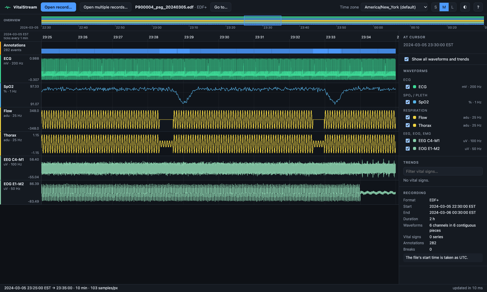
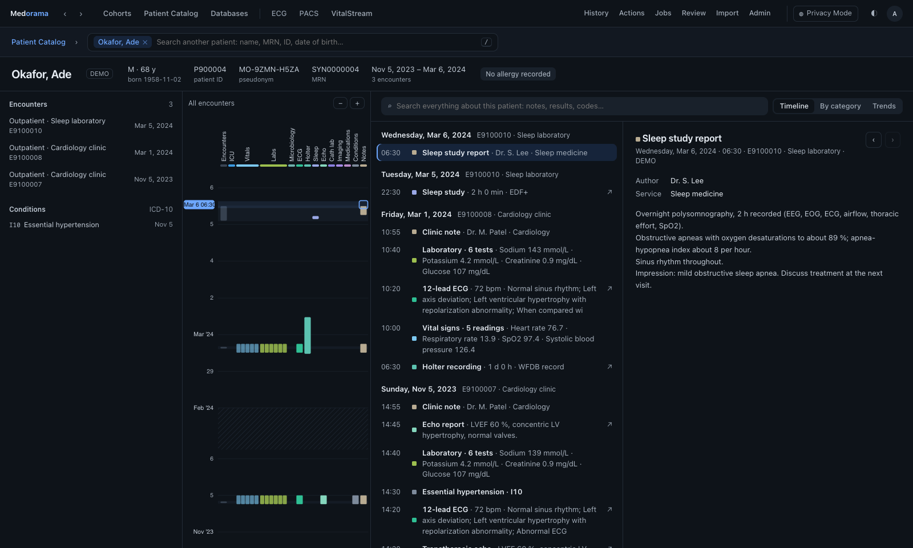

# EDF, EDF+ and BDF recordings

This page explains how Medorama, the VitalStream viewers and the ECG viewer read files of the
European Data Format (EDF) family, what they show, and how the patient identity stored in these
files is protected. Its first part is for users and data managers; its last part, the reading
rules, is the exact specification for anyone implementing or checking a reader.

EDF is a widely used open format for physiological recordings: sleep studies (polysomnography),
EEG, long-term ECG and many research datasets. Four variants are read directly, without an
add-on:

| Variant | Samples | What it adds |
|---|---|---|
| **EDF** | 16-bit | The original format ([Kemp et al., 1992](https://doi.org/10.1016/0013-4694(92)90009-7)). |
| **EDF+** | 16-bit | Annotations, and recordings with interruptions ([Kemp and Olivan, 2003](https://pubmed.ncbi.nlm.nih.gov/12948806/)). |
| **BDF** | 24-bit | The BioSemi variant of EDF, used by high-resolution EEG systems. |
| **BDF+** | 24-bit | BDF with the EDF+ extensions. |

The specifications are published at <https://www.edfplus.info/specs/>.

## Contents

- [Opening an EDF file](#opening-an-edf-file)
- [What you see in VitalStream](#what-you-see-in-vitalstream)
- [What you see in the ECG viewer](#what-you-see-in-the-ecg-viewer)
- [EDF files in Medorama: EEG and sleep studies](#edf-files-in-medorama-eeg-and-sleep-studies)
- [Patient identity in EDF files](#patient-identity-in-edf-files)
- [Limits](#limits)
- [Reading rules (for implementers)](#reading-rules-for-implementers)
- [Test files](#test-files)

## Opening an EDF file

An EDF file is one recording. A file is opened as EDF when its name ends in `.edf` or `.bdf`, in
any letter case. The built-in reader takes precedence over any adapter that lists these
extensions.

| Where | How |
|---|---|
| A VitalStream viewer (Rust, C++ or Python) | Choose **Open record…** and pick the file, or type its path in the dialog. |
| The ECG viewer | Choose **Open record…**, or drop the file on the page. **Open multiple records…** opens a folder and lists every ECG file in it and its subfolders, EDF files included, one at a time. |
| Medorama | List the file in an imported table, with its patient and a category ([importing.md, Files](importing.md#files)). With the category `eeg`, `sleep`, `holter` or `icu`, Medorama indexes it in the background and opens it in VitalStream from the patient's page. With the category `ecg`, it is an attachment, opened by the ECG viewer. |

## What you see in VitalStream

| In the file | In the viewer |
|---|---|
| Each ordinary signal | A channel, with the signal's label and physical dimension (`ECG`, `mV`). |
| Samples per data record ÷ duration of a data record | The channel's sampling rate. Signals may have different rates. |
| Digital values | Physical values, scaled with the signal's physical and digital minimum and maximum. |
| The start date and time in the header | The time axis. The time is taken as UTC, since EDF does not state a time zone. |
| EDF+ and BDF+ annotations | Events in the **Annotations** lane, with their text and duration. Hover over one to read it. |
| An interrupted recording (EDF+D) | One stretch of data per uninterrupted run, with a break between runs ("not recorded"). |
| A second signal with the same label | A channel named with its count: `ECG (2)`. |

The **Recording** panel shows the format as `EDF`, `EDF+`, `BDF` or `BDF+`, and the notes that
apply, for example when a file ends partway through a data record.



## What you see in the ECG viewer

The ECG viewer ([viewers/ecg/edf.js](../viewers/ecg/edf.js)) draws a 12-lead-style ECG on paper,
so it reads a short span of the file:

- **The leads** are the ordinary signals at the sampling rate of the first ECG signal (a signal
  labelled `I` … `V6`, or starting with `ECG` or `EKG`). A file without one uses the signals at
  the most common rate. Other signals are left out, and a note lists them.
- **The span** is the first 10 seconds of the recording's first uninterrupted part. An
  interrupted (EDF+D) file is read up to its first break, with a note.
- **Annotations** within that span are listed as notes, with their times from the start of the
  span: at most 100, then a count of the others.
- **The header's identification fields** are never read, with one exception: the four year
  digits of an EDF+ recording field's `Startdate dd-MMM-yyyy`, which date the recording.
- The page names the format (`EDF`, `EDF+`, `BDF`, `BDF+`) and the signals' filters when they
  share one.

## EDF files in Medorama: EEG and sleep studies

Medorama has two recording categories for these files, **EEG** (`eeg`) and **Sleep** (`sleep`),
beside ICU and Holter ([medorama/src/categories.rs](../medorama/src/categories.rs)). Each is a
column of the patient page's journey, and its recordings open in VitalStream. A table's
`category` column, the import's category, or its file name (`eeg`, `polysomnography`, `psg`,
`sleep study` …) chooses the category ([importing.md, Categories](importing.md#categories)).

The demo made by `tools/make-demo-data.py` includes an overnight sleep study for patient P900004:
a two-hour EDF+ file (`sleep/P900004_psg_20240305.edf`) with EEG, EOG, ECG, airflow, thoracic
effort and SpO2 signals, and its scoring (sleep stages and events) as annotations. Its table,
`sleep_index.csv`, links it to the patient's sleep-laboratory encounter (a recording reaches a
patient's page through an encounter):

```csv
patient_id,encounter_id,time,study,category,file
P900004,E9100010,2024-03-05 22:30,Polysomnography,sleep,../sleep/P900004_psg_20240305.edf
```



## Patient identity in EDF files

An EDF header has two identification fields of 80 characters each:

- **Local patient identification.** EDF+ structures it as `code sex birthdate name`, for example
  `MCH-0234567 F 02-MAY-1951 Haagse_Harry`, with `X` for any part that is unknown.
- **Local recording identification.** EDF+ structures it as
  `Startdate dd-MMM-yyyy admincode technician equipment`.

These fields often hold protected health information (PHI), so they are handled as follows.

- **The index never contains them**, and neither does anything the viewers send to the browser:
  VitalStream and the ECG viewer do not show them, in Medorama or on their own.
- **Medorama's `identify` action reads them** (`from_edf` in
  [medorama/src/identify.rs](../medorama/src/identify.rs);
  [administration.md, Identifiers in recordings](administration.md#identifiers-in-recordings)).
  It stores the code, sex, birth date, name and admin code in the catalog's identifier tables,
  next to the database's own values, so that an administrator can check that the file belongs to
  the patient it is linked to. A plain EDF patient field, which has no structure, is kept whole as
  the code. These values are shown only to users with the PHI permission, like every other
  identifier ([security.md](security.md)).
- **EDF+ annotations are free text**, and an annotation could name a person. In Privacy Mode,
  VitalStream receives them as Medorama treats clinical notes: when Privacy Mode withholds notes'
  text, each annotation reads `[Annotation]`; otherwise the patient's own names and date of birth
  are replaced, and the gate's last layer replaces the identifiers it knows and moves dates back
  (`gate_annotations` in [medorama/src/gateway.rs](../medorama/src/gateway.rs)).
- **In Privacy Mode, the privacy gate serves EDF and BDF files de-identified** when the browser
  asks for the file itself (an ECG attachment, for example). The rewrite is `edf_header` and
  `edf_annotations` in [medorama/src/deid.rs](../medorama/src/deid.rs), applied by
  `edf_deidentified` in [medorama/src/server.rs](../medorama/src/server.rs):

  | Part of the file | In Privacy Mode |
  |---|---|
  | Patient field | `X X X X`, EDF+'s form for an anonymous patient. |
  | Recording field | EDF+ and BDF+: `Startdate dd-MMM-yyyy X X X`, with the date moved back. Plain EDF and BDF, whose field is free text: blank. |
  | Start date and time | Moved back by the session's date offset, when Privacy Mode moves dates. A plain EDF file whose moved date falls outside 1985–2084, which its two-digit year cannot express, states no start. |
  | Annotation texts | Removed. Each data record keeps its time-keeping annotation (its onset), so the file's timing stays whole. |
  | Samples | Sent as they are. |
  | Bytes after the last whole data record | Left out, when the file has annotation signals. |

  A file with annotation signals is rewritten in memory, so an EDF+ file with annotations that is
  larger than 64 MB is refused in Privacy Mode; VitalStream still shows it through the gate.

To share EDF files outside the institution, de-identify them first.

## Limits

- **VitalStream: folders of EDF files.** A folder is not yet opened as one session. VitalStream's
  **Open multiple records…** reads the WFDB records of a folder; open EDF files one at a time.
  The ECG viewer's **Open multiple records…** does list the EDF files of a folder.
- **Annotation-only files.** An EDF+ file that holds only annotations (some sleep-scoring files
  do) has no signal to draw and is refused. Its events cannot yet be shown over another file's
  signals.
- **The ECG viewer reads 10 seconds**, of the first uninterrupted part, at one sampling rate.
  Open long recordings in VitalStream.
- **At most 100,000 pieces.** Each run of an EDF+D file makes one piece per signal. A file whose
  runs would make more than 100,000 pieces (an EDF+D file of many short, separate data records)
  is refused with a message that says so
  ([index-format.md, Limits](../viewers/vitalstream/docs/index-format.md#limits)).

## Reading rules (for implementers)

The Rust engine ([`libs/engine/src/sources/edf.rs`](../libs/engine/src/sources/edf.rs)), the C++
engine (`viewers/vitalstream/cpp/engine/src/sources_edf.cpp`) and the Python viewer
(`viewers/vitalstream/python/vitalstream/vitalstream_py/sources/edf.py`) implement these rules.
Three implementations reading the same file must write byte-identical indexes
([index-format.md, Conformance](../viewers/vitalstream/docs/index-format.md#conformance)). A
300 MB EDF+ file of 28,800 data records is indexed in about 0.5 to 1 second by each of them.

**Header.**
- Fixed part: 256 bytes; then 256 bytes per signal, each field written for every signal in turn
  (labels, transducers, physical dimensions, physical minima, physical maxima, digital minima,
  digital maxima, prefilters, samples per data record, reserved).
- A field is its bytes read as Latin-1, with surrounding whitespace removed (Python's
  `str.strip()`).
- Version field: `0` for EDF; for BDF, byte `0xFF` followed by `BIOSEMI`. Anything else is
  refused ("not an EDF or BDF file").
- The reserved field, once stripped, starts with `EDF+C`, `EDF+D`, `BDF+C` or `BDF+D` for EDF+
  and BDF+.
- The number of header bytes must be `256 × (number of signals + 1)`, with at least one signal.
- Integer fields (the number of header bytes, the number of data records, the number of signals,
  the samples per data record) are an optional sign and ASCII digits only.
- Other numbers are ASCII decimal numbers: an optional sign, digits, a decimal point, an
  exponent, with surrounding whitespace and underscores between digits as Python's `float()`
  accepts them (signal-core's `parse_float`). They must be finite.
- A signal labelled `EDF Annotations` or `BDF Annotations` is an annotation signal.
- Signals with zero samples per data record are left out.
- The duration of a data record must be positive when the file has an ordinary signal, and each
  ordinary signal's rate (its samples per data record divided by the duration) must be a finite
  number: a duration of `1e-320` s is refused ("signal … has no finite sampling rate").
- A `.edf` or `.bdf` file whose header cannot be read is still labelled `EDF` when browsing; it
  is refused when it is opened.

**Start time.**
- The date (`dd.mm.yy`) and the time (`hh.mm.ss`) are 8-byte fields. Positions 0–1, 3–4 and
  6–7 are ASCII digits; positions 2 and 5 are any character that is not an ASCII digit. A
  non-ASCII separator makes the field invalid.
- Two-digit years 85–99 are 1985–1999, and 00–84 are 2000–2084.
- In EDF+ and BDF+, when the recording field starts with `Startdate ` and its second word is
  11 bytes long and ends in four ASCII digits, those four digits are the year. Only the year is
  used: the day and the month always come from the header's date, and the second word's dashes
  and month are not checked. The header's year positions are then ignored (any two characters
  are accepted, typically `yy`, which EDF+ writes after 2084).
- The month must be 1–12, the day 1–31 (not checked against the month: 31.02 becomes March 2),
  the hour 0–23, the minute and second 0–59.
- The start, in Unix seconds, is that date and time taken as UTC.
- An invalid date or time means the file states no start. Times then count from 0, and every
  piece is marked untimed (`timed: false`).

**Data records.**
- Size: the sum of the samples per data record of all signals, × 2 bytes (EDF) or × 3 bytes
  (BDF).
- Samples are little-endian two's-complement integers.
- The number of records read is the number of whole records in the file after the header. When
  the header states a non-negative count smaller than that, only that many are read; the
  records beyond it are left out without a note.
- Bytes after the file's last whole record are left out, with a note.

**Physical values.**
- When `dmax ≠ dmin`: `pmin + (d − dmin) × ((pmax − pmin) / (dmax − dmin))`.
- When `dmax = dmin`: the digital value `d` itself.
- Computed in IEEE double precision, in exactly this order, without fused multiply-add. The
  envelopes store them as 32-bit floats.

**Time-stamped annotation lists (TALs).**
- An annotation signal's bytes in a data record are TALs, each ended by a zero byte; runs of
  zero bytes are padding.
- A TAL is `onset[\x15duration]\x14text\x14text\x14…`.
- Onset and duration are numbers read as above. A TAL whose onset is not valid UTF-8 or not a
  number is skipped. A duration that is not a number counts as none, and the TAL is kept.
- Each text is decoded as UTF-8, with invalid bytes replaced, and its whitespace runs are
  collapsed to single spaces (Python's `' '.join(text.split())`).

**Record onsets and runs.**
- In EDF+ and BDF+, a record's onset is the onset of the first TAL of the first annotation
  signal (its time-keeping annotation), even when that signal has 0 samples per data record.
- Otherwise, or when a record has no such TAL, a record starts where the record before it ends
  (the first one at 0).
- A record whose onset differs by more than 10⁻⁶ s from the end of the record before it starts a
  new **run**.
- Each run makes one piece per ordinary signal, in signal order, with
  `t0 = start + onset of the run's first record`.

**Annotations.**
- Every non-empty text of every TAL is an event: `t0 = start + onset`, and
  `t1 = t0 + duration` when the duration is positive, else `t1 = t0`. Its `level` is null and its
  `kind` is `annotation`.
- Annotation signals of plain EDF and BDF files also give events; they only do not keep time.
- Events are listed in the order of the file, then sorted by `t0` with a stable sort.

**The index** ([index-format.md](../viewers/vitalstream/docs/index-format.md)):
- `kind` is `edf`; `format` is `EDF`, `EDF+`, `BDF` or `BDF+`.
- **Channels:** one per ordinary signal, in signal order, created before any record is read.
  Each has `label` (repeated labels get ` (2)`, ` (3)` …), `unit` (the physical dimension) and
  `modality` `edf`.
- **Pieces:** besides the common keys (`id`, `ch`, `fs`, `n`, `t0`, `timed`, `env`), each piece
  has `sig` (the signal's position in the header, annotation signals included) and
  `data_record` (the run's first record), in that order.
- **Gaps:** between consecutive runs, when the next starts after the previous ends, with `t0`
  (the end of the previous run), `t1`, `reason` `not recorded`, `gap_s`, `exact` true,
  `measured_by` null and `notes` empty.
- **Alarms:** the events above.
- `vitals` and `marker_names` are empty, `skipped` is `{}`, and `reader` is `{}`.
- **Notes, in this order:**
  1. `The file's start time is taken as UTC.` or `The file states no valid start time: times
     are counted from its start, and marked "time not stated".`;
  2. then, when the header states more records than the file holds, `The header states N data
     records; the file holds M.`, or otherwise, when bytes follow the last whole record,
     `The file ends inside a data record: its last N bytes are left out.`
- A file with no ordinary signal, or with no whole data record, is refused.
- **The key:** a file's key, from its size and modification time
  ([index-format.md, The key](../viewers/vitalstream/docs/index-format.md#the-key)).

## Test files

[`viewers/vitalstream/testdata/edf/`](../viewers/vitalstream/testdata/edf) holds synthetic files
written by `viewers/vitalstream/testdata/generate.py`:

| File | Tests |
|---|---|
| `psg_plus.edf` | EDF+C: three signals at 250, 25 and 1 Hz; a first record 0.25 s after the header's time; annotations with and without a duration; an invented identity in the patient field, which must appear in no index file |
| `gappy_plus.edf` | EDF+D: records of 0.5 s in three runs, with breaks |
| `plain.edf` | EDF of 1999 (a two-digit year); the number of records unknown (`-1`); a record cut short at the end |
| `eeg_plus.bdf` | BDF+C: 24-bit samples; a signal whose digital range is zero |

They are checked by `libs/engine/tests/edf.rs`, by Medorama's `identify` and de-identification
tests, by the index parity test across the three viewers, and (for the ECG viewer) by
`viewers/ecg/tests/edf.test.js`.
