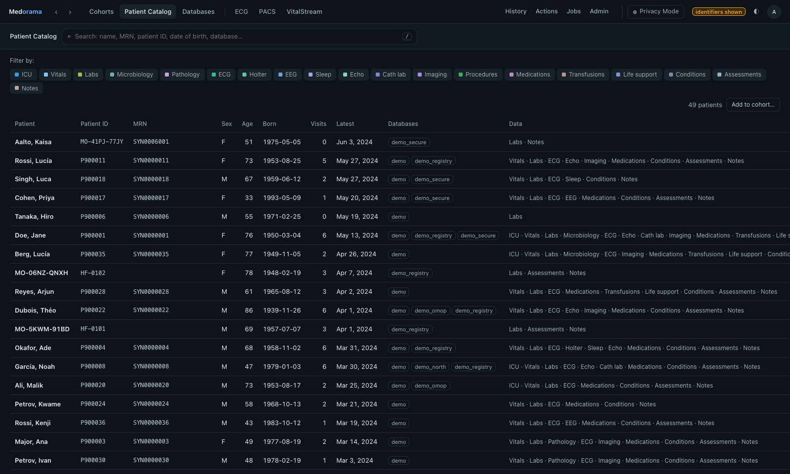
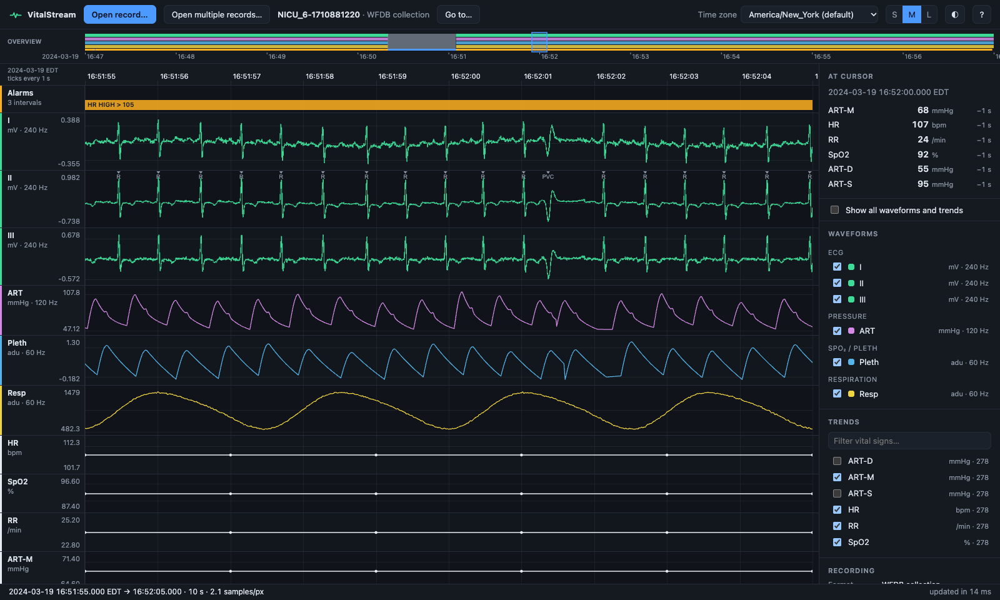
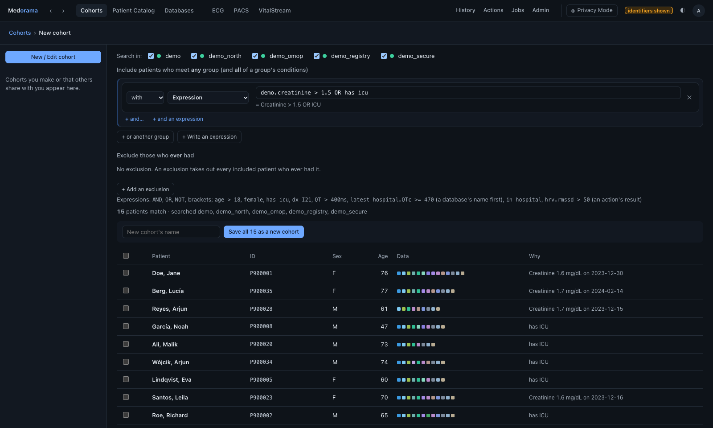
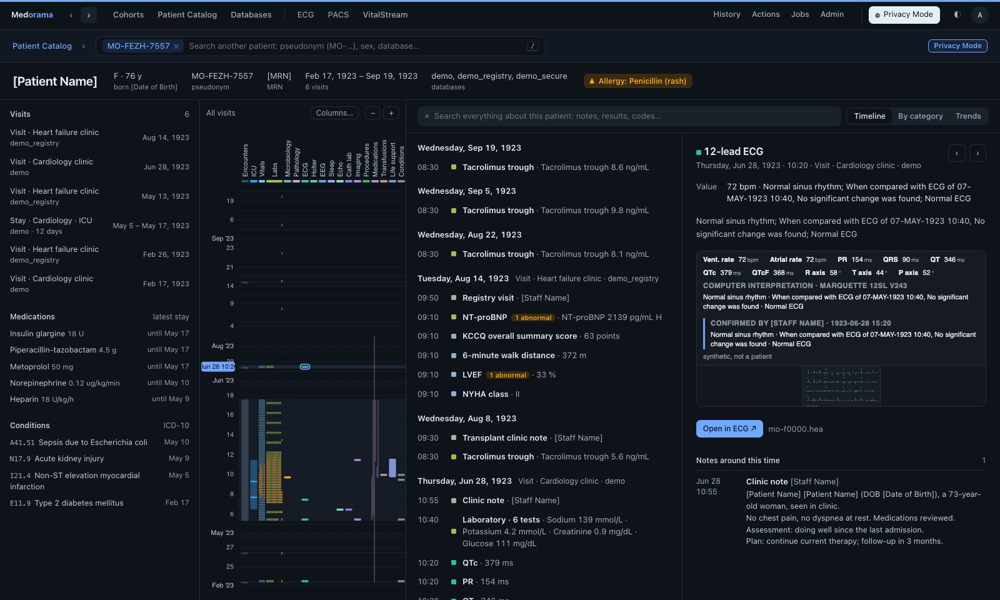

# Get started

This page takes a first-time user or an administrator from an empty computer to a running
Medorama with invented patients, and then through a short tour of what it does. It takes about
fifteen minutes, most of which is the build. Deploying Medorama for other people is covered
separately in [administration](administration.md), and [Install](install.md) gives the
commands for every operating system, for Medorama and for each viewer on its own.

- [What you need](#what-you-need)
- [Install Medorama with the demo](#install-medorama-with-the-demo)
- [Set Medorama up and start the server](#set-medorama-up-and-start-the-server)
- [Sign in](#sign-in)
- [A first tour](#a-first-tour)
- [Try the viewers on their own](#try-the-viewers-on-their-own)
- [Remove the demo](#remove-the-demo)
- [Next steps](#next-steps)

> **Research use only.** Medorama is research software, not a medical device. Try it on the
> demo first; put real patient data in it only on a server your institution has approved
> ([security review](security.md)).

## What you need

Medorama builds from source on Linux, macOS and Windows 10 or 11, without administrator rights
once the compilers are present. You need:

| | Linux | macOS | Windows |
|---|---|---|---|
| Git and Python 3.9 or later | `sudo apt install git python3 python3-venv` (Debian, Ubuntu) or `sudo dnf install git python3` (Fedora, RHEL) | `xcode-select --install` (the Command Line Tools) | `winget install Git.Git` and `winget install Python.Python.3.12` |
| A C compiler | `sudo apt install build-essential` or `sudo dnf install gcc` | the Command Line Tools | the Microsoft C++ Build Tools (workload "Desktop development with C++") |
| Perl, to build OpenSSL for SQLCipher (the encryption of Medorama's workspace) | `sudo apt install perl` or `sudo dnf install perl` | part of macOS | `winget install StrawberryPerl.StrawberryPerl` |
| Rust 1.88 or later | installed in your user account by the installer if it is missing | the same | the same |
| A web browser | any recent browser | the same | the same |

The [prerequisites](building.md#prerequisites) section gives the exact commands, including the
Build Tools command for Windows, and [building](building.md) covers machines without
administrator rights or without internet access.

## Install Medorama with the demo

Medorama imports nothing: it **connects databases** and reads them in place. The *demo* is six
such databases of about 40 invented patients, as three hospitals, a research registry and an ECG
archive would have them:
- `demo`, made with **db-builder** (the tool that turns tables, exports and folders of
  recordings into a database to connect): 40 patients with visits, ICU stays, laboratory
  results, vital signs, medications, transfusions, life support, procedures, diagnoses,
  assessments, microbiology, pathology and notes; ICU recordings, Holter ECGs, sleep studies
  (EDF+), EEGs (BDF+), 12-lead ECGs, X-rays, CT series, echo loops and coronary angiography;
- `demo_north`, a second hospital's db-builder database, which shares some of those patients
  (by MRN) and has one identity conflict;
- `demo_omop`, a third hospital's OMOP database;
- `demo_registry`, a research registry read through SQL views;
- `demo_muse`, an ECG archive of MUSE XML files, read through the views of its ECG metadata
  database;
- `demo_secure`, an encrypted db-builder database.

Every person in it is invented (pseudo names, `SYN` MRNs, invented dates). Its ECGs, CT series
and some X-rays are built from real recordings and public images transformed so that they show
no one ([tools/demo/README.md](../tools/demo/README.md)). It is meant for trying Medorama and is
off by default. It runs as **an installation of its own**, with its own home folder, workspace
and port: a demo installation connects demo databases only, and a site's installation never one
([design/demo.md](design/demo.md)).

The installer builds Medorama, db-builder, one VitalStream waveform viewer and the database tools
into a `.venv` folder inside the clone. This guide uses the Rust viewer (`--viewer rs`), which
needs nothing beyond Rust. The default, the C++ viewer, also needs a C++20 compiler.

**On Linux or macOS:**

1. Clone the repository and enter it:

   ```bash
   git clone https://github.com/alphanumericslab/medorama.git && cd medorama
   ```

2. Run the installer with the Rust viewer and the demo. It takes a few minutes:

   ```bash
   tools/install-medorama.sh --viewer rs --demo
   ```

3. Activate the environment. Do this in every new terminal:

   ```bash
   source .venv/bin/activate
   ```

**On Windows, in PowerShell:**

1. Clone the repository and enter it:

   ```powershell
   git clone https://github.com/alphanumericslab/medorama.git; cd medorama
   ```

2. Run the installer with the Rust viewer and the demo:

   ```powershell
   powershell -ExecutionPolicy Bypass -File tools\install-medorama.ps1 -Viewer rs -Demo
   ```

3. Activate the environment. Do this in every new PowerShell window:

   ```powershell
   .venv\Scripts\Activate.ps1
   ```

`tools/install-medorama.sh --help` lists the other options: `--viewer cpp|rs|py|none` chooses
the viewer, `--no-tools` leaves out the database tools, `--no-rustup` refuses to install Rust,
`--no-wfdb` builds without WFDB support, with no wfdb-x code
([building.md, Without WFDB](building.md#without-wfdb); not with the demo), and
`--accept-license` accepts the license terms without asking (for scripts). The Windows options
are `-Viewer`, `-NoTools`, `-NoRustup`, `-NoWfdb` and `-AcceptLicense`.

The installer first shows Medorama's license terms and asks you to accept them: type `y` or
`yes` to go on. Medorama is free for noncommercial use; commercial use needs a license from the
author ([building.md, License terms](building.md#license-terms)).

## Set Medorama up and start the server

`medorama init` sets Medorama up once. It makes a *home folder* (`--home`; by default
`~/.local/share/medorama`, or `%LOCALAPPDATA%\medorama` on Windows) with the settings, the
*control store* (Medorama's own database: users, grants, the audit log, the list of databases; no
patient data) and the *master key*, and a *workspace*: the folder where Medorama keeps what it
holds of each database (its patients as linked and their encounters, the names and units of its
variables, the recordings opened and their indexes) and the cohorts. Each database's files and each cohort's are encrypted with a key of
their own, the indexes included (the files that action plug-ins write are not: keep the
workspace on an encrypted disk).

1. Set the demo up as an installation of its own. The command asks twice for the password of
   the first administrator, who is named `admin`; use at least 10 characters. With `--demo`, it
   makes a *demo installation*: it connects the demo's six databases, which the installer made,
   adds its example action plug-in, and makes five example cohorts:

   ```bash
   medorama --home ~/medorama-demo init --workspace ~/medorama-demo-workspace --demo
   ```

   On Windows, write the folders as `$HOME\medorama-demo` and `$HOME\medorama-demo-workspace`.
   A demo installation is never the home that commands without `--home` reach: give
   `--home ~/medorama-demo` to every command for the demo.

2. Start the server, on a port of its own (8095, which `init --demo` gives it: a site's
   installation keeps 8090, so that both can be open at once, each with its own sign-in). It serves the web page and the API, checks the
   databases every minute, and indexes the recordings in the background (every recording of
   the demo):

   ```bash
   medorama --home ~/medorama-demo serve
   ```

3. Open <http://127.0.0.1:8095> in a browser on the same computer. A band on every page says
   that every patient there is invented, and the browser tab's title begins with "Demo".

**Your own databases** go into a site's installation, set up apart, without `--demo` (it
becomes the home commands reach without `--home`), on the default port 8090:

```bash
medorama init --workspace ~/medorama-workspace
db-builder add ~/study.sqlite patients.csv labs.csv --issuer HOSP --mrn-authority HOSP
medorama databases connect study --kind dbb --url sqlite:$HOME/study.sqlite
medorama serve                                   # http://127.0.0.1:8090
```

An OMOP database, or any SQL database through views, is connected the same way, from the command
line or from the page (Databases › **Connect a database**;
[administration](administration.md#connected-databases)). Connecting reads the persons, their
visits and the names of what the database holds; a patient's data and recordings are read when
the patient is opened ([what Medorama keeps](databases.md#what-medorama-keeps-of-a-database)).
A site's installation refuses the demo's databases, and the demo's installation refuses yours.

The server listens only on this computer (127.0.0.1) by default. To reach it from another
computer, use an SSH tunnel or an HTTPS reverse proxy, as described in
[administration](administration.md#deployment).

## Sign in

Sign in as `admin` with the password you chose. The administrator holds the *PHI permission*
(protected health information): the right to see identifiers such as names, medical record
numbers (MRNs) and dates of birth, of the databases on which the user holds the `phi` grant. The
administrator who connects a database is granted everything on it, so `admin` sees the demo's
invented names. For administrators, *Privacy Mode* starts off; for every other user, it starts
on. Other users see a database only once it is granted to them (its page, **Who may use it**).

Medorama opens on the **Cohorts** tab. The top bar has three ways to the patients (**Cohorts**,
**Patient Catalog**, **Databases**), the viewers (**ECG**, **PACS**, **VitalStream**), and the
work tabs at the right (**History**, **Actions**, **Jobs**, **Admin**).
The **Privacy Mode** switch and the theme button (◐) are at the far right.

## A first tour

### Find a patient

1. Open **Patient Catalog**. It lists the patients of the databases you may view (49 in the
   demo), with the databases and the kinds of data each one has. Many are in more than one
   database: Jane Doe is in `demo`, `demo_registry` and `demo_secure`.
2. Click **Doe, Jane** (patient ID `P900001`). You can also type a name, MRN or patient ID in the
   search line.

**Databases** lists the six demo databases, each with a green dot (online; grey would be
offline), what it holds, its variables and who may use it.



### Read the Patient Journey

A patient's page shows everything known about the patient on one time line.


- The **patient bar** at the top shows the name, sex, age, patient ID, pseudonym, MRN and the dates
  of the first and latest data; at its right end, the databases the data come from.
- Four columns follow, and each fact appears once among them:
  1. **Visits**: the current status: the allergies first, the visits, the latest stay's
     medications, the conditions.
  2. The **Patient Journey** draws every item, from every database that holds the patient, on
     one time line, newest at the top, with one column per clinical category (ICU, Vitals, Labs,
     ECG, Holter, Imaging, Medications and so on). ICU stays appear as light bars with their
     recordings over them. Hover over a mark to see what it is, and click it to open it.
  3. **What was done** lists one line per thing done, by day, by name only: a laboratory panel
     named by its tests, a day's vital signs, an ECG with its measurements. The search box
     above it searches everything the patient has, for example `lactate > 4` or `ecg icu`.
  4. The **detail** shows everything about the thing chosen: values, ranges, text, files.

### Open an ECG and a recording

1. In **What was done**, click a **12-lead ECG** line. The detail shows the tracing, the
   statements (those new since the patient's previous ECG marked **new**, and the previous one's
   no longer said under **no longer**), and each measurement as a tile with its change since the
   previous ECG and its trend. ‹ and › step to the patient's other ECGs.
2. Click **Open in ECG**. The ECG opens in the **ECG** tab on standard paper (25 mm/s,
   10 mm/mV), where you can switch layouts and measure with calipers.
3. Return to the patient with **‹ Patient** or the browser's Back button.
4. In the Journey, click a recording in the ICU column. The detail shows the recording's main
   vital signs. Click in that chart to open the recording in **VitalStream** at that moment.



In VitalStream, zoom with the mouse wheel from the whole stay down to single samples. The demo
patient Ade Okafor (`P900004`) also has a 24-hour Holter and an overnight EDF+ sleep study, whose
annotations appear in VitalStream's **Annotations** lane ([EDF recordings](edf.md)).

The first time you open a recording, it may still be indexing. Its status appears in the
**Jobs** tab.

### Build a cohort

A *cohort* is a named set of patients, found across the databases by criteria and kept.

The demo comes with five example cohorts: *ICU stays* (`icu`), *Long QTc*
(`demo_muse.QTc > 450 ms`), *Long QTc since 2022* (the same, from 2022-01-01), *Women over 65 with an ECG* (`female AND age > 65 AND has ecg`) and
*Sepsis* (`dx sepsis`). Open one from **Cohorts**, or make your own:

1. Open **Cohorts** and click **New / Edit cohort**. **Search in** ticks the databases to search
   (none ticked: every one you may search).
2. Click **+ Write an expression** and type `has ecg AND female`. The patients found, and why
   each one matched, appear below as you type, with the databases searched and those left out.
3. Type a name in **New cohort's name** and click **Save … as a new cohort**. With no patient
   ticked, every patient found is saved; after ticking a page, **Tick all N** ticks every one.



Expressions can combine results, ECG measurements, diagnoses, medications, age, sex and text,
for example `QTc > 470ms`, `dx I21` or `medication heparin`. The
[user guide](user-guide.md#cohorts) lists the whole syntax.

### Turn on Privacy Mode

*Privacy Mode* shows the same data without any identifier. The server, not the browser, removes
the identifiers, so none of them reaches the page.

1. Click **Privacy Mode** at the right of the top bar.
2. Look at Jane Doe's page again.



What changes:

- The name becomes `[Patient Name]`, the MRN `[MRN]` and the date of birth `[Date of Birth]`.
- Patient IDs and visits are replaced by *pseudonyms*: random codes such as `MO-D5QM-Y1X5`
  for a patient and `MO-E-QMC6-E2VA` for a visit.
- Every date moves back by the same number of days for this patient, so the intervals between
  events stay the same.
- File names become tokens such as `mo-f0000.hea`, and files are de-identified before they
  leave the server.
- Staff names in notes become `[Staff Name]`, and searches by name or MRN are refused.

A user without the PHI permission always works this way. To see it yourself, add such a user
from a second terminal (with the environment activated); the command asks for the new user's
password. Then sign in as that user in a private browser window:

```bash
medorama --home ~/medorama-demo user add --role viewer reader
for d in demo demo_north demo_omop demo_registry demo_muse demo_secure; do medorama --home ~/medorama-demo databases grant $d reader view; done
```

[Protecting patient data](protecting-patient-data.md) explains how the privacy gate works and
what it cannot clean (for example, text burned into images).

### Switch the theme

The ◐ button switches the page between the light and the dark theme. Until you choose, the page
follows your system's setting, and the viewers in its tabs follow the page.

## Try the viewers on their own

Each viewer is also a program of its own, without Medorama:

- **On the website.** The ECG viewer and the PACS viewer run in your browser at
  <https://medorama.org/viewers/ecg/> and
  <https://medorama.org/viewers/pacs/>. Files you open there are read in
  your browser and never leave your computer. Synthetic examples are linked from their pages.
- **On your computer.** VitalStream installs alone with `viewers/vitalstream/install.sh` (on
  Windows, `viewers\vitalstream\install.ps1`), and the ECG and PACS viewers open from disk.

[The viewers](../viewers/README.md) explains how to install, run and protect each one.

## Remove the demo

The demo is an installation of its own, and stays one: it never becomes a site's installation,
and nothing of it is in yours. When you are done with it, stop its server and delete its home
folder and its workspace (`~/medorama-demo` and `~/medorama-demo-workspace` above). The demo's
databases and files stay where the installer wrote them, so a new demo installation can be made
again later ([administration, The demo](administration.md#the-demo)). Real data go into a
site's installation, set up apart with `medorama init` ([above](#set-medorama-up-and-start-the-server)).

An installation set up before 0.3.1 that connects both the demo's databases and real ones is
refused until the databases of one kind are removed (`medorama databases remove NAME`, each of
the demo's six); the demo is then made as its own installation.

To uninstall, delete the clone ([building](building.md#update-and-uninstall)).

## Next steps

| You are | Continue with |
|---|---|
| A researcher or clinician | The [user guide](user-guide.md) and the [user's manual](user-manual/medorama-user-manual.pdf) |
| An administrator | [Administration](administration.md): settings, connected databases, grants, keys, users and roles, deployment as a service, backups |
| A security or privacy reviewer | [Security and privacy](security.md), [architecture](architecture.md), [protecting patient data](protecting-patient-data.md) and [sign-in](sign-in.md) |
| A data manager | [Databases](databases.md): what a database must provide, connecting OMOP or SQL databases; [db-builder](../db-builder/README.md) and [importing](importing.md): tables, exports and folders of recordings made into a database, and the columns it recognizes |
| An integrator or developer | [Readers and data models](readers.md), [adapters](adapters.md), the [HTTP API](api.md) and [developing](developing.md) |

The [documentation index](README.md) lists every page.
