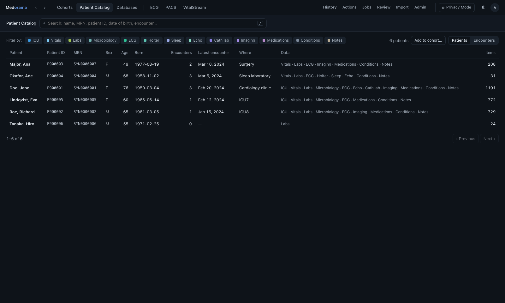
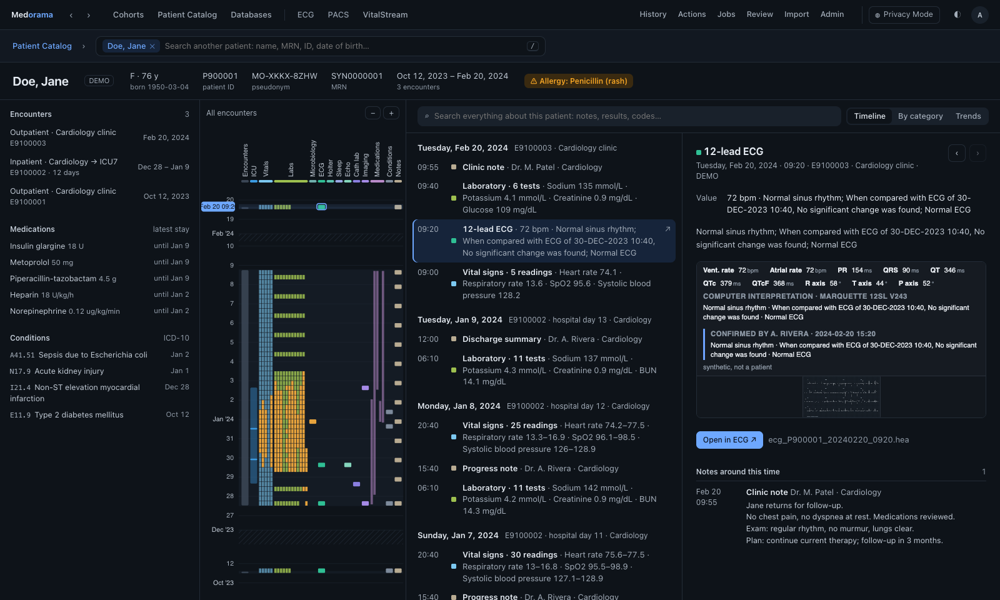
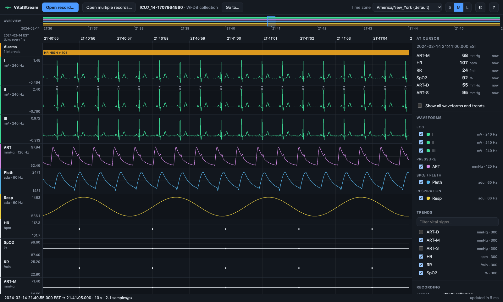
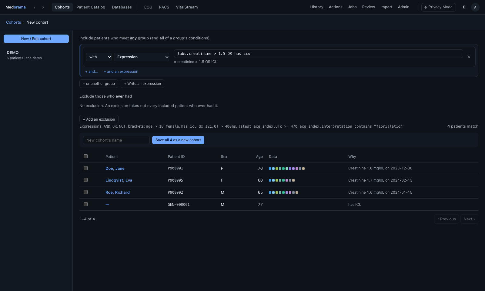
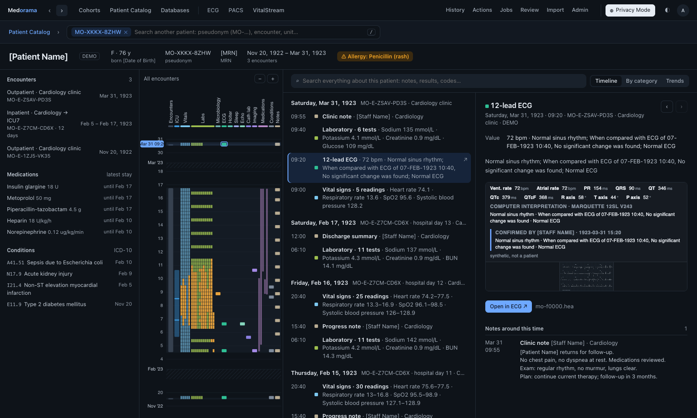

# Get started

This page takes a first-time user or an administrator from an empty computer to a running
Medorama with invented patients, and then through a short tour of what it does. It takes about
fifteen minutes, most of which is the build. Deploying Medorama for other people is covered
separately in [administration](administration.md), and [Install](install.md) gives the
commands for every operating system, for Medorama and for each viewer on its own.

- [What you need](#what-you-need)
- [Install Medorama with the demo](#install-medorama-with-the-demo)
- [Create the catalog and start the server](#create-the-catalog-and-start-the-server)
- [Sign in](#sign-in)
- [A first tour](#a-first-tour)
- [Try the viewers on their own](#try-the-viewers-on-their-own)
- [Remove the demo](#remove-the-demo)
- [Next steps](#next-steps)

> **Research use only.** Medorama is research software, not a medical device. Try it on the
> demo first; put real patient data in it only on a server your institution has approved
> ([security review](security.md)).

## What you need

Medorama builds from source on Linux, macOS and Windows 10 or 11, without administrator rights
once the compilers are present. You need:

| | Linux | macOS | Windows |
|---|---|---|---|
| Git and Python 3.9 or later | `sudo apt install git python3 python3-venv` (Debian, Ubuntu) or `sudo dnf install git python3` (Fedora, RHEL) | `xcode-select --install` (the Command Line Tools) | `winget install Git.Git` and `winget install Python.Python.3.12` |
| A C compiler | `sudo apt install build-essential` or `sudo dnf install gcc` | the Command Line Tools | the Microsoft C++ Build Tools (workload "Desktop development with C++") |
| Rust 1.88 or later | installed in your user account by the installer if it is missing | the same | the same |
| A web browser | any recent browser | the same | the same |

The [prerequisites](building.md#prerequisites) section gives the exact commands, including the
Build Tools command for Windows, and [building](building.md) covers machines without
administrator rights or without internet access.

## Install Medorama with the demo

The *demo* is a set of six invented patients with encounters, laboratory results, vital signs,
medications, notes, short ICU recordings, a 24-hour Holter, an overnight sleep study (EDF+),
12-lead ECGs, X-rays, CT series, echo loops and a coronary angiography run. Everything in it is
synthetic. It is meant for trying Medorama and is off by default.

The installer builds Medorama, one VitalStream waveform viewer and the database tools into a
`.venv` folder inside the clone. This guide uses the Rust viewer (`--viewer rs`), which needs
nothing beyond Rust. The default, the C++ viewer, also needs a C++20 compiler.

**On Linux or macOS:**

1. Clone the repository and enter it:

   ```bash
   git clone https://github.com/alphanumericslab/medorama.git && cd medorama
   ```

2. Run the installer with the Rust viewer and the demo. It takes a few minutes:

   ```bash
   tools/install-medorama.sh --viewer rs --demo
   ```

3. Activate the environment. Do this in every new terminal:

   ```bash
   source .venv/bin/activate
   ```

**On Windows, in PowerShell:**

1. Clone the repository and enter it:

   ```powershell
   git clone https://github.com/alphanumericslab/medorama.git; cd medorama
   ```

2. Run the installer with the Rust viewer and the demo:

   ```powershell
   powershell -ExecutionPolicy Bypass -File tools\install-medorama.ps1 -Viewer rs -Demo
   ```

3. Activate the environment. Do this in every new PowerShell window:

   ```powershell
   .venv\Scripts\Activate.ps1
   ```

`tools/install-medorama.sh --help` lists the other options: `--viewer cpp|rs|py|none` chooses
the viewer, `--no-tools` leaves out the database tools, `--no-rustup` refuses to install Rust,
and `--no-wfdb` builds without WFDB support, with no wfdb-x code
([building.md, Without WFDB](building.md#without-wfdb); not with the demo). The Windows options
are `-Viewer`, `-NoTools`, `-NoRustup` and `-NoWfdb`.

## Create the catalog and start the server

The *catalog* is Medorama's own database: its patients, their encounters and data, the links to
their files, and the users. It lives in a home folder (by default `~/.local/share/medorama`, or
`%LOCALAPPDATA%\medorama` on Windows). Results and indexes go to a separate results folder.

1. Create the catalog. The command asks twice for the password of the first administrator, who
   is named `admin`; use at least 10 characters. Because the installer made the demo, `init`
   also loads it into a cohort named **DEMO**:

   ```bash
   medorama init --results ~/medorama-results
   ```

   On Windows, write the folder as `$HOME\medorama-results`.

2. Start the server. It serves the web page and the API, and indexes the demo's recordings in
   the background:

   ```bash
   medorama serve
   ```

3. Open <http://127.0.0.1:8090> in a browser on the same computer.

The server listens only on this computer (127.0.0.1) by default. To reach it from another
computer, use an SSH tunnel or an HTTPS reverse proxy, as described in
[administration](administration.md#deployment).

## Sign in

Sign in as `admin` with the password you chose. The administrator holds the *PHI permission*
(protected health information): the right to see identifiers such as names, medical record
numbers (MRNs) and dates of birth. For administrators, *Privacy Mode* starts off, so the demo's
invented names are visible. For every other user, Privacy Mode starts on.

Medorama opens on the **Cohorts** tab. The top bar has three ways to the patients (**Cohorts**,
**Patient Catalog**, **Databases**), the viewers (**ECG**, **PACS**, **VitalStream**), and the
work tabs at the right (**History**, **Actions**, **Jobs**, **Review**, **Import**, **Admin**).
The **Privacy Mode** switch and the theme button (◐) are at the far right.

## A first tour

### Find a patient

1. In **Cohorts**, open the cohort **DEMO** in the list. It holds the six demo patients.
2. Click **Doe, Jane** (patient ID `P900001`).

You can also open **Patient Catalog**, which lists every patient with the kinds of data each
one has, and type a name, MRN or patient ID in its search line.



### Read the Patient Journey

A patient's page shows everything known about the patient on one time line.



- The **patient bar** at the top shows the name, sex, age, patient ID, pseudonym, MRN, the span
  of the data and any allergies.
- The **Patient Journey** on the left draws every item on one time line, newest at the top, with
  one column per clinical category (ICU, Vitals, Labs, ECG, Holter, Imaging, Medications and so
  on). ICU stays appear as light bars with their recordings over them. Hover over a mark to see
  what it is, and click it to open it.
- The **report** in the center lists the entries by day. The search box above it searches
  everything the patient has, for example `lactate > 4` or `ecg icu`.
- The **detail** on the right shows the selected entry.

### Open an ECG and a recording

1. In the report, click a **12-lead ECG** entry. The detail shows its measurements, the
   interpretation and a preview of the tracing.
2. Click **Open in ECG**. The ECG opens in the **ECG** tab on standard paper (25 mm/s,
   10 mm/mV), where you can switch layouts and measure with calipers.
3. Return to the patient with **‹ Patient** or the browser's Back button.
4. In the Journey, click a recording in the ICU column. The detail shows the recording's main
   vital signs. Click in that chart to open the recording in **VitalStream** at that moment.



In VitalStream, zoom with the mouse wheel from the whole stay down to single samples. The demo
patient Ade Okafor (`P900004`) also has a 24-hour Holter and an overnight EDF+ sleep study, whose
annotations appear in VitalStream's **Annotations** lane ([EDF recordings](edf.md)).

The first time you open a recording, it may still be indexing. Its status appears in the
**Jobs** tab.

### Build a cohort

A *cohort* is a named set of patients, found across every database by criteria and kept.

1. Open **Cohorts** and click **New / Edit cohort**.
2. Click **+ Write an expression** and type `has ecg AND female`. The patients found, and why
   each one matched, appear below as you type.
3. Type a name in **New cohort's name** and click **Save … as a new cohort**.



Expressions can combine results, ECG measurements, diagnoses, medications, age, sex and text,
for example `QTc > 470ms`, `dx I21` or `medication heparin`. The
[user guide](user-guide.md#cohorts) lists the whole syntax.

### Turn on Privacy Mode

*Privacy Mode* shows the same data without any identifier. The server, not the browser, removes
the identifiers, so none of them reaches the page.

1. Click **Privacy Mode** at the right of the top bar.
2. Look at Jane Doe's page again.



What changes:

- The name becomes `[Patient Name]`, the MRN `[MRN]` and the date of birth `[Date of Birth]`.
- Patient and encounter IDs are replaced by *pseudonyms*: random codes such as `MO-D5QM-Y1X5`
  for a patient and `MO-E-QMC6-E2VA` for an encounter.
- Every date moves back by the same number of days for this patient, so the intervals between
  events stay the same.
- File names become tokens such as `mo-f0000.hea`, and files are de-identified before they
  leave the server.
- Staff names in notes become `[Staff Name]`, and searches by name or MRN are refused.

A user without the PHI permission always works this way. To see it yourself, add such a user
from a second terminal (with the environment activated); the command asks for the new user's
password. Then sign in as that user in a private browser window:

```bash
medorama user add --role viewer reader
```

[Protecting patient data](protecting-patient-data.md) explains how the privacy gate works and
what it cannot clean (for example, text burned into images).

### Switch the theme

The ◐ button switches the page between the light and the dark theme. Until you choose, the page
follows your system's setting, and the viewers in its tabs follow the page.

## Try the viewers on their own

Each viewer is also a program of its own, without Medorama:

- **On the website.** The ECG viewer and the PACS viewer run in your browser at
  <https://medorama.org/viewers/ecg/> and
  <https://medorama.org/viewers/pacs/>. Files you open there are read in
  your browser and never leave your computer. Synthetic examples are linked from their pages.
- **On your computer.** VitalStream installs alone with `viewers/vitalstream/install.sh` (on
  Windows, `viewers\vitalstream\install.ps1`), and the ECG and PACS viewers open from disk.

[The viewers](../viewers/README.md) explains how to install, run and protect each one.

## Remove the demo

When you are done with the demo, an administrator deletes it:

1. Open **Cohorts › DEMO**.
2. Click **Delete…**. The page first shows what will be removed (patients, encounters, items and
   recordings), and then removes it all in one step.

The command `medorama demo remove` does the same from a terminal; `medorama demo remove
--dry-run` only reports what would go. The demo's files stay where the installer wrote them, so
`medorama demo add` can load the demo again later. Only the demo cohort removes its patients
when deleted: deleting any other cohort leaves its patients in the catalog. The
[demo](administration.md#the-demo) section of the administration guide gives the details.

To start again from nothing, stop the server and delete the catalog's home folder and the
results folder; to uninstall, delete the clone ([building](building.md#update-and-uninstall)).

## Next steps

| You are | Continue with |
|---|---|
| A researcher or clinician | The [user guide](user-guide.md) and the [user's manual](user-manual/medorama-user-manual.pdf) |
| An administrator | [Administration](administration.md): settings, PostgreSQL, users and roles, deployment as a service, backups |
| A security or privacy reviewer | [Security and privacy](security.md), [architecture](architecture.md), [protecting patient data](protecting-patient-data.md) and [sign-in](sign-in.md) |
| A data manager | [Databases](databases.md) and [importing](importing.md): the tables to export, the columns Medorama recognizes, connecting OMOP or SQL databases |
| An integrator or developer | [Readers and data models](readers.md), [adapters](adapters.md), the [HTTP API](api.md) and [developing](developing.md) |

The [documentation index](README.md) lists every page.
