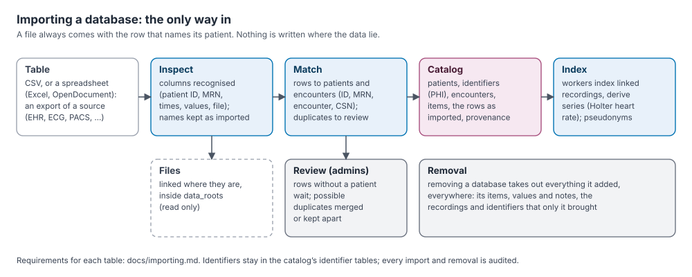

# Importing tables: reference

This page is the reference for importing tables into Medorama. It states which file types are
read, which column names Medorama recognizes for each kind of table, how rows are matched to
patients and encounters, and how times, identifiers, units, categories and files are read. It is
written for data managers and for the people who export data from a hospital's systems.

To choose how your data should reach Medorama (importing tables, connecting an OMOP or other SQL
database, or building a new database) and to follow a worked example from start to finish, read
[databases.md](databases.md) first. The settings mentioned here (`timezone`, `data_roots`,
`formats_dirs`) are described in [administration.md](administration.md#databases).



## Contents

- [How importing works](#how-importing-works)
- [Table format](#table-format)
- [Column reference](#column-reference)
  - [How column names are recognized](#how-column-names-are-recognized)
  - [Patients](#patients)
  - [Encounters](#encounters)
  - [Bed stays](#bed-stays)
  - [Results and measurements](#results-and-measurements)
  - [Medications](#medications)
  - [Conditions, procedures and allergies](#conditions-procedures-and-allergies)
  - [Notes and reports](#notes-and-reports)
  - [Files and recordings](#files-and-recordings)
  - [Measurement columns](#measurement-columns)
  - [All recognized column names](#all-recognized-column-names)
- [Categories](#categories)
- [Identifiers: patient IDs, MRNs and authorities](#identifiers-patient-ids-mrns-and-authorities)
- [How rows find their patients](#how-rows-find-their-patients)
- [Times and time zones](#times-and-time-zones)
- [Values, units and flags](#values-units-and-flags)
- [Files](#files)
- [Examples](#examples)
- [Importing](#importing)
- [After an import](#after-an-import)
- [Privacy](#privacy)
- [Checklist](#checklist)

## How importing works

Everything Medorama knows about patients comes from **databases**. In Medorama, a database is
either a table imported into the **catalog** (Medorama's own database of patients, encounters,
entries, users and settings) or a **connected database** that Medorama reads in place
([databases.md](databases.md)). This page is about imported tables.

- **Tables are exported from the institution's systems:** an EHR's patients, encounters, results
  and notes; an ECG management system's index; a PACS index; the bedside monitors' bed
  assignments. Each imported table appears as one database in the **Databases** tab, with its
  rows and columns as they came.
- **Files enter only through tables.** A recording, an ECG, a DICOM study or a PDF enters the
  catalog only as a row of a table, and that row names its patient. No file can be added on its
  own, so no file is ever without its patient.
- **Tables can come in any order.** A row whose patient or encounter no table has named yet
  waits, and is matched as soon as another import names them. There is one exception: a row
  that names only its encounter (no `patient_id`, no `mrn`) and holds no entry, such as a row of
  a table of bed stays by encounter, needs that encounter to be known already, from an earlier
  import or an earlier line of the same table. Otherwise it is refused with the message
  "no encounter … (import its encounters first)".
- **An import can be undone.** Removing an imported database removes everything it added, and
  nothing that another import also added: the links its rows gave recordings go, and a generated
  patient ID (`GEN-…`) that its rows replaced with a patient ID comes back, unless another
  database names the patient by that ID.
- **An import is all or nothing.** Imports run one at a time; one that starts while another runs
  waits (its progress says *waiting*). On SQLite, a table is stored a chunk of rows at a time, so
  that other changes (a page's edits, the audit log) are written between its chunks; until it
  ends, its database is *loading* in the imports list, and what only it adds is not shown on the
  pages, in cohorts or in exports. An import that stops part way (an error,
  a cancel, the server or the command stopped) is removed as a whole: at once, or when the
  catalog next starts. A CLIF folder is one import: a table that fails removes the folder's
  tables imported before it.

## Table format

| Property | Rule |
|---|---|
| File types | CSV (comma-separated, UTF-8, with or without a byte-order mark); Parquet (recognized by its content); Excel (`.xlsx`, `.xls`); OpenDocument (`.ods`). Of a spreadsheet, only the first sheet is read, and a spreadsheet larger than 100 MB is refused (it is read whole: save a larger table as CSV). |
| Encoding and separator | A file whose columns are separated by semicolons or tabs, a UTF-16 file, and a file that is not UTF-8 (Latin-1, Windows-1252) are refused, with a message that says which; they are not guessed at, so that no text is read wrongly. Save the table as CSV in UTF-8 ("CSV UTF-8" in Excel). |
| Header | The first row holds one name per column. When two columns would be read as the same catalog field (`value,value`), the first is; the other is kept as imported only, and the report says so. |
| Rows | One row per patient, encounter, bed stay, result, note or file, or several of these at once: one row may describe a patient, the patient's encounter and a result. Empty rows are skipped. |
| Cells | Text or numbers. Leading and trailing spaces are removed. An empty cell means "no value". |
| Size | Up to 1 GiB per upload in the web page. The command line has no limit, and reads CSV and Parquet files row by row. |
| Several files | Several files with exactly the same columns can be imported as one database (the page's **One database from these files** option, or several files given to `import-table` with `--name`). |
| Kept as imported | Every cell is kept under its column's own name. The Databases tab shows the table as it came. Column names are never changed. A table of more than 500 columns is kept whole too; criteria on its columns read its cells (slower) rather than a table of its numbers. |
| Warnings | A row that cannot be read is named by its line in its file (`line 12`; `b.csv, line 12` for a database of several files). |

## Column reference

### How column names are recognized

Medorama maps each column of a table onto one of its **catalog fields** (`patient_id`, `mrn`,
`time`, `value` and so on). It recognizes a column by its header:

1. Headers are compared ignoring case, spaces and punctuation: `Patient ID`, `patient_id` and
   `PATIENTID` are the same name.
2. A header that is a catalog field's own name is taken first. Then the other recognized names
   (synonyms) are tried. Each header is used for one field only.
3. A column named `unit` beside a `bed` column, in a table without a `value` column, is read as
   the care unit.
4. A column that is not recognized is kept under its own name and shown with the table (to users
   with the PHI permission). A column whose name carries a unit becomes a searchable number
   ([Measurement columns](#measurement-columns)).

When the names differ, map the columns once, by hand: in the Import tab (the mapping can be
saved and reused for later tables of the same shape), or with a mapping file on the command line
(`--mapping`, a TOML or JSON file of `catalog field = "header"`). When a mapping is given,
synonyms are not used: a header is read as a catalog field only if the mapping names it for that
field, or if the header is that field's own name (ignoring case) and the mapping names no other
header for that field.

The tables below list, for each kind of table, the columns that matter and the names they are
recognized by. Names are written in lower case without spaces or punctuation. **PHI** marks the
identifiers that Medorama keeps in its identifier tables and hides in Privacy Mode.

### Patients

A patients table names each patient and describes them. Each row needs at least one identifier.

| Catalog field | Required | Recognized names | Content |
|---|---|---|---|
| `patient_id` | `patient_id` or `mrn` | patientid, patient, subjectid, subject, pid, personid | The institution's or the study's patient identifier. |
| `mrn` | `patient_id` or `mrn` | mrn, medicalrecordnumber, medrecno, mrno | The medical record number (**PHI**). |
| `mrn_authority` | When several systems issue MRNs | mrnauthority, authority, assigningauthority | The system that issued the MRN ([Identifiers](#identifiers-patient-ids-mrns-and-authorities)). |
| `last_name` | No | lastname, surname, familyname | **PHI**. |
| `first_name` | No | firstname, givenname | **PHI**. |
| `birth_date` | No | birthdate, dob, dateofbirth | `YYYY-MM-DD`, `MM/DD/YYYY` or `YYYYMMDD` (**PHI**). |
| `sex` | No | sex, gender | `F`, `M`, or as written. |

Names, date of birth and sex describe a patient; they never identify one. When two imports give
different values for the same patient, the newest import's value is shown, and removing that
import brings back the earlier value.

### Encounters

An encounter is a hospital stay or a visit. A row creates or describes an encounter only when it
has an `encounter_id`; the encounter belongs to the row's patient.

| Catalog field | Required | Recognized names | Content |
|---|---|---|---|
| `encounter_id` | Yes | encounterid, encounter, visitid, visit, admissionid, hadmid, stayid | The encounter's identifier. |
| `patient_id` or `mrn` | Yes, for a new encounter | as above | The encounter's patient. |
| `csn` | No | csn, accountnumber, account, fin | The account or financial number (**PHI**). Entries of other tables can name the encounter by it. |
| `admit_time` | No | admittime, admit, admissiontime, admitted, admitdate, admissiondate | The start of the stay ([Times](#times-and-time-zones)). |
| `discharge_time` | No | dischargetime, discharge, dischtime, discharged, dischargedate | The end of the stay. |
| `admit_unit` | No | admitunit, admissionunit | The admitting unit or service. |
| `disposition` | No | disposition, dischargedisposition | The discharge disposition. |

`admit_time` and `discharge_time` matter: an entry that names only its patient is placed in the
encounter whose stay covers the entry's time.

### Bed stays

A bed stay is a stretch of an encounter spent in one bed of one care unit. Bed stays link
bedside-monitor recordings to their encounters, and a bed stay in an intensive-care unit makes
the stay appear in the **ICU** column of the patient page. Bed stays can be columns of an
encounters table (one row per bed stay, with the encounter repeated) or a table of their own.

| Catalog field | Required | Recognized names | Content |
|---|---|---|---|
| `encounter_id` | Yes | as above | The encounter the bed stay belongs to. |
| `care_unit` | Yes, unless `bed`, `bed_start` or `recording_file` is given | careunit, ward, location | The unit (`ICU7`, `MICU`). A unit whose name contains ICU, CCU, CICU or ITU, or the words "intensive" or "critical care", is an intensive-care unit. |
| `bed` | No | bed, bedlabel | The bed label. |
| `bed_start` | No | bedstart, intime, transferin | When the patient arrived in the bed. |
| `bed_end` | No | bedend, outtime, transferout | When the patient left it. |
| `recording_file` | No | recordingfile, recording, recordingname | A recording made during the bed stay, by its file name or path (any letter case). It links that recording to the encounter directly, instead of by bed and time. |

Recordings are linked to bed stays by bed and time: a recording whose file name starts with
`UNIT_BED` (BedMaster's `UNIT_BED-<Unix time>` names) is linked to the bed stay of that care unit
and bed whose times overlap the recording.

### Results and measurements

Results and measurements are laboratory results, vital signs, scores, ECG measurements and any
other dated value. In Medorama, they and all other dated items are **entries**, shown in the
patient page's journey and report.

| Catalog field | Required | Recognized names | Content |
|---|---|---|---|
| `patient_id`, `mrn`, `encounter_id` or `csn` | At least one | as above | The patient (and encounter) the entry belongs to ([How rows find their patients](#how-rows-find-their-patients)). |
| `name` | Yes (or `value`, `text` or `file`) | name, test, testname, item, parameter, label, drug, medication, description, notetype, type, study | What was measured: `Lactate`, `Heart rate`. |
| `time` | Recommended | time, datetime, charttime, date, timestamp, resulttime, collected, performed, starttime, start | When it was measured or collected. |
| `end_time` | No | endtime, end, stop, stoptime | The end, for anything that lasts. |
| `value` | No | value, result, valuenum, resultvalue, dose, amount, measurement | The result. A number is stored as a number; anything else as text. |
| `unit` | No | unit, units, uom, valueuom | The unit of the value (`mmol/L`). |
| `ref_low`, `ref_high` | No | reflow, low, lower, normallow, rangelow; refhigh, high, upper, normalhigh, rangehigh | The normal range. Must be numbers when given. |
| `flag` | No | flag, abnormal, abnormalflag | The abnormal flag ([Values, units and flags](#values-units-and-flags)). |
| `code`, `vocabulary` | No | code, icd, icd10, cpt, loinc, ndc, rxnorm; vocabulary, codesystem, system | A code and its vocabulary: `2524-7`, `LOINC`. |
| `category` | No | category, kind | The entry's category ([Categories](#categories)). |
| `domain` | No | domain | `measurement`, `drug`, `observation`, `condition`, `procedure` or `note`. Used to choose the category when none is given. |
| `service`, `author` | No | service, department, specialty; author, provider, clinician, physician | The service that produced the entry, and who wrote it. |

A row whose `name`, `value`, `text` and `file` are all empty holds no entry: it only describes
its patient or encounter.

### Medications

Medications use the same columns as results. Give the table the category `med`: with
`--category med`, the **Kind of data** choice in the page, a `category` column, or a file name
such as `medications.csv`.

| Catalog field | Content |
|---|---|
| `name` | The drug (`Norepinephrine`). |
| `time`, `end_time` | The start and end of the administration or infusion. |
| `value`, `unit` | The dose and its unit (`0.05`, `mcg/kg/min`). |
| `code`, `vocabulary` | For example an RxNorm code (`7512`, `RxNorm`). |

### Conditions, procedures and allergies

| Kind | Category | Columns |
|---|---|---|
| Conditions (diagnoses, problems) | `dx` | `name`, `code` and `vocabulary` (`A41.9`, `ICD10CM`), `time` (onset or diagnosis), `end_time` (resolution). Shown in the patient column of the patient page and in the journey. |
| Procedures | `proc` | `name`, `code` and `vocabulary` (`CPT`), `time`, `end_time`. |
| Allergies | `allergy` | `name` (the substance) and `text` (the reaction). Shown with the patient, in the patient bar, not as a journey column. |

### Notes and reports

| Catalog field | Required | Content |
|---|---|---|
| `patient_id`, `mrn`, `encounter_id` or `csn` | At least one | The note's patient and encounter. |
| `text` | Yes | The note's or the report's text. Recognized names: text, note, notetext, report, reporttext, interpretation, comment, comments, body, impression, reaction, finding, findings, conclusion. |
| `time` | Recommended | When it was written. |
| `name` | No | The type of note (`Progress note`, `Discharge summary`). |
| `author`, `service` | No | Who wrote it, and the service. |

Free text may name patients and staff. In Privacy Mode it is shown with the patient's own names
and date of birth replaced, or withheld, as the administrator chooses ([Privacy](#privacy)).

### Files and recordings

A row with a `file` column brings in a file: a recording, a 12-lead ECG, a DICOM study, a picture,
a video or a document.

| Catalog field | Required | Recognized names | Content |
|---|---|---|---|
| `patient_id` or `mrn` (or `encounter_id`) | Yes | as above | The file's patient. |
| `file` | Yes | file, path, filepath, image, link, filename | The file's path ([Files](#files)). |
| `time` | Recommended | as above | When the file was recorded or acquired. |
| `category` | Recommended | category, kind | Decides whether the file is a recording or an attachment, and which viewer opens it. |
| `name`, `text` | No | as above | The entry's name (default: the file's name without its extension) and a text such as an interpretation. |
| Measurement columns | No | `QTc (ms)`, `LVEF (%)` | Values that cohorts can search ([Measurement columns](#measurement-columns)). |
| Viewer hints | No | `pixel spacing (mm)`, `fps` | A picture's scale and a folder of pictures' frame rate ([Files](#files)). |

An ECG table, such as the one `muse-py index` writes, is a table of this kind: one row per ECG,
with its patient, its time, its measurements as columns, its interpretation and its file.

A **recording** (ICU monitoring, a Holter, an EEG, a sleep study) reaches its patient's page
through an encounter. Give the row's `encounter_id`, or let the recording find its encounter by
bed and time ([How rows find their patients](#how-rows-find-their-patients)). A recording that
belongs to no encounter is kept in the catalog's list of recordings but is shown on no patient's
page; a row that names a recording with its patient but no `encounter_id` says so in the import
report ("names no encounter_id: it is linked only by its bed and time, else to no patient").
The encounter a row gives its recording is a link of the import (method `file`), not a decision
by hand: removing the import removes the link, and a decision made by hand in Review wins over
it.

### Measurement columns

A column that is not one of the catalog fields becomes a **measurement column**, a number that
cohorts can search and compare, when its header names a unit or when it is a known ECG
measurement:

- **A unit in brackets:** `QT (ms)`, `LVEF (%)`, `Lactate [mmol/L]`. The unit is the text in the
  last pair of round or square brackets, at most 12 characters.
- **A known ECG measurement on its own**, in its usual unit:

  | Header | Unit |
  |---|---|
  | `Vent. rate`, `Ventricular rate`, `Atrial rate`, `Heart rate`, `HR` | bpm |
  | `PR`, `QRS`, `QT`, `QTc`, `QTcB`, `QTcF`, `RR` | ms |
  | `P axis`, `R axis`, `QRS axis`, `T axis` | ° |

These rules are in `measure_column` and the list `MEASURES` in
[medorama/src/tables.rs](../medorama/src/tables.rs). Cohorts compare a measurement column's
values in its unit (`QT > 0.4 s`).

### All recognized column names

This table is the complete list, grouped as the Import tab groups the fields (`GROUPS` and
`SYNONYMS` in [medorama/src/tables.rs](../medorama/src/tables.rs)).

| Group | Catalog field | Recognized names |
|---|---|---|
| Patient | `patient_id` | patientid, patient, subjectid, subject, pid, personid |
| | `mrn` | mrn, medicalrecordnumber, medrecno, mrno |
| | `mrn_authority` | mrnauthority, authority, assigningauthority |
| | `last_name` | lastname, surname, familyname |
| | `first_name` | firstname, givenname |
| | `birth_date` | birthdate, dob, dateofbirth |
| | `sex` | sex, gender |
| Encounter | `encounter_id` | encounterid, encounter, visitid, visit, admissionid, hadmid, stayid |
| | `csn` | csn, accountnumber, account, fin |
| | `admit_time` | admittime, admit, admissiontime, admitted, admitdate, admissiondate |
| | `discharge_time` | dischargetime, discharge, dischtime, discharged, dischargedate |
| | `admit_unit` | admitunit, admissionunit |
| | `disposition` | disposition, dischargedisposition |
| Location | `care_unit` | careunit, ward, location |
| | `bed` | bed, bedlabel |
| | `bed_start` | bedstart, intime, transferin |
| | `bed_end` | bedend, outtime, transferout |
| | `recording_file` | recordingfile, recording, recordingname |
| Item | `category` | category, kind |
| | `name` | name, test, testname, item, parameter, label, drug, medication, description, notetype, type, study |
| | `time` | time, datetime, charttime, date, timestamp, resulttime, collected, performed, starttime, start |
| | `end_time` | endtime, end, stop, stoptime |
| | `value` | value, result, valuenum, resultvalue, dose, amount, measurement |
| | `unit` | unit, units, uom, valueuom |
| | `ref_low` | reflow, low, lower, normallow, rangelow |
| | `ref_high` | refhigh, high, upper, normalhigh, rangehigh |
| | `flag` | flag, abnormal, abnormalflag |
| | `code` | code, icd, icd10, cpt, loinc, ndc, rxnorm |
| | `vocabulary` | vocabulary, codesystem, system |
| | `text` | text, note, notetext, report, reporttext, interpretation, comment, comments, body, impression, reaction, finding, findings, conclusion |
| | `author` | author, provider, clinician, physician |
| | `service` | service, department, specialty |
| | `domain` | domain |
| File | `file` | file, path, filepath, image, link, filename |
| Other | `source` | source (the row's source label; it overrides the import's `--source` for that row) |

## Categories

A **category** is a column of the patient page's journey and a group of its report. Categories
follow the way a physician reads a chart, not the systems the data came from: one table may fill
several categories, and several tables one. An entry's category comes from, in this order:

1. its row's `category` column;
2. the category chosen for the table (`--category`, or **Kind of data** in the Import tab);
3. the table's file name (`labs.csv`, `medications.xlsx`) or headers;
4. its `domain` and name: drugs are `med`, conditions `dx`, procedures `proc`, notes `note`,
   observations `obs`; a measurement named like a vital sign (`HR`, `SpO2`, `Temperature`) is
   `vit`, and any other is `lab`.

A category is written as its key, its label, or one of its words, in any letter case. The list
is `CATEGORIES` in [medorama/src/categories.rs](../medorama/src/categories.rs).

| Key | Label | Words that also name it |
|---|---|---|
| `icu` | ICU | intensive care, critical care, monitoring, bedside monitoring, waveforms, bedmaster |
| `vit` | Vitals | vital, vitals, vital signs, vital sign, flowsheet |
| `lab` | Labs | labs, laboratory, chemistry, hematology, coagulation, blood gas, blood gases |
| `micro` | Microbiology | microbiology, culture, cultures, sensitivity, sensitivities |
| `path` | Pathology | pathology, biopsy, biopsies, cytology, histology |
| `ecg` | ECG | ekg, 12-lead, 12 lead, electrocardiogram, muse |
| `holter` | Holter | ambulatory ecg, event monitor, patch monitor |
| `eeg` | EEG | electroencephalography, electroencephalogram, neurophysiology, ieeg, seeg |
| `sleep` | Sleep | sleep study, sleep studies, polysomnography, psg |
| `echo` | Echo | echocardiography, echocardiogram, tte, tee |
| `cath` | Cath lab | cath lab, catheterization, cardiac catheterization, angiography, angiogram, coronary angiography, xa, ivus, oct, pci |
| `img` | Imaging | imaging, radiology, ct, mri, x-ray, xray, ultrasound, dicom, pacs |
| `proc` | Procedures | procedure, procedures, surgery, operation, operations, cpt |
| `med` | Medications | meds, medication, medications, drug, drugs, mar, pharmacy |
| `blood` | Transfusions | blood, transfusion, transfusions, blood product, blood products, blood bank |
| `support` | Life support | life support, ventilation, ventilator, respiratory support, dialysis, crrt, ecmo |
| `dx` | Conditions | condition, conditions, diagnosis, diagnoses, problem, problems, problem list, icd |
| `obs` | Assessments | observation, observations, assessment, assessments, score, scores |
| `note` | Notes | note, notes, clinical note, clinical notes, document, documents, report, reports |
| `allergy` | Allergies | allergy, allergies, intolerance, intolerances |

The **recording categories** are `icu`, `holter`, `eeg` and `sleep`. Their files are recordings,
indexed in the background and opened in VitalStream, the waveform viewer. Files of the other
categories are attachments of their entry, opened by that category's viewer ([Files](#files)).

## Identifiers: patient IDs, MRNs and authorities

| Identifier | Rule |
|---|---|
| `patient_id` | Names one patient across all databases. It is compared exactly, as text. A patient ID that was merged into another one leads to that one. |
| `mrn` | Names a patient only together with its authority. MRNs are compared without surrounding spaces and ignoring letter case. A patient may have MRNs of several authorities. |
| `mrn_authority` | The system that issued the MRN (`HOSP`, `CLINIC`). An empty authority is the catalog's default one. Give it whenever MRNs from different systems could collide. |
| A patient known only by an MRN | Receives a generated patient ID, `GEN-…`, which stays the same for that MRN and is never given to another patient. |
| `encounter_id` | Names one encounter across all databases, compared exactly. An encounter belongs to one patient: a row that gives it to another patient is held back for review. |
| `csn` | An encounter's account number. Entries can name their encounter by it. |

A row is **held back for review** when its patient ID and MRN name two different patients, when
its MRN belongs to a patient with another patient ID, or when its patient already has another MRN
of the same authority. The Review tab shows it, and an administrator with the PHI permission
applies it (merging the patients, adding the MRN, moving the encounter) or dismisses it.

## How rows find their patients

- **A patient** is named by `patient_id` or `mrn` (with `mrn_authority` when MRNs come from
  several systems). Names, date of birth and sex describe the patient. Differences between
  tables are shown for review rather than overwritten
  ([administration.md, Patients and encounters across databases](administration.md#patients-and-encounters-across-databases)).
- **An encounter** is created by a row with an `encounter_id`, for the row's patient. Its `csn`
  is kept with it.
- **An entry** (a result, a note, a file) is matched by the first key it has:
  1. `encounter_id`: that encounter;
  2. `csn`: the encounter with that account number;
  3. `mrn` (else `patient_id`) and its `time`: the patient, and the patient's encounter whose
     admission and discharge cover that time. An entry of a known patient outside every
     encounter stays with the patient.

  An entry that matches nothing **waits**, with its keys, and is matched when a later import
  names its patient or encounter.
- **Recordings** also find their encounters by bed and time (`care_unit`, `bed`, `bed_start`,
  `bed_end`), by `recording_file`, or by their BedMaster file names (`UNIT_BED-<time>`).
- **The same entry twice:** a row identical to an entry already stored is not stored again. The
  entry is recorded as held by both imports, and stays until the last of them is removed.
- **Possible duplicates** (two IDs for one person) are listed in Review, where an administrator
  with the PHI permission merges them or marks them as different people.

## Times and time zones

| Written as | Read as |
|---|---|
| `2024-03-02T07:10:00-05:00`, `2024-03-02T12:10:00Z`, `2024-03-02 12:10:00+00:00` | That moment: the offset or `Z` is used. A space may replace the `T`. |
| `2024-03-02 07:10`, `2024-03-02 07:10:00`, `2024-03-02T07:10`, `03/02/2024 07:10`, `02.03.2024 07:10` | Local time in the catalog's time zone (`timezone` in `medorama.toml`; default `America/New_York`). Fractions of a second are allowed. |
| `2024-03-02`, `03/02/2024`, `02.03.2024` | Local midnight. |
| `1709381400` | Unix seconds. Only a number above 10^8 is a time; a smaller one is refused ("not a time"). A number of 10^11 or more is refused too: it counts milliseconds (divide it by 1000). |
| An Excel date | As Excel stores it, in local time. |
| A Parquet timestamp | An instant (`isAdjustedToUTC`), or a local time in the catalog's time zone when the column says it is not adjusted to UTC. |

- A date with slashes is read in the order the catalog writes its dates (Admin › Dates and
  times): day first (`03/02/2024` is February 3) when they are written day/month/year, else
  month first, the American way (`03/02/2024` is March 2). Choose that setting before importing
  tables with such dates. A date with dots (`02.03.2024`) is always day first.
- A year has its four digits: `03/02/24` is refused ("write the year with its four digits"),
  never read as the year 24. A time before 1900 or after 2200 is refused, and a date of birth
  before 1880 or in the future.
- CLIF's times are UTC: a CLIF table's time written without an offset is read as UTC, not in the
  catalog's time zone.
- A local time that a daylight-saving change skips is read with the offset after the change:
  02:30 on 2024-03-10 in New York is the moment shown as 01:30.
- Set `timezone` before the first import, since it decides how every local time is read
  (`parse_time` in [medorama/src/util.rs](../medorama/src/util.rs)).
- A time that cannot be read makes its row invalid; the import report names the line.

## Values, units and flags

- **Values:** a `value` that is a number (`4.1`, `-2`, `1e3`) is stored as a number and can be
  compared in cohorts; any other value (`positive`, `<0.5`) is stored as text.
- **Units:** write the unit as the source system does (`mmol/L`, `mg/dL`, `bpm`). Cohorts
  compare values in the unit a criterion names, converting between units where they can.
- **Normal ranges:** `ref_low` and `ref_high` must be numbers. A value outside them is shown as
  abnormal even without a flag.
- **Flags** set how a value is shown in the journey and the report (`level` in
  [medorama/src/patient/journey.rs](../medorama/src/patient/journey.rs)):

  | Shown as | Flags (any letter case) |
  |---|---|
  | Critical (orange) | `HH`, `LL`, `C`, `crit`, `critical`, `panic`, `AA`, `!` |
  | Abnormal (amber) | `H`, `L`, `A`, `abn`, `abnormal`, `high`, `low`, `pos`, `positive`, `R`, `resistant`, `detected` |
  | Normal | anything else, unless the value is outside its range |

## Files

- **Where the file is:** a `file` cell holds a path. On the command line, relative paths are read
  from the table's folder. When the catalog's `data_roots` setting (in `medorama.toml`) names
  folders, every file must lie inside one of them; these folders are the **data roots**. An
  empty `data_roots`, the default, allows any folder; on a server that holds real data, set it.
  Files are read where they are, never copied, moved or written.
- **A missing file**, or a file outside the data roots, is reported ("no such file", "is outside
  the configured data_roots") and left out; the rest of the row is imported.
- **Recording or attachment:** when the row's or the table's category is a recording category
  (`icu`, `holter`, `eeg`, `sleep`) or names none, a file Medorama can read as a recording
  becomes a **recording**:
  - a WFDB record (its `.hea` file; a multi-segment record whole), a folder of WFDB records (read
    with its subfolders as one session), or a WFDB collection ([wfdb-collection.md](wfdb-collection.md));
  - an EDF, EDF+, BDF or BDF+ file ([edf.md](edf.md));
  - a file that an installed **adapter** reads, such as BedMasterEx `.Stp` files with the
    stp-adapter add-on ([adapters.md](adapters.md); the stp-adapter is private and available to
    institutions under agreement).

  A recording without a category goes to the ICU column. Any other file is an **attachment** of
  its entry, opened by the category's viewer:

  | Category | Files | Opened in |
  |---|---|---|
  | ICU, Holter, EEG, Sleep | WFDB records, folders and collections; EDF, EDF+, BDF, BDF+; `.Stp` with the stp-adapter add-on | VitalStream |
  | ECG | WFDB (`.hea` with its signal files), GE MUSE XML, DICOM ECGs, EDF and BDF, the ECG viewer's JSON form, PNG, JPEG, PDF | the ECG viewer |
  | Echo, Cath lab, Imaging | DICOM files, a DICOM series' folder (files without an extension are recognized), videos, pictures, PDF | the PACS viewer |
  | Any other | pictures, videos and PDF | the entry's detail, on the patient page |

- **A recording that no installed reader reads** (for example a `.Stp` file before the
  stp-adapter add-on is installed) is skipped with a message, and nothing of it is kept. Once
  the add-on is installed, remove that import and import the table again
  ([adapters.md, Installing an add-on](adapters.md#installing-an-add-on)).
- **A Medorama built without WFDB support** ([building.md, Without WFDB](building.md#without-wfdb))
  skips a WFDB recording (a record, a folder of records or a collection) the same way, with the
  message "this build has no WFDB support (built without the `wfdb` feature)". A WFDB record
  attached to an ECG item still opens in the ECG viewer, which reads it in the page.
- **Privacy Mode:** the privacy gate sends only files it can de-identify or mark: WFDB headers and
  their `.dat` and `.mat` signal files, GE MUSE XML, DICOM, EDF and BDF files, pictures, videos
  and PDF. It refuses the rest: JSON ECGs, text files, and signal files with an extension other
  than `.dat` or `.mat` (`file_kind` in [medorama/src/gate.rs](../medorama/src/gate.rs)).
- **A WFDB record is its header:** a row whose file is a signal file (`.dat`, `.mat`) is skipped,
  with a warning that names the header to give in its place
  ([wfdb-collection.md](wfdb-collection.md#one-record)).
- **Hints for the viewers:** columns of the same row can give a picture's or a video's scale and
  a folder of pictures' frame rate. The first positive number of each kind counts:

  | Hint | Column names (ignoring case, spaces, punctuation) | Units |
  |---|---|---|
  | Scale, mm per pixel | `pixel spacing`, `pixel size`, `spacing`, `mm per pixel`, `mm/pixel`, `resolution` | none or `mm`, `mm/px`, `mm/pixel`; `cm`, `cm/px`, `cm/pixel` (× 10); `um`, `µm` (÷ 1000) |
  | Frame rate | `fps`, `frame rate`, `frames per second` | none or `fps`, `Hz`, `/s`, `1/s` |

  The unit is written in brackets, as for measurement columns (`pixel spacing (mm)`,
  `frame rate (Hz)`); another unit is ignored (`viewer_hints` in
  [medorama/src/patient/files.rs](../medorama/src/patient/files.rs)).
- **Tables made from the files themselves:** `dicom-py index FOLDER -o imaging.csv` and
  `muse-py index FOLDER -o ecg.csv` write a table with one row per DICOM series or ECG: its
  patient (in a column `mrn`), its time, its category, its measurements and its file
  ([viewers/README.md](../viewers/README.md)).

## Examples

A patients table:

```csv
MRN,Last Name,First Name,DOB,Sex,Patient ID
SYN0000001,Doe,Jane,1950-03-04,F,P900001
```

Encounters with their bed stays (one row per bed stay; the encounter repeats):

```csv
Encounter ID,Patient ID,CSN,Admit Time,Discharge Time,Admit Unit,Care Unit,Bed,Bed Start,Bed End
E9100002,P900001,9000000102,2023-12-28 07:40,2024-01-09 13:00,Cardiology,ICU7,12,2024-01-01 11:00,2024-01-03 11:00
```

Laboratory results, matched by MRN and encounter:

```csv
MRN,Encounter ID,Test Name,Result,Units,Ref Low,Ref High,Abnormal Flag,Collected,Code,Code System
SYN0000001,E9100002,Lactate,4.1,mmol/L,0.5,2,H,2024-01-02 06:10,2524-7,LOINC
```

An index of ECGs, with files and measurements:

```csv
patient_id,encounter_id,time,QT (ms),QTc (ms),interpretation,file
P900001,E9100002,2024-01-02 08:00,410,452,Sinus tachycardia,ecg/ecg_P900001_20240102.hea
```

ICU recordings (their encounters are also found by bed and time, and by BedMaster's file names,
`UNIT_BED-<Unix time>.Stp`):

```csv
patient_id,encounter_id,file
P900001,E9100002,icu/recording.Stp
```

A sleep study, an EDF+ file in the Sleep category (from the demo's `sleep_index.csv`):

```csv
patient_id,encounter_id,time,study,category,file
P900004,E9100010,2024-03-05 22:30,Polysomnography,sleep,../sleep/P900004_psg_20240305.edf
```

`tools/make-demo-data.py` writes a complete synthetic set of such tables and files for trying an
import end to end. The installers' `--demo` option loads it into a new catalog as a cohort named
DEMO ([administration.md, The demo](administration.md#the-demo)).

## Importing

**In the web page** (administrators):

1. Open **Import** › **Add a database** and keep **Import tables** selected.
2. Optionally choose the **Kind of data** (the category of the table's entries) and the
   **Format** (a known export, or recognition by the columns).
3. Drop the files, or choose them. For each file, Medorama shows the columns it recognized and
   those it did not. Map the others under **Columns**, and save the mapping if you will import
   tables of the same shape again.
4. Select **Preview all** to read and check every row without keeping anything. The report says
   what would be added, matched, held back and ignored.
5. Select **Import all**. The import runs on the server; its progress (rows, share done, time
   left) shows on the page and on the Import tab wherever you are. **Cancel** stops it and keeps
   nothing.

**On the command line**, `medorama import-table` imports one table, or several files with the
same columns as one database. The following commands show its common uses:

```bash
medorama import-table labs.csv                  # recognize the columns, import
medorama import-table labs.csv --dry-run        # check and count only; store nothing
medorama import-table notes.xlsx --category note
medorama import-table export.csv --mapping mapping.toml --source "EHR extract 2024-03"
medorama import-table part1.csv part2.csv --name "LIS 2024"   # several files, one database
medorama import-table muse.csv --format ge-muse-patient-id    # a known export, named
```

| Option | Meaning |
|---|---|
| `--mapping FILE` | Map columns by hand: a TOML or JSON file of `catalog field = "header"`, under `[columns]` or at the top level. |
| `--category KEY` | The category of the table's entries when it has no `category` column. |
| `--format KEY` | `auto` (the default: recognized by its columns), `none`, or a format's key (`medorama formats` lists them). |
| `--name NAME` | The database's name (default: the file's name). Required with several files. |
| `--source LABEL` | The rows' source label (default: the name). A `source` column overrides it per row. |
| `--dry-run` | Read and check every row as the import does, then keep nothing. A dry run takes about as long as the import (an ECG list of 500,000 rows: under a minute on SQLite). |

In a terminal, the import shows its progress on one line. A CLIF folder is imported with
`medorama import-clif FOLDER` ([databases.md, Import a known export](databases.md#import-a-known-export)).

## After an import

- **The Databases tab** shows the table as imported, each row with its patient and its file.
- **Review** (administrators) lists rows waiting for their patient or encounter, possible
  duplicates, and conflicts between tables.
- **Recordings** are indexed by the background workers; the Jobs tab shows the queue.
- **Removing a database** (Import › Sources, or `medorama imports list` and then
  `medorama imports remove ID`) takes out everything it added, everywhere.
- **Every import and removal** is written to the audit log.

## Privacy

- Names, MRNs, account numbers and dates of birth are kept in the catalog's identifier tables,
  and in the imported rows as they came. Users without the PHI permission, and every user in
  Privacy Mode, see placeholders and pseudonyms instead
  ([security.md, Privacy Mode](security.md#7-privacy-mode-and-the-privacy-gate)).
- Export the identifiers you need for linking and nothing more. A study that needs no names or
  dates of birth should not import them: the catalog links by IDs and MRNs alone.
- Free text (notes, reports, interpretations) may name patients and staff. By default, Privacy
  Mode shows it with the patient's own names and date of birth replaced, and marked; the
  administrator can withhold it (Admin › Privacy Mode: *The text of notes and reports*).
- Keep exports for import on an encrypted disk, delete them once imported, and never commit
  them to a repository ([PRIVACY.md](../PRIVACY.md)).

## Checklist

1. `timezone` is set in `medorama.toml`, and `data_roots` covers the files' folders.
2. The patients table comes first. Any order works, but a first table of patients makes matching
   easy to check.
3. Each table is a UTF-8 CSV file, a Parquet file or a spreadsheet with one header row; every row
   names its patient (`patient_id` or `mrn`); times are in one of the formats above.
4. File paths are relative to the table's folder, inside the data roots.
5. A dry run (`--dry-run`, or **Preview all**) shows what would be added, matched and held back.
6. After the import, Review shows held-back rows and duplicates, and the Databases tab shows the
   table as imported.
