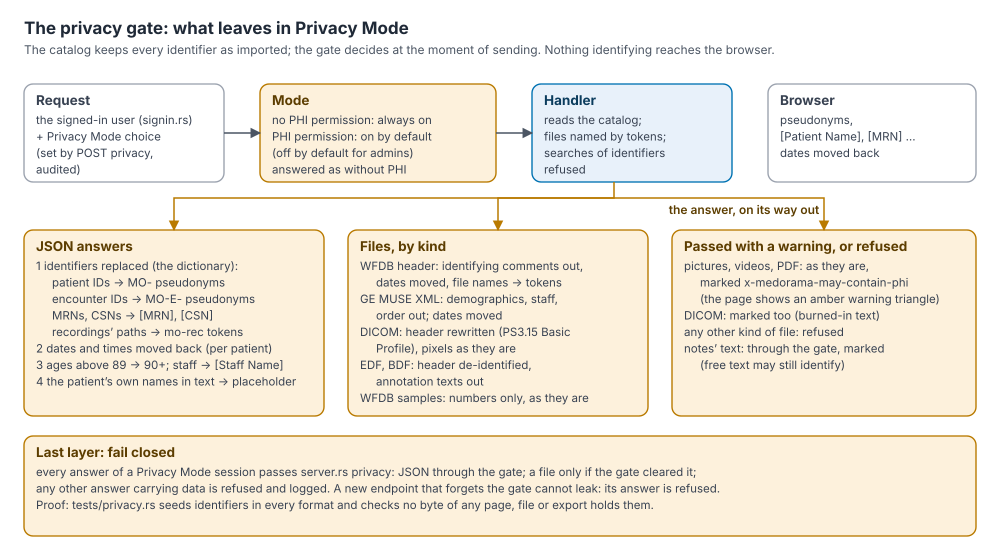
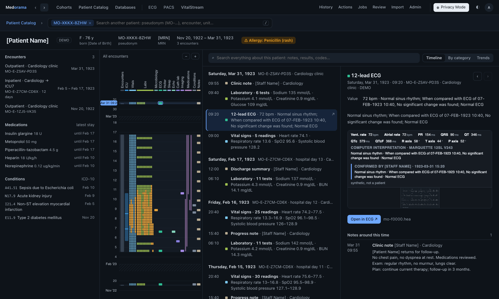

# How Medorama protects patient data

This page explains how Medorama keeps patients' identities from people who are not allowed to
see them. It is written for everyone who works with Medorama: users who want to know what
Privacy Mode shows, data managers who prepare data, and privacy officers and IT security
reviewers who must judge the design. The explanations are in plain language; each section ends
with references to the code and tests, for reviewers who want to check them. The complete
security review, with the threat model and the deployment checklist, is
[security.md](security.md).

## Contents

- [The principle](#the-principle)
- [Terms used on this page](#terms-used-on-this-page)
- [Privacy Mode and the PHI permission](#privacy-mode-and-the-phi-permission)
- [What is withheld and what replaces it](#what-is-withheld-and-what-replaces-it)
- [De-identifying files at the source](#de-identifying-files-at-the-source)
- [The VitalStream viewer](#the-vitalstream-viewer)
- [Exports and plug-in actions](#exports-and-plug-in-actions)
- [Connected databases](#connected-databases)
- [Failing closed](#failing-closed)
- [How the design is verified](#how-the-design-is-verified)
- [What Privacy Mode cannot do](#what-privacy-mode-cannot-do)
- [The repository holds no patient data](#the-repository-holds-no-patient-data)

## The principle

Medorama brings together data that identify patients: names, medical record numbers, dates of
birth, account numbers, and the dates of every event. Its design rests on three rules.

1. **Identifiers are kept in one place only: the catalog database.** The catalog keeps every
   identifier as it was imported, in its own tables. Copies are not made elsewhere: the
   viewers, the waveform indexes, the results of analyses and the plug-in programs never
   receive them.
2. **What leaves the server is decided at the moment of sending.** Privacy Mode is a property
   of a user's session, not of the data. For each answer, the server checks who is asking and
   whether that session is in Privacy Mode, and then sends either the identified data or a
   de-identified copy made on the spot.
3. **Nothing identifying reaches the browser of a user who may not see it.** The page in the
   browser does no masking of its own: it never receives what it must not show. A user who
   opens the browser's developer tools, or calls the API directly, gets the same de-identified
   answers that the page displays.

The part of the server that makes the de-identified copy is called the **privacy gate**.

The two screenshots below show the same synthetic patient. On the left, an administrator with
the PHI permission sees the identified record; on the right, the same page in Privacy Mode
shows placeholders, a pseudonym and dates moved back by about a century.

| Identified | Privacy Mode |
|---|---|
|  |  |

## Terms used on this page

| Term | Meaning |
|---|---|
| PHI | Protected health information: anything that can identify a patient, together with their health data. |
| Catalog | Medorama's own database of patients, encounters, clinical entries, recordings, users and the audit log (SQLite or PostgreSQL). |
| Identifier | A value that names a person directly: a name, a medical record number (MRN), a date of birth, an account number (CSN), an imported patient or encounter ID. |
| PHI permission | A right given to a user account by an administrator. Without it, a user can never see identifiers. |
| Privacy Mode | The state of a session in which every answer passes the privacy gate. |
| Privacy gate | The server code that de-identifies answers and files for sessions in Privacy Mode, and refuses what it cannot de-identify. |
| Pseudonym | A random code that stands for a patient (`MO-XXXX-XXXX`) or an encounter (`MO-E-XXXX-XXXX`) in Privacy Mode. |
| Placeholder | Fixed text that stands for a withheld value, such as `[Patient Name]` or `[MRN]`. |
| Date offset | The amount by which Privacy Mode moves a patient's dates back: the catalog's offset plus the patient's own number of days. |
| Connected database | A database that Medorama reads in place, such as an OMOP instance, instead of importing it. |

## Privacy Mode and the PHI permission

### Who is in Privacy Mode

Every session is in Privacy Mode unless its user has the PHI permission and has switched
Privacy Mode off. The defaults are as follows.

| User | Privacy Mode |
|---|---|
| Without the PHI permission (any role) | Always on. It cannot be switched off. |
| With the PHI permission, not an administrator | On when the user signs in. The user may switch it off. |
| Administrator with the PHI permission | Off when the user signs in. The administrator may switch it on. |

The role of a user (viewer, analyst or administrator) decides what the user may *do*; the PHI
permission decides what the user may *see*. An administrator grants the PHI permission when
creating an account, or later in Admin › Users ([administration.md](administration.md)). Most
users should not have it: they work with pseudonyms and shifted dates, which is enough for
most research.

### Switching Privacy Mode

The **Privacy Mode** switch in the page's header changes the mode for that session. The server
keeps the choice with the session, never in the browser, and writes an entry to the audit log
(`privacy_on` or `privacy_off`): leaving Privacy Mode is always audited. The page then reloads,
so that nothing identified stays on the screen after Privacy Mode is switched on. A user
without the PHI permission who asks to leave Privacy Mode is refused (HTTP 403). Every sign-in
starts in the user's default mode, so whoever uses the browser next starts there too.

Signing out, or a session that ends while the page is open, reloads the page: the next person
to sign in at that browser sees nothing of what the previous user saw.

A session in Privacy Mode is treated exactly like a user without the PHI permission: the server
replaces the session's user with a copy that has no PHI permission
(`users.rs`, `User::in_privacy_mode`), so every check that depends on the permission fails
closed for that session.

**For reviewers:** the decision is `server.rs` `in_privacy` and `session_user`; the switch is
`server.rs` `set_privacy`. Tested in `medorama/tests/privacy.rs` (a user without the
permission is refused; an administrator who switches Privacy Mode on receives no identifier).

## What is withheld and what replaces it

### Identifiers and dates

The table lists what Privacy Mode withholds by default and what the user sees instead. The
defaults follow the identifiers of the HIPAA Safe Harbor list that the catalog holds, with one
exception, the text of notes, described below.

| Data | In Privacy Mode |
|---|---|
| Patients' names | `[Patient Name]` |
| Staff names (authors of notes, ECG overreaders, physicians) | `[Staff Name]` |
| Medical record numbers | `[MRN]` |
| Account numbers (CSN) | `[CSN]` |
| Dates of birth | `[Date of Birth]`. The age is computed on the server and shown instead. |
| Imported patient IDs | The patient's pseudonym, `MO-XXXX-XXXX` (an imported ID may be an MRN). |
| Imported encounter IDs | The encounter's pseudonym, `MO-E-XXXX-XXXX`. |
| Every date and time | Moved back by the patient's date offset ([Dates and ages](#dates-and-ages)). |
| Ages above 89 | `90+` |
| Recordings' paths and file names | Tokens (`mo-rec:<n>`, `mo-f0003.dcm`), and `[Recording]` or `[File Name]` where a name is shown. |
| Columns of imported databases that hold identifiers | Kept under their imported names; their cells become placeholders, so the table keeps the shape of the source. |
| Columns that the catalog does not recognize | Withheld (`[Withheld]`), except measurement columns such as `QT (ms)`, which hold numbers. |
| The text of notes and reports | Shown by default, with the patient's own names and date of birth replaced, and marked with a warning. Withheld (`[Withheld]`) when the administrator chooses so ([Text and notes](#text-and-notes)). |

Placeholders are fixed text. They never reveal the length or the form of the value they
replace.

### Pseudonyms

Each patient receives a pseudonym such as `MO-D5QM-Y1X5` when first seen, and each encounter
one such as `MO-E-QMC6-E2VA`. Users find patients by these pseudonyms in Privacy Mode, and
exports name patients by them.

- **Random and stored, never derived.** The seven characters come from the operating system's
  secure random generator; an eighth is a check character. No calculation on an MRN or a name
  produces the pseudonym: the only link between a pseudonym and a person is the catalog
  database. This follows HIPAA 45 CFR §164.514(c), which asks that a re-identification code
  not be "derived from or related to information about the individual", and ISO/TS 25237.
- **Why not a hash of the MRN.** MRNs are short, so every possible MRN can be hashed in
  minutes, which would reverse an unkeyed hash. A keyed hash would depend on one secret
  forever and would still be derived from the identifier.
- **Stable.** A patient keeps the same pseudonym through re-imports and restarts. When two
  records are merged as one person, the absorbed record's pseudonym stays as an alias, so that
  earlier exports and cohort definitions still resolve.
- **Checked.** The check character (Luhn mod 32, in Crockford's base 32, which has no I, L, O
  or U) catches any single mistyped character, so a pseudonym typed into a search is either
  right or refused.
- **The same everywhere.** Pages, exports, cohort definitions, DICOM headers and plug-ins'
  job descriptions use the same pseudonym.

A catalog rebuilt from scratch draws new pseudonyms. Keep backups of the database to keep
pseudonyms stable.

### Dates and ages

Research depends on the time between events, so Privacy Mode moves dates rather than removing
them.

- **The catalog's offset.** Every date and time moves back by an offset that the administrator
  sets in years, months, days and hours (Admin › Privacy Mode). The default is 36,570 days,
  about 100 years.
- **Each patient's own days.** On top of that, each patient's dates move back by a whole number
  of days between 0 and a maximum (`spread_days`: 365 by default, at least 30 and at most
  3,650; a smaller value saved before that minimum is kept, since raising it moves every
  patient's dates, and `medorama serve` warns about it at start). This number
  is drawn at random once, when the patient's pseudonym is drawn, and stored with it. Every user
  and every session therefore sees the same dates for the same patient.
- **Intervals are kept.** The time between any two events of one patient is exact. Between two
  patients it changes by the difference of their own days.
- **Everywhere.** Dates move in every form the catalog holds or sends: numbers (Unix times),
  text (`2024-01-02` with or without a time, `2024/01/02`, `01/02/2024`, `2.1.2024`,
  `02-JAN-2024`, `Jan 2, 2024`, `2 January 2024`, `20240102`), BedMaster file names' Unix times
  (a name whose moved time falls before 1970 is written with a minus sign:
  `ICU7_12--1455465600`), DICOM dates and times, GE MUSE XML dates, WFDB base dates, EDF start
  dates, and the keys of entries that carry a time. A date written `01/02/2024` is read month
  first, unless the catalog writes dates day first (Admin › Dates and times) or the month would
  be over 12; `2.1.2024` is read day first. Either way the year moves back by about a century,
  so a misread date shows no real date. A Unix time written on its own is a number, and is
  kept.
- **Searches and criteria in Privacy Mode.** A search, a filter or a sort uses only what the
  session is shown (pseudonyms, file tokens, each patient's dates as shown), so it cannot test a
  real value. A date a user types, in a cohort criterion or a date filter, is a date as shown:
  the server compares it with each patient's dates as that session sees them, so the criterion
  means exactly what the page says. The page never holds the date offset: only administrators
  may read it (`GET deid`).
- **Ages.** Ages are computed on the server from the date of birth, which never leaves it.
  Ages above 89 are shown as `90+`.

Date shifting is pseudonymization, not anonymization. Anyone who learns the real date of one
of a patient's events can re-date all of that patient's events, and every other patient's to
within `spread_days`. Keep the offset confidential.

### Text and notes

Free text, such as clinical notes and reports, can name the patient, relatives or staff in
ways that no rule can recognize reliably. By default, Privacy Mode shows the text of notes,
because it is often essential for research, with the following protections:

- the patient's own names (each word of at least two letters, and each part of a compound
  name such as `Smith-Jones` or `O'Brien`) and date of birth are replaced by `[Patient Name]`
  and `[Date of Birth]`;
- identifiers the catalog knows (MRNs, account numbers, imported IDs of four or more
  characters that contain a digit) are replaced wherever they appear, and so are recordings'
  paths and the folders they lie in (`[Folder]`), which may be named after the patient;
- phrases such as "Confirmed by …" or "Signed by …" are replaced by `[Staff Name]`;
- dates in the text are moved back;
- the page marks the text with a warning, because it may still identify someone.

An administrator who prefers to withhold all free text ticks *The text of notes and reports*
in Admin › Privacy Mode; notes then appear as `[Withheld]`.

### Searches

In Privacy Mode, a search by name, MRN, date of birth, account number or a withheld column is
refused with a message (HTTP 400). A plain word does not match identifiers behind the scenes
either: otherwise the number of results would reveal whether a person is in the catalog.
Patients are found by their pseudonyms, and encounters by theirs. Searches of identifiers by
users who may see them are written to the audit log (`phi_search`).

### What the administrator can change

Admin › Privacy Mode lets an administrator choose which kinds of identifiers are withheld, the
catalog's offset and `spread_days`. Every change is written to the audit log (`deid_settings`)
with the new settings. Some protections do not depend on these settings and always apply in
Privacy Mode: imported patient and encounter IDs become pseudonyms, file names become tokens,
staff names become `[Staff Name]`, unrecognized columns are withheld, and files the gate cannot
de-identify are refused.

**For reviewers:** placeholders, the identifier dictionary and table cells are in `gate.rs`
(`Dict`, `Restricted::json`, `column_placeholder`, `column_mask`); dates, ages and the settings
in `deid.rs` (`FIELDS`, `Settings`, `answer_with`, `shift_text`); pseudonyms in
`pseudonyms.rs`. Unit tests in each module; end to end in `medorama/tests/privacy.rs`.

## De-identifying files at the source

Patients' files (ECGs, recordings, DICOM studies, documents) are sent one item at a time,
through `patients/{id}/file/{item}`, and only the files that belong to that item. In Privacy
Mode, the gate decides how each file leaves according to its kind. A file is de-identified as
it is sent; the original on disk is never changed.

### How each kind of file leaves

| Kind of file | In Privacy Mode |
|---|---|
| WFDB header (`.hea`) | Comments that identify the patient (name, ID, MRN, date of birth, address, phone, however their key is written: `Patient_Name:`, `Name=`, `Patient name -`, `Birthdate:`) are removed; the patient's own names and date of birth are replaced in every other comment; staff named in comments become `[Staff Name]`; the base date and dates in comments are moved back; ages above 89 become `90+`; the record's name and its signal files' names are replaced by tokens. |
| WFDB samples (`.dat`) | Sent as they are (they hold only numbers) when a header of the same item names them; any other `.dat` file is refused. |
| GE MUSE XML (`.xml` with a `RestingECG` element) | The patient's demographics are removed except age (capped) and sex, whatever attributes or spaces their tags hold; the order is removed; staff names become `[Staff Name]` and their IDs are emptied; a patient's name elsewhere becomes `[Patient Name]`; the patient's own names and date of birth are replaced in the statements; "Confirmed by …" phrases are replaced; every date is moved back. A file that still holds a patient's name, ID or date of birth after all this is refused, as is any other XML file. |
| DICOM (`.dcm`, `.dicom`, or a file recognized by its content) | The header is rewritten with the actions of the DICOM confidentiality profile for the attributes listed ([DICOM](#dicom)); the pixel data are copied byte for byte. The file is marked as possibly identifying. |
| EDF, EDF+, BDF, BDF+ (`.edf`, `.bdf`) | The header is de-identified and the texts of annotations are removed; the samples are sent as they are ([EDF and BDF](#edf-and-bdf)). |
| Pictures, videos and PDF documents | Sent as they are, marked as possibly identifying: the viewer's tab shows an amber warning triangle. |
| Anything else | Refused (HTTP 403). |

**File names never leave.** In Privacy Mode, an item's files are named by tokens (`mo-f0000.hea`,
`mo-f0001.dat`), and a request that gives a real file name is not accepted. Answers that carry
files vary with the session cookie (`Vary: Cookie`), so a browser never shows a cached
identified copy in Privacy Mode.

### DICOM

The rewrite applies the actions of DICOM PS3.15 Table E.1-1, the **Basic Application Level
Confidentiality Profile** (`X`: removed; `Z`: emptied; `D`: a dummy value; `U`: a new UID),
for the attributes listed in `dicom.rs` (`PROFILE`), with the **Retain Longitudinal Temporal
Information with Modified Dates** option (dates moved by the patient's date offset, instead of
removed). It is not a certified implementation of the profile: an attribute of the table that
the list lacks is kept, with its free text scrubbed as below. The De-identification Method
written into the file says so.

| Element | In Privacy Mode |
|---|---|
| Patient's Name | `[Patient Name]` |
| Patient ID | The patient's pseudonym |
| Patient's Birth Date | Emptied |
| Patient's Age | Capped at 90 years when ages are capped |
| Patient's Sex, Size and Weight | Kept |
| Every other element of the patient group (0010) | Removed |
| The clinical trial module (0012) | Removed |
| Other person names (referring, performing and reading physicians, operators, observers) | `[Staff Name]` |
| The attributes of the list: institution, department, station, addresses and phones, device, detector and other equipment IDs, accession, study, order, procedure, admission and visit IDs; descriptions (study, series, requested and performed procedures, derivation, admitting and discharge diagnoses); comments (image, study, acquisition, identifying, performed procedure step, visit); protocol names; structured report text and content (Text Value, Content Sequence); graphic annotations; icon images; digital signatures | Removed (`X`), or emptied (`Z`: accession, institution name, study ID, order numbers) |
| Curves (50xx), overlays (60xx: their bitmaps, labels and comments), the retired results group (4008) | Removed |
| Free text left (SH, LO, ST, LT, UC, UT; in implicit-VR files, elements of unknown VR that hold text) | The patient's own names and date of birth, and the identifiers the catalog knows, replaced; dates in it moved back |
| Private elements | Removed |
| Instance UIDs (study, series, instance, frame of reference, references) | Replaced by `2.25.` and 128 bits of an HMAC-SHA-256 under the catalog's secret, so that a series still holds together and nobody without the secret can map them back. The standard's own UIDs (classes, transfer syntaxes) are kept. |
| Dates and times | Moved back; a date and its time together |
| Patient Identity Removed, De-identification Method, Longitudinal Temporal Information Modified | Added (`YES`, the method, `MODIFIED`) |

The file keeps its transfer syntax (explicit or implicit VR little endian, and every
compressed syntax). In implicit VR the file does not say which elements are person names:
the rewrite knows the person names of the standard's dictionary by their tags. Deflated and
big-endian files are refused, because they could not be rewritten safely, and so are files
with sequences nested more than 32 deep. Real files from several vendors and syntaxes (CT in implicit and explicit VR,
JPEG Lossless, JPEG Extended 12-bit, multi-frame JPEG Baseline angiography, panoramic X-ray)
were checked with pydicom after the rewrite: no original identifier and no private element
remain, and the pixels are identical (`medorama/tests/dicom_samples.rs`).

What the pixels show is not changed. Ultrasound images, secondary captures and scanned
documents may carry names burned into the image, so every DICOM file is sent with the
"may contain PHI" mark.

### EDF and BDF

An EDF or BDF header has two identification fields, one for the patient and one for the
recording, and states the recording's start date and time
([edf.md](edf.md#patient-identity-in-edf-files)). In Privacy Mode:

- the patient field becomes `X X X X`, EDF+'s form for an anonymous patient;
- in EDF+ and BDF+ files, the recording field becomes `Startdate dd-MMM-yyyy X X X`, with the
  start date moved back; in plain EDF and BDF files, whose recording field is free text, it
  is left blank;
- the start date and time are moved back. EDF writes two-digit years for 1985 to 2084 only: an
  EDF+ file whose moved date falls outside that range has `yy` in its date field and the full
  year in its recording field, as EDF+ prescribes; a plain EDF file states no start date
  rather than a wrong one;
- in EDF+ and BDF+ files, the texts of annotations are removed. Each data record keeps only
  its time-keeping annotation (its onset), so that the file's timing stays whole;
- the samples are sent as they are.

A file without annotation signals is streamed: only its header is rewritten. A file with
annotation signals is rewritten whole in memory, so EDF+ files with annotations larger than
64 MB are refused in Privacy Mode; such recordings can still be opened in VitalStream. The
technical fields of the signal headers (labels, units, transducer and prefiltering
descriptions) are kept as they are.

The engine and the viewers never put the patient and recording fields into an index or any
answer. Medorama's `identify` action reads them into the catalog's identifier tables, where
an administrator can check that the file belongs to the patient it is linked to.

### Why some files pass with a warning

Pictures, videos, PDF documents and DICOM pixels are images: the gate cannot read what they
show, and removing burned-in text would require optical character recognition, which
Medorama does not do. Refusing them would make imaging research impossible in Privacy Mode,
so they are sent as they are, with the header `x-medorama-may-contain-phi`, and the page shows
an amber warning triangle on the tab that displays them. Every other kind of file that the gate
cannot de-identify is refused.

**For reviewers:** the file rules are `gate.rs` `FileKind` and `file_kind`, and
`server.rs` `attachment_response`; WFDB headers are `deid.rs` `wfdb_header`; MUSE XML is
`deid.rs` `muse_xml`; DICOM is `dicom.rs`; EDF is `deid.rs` `edf_header` and
`edf_annotations`, called by `server.rs` `edf_deidentified`. File tokens are `gate.rs`
`file_token` and `token_index`.

## The VitalStream viewer

The VitalStream waveform viewer runs as a separate program on the server, reachable only
through Medorama's **gateway** (`/viewer/`). The viewer itself never reads names or dates of
birth from any recording. In Privacy Mode, the gateway adds the following rules:

- recordings are opened by token (`mo-rec:<n>`), never by path; a path sent by the page is
  refused;
- browsing and scanning folders is refused, because folder and file names may identify;
- the times the page sends are moved forward before they reach the viewer, and every time in
  the viewer's answers is moved back, by the recording's patient's date offset;
- a dataset's path and name are replaced by its token and `[Recording]`;
- every answer then passes the gate's last layer, like any other answer.

EDF+ annotations appear as events in VitalStream's Annotations lane. Because they are free text,
the gateway treats them as Medorama treats clinical notes. When Privacy Mode withholds notes'
text, each annotation is replaced by `[Annotation]`. Otherwise the patient's own names and date
of birth are replaced by placeholders, and the gate's last layer then replaces the identifiers
the catalog knows and moves dates back. Like notes, such text may still identify someone in ways
no rule recognizes; see [What Privacy Mode cannot do](#what-privacy-mode-cannot-do).

**For reviewers:** `gateway.rs` (`handle`, `shift_query`, `gate_annotations`); tested with a real
viewer in `medorama/tests/gateway.rs`, and `gate_annotations` by its unit test
`annotations_in_privacy_mode`.

## Exports and plug-in actions

- **Exports** made in Privacy Mode (cohort members, definitions, members' data, Excel files,
  database CSV files) pass the same gate. They have the same columns as identified exports,
  with identifiers as placeholders, patients named by pseudonym and dates moved back. Exports by
  users who see identifiers are written to the audit log (`phi_export`).
- **Plug-in actions** (programs an administrator installs to analyze recordings) receive a job
  description with the recording's path, its index folder, an output folder, and the
  pseudonyms of its encounters and patients, never their imported IDs
  ([actions.md](actions.md)). They also do not receive the server's secrets in their
  environment ([security.md](security.md#13-background-jobs-and-plug-in-actions)).

## Connected databases

A connected database (an OMOP instance, a data warehouse read through SQL views) is read in
place, read-only, and its data leave through the same gate as the catalog's.

- **Only canonical columns are read.** Medorama reads a connected database through three views
  of fixed columns (persons, visits, entries), each column with a privacy class: key,
  identifier, date, free text, staff or clinical value. A view cannot add a field that the gate
  does not know ([databases.md](databases.md)).
- **Persons are linked to patients.** A connected database's persons are linked to the
  catalog's patients, so they leave as pseudonyms. Their identifiers are copied into the
  catalog's identifier tables, where the gate knows them; their keys in the source database
  never leave.
- **Entries are named by tokens.** An entry is named by a keyed hash
  (`live:<connection>:<token>`) that holds neither its key nor its time. Its dates move back
  with the rest, its text follows the rule for notes, and its authors are treated as staff.
- **Searches** of identifiers in connected databases need the PHI permission, as in the
  catalog.

**For reviewers:** `sources/` (read-only sessions, views, the person registry in
`sources/link.rs`) and `patient/items.rs` `live_items`; tested in
`medorama/tests/connections.rs` over a synthetic OMOP database, in SQLite and PostgreSQL.

## Failing closed

Most answers are de-identified by the code that builds them, because that code knows what each
value is. A last layer of the server then enforces the rule for every answer of a session in
Privacy Mode:

- a JSON answer passes through the gate there, whatever the endpoint;
- a file passes only if the gate cleared it;
- any other answer that carries data is refused (HTTP 403), and the refusal is written to the
  server's error output.

The pages and scripts of the web interface, redirects and error messages hold no patient data
and pass unchanged. As a result, a new endpoint whose author forgets the gate cannot leak
identifiers: its answer is refused or de-identified. This is why the gate is said to fail
closed. In the same spirit, a session in Privacy Mode is handled as a user without the PHI
permission, so a forgotten permission check also errs on the side of withholding.

**For reviewers:** `server.rs` `privacy` (the last layer) and `cleared`, `may_hold_phi`
(the marks set by handlers); the internal header `x-medorama-gate` is removed before an answer
leaves.

## How the design is verified

- **End to end.** `medorama/tests/privacy.rs` seeds a catalog with identifiers that cannot
  appear by chance: a name, an MRN, patient, encounter and account numbers, a date of birth,
  staff names, an institution, and real dates in the forms that tables, DICOM, MUSE, WFDB, EDF
  and EDF+ write them. They are placed in every format the catalog serves: tables, notes, a
  WFDB record, GE MUSE XML, DICOM, an EDF+ file, a picture, a text file and an ICU recording.
  The test then requests every page's answers, every entry's detail, every file and its parts,
  and every cohort and database export, as a user without the PHI permission and as an
  administrator who switched Privacy Mode on. It asserts that no byte of any answer holds any
  of the seeded identifiers, that no JSON number is a real time, that identifier searches are
  refused or find nobody, that placeholders and pseudonyms appear, that the text file is
  refused, and that pictures and DICOM files are marked. It also checks that the identified
  answers do hold the identifiers, so that the test would fail if it checked nothing.
- **The viewer.** `medorama/tests/gateway.rs` runs a real VitalStream viewer behind the
  gateway, in Privacy Mode too.
- **Connected databases.** `medorama/tests/connections.rs` repeats the Privacy Mode check over a
  synthetic OMOP database.
- **Each de-identifier.** Unit tests in `gate.rs`, `deid.rs` (including real EDF test files),
  `dicom.rs` and `pseudonyms.rs`; `medorama/tests/dicom_samples.rs` checks real DICOM files
  with pydicom.

The commands that run these tests are listed in
[security.md, Verifying these claims](security.md#18-verifying-these-claims).

## What Privacy Mode cannot do

Privacy Mode reduces what users see; it does not make data anonymous. Reviewers and users should
know its limits.

- **Burned-in text.** Names written into pictures, scanned PDFs, video frames and DICOM pixels
  are not removed. These files are marked with the amber warning instead.
- **Free text.** Notes, reports and EDF+ annotations may name the patient, relatives or staff in
  ways no rule recognizes. Notes are marked; an administrator can withhold the text of notes
  entirely, and the same setting withholds EDF+ annotation texts in VitalStream.
- **Quasi-identifiers.** Sex, a capped age, rare diagnoses, units and beds, small cohorts and
  exact intervals can single out a person when combined with outside knowledge.
- **Date offsets.** Learning one real date of a patient reveals that patient's offset, and every
  other patient's to within `spread_days`.
- **Not Safe Harbor.** Because dates are shifted rather than removed, data viewed or exported in
  Privacy Mode are not de-identified under HIPAA's Safe Harbor method. They suit use as a
  limited data set under a data use agreement, or under an expert determination
  ([security.md, Regulatory mapping](security.md#15-regulatory-mapping)).
- **Everyone sees every patient.** Medorama has no per-patient or per-study access lists: every
  signed-in user may see every patient of a catalog, as Privacy Mode and the PHI permission
  allow. Separate catalogs serve separate studies.

The deploying institution remains responsible for the rest: who receives accounts and the PHI
permission, how the server and its backups are protected, which data are imported, and how
exports are used and shared. The [deployment checklist](security.md#16-deployment-checklist)
lists these duties.

## The repository holds no patient data

Medorama's source repository contains no patient data. Tests and demonstrations use synthetic
data only, or public data sets kept outside the repository. A pre-commit hook
(`tools/git-hooks`) refuses recordings, data files, notebooks with outputs and real recording
names. The rules are in [PRIVACY.md](../PRIVACY.md).
