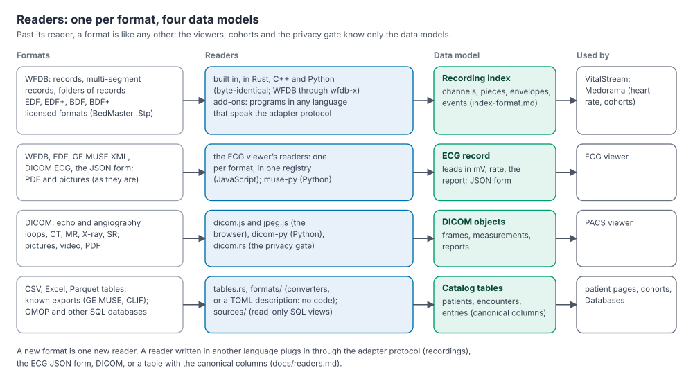

# Readers and data models

This page explains how Medorama and its viewers read files and databases, and how to add a new
format. It is written for integrators and contributors who need to bring a format that Medorama
does not read yet, and for reviewers who want to know where format-specific code lives.



## Contents

- [The design](#the-design)
- [The four data models](#the-four-data-models)
  - [Recordings: the index](#recordings-the-index)
  - [ECG records](#ecg-records)
  - [DICOM objects](#dicom-objects)
  - [Catalog tables](#catalog-tables)
- [The readers that exist](#the-readers-that-exist)
- [Add a format](#add-a-format)
  - [Recordings: a built-in reader or an adapter](#recordings-a-built-in-reader-or-an-adapter)
  - [ECGs: a reader in the ECG viewer, or a converter](#ecgs-a-reader-in-the-ecg-viewer-or-a-converter)
  - [Images: convert to DICOM](#images-convert-to-dicom)
  - [Tables: add an import format or a connected database](#tables-add-an-import-format-or-a-connected-database)
- [Two exceptions: WFDB and BedMasterEx .Stp](#two-exceptions-wfdb-and-bedmasterex-stp)

## The design

Every file format has its own **reader**, and every reader produces one of four **data models**:
a recording's index, an ECG record, a DICOM object, or rows of the catalog's canonical tables.
Past the reader, nothing depends on the format: VitalStream draws an index the same way whether
it came from a WFDB record or an EDF file, cohorts search entries the same way whether they came
from a CSV file or an OMOP database, and the privacy gate checks the same fields whatever their
origin.

This design has three consequences:

- **A new format is one new reader.** No viewer, cohort or privacy code changes, as long as the
  reader produces one of the four models.
- **Readers can be written in any language.** A reader in another language plugs in through a
  documented boundary: the adapter protocol for recordings, the JSON form for ECGs, DICOM for
  images, and a table or a set of SQL views with the canonical columns for tabular data.
- **Identity stays out of the models.** No data model has a place for the patient's identity. A
  recording's index, an ECG record and the viewers' output never hold a name, an identifier or
  a birth date. Identifiers reach Medorama only through the catalog's identifier tables
  (imported columns, connected views, and the `identify` action for identifiers stored inside
  recordings), where the privacy gate controls them.

## The four data models

| Model | What it is | Specification | Used by |
|---|---|---|---|
| Recording index | Channels, pieces of contiguous samples, min/max envelopes, vital-sign series, events, markers and breaks | [index-format.md](../viewers/vitalstream/docs/index-format.md), [data-model.md](../viewers/vitalstream/docs/data-model.md) | VitalStream; Medorama (a Holter's heart rate, recordings in cohorts and on patient pages) |
| ECG record | Leads in millivolts, their sampling rate, the report (measurements, statements, notes); and its JSON form | The header comment of [viewers/ecg/readers.js](../viewers/ecg/readers.js), summarized below | The ECG viewer |
| DICOM object | Frames, measurements and reports, as the DICOM standard defines them | DICOM (PS3) | The PACS viewer; the ECG viewer for DICOM ECGs |
| Catalog tables | Patients, encounters, bed stays and entries, in canonical columns | [importing.md, Column reference](importing.md#column-reference); [databases.md, Canonical views reference](databases.md#canonical-views-reference) | Patient pages, cohorts, the Databases tab |

### Recordings: the index

A recording (an ICU monitor's waveforms, a Holter, an EEG, a sleep study) is turned into an
**index**: a folder that holds the recording's structure (its channels and the pieces each
channel is made of), min/max envelopes of every waveform for fast drawing over days, and its
markers, vital-sign series, alarms and breaks. The index never holds the recording's samples in
full: when a view zooms in close, the samples are read from the recording itself through the
same reader.

The index format is specified so that independently written programs produce the same bytes:
the three VitalStream viewers (Rust, C++, Python) and Medorama share index folders, and a test
checks that they write byte-identical indexes ([index-format.md,
Conformance](../viewers/vitalstream/docs/index-format.md#conformance)). The language-neutral model
behind it (channels, pieces, lanes, breaks, "time not stated") is in
[data-model.md](../viewers/vitalstream/docs/data-model.md).

### ECG records

The ECG viewer reads every format into one **record**, defined in the header comment of
[viewers/ecg/readers.js](../viewers/ecg/readers.js):

```
{ name, start, fs, leads: [{ name, units, fs, v }], meta }
```

| Field | Content |
|---|---|
| `name` | What the record calls itself (a WFDB record's name, `MUSE ECG`). The page shows the file's name instead. |
| `start` | When it was recorded, in Unix seconds (UTC), or `null` when the file does not say. |
| `fs` | The sampling rate in Hz. Each lead may state its own `fs`. |
| `leads` | In the file's order. `name` is the lead's label (`I`, `II`, `aVR`, `V1`, `ECG II`; the twelve standard leads are found by name), `units` is `mV`, and `v` holds the samples in millivolts (`NaN` where a sample is missing). |
| `meta` | Optional: `fields` (label and text pairs), `measurements` (`name`, `value`, `unit`, optional `lead`), `statements` (`source`: `computer`, `confirmed` or `edited`, with optional `program`, `by`, `time`, and `lines`), and `notes`. |

The patient's identity is never part of a record. `ECG.checked` in
[viewers/ecg/ecg.js](../viewers/ecg/ecg.js) refuses a record that the paper cannot draw (no
leads, no samples, no rate).

**The JSON form** is the same record as a JSON file, which the viewer opens like any other ECG:

```
{ name, start, fs, leads: [{ name, fs?, units, samples: [number | null] }], meta? }
```

Here `start` is Unix seconds, ISO 8601 text or `null`; `units` is `mV`, `uV` (µV) or `V`; a missing
sample is `null`; and `meta` is checked (unknown parts and identifying fields are dropped). A
program in any language can convert a format the page does not read into this form; `muse-py
json` does so for GE MUSE XML.

### DICOM objects

Images (echocardiography and other ultrasound loops, angiography, CT, MR, nuclear medicine,
X-ray), structured reports, encapsulated PDF documents and DICOM waveforms (ECGs) keep their own
standard model, DICOM. No other image model is defined: an image format that is not DICOM is
either shown as it is (pictures, videos, PDF) or converted to DICOM. The PACS viewer's reader is
[viewers/pacs/dicom.js](../viewers/pacs/dicom.js) (and `jpeg.js` for lossless and 12-bit JPEG);
the privacy gate rewrites DICOM headers in [medorama/src/dicom.rs](../medorama/src/dicom.rs).

### Catalog tables

Tabular data (patients, encounters, bed stays, results, drugs, conditions, notes, and the files
they name) end up in the catalog's **canonical columns**. Imported tables reach them through the
recognized column names and mappings; known exports through an import format that converts them
first; connected databases through three SQL views (`persons`, `visits`, `entries`). The columns
are specified in [importing.md, Column reference](importing.md#column-reference) and
[databases.md, Canonical views reference](databases.md#canonical-views-reference).

## The readers that exist

| Format | Reader | Language | Where | Model |
|---|---|---|---|---|
| WFDB records, multi-segment records, collections, folders of records | WFDB reader, through wfdb-x (refused in a build without WFDB support: [building.md](building.md#without-wfdb)) | Rust, C++, Python | [libs/engine/src/sources/wfdb_folder.rs](../libs/engine/src/sources/wfdb_folder.rs); `viewers/vitalstream/cpp/engine/src/sources_wfdb.cpp`; `viewers/vitalstream/python/vitalstream/vitalstream_py/sources/wfdb_folder.py` | Recording index ([wfdb-collection.md](wfdb-collection.md)) |
| EDF, EDF+, BDF, BDF+ | EDF reader | Rust, C++, Python | [libs/engine/src/sources/edf.rs](../libs/engine/src/sources/edf.rs); `cpp/engine/src/sources_edf.cpp`; `python/…/sources/edf.py` | Recording index ([edf.md](edf.md)) |
| BedMasterEx `.Stp` (GE Unity and Carescape, Philips PIICiX and Viridia) | stp-adapter, a private add-on available to institutions under agreement | Rust, C++, Python | outside this repository, through the adapter protocol ([adapters.md](adapters.md)) | Recording index |
| WFDB (a `.hea` with its signal files) | `wfdb.js` | JavaScript | [viewers/ecg/](../viewers/ecg/README.md) | ECG record |
| GE MUSE XML | `muse.js`; `muse-py` (`json`, `wfdb`, `index`) | JavaScript; Python | viewers/ecg/, viewers/ecg/python/muse | ECG record (and its JSON form, a WFDB record, a table) |
| DICOM ECG waveforms | `dicom-ecg.js` with `dicom.js`; `dicom-py wfdb` | JavaScript; Python | viewers/ecg/, viewers/pacs/python/dicom | ECG record (or a WFDB record) |
| EDF, EDF+, BDF, BDF+ | `edf.js` | JavaScript | viewers/ecg/ | ECG record |
| The ECG viewer's JSON form | `ECG.readJson` in `ecg.js` | JavaScript | viewers/ecg/ | ECG record |
| PNG, JPEG, PDF | shown as they are | | viewers/ecg/, viewers/pacs/ | (not a model) |
| DICOM images, loops, series, structured reports, encapsulated PDF | `dicom.js`, `jpeg.js`; `dicom-py index` | JavaScript; Python | [viewers/pacs/](../viewers/pacs/README.md) | DICOM object (and a table) |
| DICOM headers in Privacy Mode | `dicom.rs` | Rust | medorama/src/ | DICOM object, de-identified |
| CSV, Parquet, Excel, OpenDocument tables | `tables.rs`, `parquet_rows.rs` | Rust | medorama/src/ | Catalog tables |
| GE MUSE metadata tables; CLIF tables | `formats/ge_muse.rs`; `formats/clif.rs` | Rust | [medorama/src/formats/](../medorama/src/formats/mod.rs) | Catalog tables |
| A site's own exports | TOML descriptions (`formats/declared.rs`) | none: a description | a folder of `formats_dirs` | Catalog tables |
| OMOP CDM 5.3 and 5.4 | built-in views (`sources/omop.rs`) | SQL | [medorama/src/sources/](../medorama/src/sources/mod.rs) | Catalog tables (connected) |
| Any other SQL database | your three views | SQL | a TOML file | Catalog tables (connected) |

## Add a format

Choose the data model first: it decides where the reader goes. A format of waveforms that people
scroll through for hours is a recording; a 10-second, 12-lead ECG printed on paper is an ECG
record; an image is DICOM; anything tabular is catalog tables.

### Recordings: a built-in reader or an adapter

A recording format can be read in two ways:

| | Built-in reader | Adapter |
|---|---|---|
| What it is | A module of the recording engine, written three times: Rust, C++ and Python | A separate program, named `<name>-adapter`, installed beside Medorama and the viewers |
| Language | Rust, C++ and Python, all three | Any language |
| Distributed | With Medorama and the viewers, in this repository | Separately: an add-on, which may be licensed or private |
| Choose it when | The format is open and public, worth reading everywhere without an installation, and its rules can be written down exactly (as [edf.md](edf.md) does) | The format is licensed or restricted, needs a vendor's library, or you want one implementation in a language of your choice |

**A built-in reader.** The EDF reader, [libs/engine/src/sources/edf.rs](../libs/engine/src/sources/edf.rs),
is the model to follow; the module table is in
[libs/engine/src/sources/mod.rs](../libs/engine/src/sources/mod.rs).

1. **Write down the reading rules** of the format, exactly, in a page like
   [edf.md, Reading rules](edf.md#reading-rules-for-implementers): the header, the numbers, the
   start time, how pieces and breaks are made, the events, every key of `meta.json`, and the
   notes. The three implementations must agree byte for byte, so the rules leave nothing to
   interpretation.
2. **Write the Rust module** in `libs/engine/src/sources/`: a test of the file (`is_<format>`), its
   format label, `build(path, progress, cancelled) -> (meta, arrays)` for the index, and a
   `Reader` whose `read(piece, a, b)` returns the physical samples `a` to `b - 1` of a piece. The
   module never reads the patient's identity into the index.
3. **Register it** in `sources/mod.rs`: a line in `kind_of`, `format_label`, `build`, and the
   `Reader` enum (`new` and `read`).
4. **Write the same reader in C++** (`viewers/vitalstream/cpp/engine/src/sources_<format>.cpp`,
   declared in `include/engine/sources.hpp`, dispatched in `sources.cpp`, listed in the engine's
   `CMakeLists.txt`) **and in Python** (`vitalstream_py/sources/<format>.py`, dispatched in
   `sources/__init__.py`).
5. **Add test files** (synthetic only) to `viewers/vitalstream/testdata/`, written by its
   `generate.py`, and tests in each language (`libs/engine/tests/`, the Python viewer's tests).
6. **Check the three agree:** `make parity` indexes the test files with every built viewer and
   checks that the indexes are byte-identical.
7. **Teach Medorama the format** where it needs to know it: `is_recording` in
   [medorama/src/tables.rs](../medorama/src/tables.rs) (so that an imported row makes a recording);
   the file kinds in [medorama/src/patient/files.rs](../medorama/src/patient/files.rs) and
   [medorama/src/gate.rs](../medorama/src/gate.rs) if its files are also served to the browser
   (the gate refuses, in Privacy Mode, any kind it cannot de-identify); and
   [medorama/src/identify.rs](../medorama/src/identify.rs) if the file stores identifiers, so that
   the `identify` action can read them into the identifier tables.

**An adapter.** The protocol is in [adapters.md](adapters.md#the-protocol).

1. Write a program named `<name>-adapter` that answers `describe` (its formats: kind, label and
   extensions), `detect`, `index PATH DIR` (the index files, in the index format), `serve` (a
   session that returns samples), `identify` (the identifiers the file states), and `--version`.
2. Test it with every viewer: `viewers/vitalstream/tests/parity/index_parity.py --adapters-dir DIR
   FILE…` indexes a recording through the adapter with each built viewer and checks the results
   are byte-identical ([adapters.md, Writing an adapter](adapters.md#writing-an-adapter)).
3. Install it with `medorama addons install PROGRAM` and restart Medorama. Nothing in Medorama or
   the viewers names the adapter's format: until the adapter is installed, its files are like
   any other file they do not read.

### ECGs: a reader in the ECG viewer, or a converter

**A reader in the ECG viewer.** The viewer keeps one registry of readers,
[viewers/ecg/readers.js](../viewers/ecg/readers.js); each format has its own file (`wfdb.js`,
`muse.js`, `dicom-ecg.js`, `edf.js`).

1. Write the reader in its own file. It maps the format to the record above (`ecg.js` has the
   helpers: units to millivolts, metadata from "key: value" lines, `ECG.checked`), and never reads
   the patient's identity.
2. End the file with `Readers.add({ key, label, extensions, sniff, read })`. `sniff(name, bytes,
   type)` says whether a file's content is this format; `read(name, bytes, sibling)` returns a
   promise of the record, and `sibling(fileName)` gives a file next to this one (a WFDB header's
   signal files). Optional fields are `companions` (extensions read with it, not opened alone),
   `parts` (files of a folder that belong to this record) and `loose` (its sniff is a guess, tried
   after the others).
3. Load it in `viewers/ecg/index.html` after `readers.js`. The order of the scripts is the order
   the page lists the formats in.
4. List it in Medorama's built-in page files (`page!("ecg", …)` in
   [medorama/src/server.rs](../medorama/src/server.rs)).
5. Test it in `viewers/ecg/tests/` (`readers.test.js`: what the registry finds for a file).
6. For Medorama to send such files in Privacy Mode, the privacy gate must be able to
   de-identify them (`file_kind` in [medorama/src/gate.rs](../medorama/src/gate.rs)); otherwise
   they are refused in Privacy Mode, which is the safe default.

**A converter in any language.** A program can convert a format the page does not read into the
ECG viewer's JSON form, which the page opens like any other ECG. Note that the privacy gate
refuses JSON files in Privacy Mode, because it cannot check what they hold. For ECGs that will be
viewed through Medorama in Privacy Mode, convert to a WFDB record instead (`muse-py wfdb`,
`dicom-py wfdb` do so): the gate de-identifies WFDB headers.

### Images: convert to DICOM

The PACS viewer reads DICOM, and shows pictures, videos and PDF documents as they are. An image
format that is neither should be converted to DICOM with a conversion tool, keeping its
acquisition date, modality and pixel spacing. DICOM is also the safer choice for Medorama: in
Privacy Mode the gate rewrites a DICOM file's header (names, IDs, dates, UIDs), while pictures
and videos go out as they are, with the "may contain PHI" warning, because the gate cannot know
what they show.

### Tables: add an import format or a connected database

Tabular data need a reader only when their columns cannot simply be mapped. In order of effort:

1. **A mapping** (no reader at all): map the columns once in the Import tab, or with
   `--mapping` ([databases.md, When the columns have other names](databases.md#when-the-columns-have-other-names)).
2. **A TOML description**, for an export your site imports regularly: column by column, with date
   forms, value maps, numbers and joined columns. No code and no build
   ([databases.md, Describe your own export in TOML](databases.md#describe-your-own-export-in-toml);
   [medorama/src/formats/declared.rs](../medorama/src/formats/declared.rs)).
3. **A Rust converter**, for what a description cannot say (one row that becomes several
   entries, values that depend on other rows or tables). Implement the two traits of
   [medorama/src/formats/mod.rs](../medorama/src/formats/mod.rs):
   - `Format`: `key` (its name on the command line and in the page), `label`, `category`,
     `about`, `detect(headers)` (whether a table with these columns is one) and
     `start(headers)` (its converter);
   - `Converter`: `headers()` (the converted table's columns, catalog fields or columns of its
     own), and `row(record)` or `rows(record)` (the converted row, several rows, or why a row is
     left out).

   Register it in `builtin()` in the same file. [ge_muse.rs](../medorama/src/formats/ge_muse.rs)
   (one row per ECG) and [clif.rs](../medorama/src/formats/clif.rs) (one format per CLIF table,
   rows that become several entries) are the examples. A format keeps only what it names:
   identifiers it maps to the catalog's patient columns are masked in Privacy Mode, and it should
   not keep other identifying columns (staff, account numbers).
4. **A connected database's views**, when the data should stay in their database: three SQL
   queries with the canonical columns, or the built-in OMOP views
   ([databases.md, Connect any SQL database through views](databases.md#connect-any-sql-database-through-views)).
   A new kind of database engine is added in [medorama/src/sources/](../medorama/src/sources/mod.rs)
   and [medorama/src/sql/](../medorama/src/sql/mod.rs).

## Two exceptions: WFDB and BedMasterEx .Stp

Two formats are read by code that does not live in this repository:

- **WFDB** is read through **wfdb-x**, a public WFDB library with Rust, C++ and Python
  implementations (<https://github.com/alphanumericslab/wfdb-x>). The three engines use the
  library of their own language, fetched at a pinned version (`Cargo.toml`,
  `viewers/vitalstream/cpp/cmake/deps.cmake`). The engines' WFDB modules add what WFDB itself
  does not define: collections, folders of records read as one session, and the index
  ([wfdb-collection.md](wfdb-collection.md)).
- **BedMasterEx `.Stp`** files are read by the **stp-adapter**, a private add-on available to
  institutions under agreement, which plugs in through the adapter protocol
  ([adapters.md](adapters.md)). Medorama and the viewers contain no code for this format.
