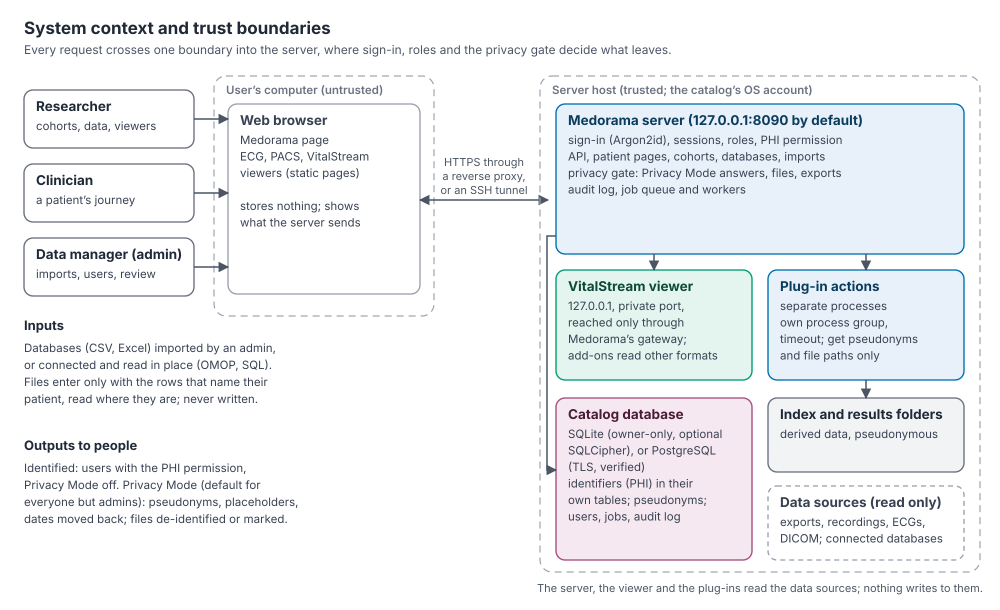
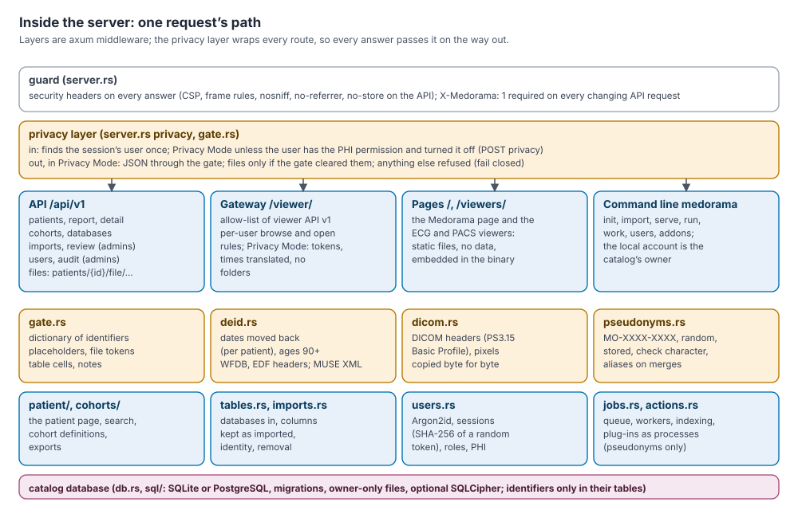
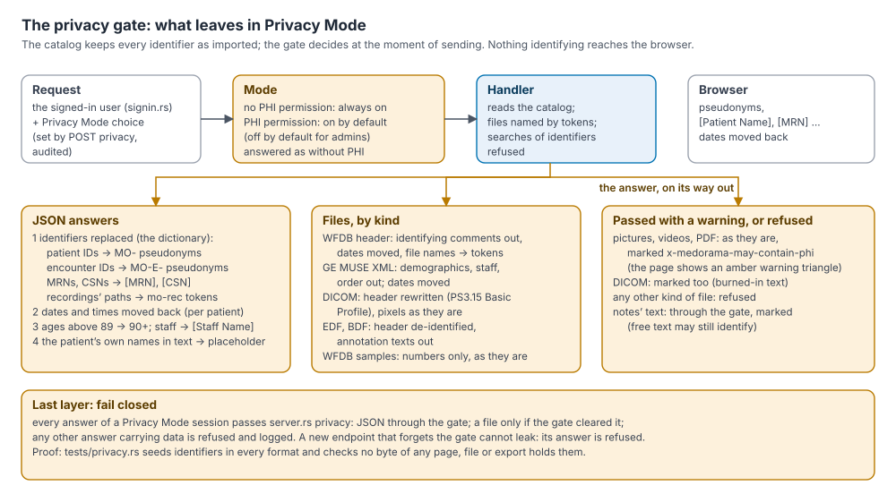

# Security and privacy review

This document is for the people who decide whether Medorama may run on their institution's
patient data: IT security reviewers, privacy officers, and IT and research administrators. It
describes what Medorama protects, against whom, how, and what it leaves to the deploying
institution. Each control names the code that implements it and the test that checks it, so
that every claim can be verified rather than taken on trust.

It describes Medorama 0.1.0 (unreleased). Medorama is research software, not a medical device,
and it holds no certification. To report a vulnerability, see [SECURITY.md](../SECURITY.md).

A plain-language explanation of how identifiers are hidden is
[protecting-patient-data.md](protecting-patient-data.md); the system's parts are described in
[architecture.md](architecture.md), and sign-in in [sign-in.md](sign-in.md).

## Contents

- [Executive summary](#executive-summary)
1. [Scope and intended use](#1-scope-and-intended-use)
2. [Architecture and trust boundaries](#2-architecture-and-trust-boundaries)
3. [Assets and data classification](#3-assets-and-data-classification)
4. [Threat model](#4-threat-model)
5. [Authentication](#5-authentication)
6. [Authorization](#6-authorization)
7. [Privacy Mode and the privacy gate](#7-privacy-mode-and-the-privacy-gate)
8. [Data at rest](#8-data-at-rest)
9. [Data in transit](#9-data-in-transit)
10. [Web application security](#10-web-application-security)
11. [Untrusted input](#11-untrusted-input)
12. [Audit logging](#12-audit-logging)
13. [Background jobs and plug-in actions](#13-background-jobs-and-plug-in-actions)
14. [Supply chain, build and repository](#14-supply-chain-build-and-repository)
15. [Regulatory mapping](#15-regulatory-mapping)
16. [Deployment checklist](#16-deployment-checklist)
17. [Known limitations and residual risks](#17-known-limitations-and-residual-risks)
18. [Verifying these claims](#18-verifying-these-claims)

## Executive summary

Medorama is a single server program, written in Rust, that an institution runs on its own
hosts. It serves a web page and three viewers to the institution's users, and reads patient
data from imported tables, files and connected databases. It sends nothing to any third party:
no telemetry, no external services, and no scripts or fonts from other sites.

- **One way in.** Every request passes Medorama's sign-in. Users sign in either with
  Medorama's own accounts (Argon2id password hashes, throttling, hashed session tokens) or
  through the institution's authenticating reverse proxy, which brings single sign-on and
  multi-factor authentication. The sign-in method is one module (`signin.rs`); roles and
  permissions are decided in Medorama, on the server, for every request.
- **Identifiers in one place.** Names, medical record numbers, dates of birth, account numbers
  and imported IDs are kept only in the catalog database, in their own tables. The viewers,
  indexes, results and plug-ins receive pseudonyms only.
- **Privacy Mode by default.** Users without the PHI permission are always in Privacy Mode, and
  users with it start in Privacy Mode unless they are administrators. In Privacy Mode, the
  privacy gate de-identifies every answer as it is sent: identifiers become placeholders and
  random pseudonyms, dates move back by a per-patient offset, and files are de-identified at
  the source (WFDB, GE MUSE XML, DICOM with the actions of PS3.15's Basic Profile for the
  attributes it lists, EDF and BDF). Pictures,
  videos and PDF documents pass with a warning; any other file is refused.
- **Fail closed.** A last layer of the server puts every JSON answer of a Privacy Mode session
  through the gate and refuses any other answer the gate did not clear, so a new endpoint that
  forgets the gate cannot leak identifiers. An end-to-end test seeds identifiers in every
  format and checks that no byte of any answer, file or export contains them.
- **Read-only sources, sealed audit log.** Data folders and connected databases are only read.
  Sign-ins, identifier searches and views, exports and administrative changes are written to
  an audit log that is sealed every minute with a hash chain and can be copied to storage out of
  the database administrators' reach.
- **Conservative network posture.** Medorama listens on 127.0.0.1 by default and relies on a
  TLS reverse proxy or an SSH tunnel for remote access. Its waveform viewer runs on a private
  loopback port behind an allow-list gateway. Connections to PostgreSQL use verified TLS.

The deploying institution remains responsible for the host, TLS, backups, accounts and the PHI
permission, network policy, and the governance of exports. The main residual risks are
identities burned into images and free text, quasi-identifiers, the trust placed in
administrators and installed plug-ins, and, in proxy mode, the trust placed in the proxy
([section 17](#17-known-limitations-and-residual-risks)).

## 1. Scope and intended use

**Medorama** brings a patient's data from many databases together: admissions and bed stays,
laboratory results, vital signs, medications, conditions, notes, ECGs, imaging and
bedside-monitor recordings. It shows each patient's journey on one page, lets researchers build
cohorts across every database, and opens recordings and images in its own viewers.

- **Research use.** Medorama is research software. It is not a medical device, is not cleared
  for diagnosis or treatment, and must not be used to make clinical decisions.
- **One institution.** It runs on hosts the institution controls: one server with a SQLite
  catalog, or several servers sharing a PostgreSQL catalog. It serves that institution's users
  through a browser. It is not a multi-tenant cloud service.
- **Data enter as databases.** An administrator imports tables (CSV, Excel, Parquet) exported
  from the institution's systems. Files (recordings, ECGs, DICOM studies, documents) enter only
  as rows of such tables, which name their patient; they are read where they lie and never
  written ([importing.md](importing.md)).
- **Or are read in place.** An administrator may connect databases (an OMOP CDM instance, a
  warehouse), which Medorama reads read-only at each request through views of fixed columns
  ([databases.md](databases.md)). Only the identifiers of their persons are copied, when they
  are linked to patients.

What Medorama does **not** provide, and a deployment must: TLS termination, the identity
provider for single sign-on or multi-factor authentication, host hardening, backups and their
encryption, network policy, and a retention policy. See the
[deployment checklist](#16-deployment-checklist).

## 2. Architecture and trust boundaries



| Zone | Contains | Trust |
|---|---|---|
| User's computer | The browser, with the Medorama page and the ECG, PACS and VitalStream viewers (static pages). | **Untrusted.** Every request is authenticated and authorized on the server; the page decides nothing about access. |
| Network | HTTPS from a reverse proxy, or an SSH tunnel. | **Untrusted.** Medorama listens on 127.0.0.1 by default. |
| Authenticating proxy (optional) | The institution's sign-in in front of Medorama (`sign_in = "proxy"`). | **Trusted to name the user**, on connections from `proxy_addresses` only ([5.2](#52-sign-in-through-the-institutions-proxy)). |
| Server host | The `medorama` process; its VitalStream viewer (a child process on a private loopback port); plug-in actions (child processes); the catalog database; the index and results folders. | **Trusted.** One operating-system account, the catalog's owner, runs everything. |
| Data sources | Exported tables, recordings, ECGs, DICOM studies, documents. | Read only, inside the configured `data_roots`. |
| Database server (optional) | The catalog in PostgreSQL, when `database_url` is set. | **Trusted like the host**: it holds every identifier. Reached over TLS with a verified certificate, by an account with rights on that database only. |
| Connected databases (optional) | OMOP instances, warehouses. | **Read only, enforced** (read-only sessions, read-only SQLite files). What they return is data, never instructions: only the canonical columns are read. |



Every HTTP request passes the same layers before and after its handler
([server.rs](../medorama/src/server.rs), `router`):

1. **guard** (`guard`): sets security headers on every answer, and refuses any API request
   that changes something unless it carries the header `X-Medorama: 1`.
2. **privacy** (`privacy`): identifies the user once per request through `signin::identify`,
   decides whether the session is in Privacy Mode, and on the way out applies the privacy gate
   to every answer of such a session ([section 7](#7-privacy-mode-and-the-privacy-gate)).
3. **The handler** receives the user as `Auth(User)` and checks the role and the PHI permission
   it needs.

The deployment topologies (one server, several servers on PostgreSQL, behind a TLS proxy or
an institution's sign-in, viewers alone) are described in
[architecture.md](architecture.md#trust-boundaries-and-deployment). Every setting and endpoint
is specified in [administration.md](administration.md) and [api.md](api.md).

## 3. Assets and data classification

| Asset | Examples | Classification | Where it lives |
|---|---|---|---|
| Direct identifiers | Names, MRNs, dates of birth, account numbers (CSN), imported patient and encounter IDs | **PHI** | The catalog's identifier tables (`patient_identifiers`, `patient_mrns`, `encounter_identifiers`) and the rows of imported databases (`import_rows`) |
| Clinical data | Results, vital signs, medications, conditions, notes, with their real dates | **PHI** (dates and free text identify; HIPAA counts them) | The catalog (`ehr_items`, `import_rows`) |
| Files | Recordings, ECGs, DICOM studies, PDFs, pictures, videos | **PHI** (headers, file names, burned-in text) | The data sources (read only) |
| Derived data | Recording indexes, derived series, plug-ins' results | Sensitive (dated, linkable) | The index and results folders |
| Pseudonyms | `MO-XXXX-XXXX`, `MO-E-XXXX-XXXX` | Pseudonymous; the link to identity exists only in the catalog | The catalog |
| Credentials | Password hashes, session token hashes | Secret | The catalog (`users`, `sessions`) |
| Database passwords | The PostgreSQL catalog's, each connected database's | Secret | Files readable by the catalog's account (`database_password_file`, a connection's `password_file`) or the environment; never in the database, a settings file, a URL or the audit log |
| Connected persons | Each connected database's own key for a linked person | **PHI** (a source's key may identify) | `source_persons`; never sent: persons leave as pseudonyms, entries as tokens |
| Secrets | The catalog's secret (keys the replacement of DICOM UIDs and the tokens of connected entries); the internal viewer's password file and signing key; the database key (encrypted builds) | Secret | The database (`settings`), `<home>/viewer/auth.json` (mode 0600), the environment or a key file |
| Audit log | Who signed in, imported, searched identifiers, viewed, exported | Sensitive (searches may name patients) | The catalog (`audit`, `audit_seals`), and optionally `audit_export` |

## 4. Threat model

**Actors considered:**

| Actor | Capability | Main controls |
|---|---|---|
| Network attacker | Reaches the server's port | Loopback by default; TLS at a reverse proxy; every endpoint except sign-in and the static pages requires a signed-in user; sign-in throttling |
| Someone who can reach Medorama's port in proxy mode | Sends a forged user header | The header is believed only from `proxy_addresses`; Medorama stays on 127.0.0.1 or behind a firewall ([5.2](#52-sign-in-through-the-institutions-proxy)) |
| Signed-in user without the PHI permission | Any role | Always in Privacy Mode: answers through the gate; identifier searches refused; files the gate cannot de-identify refused |
| User with the PHI permission | Sees identifiers when they choose | Privacy Mode on by default for non-administrators; switching it off is audited; identifier searches, views and exports are audited |
| Administrator | Manages users, imports and settings | Trusted by design; actions audited; audit log sealed and exportable |
| Malicious or malformed file | In a data source | Parsers check every length; failures are errors, not crashes; active content sandboxed |
| Malicious web content | A crafted SVG, PDF or note | Strict Content Security Policy, no inline scripts, sandboxed file responses, output escaping |
| Other users of the host | Local accounts | Owner-only database and secret files; the internal viewer requires a password only Medorama knows. In proxy mode, local accounts must be trusted ([17](#17-known-limitations-and-residual-risks)) |
| Lost or stolen storage | A disk, a backup | Optional database encryption (SQLCipher); full-disk encryption and encrypted backups are the deployment's responsibility |
| A connected database returning crafted data | Values meant to break parsing, the page or the gate | Only the canonical columns are read, as values; at most `max_rows` rows per criterion, each query time-limited; everything shown is escaped and passes the gate |
| Network between Medorama and its databases | Reads or alters traffic | TLS (rustls) with the server's certificate and name verified; required for any server not on the same host unless the URL says `sslmode=disable` |

**Threats and mitigations** (STRIDE):

| Threat | Example | Mitigation | Residual risk |
|---|---|---|---|
| Spoofing | Guessing a password, stealing a session, forging the proxy's header | Argon2id hashes; 256-bit random session tokens stored hashed; HttpOnly, SameSite=Strict cookies, Secure behind TLS; throttling. Proxy mode: single sign-on and MFA at the proxy, header believed only from `proxy_addresses` | Password mode has no MFA (use proxy mode where it is required). Proxy mode is as strong as the proxy and the network path to Medorama |
| Tampering | Changing data through forged requests | Changing requests need `X-Medorama: 1` (CSRF) and, in password mode, a SameSite=Strict cookie; roles checked on the server | An administrator can change anything, by design; audited |
| Repudiation | Denying a search or an export | Audit log of sign-ins, imports, removals, identifier searches and views, exports and Privacy Mode switches; sealed every minute with a hash chain and exportable to a file out of the database's reach | Changing the database and the export file together |
| Information disclosure | A user without the PHI permission reading identifiers | The privacy gate on every answer, failing closed; identifier searches refused; pseudonyms not derivable from identifiers | Pixels, PDFs, videos and free text may still show identity: marked, not removed ([17](#17-known-limitations-and-residual-risks)) |
| Denial of service | Huge uploads, expensive searches | Uploads capped at 1 GiB; imports for administrators only; a worker pool; time and row limits on connected databases | Not hardened against hostile signed-in users |
| Elevation of privilege | A viewer reaching outside its files; path traversal | File access only through an item's own files inside `data_roots`; the gateway's allow-list; `..` refused | Plug-ins run with the catalog's rights (administrator-installed code is trusted) |

## 5. Authentication

All sign-in code is in [signin.rs](../medorama/src/signin.rs); accounts and sessions are in
[users.rs](../medorama/src/users.rs). The setting `sign_in` chooses the method. Configuration,
proxy examples and the procedure are in [sign-in.md](sign-in.md).

### 5.1 Password sign-in (the default)

- **Accounts** are personal, created by an administrator in Admin › Users or with
  `medorama user add`. Account names use letters, digits and `. _ - @`, up to 64 characters.
- **Passwords** have at least 10 characters and are stored as **Argon2id** hashes (the `argon2`
  crate's defaults: 19 MiB of memory, 2 iterations, 1 lane, a random salt per password). A
  sign-in with an unknown name performs the same hashing work, so timing does not reveal which
  names exist.
- **Throttling:** every attempt is counted before its password is checked, so attempts made at
  once count too. After 5 attempts that failed within 60 seconds, an account name is locked for
  60 seconds **from that address** (the lock is per name and address, so nobody can lock another
  user out from elsewhere); after 30 failed attempts within 60 seconds from one address,
  whatever the names, that address is refused for 60 seconds. Behind a reverse proxy in
  password mode every request comes from the proxy's address, so these limits are the whole
  site's. At most 4 passwords are checked at once (Argon2id takes memory on purpose); a name no
  account can have (over 64 characters, other characters) is refused without a check. Every
  failure waits one second before answering. Failures are audited (`login_failed`, with at
  most 64 characters of the name given).
- **Sessions:** a 256-bit random token from the operating system's generator; only its SHA-256
  is stored. The cookie (`medorama_<port>`) is `HttpOnly`, `SameSite=Strict`, `Path=/`, and
  `Secure` when `secure_cookies = true` (required behind TLS). Sessions expire after
  `session_hours` (default 12) and end when unused for `session_idle_minutes` (default 60; 0:
  only `session_hours` ends them). The page's automatic checks for new data (`GET version`, and
  requests marked `X-Background: 1`) do not count as use, so an unattended page signs out. The
  time of last use is written at most once a minute. Expired sessions are purged.
- **Ending sessions:** **Sign out** deletes the session. A user can end all their sessions on
  every device (**Sign out everywhere**, `POST logout {"everywhere": true}`), and an
  administrator can end a user's (Admin › Users › **Sign out**, `PATCH users/{id}
  {"sign_out": true}`); both are audited. A new password or a disabled account ends them too.
  A disabled account is refused at its next request.

Tests: `medorama/tests/signin.rs` (`with_passwords`), and the sign-in steps of every API test.

### 5.2 Sign-in through the institution's proxy

With `sign_in = "proxy"`, an authenticating reverse proxy (oauth2-proxy, Apache httpd with
mod_auth_openidc, mod_shib or mod_auth_gssapi, nginx with `auth_request`) signs the user in with
the institution's method, including single sign-on (OpenID Connect, SAML), Kerberos and
multi-factor authentication, and names the user in a header (`proxy_user_header`, default
`X-Remote-User`).

- **The header is believed only on connections from `proxy_addresses`** (default 127.0.0.1 and
  ::1; exact addresses, no ranges). From anywhere else it is ignored and the request is not
  signed in (`signin::identify`).
- **Accounts stay in Medorama.** The name is matched case-insensitively with an enabled
  account (`users::get_by_login`); a name with no account, a disabled account, or two accounts
  differing only in case is refused with HTTP 403 and a reason the page displays. Roles and
  the PHI permission are assigned in Medorama, not taken from the identity provider.
- **No password is accepted:** `POST login` and password changes are refused (HTTP 400).
- **Sessions are the proxy's.** Medorama keeps none in this mode; **Sign out** leads to
  `proxy_logout_url`. Session lifetime and idle timeout are set at the proxy or the identity
  provider.
- **Audit:** one `login` entry per visit (detail `proxy`), and one `login_failed` entry per
  visit for an unknown name.
- **Requirements:** Medorama must be reachable only through the proxy (keep
  `host = "127.0.0.1"`, or firewall its port to the proxy's address), its host must have no
  untrusted local accounts, the proxy must remove any incoming copy of the header, and TLS
  must terminate at the proxy with `secure_cookies = true`
  ([sign-in.md, Security requirements](sign-in.md#security-requirements-for-proxy-sign-in)).
- **Validation:** inconsistent settings stop Medorama at start (`config.rs`, `sign_in_method`).

The proxy's header must come once: a request with two copies of it (one the client sent, one the
proxy added) names nobody. Addresses compare as the same address whether written as IPv4 or as
IPv6's form of it (`::ffff:127.0.0.1`).

Tests: `medorama/tests/signin.rs` (`through_a_proxy`: the header from another address counts for
nothing, a name without an account is refused with its reason, passwords are refused, one audit
entry per visit; `proxy_headers_and_addresses`; `throttled_sign_in`: 40 attempts at once, 5
checked; `the_phi_permission_is_given_by_those_who_have_it`) and `config.rs` `sign_in_settings`.

### 5.3 Other access paths

- **The command line** (`medorama …` on the host) acts as the catalog's owner: whoever can run it
  under the catalog's operating-system account can read the database directly anyway.
- **The internal VitalStream viewer** listens on 127.0.0.1 on a private port, with a password
  file (`<home>/viewer/auth.json`, mode 0600) whose signing key only Medorama knows. Medorama's
  gateway signs each request it passes on and never forwards the user's own cookie; users never
  sign in to the viewer, and its port is of no use to other local accounts (`viewer.rs`,
  `gateway.rs`).
- **The viewers alone**, without Medorama, have their own optional password and a root folder
  fixed at build time ([sign-in.md, The viewers' own sign-in](sign-in.md#the-viewers-own-sign-in)).

Not provided by Medorama itself: multi-factor authentication and single sign-on (provided
through the proxy), password expiry, and group or role mapping from an identity provider.

## 6. Authorization

| Role | May |
|---|---|
| `viewer` | Look at patients, encounters, recordings and databases; build and keep cohorts; keep a history. |
| `analyst` | Everything a viewer may do, and run actions (indexing, plug-ins). |
| `admin` | Everything, including importing and removing databases, managing users and settings, reviewing identities and reading the audit log. |

Separately from the role, the **PHI permission** decides whether a user may leave Privacy Mode,
that is, see and search identifiers. An administrator sets it when creating the account or
later.

- **Every check is on the server.** The page hides what a user may not do, but each endpoint
  checks again (`admin()`, `User::can_run`, the session's mode).
- **A session in Privacy Mode has no PHI permission.** The server replaces its user with a copy
  without the permission (`User::in_privacy_mode`), so any check that depends on the permission
  fails closed for that session.
- **Cohorts** are private to their owner unless shared, to read or to edit, with chosen users;
  only the owner shares or deletes ([user-guide.md](user-guide.md)).
- **Files** are served one item at a time (`patients/{id}/file/{item}`) and, by name, only the
  files that belong to that item (a WFDB record's signal files, an attached folder's files),
  inside `data_roots`; never other files of the folders they lie in. Paths are compared with
  `data_roots` by their real paths (symbolic links resolved); an attached folder's symbolic
  links are not its files, and a file named by a WFDB header must really lie beside it.
- **The PHI permission** is given (to a new account or an existing one, the administrator's own
  included) only by an administrator who has it.
- **The VitalStream gateway** passes only listed requests of the viewer's API, each checked
  against the user's rights: default deny ([architecture.md, The
  gateway](architecture.md#the-gateway)). Tested in `medorama/tests/gateway.rs`.
- **Not provided:** per-patient or per-study access lists. Every signed-in user may see every
  patient in the catalog, as Privacy Mode and their permission allow. Separate catalogs serve
  separate studies.

## 7. Privacy Mode and the privacy gate



The design is explained in full, for every audience, in
[protecting-patient-data.md](protecting-patient-data.md). This section summarizes it as
controls for a review.

### 7.1 The rule

**The catalog keeps every identifier as imported; the server decides, at the moment of sending,
what leaves. In Privacy Mode, no identifier reaches the browser.** The page never receives what
it must not show and does no masking of its own.

| User | Privacy Mode |
|---|---|
| Without the PHI permission | Always on; cannot be switched off |
| With the PHI permission, not an administrator | On by default; may be switched off |
| Administrator with the PHI permission | Off by default; may be switched on |

The switch calls `POST privacy`, which is audited (`privacy_on`, `privacy_off`). The choice is
the session's and is kept by the server, never by the browser: in password mode in the
session's row, until the session ends; in proxy mode for the user's visit (until an idle time
passes without a request, or `session_hours`), in the memory of the server that was asked (with
several servers, another one answers in the user's default mode). Every sign-in starts in the
user's default mode, so no cookie, left by an earlier user of the browser or made by hand, can
take a session out of Privacy Mode. A user without the permission who asks to leave Privacy
Mode is refused (HTTP 403).

### 7.2 Controls

| Control | What it does | Code | Test |
|---|---|---|---|
| Mode decision | Privacy Mode unless the user has the PHI permission and switched it off | `server.rs` `in_privacy`, `session_user` | `tests/privacy.rs` |
| Identifier dictionary | Imported patient and encounter IDs become pseudonyms; MRNs and CSNs placeholders; recordings' paths tokens and the folders they lie in `[Folder]`, in every string of an answer (paths inside text too: an error that names a file). Rebuilt whenever an identifier changes (triggers on every table it is built from move `data_version.identifiers`) | `gate.rs` `Dict`, `Restricted::json`; `server.rs` `restricted` | `gate.rs` unit tests; `tests/privacy.rs` (`the_dictionary_follows_the_identifiers`) |
| Placeholders | Names, dates of birth, staff names, withheld and unrecognized columns become fixed text | `gate.rs` `column_placeholder`, `column_mask`, `cell` | `tests/privacy.rs` |
| Pseudonyms | Random, stored, check character; never derived from an identifier | `pseudonyms.rs` | `pseudonyms.rs` unit tests |
| Dates and ages | Every date moved back by the catalog's offset and the patient's own days; ages above 89 as `90+` | `deid.rs` `Settings`, `answer_with`, `shift_text` | `deid.rs` unit tests; `tests/privacy.rs` (no JSON number is a real time) |
| Notes | The patient's own names (each part of a compound name: `Smith-Jones`, `O'Brien`) and date of birth replaced; marked; withheld if the administrator chooses | `gate.rs` `Restricted::note`, `scrub_names`, `name_words` | `tests/privacy.rs` |
| Errors and jobs | The viewer's error texts replaced by a fixed sentence; the records of a folder it left out named by number; a failed job's error `failed`; results folders for administrators only (and not in Privacy Mode) | `gateway.rs` `private_answer`; `server.rs` `jobs_list` | `tests/privacy.rs` (`around_the_gate`, `the_viewers_errors_in_privacy_mode`) |
| Searches | Searches of identifiers refused; patients found by pseudonym | `search.rs`, `query.rs`, `patient/list.rs` | `tests/privacy.rs` |
| Files | De-identified by kind, passed with a warning, or refused ([7.3](#73-the-gates-file-rules)) | `gate.rs` `file_kind`; `server.rs` `attachment_response` | `tests/privacy.rs`; `tests/dicom_samples.rs` |
| The VitalStream gateway | Recordings by token, no folder browsing, times translated both ways | `gateway.rs` | `tests/gateway.rs` |
| Every route | Every GET route of the API, and the POST routes that answer with data, asked in Privacy Mode; a new GET route fails the test until it has a case | | `tests/privacy.rs` (`every_route_in_privacy_mode`) |
| Exports and plug-ins | Exports pass the same gate; plug-ins get pseudonyms only | `cohorts/export.rs`, `databases.rs`; `jobs.rs` | `tests/privacy.rs` |
| Connected databases | Only canonical columns, each with a privacy class; persons as pseudonyms; entries as keyed tokens | `sources/`, `patient/items.rs` `live_items` | `tests/connections.rs` |
| Fail closed | The last layer gates every JSON answer and refuses any other uncleared answer | `server.rs` `privacy` | `tests/privacy.rs` |

Administrators choose what Privacy Mode withholds, the catalog's date offset and the spread of
per-patient days in Admin › Privacy Mode; each change is audited (`deid_settings`). The defaults
follow the Safe Harbor identifiers the catalog holds, except the text of notes, which is shown
with protections and a warning unless the administrator withholds it. Pseudonyms, file tokens,
staff placeholders, the withholding of unrecognized columns and the refusal of unknown files
always apply.

### 7.3 The gate's file rules

| Kind | In Privacy Mode |
|---|---|
| WFDB header | Identifying comments removed (their keys compared without case, spaces, `_` or `-`, and written `key: value`, `key=value` or `key - value`); the patient's own names and date of birth replaced in every other comment; staff `[Staff Name]`; dates moved; ages capped; file names replaced by tokens |
| WFDB samples | Sent as they are (numbers only), when a header of the same attachment names the file; any other `.dat` file refused |
| GE MUSE XML | Demographics removed except age and sex (their tags found with attributes and spaces too); order removed; staff replaced; the patient's own names and date of birth replaced in the statements; dates moved. A file that still holds a patient's name, ID or date of birth afterwards, and other XML, refused |
| DICOM | Header rewritten with the actions of PS3.15 Table E.1-1 (the Basic Application Level Confidentiality Profile) for the attributes `dicom.rs` lists, with Retain Longitudinal Temporal Information with Modified Dates; the free text left (and, in implicit-VR files, text of unknown VR) without the patient's names, date of birth and the catalog's identifiers; pixel data copied byte for byte; marked as possibly identifying. Not a certified implementation of the profile ([protecting-patient-data.md](protecting-patient-data.md#de-identifying-files-at-the-source)). Deflated and big-endian files, and sequences nested more than 32 deep, refused |
| EDF, EDF+, BDF, BDF+ | Patient field `X X X X`; recording field `Startdate <moved date> X X X` (EDF+, BDF+) or blank (EDF, BDF); start date and time moved back; annotation texts removed, time-keeping kept; samples as they are. EDF+ files with annotations larger than 64 MB refused |
| Pictures, videos, PDF | Sent as they are, marked `x-medorama-may-contain-phi` (an amber warning triangle on the viewer's tab) |
| Anything else | Refused (HTTP 403) |

In Privacy Mode, files are named by tokens (`mo-f0000.hea`) and real file names are not
accepted; file answers carry `Vary: Cookie`. The element-by-element DICOM rules and the EDF
rules are in [protecting-patient-data.md, De-identifying files at the
source](protecting-patient-data.md#de-identifying-files-at-the-source).

### 7.4 Fail closed

The gate is applied by the handlers that know their data, and **enforced by the last layer**
(`server.rs`, `privacy`). For a session in Privacy Mode, every JSON answer passes the gate
there; a file passes only if a handler cleared it (the internal header `x-medorama-gate`, removed
before the answer leaves); any other answer carrying data is refused (HTTP 403) and logged on
the server's standard error. The pages, their scripts, redirects, errors without data and the
session's own endpoints (`me`, `login`, `logout`, `privacy`, `sign-in`) pass unchanged. A new
endpoint that forgets the gate therefore cannot leak: its answer is de-identified or refused.

### 7.5 Pseudonyms and date shifting

Pseudonyms are drawn from the operating system's secure random generator and stored; they are
not a hash of any identifier, which, for short MRNs, could be reversed by enumeration. This
follows HIPAA §164.514(c) and ISO/TS 25237. Dates are shifted, not removed, because intervals
are the substance of research: the per-patient part of the offset (0 to `spread_days`, default
365, at most 3,650) is drawn once and stored, so every session sees the same dates, and a
patient's intervals are exact. Date shifting is pseudonymization: learning one real date of a
patient reveals that patient's offset, and every other's to within `spread_days`.

### 7.6 How it is verified

`medorama/tests/privacy.rs` seeds a catalog with identifiers that cannot appear by chance (a
name, an MRN, patient, encounter and account numbers, a date of birth, staff names, an
institution, and real dates in the forms tables, DICOM, MUSE, WFDB, EDF and EDF+ write them) in
every format the catalog serves: tables, notes, a WFDB record, GE MUSE XML, DICOM, an EDF+ file,
a picture, a text file and an ICU recording. It requests every page's answers, every entry's
detail, every file and its parts, and every cohort and database export, as a user without the
PHI permission and as an administrator in Privacy Mode, and asserts that **no byte of any
answer holds any of them**, that no JSON number is a real time, that identifier searches are
refused or find nobody, that placeholders and pseudonyms appear, that unknown files are refused
and that pictures and DICOM files are marked. `tests/gateway.rs` checks the VitalStream gateway
with a real viewer; `tests/connections.rs` repeats the check over a synthetic OMOP database.
Unit tests cover each de-identifier (`gate.rs`, `deid.rs`, `dicom.rs`, `pseudonyms.rs`).

## 8. Data at rest

- **The database** (SQLite, WAL mode) lives in the catalog's home folder, outside the
  repository. The database and its `-wal` and `-shm` files are set to mode 0600, the home folder
  to 0700 (`db.rs`).
- **Encryption:** builds with the `encryption` feature use SQLCipher (AES-256); the key comes
  from `$MEDORAMA_KEY` or the file named by `key_file`. Without it, rely on full-disk
  encryption.
- **On PostgreSQL**, the database server encrypts at rest (an encrypted disk or volume; managed
  services such as Amazon RDS and Azure encrypt storage with their key services); `key_file` is
  refused. Medorama's account needs rights on its own database only.
- **Identifiers** live in their own tables, so a dump of the clinical tables carries
  pseudonymous IDs only.
- **Data sources are never written:** no part of Medorama writes into a data folder; indexes,
  results and converted files go to their own folders. **Connected databases are never
  written:** Medorama's sessions there are read-only whatever the account may do, and their data
  are not copied, apart from linked persons' identifiers.
- **Index and results folders** hold derived data with real dates: protect them like the
  recordings.
- **Secrets:** the catalog's secret (32 random bytes) is created once in the database's
  settings; the internal viewer's password file is mode 0600; connection passwords entered in
  the page are written to `<home>/secrets/<name>.password` (mode 0600, folder 0700), never to the
  database, and deleted when the database is disconnected. No secret is in the repository or
  the binary.
- **Backups** of the database hold identifiers, the pseudonym mapping and the audit log: encrypt
  them, and restrict who may restore them.

## 9. Data in transit

- Medorama speaks plain HTTP/1.1 and listens on **127.0.0.1:8090** by default. Bound to any
  other address without `secure_cookies = true`, it prints a warning at start.
- **TLS** is terminated by a reverse proxy in front of it (with `secure_cookies = true`), or
  users reach it through an SSH tunnel (`ssh -N -L 8090:127.0.0.1:8090 user@host`). In proxy
  sign-in mode, the authenticating proxy terminates TLS.
- The internal VitalStream viewer is reached over loopback only, with requests signed by its
  private key.
- **PostgreSQL** (the catalog and connected databases): TLS through rustls with the system's
  certificate authorities (and `database_ca_file`, or a connection's `--ca-file`); the server's
  certificate and name are always verified. A server on another host must offer TLS unless its
  URL says `sslmode=disable`; libpq's default, `prefer`, would fall back to plain text, and
  Medorama requires TLS instead. A server on the same host may do without
  ([sql/pg.rs](../medorama/src/sql/pg.rs), `connect`).
- Nothing is sent to any host other than those databases.

## 10. Web application security

- **Content Security Policy** on every page (`guard`): for Medorama's page `default-src 'self'`,
  `frame-ancestors 'none'`, `base-uri 'none'`, `form-action 'self'`; for the ECG and PACS
  viewers' pages `default-src 'self'`, `blob:` only for images, media and frames,
  `object-src 'none'`, `base-uri 'none'`, `form-action 'none'`, `frame-ancestors 'self'`; for the
  VitalStream viewer's page under `/viewer/` `default-src 'self'`, `script-src 'self'`,
  `img-src 'self' data:`, `object-src 'none'`, `base-uri 'none'`, `frame-ancestors 'self'`. No inline
  scripts run. Also `X-Frame-Options`, `X-Content-Type-Options: nosniff`,
  `Referrer-Policy: no-referrer`, and `Cache-Control: no-store` on the API.
- **CSRF:** every API request that changes something must carry `X-Medorama: 1`, which a
  cross-site form cannot set and a cross-site script cannot send without a CORS permission that
  Medorama never grants. Requests to the VitalStream viewer through the gateway that change
  something must carry `X-Medorama: 1` too (`server.rs` `guard`; the viewer's page sends it) and
  be JSON (`Content-Type: application/json`), which a cross-site page cannot send without the
  browser asking first. In password mode, session cookies are also `SameSite=Strict`.
- **Active content in files:** SVG and XML files, and de-identified text files, are served with
  a `sandbox` Content Security Policy; the viewers show pictures, PDFs and videos from `blob:`
  addresses.
- **Output escaping:** the pages build HTML only through an escaping helper (`esc`); there is no
  templating of untrusted HTML.
- **No third-party code in the page:** the page and the viewers are plain JavaScript modules
  embedded in the binary; nothing loads from a CDN.

## 11. Untrusted input

Every file and table is treated as untrusted.

- **Parsers** for tables, WFDB records, spreadsheets, GE MUSE XML, DICOM and EDF check every
  length against the data and never read out of bounds; a malformed file ends in an error, not a
  crash. The DICOM rewriter's tests truncate a file at every seventh byte and require an error
  or a result, never a panic.
- **EDF and BDF** (`libs/engine/src/sources/edf.rs`, `header`): the header's size must equal 256
  bytes per signal plus one; negative sample counts and non-positive record durations are
  refused; the number of data records is taken from the file's size, never beyond it, whatever
  the header declares. Tests in `libs/engine/tests/edf.rs` include files that are not EDF. The
  Privacy Mode rewrite holds at most 64 MB in memory.
- **Fuzz-style tests** (`medorama/tests/robustness.rs`) feed the expression parser and the table
  importers broken and adversarial input.
- **Coverage-guided fuzzing** ([`medorama/fuzz/`](../medorama/fuzz), cargo-fuzz with libFuzzer)
  covers tables (CSV, spreadsheets), WFDB headers, EDF and BDF files, GE MUSE XML, DICOM and
  what users type (cohort expressions, searches, dates, numbers, units). CI runs each target
  for 5 minutes every week (`make fuzz` locally).
- **Paths:** `..` is refused in every served path; files are resolved after symbolic links and
  their real paths checked against the real paths of `data_roots` (a link inside a root that
  leads out of it is outside). An attached folder's symbolic links are neither listed nor sent.
- **DICOM sequences** nested more than 32 deep are refused (the rewrite would otherwise recurse
  without bound on a crafted file).
- **Uploads** (imports) are limited to 1 GiB and to administrators.
- **The VitalStream viewers** read WFDB records with wfdb-x, a reimplementation of the WFDB C
  library that finds files only where they are named, keeps a header's signal files inside its
  folder, and has network access off. Medorama's fuzzing does not cover it: open WFDB records
  from trusted sources only. A folder of records is read within limits (5,000 header files, 20
  folder levels, 10 seconds to count them; [wfdb-collection.md](wfdb-collection.md#limits)),
  so a folder opened by mistake cannot exhaust the viewer.
- **The viewers alone** never open anything outside their root, fixed when they are built;
  symbolic links are resolved, and a link that leads outside is neither listed nor opened. A
  build without password support refuses to run under Medorama.

## 12. Audit logging

([db.rs](../medorama/src/db.rs) `audit`; Admin › Audit; `GET audit`)

Each entry records the time, the user, the event, its target and a detail.

| Area | Events |
|---|---|
| Sign-in | `login` (detail `proxy` for proxy sign-in, one per visit), `login_failed`, `password_changed`, `signed_out_everywhere` |
| Users and settings | `user_added`, `user_changed` (an administrator's **Sign out** of another user is written in its detail), `user_deleted`, `deid_settings`, `display_changed`, `init`; on the command line `addon_install`, `addon_remove` |
| Privacy Mode | `privacy_on`, `privacy_off` |
| Identifiers | `phi_search` (searches of identifiers and of notes' text), `privacy_search` (searches, filters and cohort criteria made in Privacy Mode, with their text), `phi_view`, `patient_view`, `phi_export` (an export by a user with the PHI permission outside Privacy Mode) |
| Data | `import_table`, `import_recordings`, `cancel_import`, `remove_import`, `remove_encounter`, `remove_recording`, `remove_matching`, `merge_patients`, `distinct_patients`, `move_encounter`, `link_decision`, `apply_held_row`, `dismiss_held_row`, `view_database`, `export_database`, `view` (a recording opened), `demo_add`, `demo_remove` |
| Connected databases | `connect`, `disconnect`, `link` (persons linked, held, invalid), `copy_database` |
| Cohorts | `cohort_create`, `cohort_change`, `cohort_refresh`, `cohort_delete` (each with what changed), `export` (a cohort's members' data) |
| Work | `run`, `check` |

In Privacy Mode the audit page shows no target or detail, because a search's text may name a
patient. Medorama never deletes entries. An entry the database cannot take at once (busy, or failing)
is never lost: it is kept in order and written before the next entry or by the next seal
(`db::flush_audit`), appended at once to `audit_export` when that is set (a line with
`"pending": true`), and the server's output says so.

**Tamper evidence** ([audit.rs](../medorama/src/audit.rs)):

- **Seals.** Every minute the server seals the entries written since the last seal: a seal is
  the SHA-256 chain of those entries, in order, starting from the previous seal's hash, and each
  entry records its seal. Entries committed late (a long transaction) go into the next seal.
- **Verification.** `medorama audit --verify` (or `GET audit/verify`, administrators) computes
  every chain again: an entry changed, deleted or added to a sealed batch, or a seal changed or
  deleted, shows as the first seal that no longer holds. Entries and seals are numbered by the
  database without reuse, so verification also counts what it numbered against what is left:
  the last seal deleted with its entries, or entries deleted before they were sealed, show as
  missing (on PostgreSQL, an entry lost with a transaction that failed shows the same way).
- **Out of reach.** Whoever controls the database could rewrite entries and seals together, and
  its counters with them. So each seal and its entries are also appended to `audit_export` (a
  JSON-lines file, owner-only, synced to disk): put it on storage the database's administrators
  cannot change (a write-once volume, a log collector). `GET audit/verify` compares the
  database's seals with it (each exported seal must be in the database, with the same hash):
  **the end of the log is protected by the export**, up to its last seal; entries written since
  are protected by the database's numbering only.

## 13. Background jobs and plug-in actions

([jobs.rs](../medorama/src/jobs.rs), [actions.rs](../medorama/src/actions.rs))

- **Jobs** (indexing, derived series, plug-ins) run in worker threads of the server, or in
  `medorama work` processes, from a queue in the database.
- **Plug-ins** are programs an administrator installs (a folder with `action.toml`;
  [actions.md](actions.md)). Each run is a child process in its own process group, with a
  timeout; cancelling or timing out kills the whole group. It receives a job description: the
  recording's path, its index folder, the encounters' and patients' **pseudonyms** (never their
  imported IDs), and an output folder.
- **Not the server's secrets:** a plug-in does not inherit Medorama's own environment variables
  (`MEDORAMA_…`: the database's URL and password, the encryption key), nor any whose name marks
  it as secret (containing `PASSWORD`, `SECRET`, `TOKEN`, `PASSPHRASE` or `CREDENTIAL`, ending
  in `_KEY`, PostgreSQL's `PGPASS…`, `DATABASE_URL`). The rest stays, so that it finds its
  interpreter and libraries (`actions.rs`, `secret_env`). It receives `MEDORAMA_JOB`, its job's
  description.
- **Trust:** a plug-in runs with the catalog's operating-system rights; it is trusted code, like
  the server. Install only plug-ins you have reviewed. Isolation is by process, not a sandbox:
  a plug-in can still read what the catalog's account can, including the database file.
- **Adapters** (add-on readers of licensed formats, [adapters.md](adapters.md)) are installed by
  an administrator and run in the same way; they return identifiers only to Medorama, in answer
  to `identify`.

## 14. Supply chain, build and repository

- **Rust**, built with `cargo build --locked`: dependency versions are pinned by `Cargo.lock`
  and can be vendored for offline builds ([building.md](building.md)). Every third-party
  component and its license is listed in [THIRD_PARTY_LICENSES.md](../THIRD_PARTY_LICENSES.md).
- **The page and the viewers** are plain HTML, CSS and JavaScript in the repository, embedded in
  the binary: no package manager, no build step, nothing fetched at run time.
- **CI** runs formatting, lints (`clippy`) and every test on Linux, macOS and Windows, the same
  tests on PostgreSQL 14 and 17, a browser test of the page (headless Chrome), the encrypted
  build and the installers ([.github/README.md](../.github/README.md)), and the privacy check
  below on every commit of a change. Binary releases are built from a version tag, and carry
  the license texts of every crate compiled in (`THIRD_PARTY_CRATES.txt`) and wfdb-x's
  (`LICENSE-wfdb-x`).
- **Dependencies are checked** by `cargo deny` ([`deny.toml`](../deny.toml), for the whole Rust
  workspace; `make audit`), on every change and every week: any RustSec advisory (vulnerable,
  unmaintained or yanked crates), any license not on the allowed list, or any crate from
  elsewhere than crates.io fails the build.
- **The API is described** in [`medorama/openapi.yaml`](../medorama/openapi.yaml) (OpenAPI 3.1):
  a test fails when a route is added, removed or changed on one side only.
- **The repository holds no patient data.** A privacy check
  ([`tools/git-hooks/check-files`](../tools/git-hooks/check-files)), run by the pre-commit and
  pre-merge-commit hooks and by CI's `privacy` job on every commit, refuses recordings, data files, notebooks with outputs, real recording names and anything in the
  folders kept for local data ([PRIVACY.md](../PRIVACY.md)). Tests and demonstrations use
  synthetic data only, or public data sets kept outside git.

## 15. Regulatory mapping

Medorama is a tool; compliance is a property of a deployment and its governance. This section
maps Medorama's behavior to common requirements so that a privacy or security officer can judge
how it supports them. Medorama is designed to support these safeguards; it does not by itself
make a deployment compliant, and the deploying institution remains responsible.

**HIPAA Security Rule** (45 CFR Part 164, Subpart C), technical and selected administrative
safeguards:

| Safeguard | How Medorama supports it | The institution provides |
|---|---|---|
| Access control, unique user identification (§164.312(a)(2)(i)) | Personal accounts; in proxy mode, the institution's identities | Account provisioning and review |
| Access control, automatic logoff (§164.312(a)(2)(iii)) | `session_idle_minutes`, `session_hours` (password mode) | The proxy's or identity provider's session limits (proxy mode) |
| Access control, encryption and decryption (§164.312(a)(2)(iv)) | Optional SQLCipher encryption of the SQLite catalog | Full-disk and backup encryption; PostgreSQL storage encryption |
| Audit controls (§164.312(b)) | The audit log, sealed every minute, exportable ([section 12](#12-audit-logging)) | Regular review; storage for `audit_export` |
| Integrity (§164.312(c)(1)) | Data sources and connected databases are only read; audit seals detect changes to the log | Backups and their integrity |
| Person or entity authentication (§164.312(d)) | Argon2id passwords with throttling; proxy sign-in for SSO and MFA | The identity provider and MFA policy |
| Transmission security (§164.312(e)(1)) | Loopback by default; verified TLS to PostgreSQL | TLS termination at a reverse proxy, network policy |
| Information access management (§164.308(a)(4)) | Roles, the PHI permission, Privacy Mode by default | Deciding who receives the PHI permission |
| Log-in monitoring (§164.308(a)(5)(ii)(C)) | `login` and `login_failed` entries | Monitoring them |
| Risk analysis, contingency plan, physical safeguards (§164.308, §164.310) | This document, as input to the analysis | The analysis, backups, disaster recovery, facility controls |

**HIPAA Privacy Rule, de-identification** (45 CFR §164.514(b)(2), Safe Harbor): the 18 kinds of
identifiers, and what Privacy Mode does with each.

| Identifier | Privacy Mode |
|---|---|
| Names | `[Patient Name]`; staff `[Staff Name]` |
| Geographic subdivisions smaller than a state | Not a catalog field: a column holding addresses is unrecognized, and Privacy Mode withholds it (`[Withheld]`) |
| All elements of dates (except year) related to an individual | **Moved back, not removed** (see below) |
| Telephone and fax numbers, e-mail addresses | Likewise unrecognized columns, withheld |
| Social security numbers | Not held by design; an unrecognized column holding them is withheld (only measurement columns of unrecognized data are shown) |
| Medical record numbers | `[MRN]` |
| Health plan beneficiary numbers, account numbers | `[CSN]` |
| Certificate or license numbers, vehicle and device identifiers | DICOM device serial numbers removed; other such columns unrecognized, so withheld |
| Web addresses, IP addresses | Not held |
| Biometric identifiers, full-face photographs | **Not removed:** pictures and images are sent as they are, marked |
| Any other unique identifying number or code | Imported patient and encounter IDs replaced by pseudonyms; DICOM UIDs replaced |
| Ages over 89 | `90+` |

**Dates are shifted, not removed.** Safe Harbor removes every element of a date except the year;
Privacy Mode keeps dates, moved by an offset per patient, because intervals are the substance of
research. Data viewed or exported in Privacy Mode are therefore **not** de-identified under Safe
Harbor. They are suited to use as a **limited data set** with a data use agreement
(§164.514(e)), or under an **expert determination** (§164.514(b)(1)) that weighs the offset,
the residual quasi-identifiers and the recipients. Images and free text may still identify.

**GDPR:** data shown or exported in Privacy Mode are pseudonymized data (Art. 4(5)), and remain
personal data. Medorama is designed to support data protection by design and by default
(Art. 25: Privacy Mode is the default for every user but administrators) and the security of
processing (Art. 32: pseudonymization, access control, optional encryption, audit logging). The
pseudonym mapping and the identifiers are kept separately, in the catalog's own tables, under
the catalog's access controls. The controller's other duties (lawful basis, records of
processing, data subjects' rights, retention) remain with the institution.

## 16. Deployment checklist

1. A dedicated host or virtual machine, an operating-system account for the catalog, full-disk
   encryption, and the operating system kept up to date. No untrusted local accounts on the
   host.
2. The catalog's home folder on a local disk (SQLite's locking is unreliable on network file
   systems), owned by the catalog's account.
3. Build with `encryption` and keep the key outside the home folder (`$MEDORAMA_KEY` from the
   service manager, or a `key_file` readable only by the account), or rely on disk encryption.
4. Keep `host = "127.0.0.1"`. Put a reverse proxy with TLS in front, and set
   `secure_cookies = true`, or give users SSH tunnels. Never expose port 8090 directly.
5. Where policy requires single sign-on or MFA, use proxy sign-in
   ([sign-in.md](sign-in.md)):
   - set `sign_in = "proxy"`, `proxy_user_header`, and `proxy_addresses` to the proxy's address
     only;
   - make Medorama reachable only from the proxy (loopback, or a firewall rule);
   - make the proxy remove any incoming copy of the header, and verify it with a forged request
     ([sign-in.md, step 6](sign-in.md#set-up-proxy-sign-in));
   - create accounts under the names the proxy sends; set `proxy_logout_url`;
   - set session lifetime and idle timeout at the proxy or the identity provider.
6. Set `data_roots` to the folders that hold the data, and nothing more; mount them read-only for
   the catalog's account where possible.
7. Grant the PHI permission only to the people who need identifiers; everyone else works in
   Privacy Mode. Review the list of users regularly, and disable accounts promptly when people
   leave.
8. In Admin › Privacy Mode, review what is withheld and choose the date offset and each patient's
   days; record them under your governance, and do not disclose the offset.
9. Install only reviewed plug-ins and add-ons.
10. Back up the database (it holds identifiers, the pseudonym mapping and the audit log), encrypt
    the backups, and test restoring them.
11. Set `audit_export` to a file on write-once storage, or one your log management collects; run
    `medorama audit --verify` regularly (it fails when the log was altered).
12. Run Medorama as a service: a systemd user service, a launchd agent, or on Windows a script
    in the Startup folder ([administration.md](administration.md)).
13. **On PostgreSQL:** a database and an account for Medorama alone; TLS on the server (Medorama
    requires it, and verifies the certificate and the name); the password in a 0600 file or the
    service's environment; the server's storage encrypted; `pg_dump` backups encrypted.
14. **Connected databases:** an account that can only read, on the views' tables only; the
    network path allowed from Medorama's hosts only; TLS; a time limit and a row limit suited to
    the database (`--timeout-s`, `--max-rows`).
15. **No demo with real patients:** install without `--demo` (the default), so that `init`
    creates an empty catalog. If a catalog holds the demo (a cohort named DEMO), an
    administrator deletes that cohort before real data arrive; its invented patients then leave
    the catalog ([administration.md](administration.md)).

## 17. Known limitations and residual risks

The work planned against these is in [todo.md, Privacy and security](todo.md#privacy-and-security).

- **Pixels, documents, video, free text.** Names burned into images, scanned PDFs and video
  frames, and free text that names relatives or staff, are not removed; they are marked.
  Free-text de-identification and optical character recognition of burned-in text are out of
  scope for now.
- **EDF+ annotations.** In files sent to the ECG viewer, annotation texts are removed. In
  VitalStream they are treated as notes (`gateway.rs` `gate_annotations`): withheld when Privacy
  Mode withholds notes' text, otherwise shown with the patient's own names and date of birth and
  the identifiers the catalog knows replaced. Like notes, free text may still identify someone.
- **Quasi-identifiers.** Sex, a capped age, rare diagnoses, units and beds, small cohorts and
  exact intervals can single out a person when combined with outside knowledge.
- **Date offsets.** Learning one real date of a patient reveals that patient's offset, and every
  other patient's to within `spread_days`.
- **Every user sees every patient** of a catalog, as their mode allows: there are no per-patient
  or per-study access lists.
- **Proxy sign-in trusts the proxy and the host.** Anyone who can connect to Medorama's port from
  an address in `proxy_addresses`, including any process on the host with the default
  addresses, can name any user. Roles and the PHI permission are not taken from the identity
  provider, and accounts must still be given an (unused) password when created.
- **Password sign-in has no multi-factor authentication** and no password expiry. Use proxy
  sign-in where policy requires them.
- **Administrators are trusted.** The audit log lives in the same database; its seals show a
  change after the fact, and its export (`audit_export`) keeps a copy out of the database's
  reach, but a host administrator who changes both the database and the export file at once is
  not detected.
- **Plug-ins and add-ons** run with the catalog's rights (without its secrets in their
  environment).
- **Connected databases' own access rules** are not Medorama's: every Medorama user sees the data
  of linked persons, as their mode allows. Connect only databases that all Medorama users may
  use.
- **A connected database that does not answer** leaves patient pages without its data (the
  banner names it) and makes cohort searches fail rather than silently miss it.
- **Unsupported encodings are refused, not converted:** deflated or big-endian DICOM, XML that is
  not GE MUSE, text attachments, and EDF+ files with annotations larger than 64 MB are refused in
  Privacy Mode.

## 18. Verifying these claims

From a clone of the repository, the following commands run the tests that check the controls
above. In `medorama/`:

```bash
cargo test --locked                          # every test, including those below
cargo test --test privacy                    # Privacy Mode end to end: no identifier in any answer, file or export
cargo test --test signin                     # password and proxy sign-in
cargo test --test gateway                    # the VitalStream gateway with a real viewer, Privacy Mode included
cargo test --test connections                # a connected OMOP database: cohorts, the page, Privacy Mode
cargo test --test browser                    # the page in headless Chrome, Privacy Mode on screen
cargo test --test openapi                    # the API's description names every route
cargo test --lib -- gate:: deid:: dicom:: pseudonyms:: config::   # each de-identifier; the sign-in settings
cargo clippy --all-targets                   # lints
MEDORAMA_TEST_POSTGRES=postgres://user@host/db cargo test   # every test again, the catalog in PostgreSQL
medorama audit --verify                      # the audit log's seals hold (on a deployed catalog)
```

At the repository's root:

```bash
cargo test -p recording-engine --test edf    # the EDF and BDF reader
cargo deny check                             # dependencies: advisories, licenses, sources
make fuzz                                    # the parsers, fuzzed (tables, wfdb_header, edf, muse_xml, dicom, queries)
```

| To inspect | Read |
|---|---|
| Sign-in: methods, the proxy's header, password sign-in and throttling | `medorama/src/signin.rs`; the settings in `medorama/src/config.rs` (`sign_in_method`) |
| Sessions, the Privacy Mode decision, the last layer, security headers | `medorama/src/server.rs`: `session_user`, `in_privacy`, `privacy`, `guard` |
| The gate: dictionary, placeholders, files, table cells | `medorama/src/gate.rs` |
| Dates, ages, WFDB headers, MUSE XML, EDF headers and annotations | `medorama/src/deid.rs` |
| DICOM | `medorama/src/dicom.rs` |
| Files in Privacy Mode | `medorama/src/server.rs`: `attachment_response`, `edf_deidentified`, `file_response` |
| Pseudonyms | `medorama/src/pseudonyms.rs`; the `pseudonym` column of `patients` and `encounters`, `pseudonym_aliases` (`medorama/src/schema/`) |
| Accounts and sessions | `medorama/src/users.rs` |
| The VitalStream gateway and the viewer's supervisor | `medorama/src/gateway.rs`, `medorama/src/viewer.rs` |
| The database, migrations, file permissions, encryption key | `medorama/src/db.rs`, `medorama/src/schema/` |
| SQLite and PostgreSQL behind one interface, TLS | `medorama/src/sql/` |
| Connected databases: read-only access, views, the registry | `medorama/src/sources/` |
| The audit log's seals | `medorama/src/audit.rs`; the tables `audit` and `audit_seals` |
| Plug-ins' environment | `medorama/src/actions.rs` (`secret_env`), `medorama/src/jobs.rs` |
| The API, endpoint by endpoint | `medorama/openapi.yaml` |
| Dependency policy | `deny.toml` (the Rust workspace: Medorama, the libraries, `vitalstream-rs`) |
