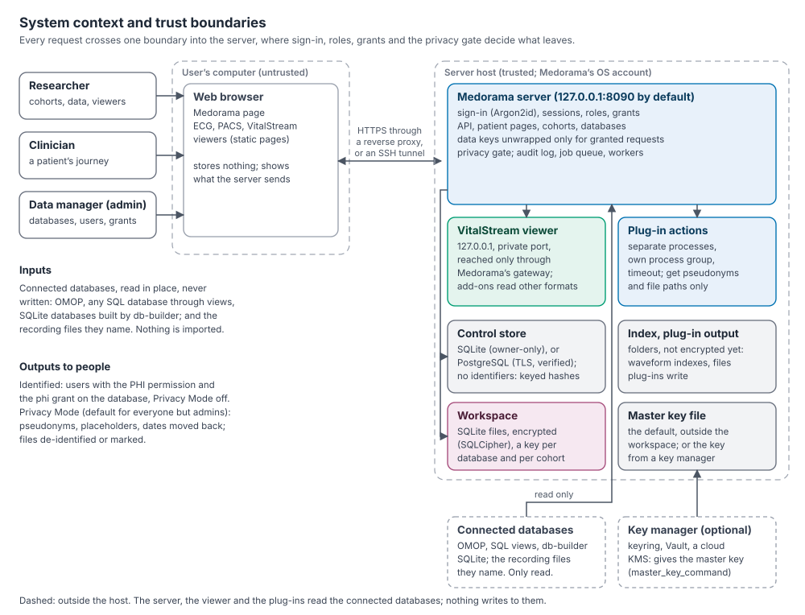
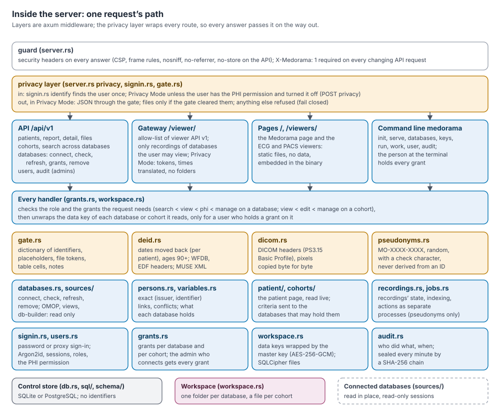
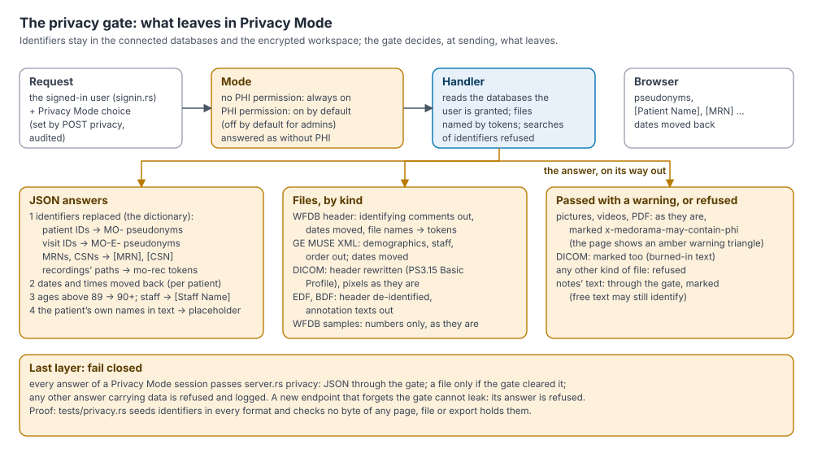

# Security and privacy review

This document is for the people who decide whether Medorama may run on their institution's
patient data: IT security reviewers, privacy officers, and IT and research administrators. It
describes what Medorama protects, against whom, how, and what it leaves to the deploying
institution. Each control names the code that implements it and the test that checks it, so
that every claim can be verified rather than taken on trust.

It describes Medorama 0.3.1 (a pre-release). Medorama is research software, not a medical device,
and it holds no certification. To report a vulnerability, see [SECURITY.md](../SECURITY.md).

A plain-language explanation of how identifiers are hidden is
[protecting-patient-data.md](protecting-patient-data.md); the system's parts are described in
[architecture.md](architecture.md), and sign-in in [sign-in.md](sign-in.md).

## Contents

- [Executive summary](#executive-summary)
1. [Scope and intended use](#1-scope-and-intended-use)
2. [Architecture and trust boundaries](#2-architecture-and-trust-boundaries)
3. [Assets and data classification](#3-assets-and-data-classification)
4. [Threat model](#4-threat-model)
5. [Authentication](#5-authentication)
6. [Authorization](#6-authorization)
7. [Privacy Mode and the privacy gate](#7-privacy-mode-and-the-privacy-gate)
8. [Data at rest](#8-data-at-rest)
9. [Data in transit](#9-data-in-transit)
10. [Web application security](#10-web-application-security)
11. [Untrusted input](#11-untrusted-input)
12. [Audit logging](#12-audit-logging)
13. [Background jobs and plug-in actions](#13-background-jobs-and-plug-in-actions)
14. [Supply chain, build and repository](#14-supply-chain-build-and-repository)
15. [Regulatory mapping](#15-regulatory-mapping)
16. [Deployment checklist](#16-deployment-checklist)
17. [Known limitations and residual risks](#17-known-limitations-and-residual-risks)
18. [Verifying these claims](#18-verifying-these-claims)

## Executive summary

Medorama is a single server program, written in Rust, that an institution runs on its own
hosts. It serves a web page and three viewers to the institution's users, and reads patient
data from the databases it is connected to (OMOP instances, SQL databases through views, SQLite
files made by db-builder), in place and read-only, and from the files those databases name. It
imports nothing, and sends nothing to any third party: no telemetry, no external services, and
no scripts or fonts from other sites.

- **One way in.** Every request passes Medorama's sign-in. Users sign in either with
  Medorama's own accounts (Argon2id password hashes, throttling, hashed session tokens) or
  through the institution's authenticating reverse proxy, which brings single sign-on and
  multi-factor authentication. The sign-in method is one module (`signin.rs`); roles, grants and
  permissions are decided in Medorama, on the server, for every request.
- **No patient data in the control store.** Medorama's own database holds users, grants, the
  audit log, the list of connected databases, cohort definitions, patient numbers with their
  pseudonyms, keyed hashes of identifiers, and wrapped keys: no identifier, name or value read
  from a database.
- **An encrypted workspace, one key per database and per cohort.** What Medorama generates from
  a database (its persons as linked and their encounters, the names and units of its variables,
  the state of the recordings it has opened, the numbers of actions' results) and each cohort's members are SQLite files encrypted with SQLCipher (AES-256), each
  owner with its own data key. The data keys are kept only wrapped (AES-256-GCM) by a master key
  that lives outside the workspace. Removing a database destroys its key first
  (crypto-shredding), then its files, then every cohort row it contributed to.
- **Access granted per database and per cohort.** A user searches, views or sees the
  identifiers of a database only when granted it (`search`, `view`, `phi`, `manage`).
  Administrators are not granted databases by being administrators; an administrator who grants
  themselves one is audited. The server unwraps a database's key only for a request that holds a
  grant on it.
- **Exact identity, never guessed.** Databases are joined only where they name a patient by the
  same issuer and identifier. Medorama never merges patients and has no scored matching.
- **Privacy Mode by default.** Users without the PHI permission are always in Privacy Mode, and
  users with it start in Privacy Mode unless they are administrators. In Privacy Mode, the
  privacy gate de-identifies every answer as it is sent: identifiers become placeholders and
  random pseudonyms, dates move back by a per-patient offset, and files are de-identified at
  the source (WFDB, GE MUSE XML, DICOM with the actions of PS3.15's Basic Profile for the
  attributes it lists, EDF and BDF). Pictures, videos and PDF documents pass with a warning; any
  other file is refused. Outside Privacy Mode, a database's identifiers are shown only to users
  with the PHI permission and the `phi` grant on that database.
- **Fail closed.** A last layer of the server puts every JSON answer of a Privacy Mode session
  through the gate and refuses any other answer the gate did not clear, so a new endpoint that
  forgets the gate cannot leak identifiers. An end-to-end test seeds identifiers in every
  format and checks that no byte of any answer, file or export contains them.
- **Read-only sources, sealed audit log.** Connected databases and their files are only read.
  Sign-ins, grants, identifier searches and views, exports, removals and administrative changes
  are written to an audit log that is sealed every minute with a hash chain and can be copied to
  storage out of the control store administrators' reach.
- **Conservative network posture.** Medorama listens on 127.0.0.1 by default and relies on a
  TLS reverse proxy or an SSH tunnel for remote access. Its waveform viewer runs on a private
  loopback port behind an allow-list gateway. Connections to PostgreSQL use verified TLS.

The deploying institution remains responsible for the host and its disk encryption, TLS,
backups and the custody of the master key, accounts, grants and the PHI permission, network
policy, the connected databases themselves (their identity rules, accounts, encryption and
backups), and the governance of exports. The main residual risks are identities burned into
images and free text, quasi-identifiers, the plug-ins' output folders (not encrypted in
this version), the trust placed in administrators and installed plug-ins, and, in proxy mode, the
trust placed in the proxy ([section 17](#17-known-limitations-and-residual-risks)).

## 1. Scope and intended use

**Medorama** brings a patient's data from many databases together: visits and stays,
laboratory results, vital signs, medications, conditions, notes, ECGs, imaging and
bedside-monitor recordings. It shows each patient's journey on one page, lets researchers build
cohorts across the databases they are granted, and opens recordings and images in its own
viewers.

- **Research use.** Medorama is research software. It is not a medical device, is not cleared
  for diagnosis or treatment, and must not be used to make clinical decisions.
- **One institution, one server.** It runs on a host the institution controls, with its control
  store in SQLite or in the institution's PostgreSQL. It serves that institution's users through
  a browser. It is not a multi-tenant cloud service.
- **Data are connected, never imported.** An administrator connects databases: an OMOP CDM
  instance, any SQL database through views of fixed columns, or a SQLite file made by
  [db-builder](../db-builder/README.md) from exported tables, known exports and folders of
  recordings ([databases.md](databases.md)). Medorama reads them in place, read-only, at each
  request. Files (recordings, ECGs, DICOM studies, documents) are named by the databases' rows
  with their patient; they are read where they lie and never written.
- **Identity is a requirement on the databases.** Each database names its patients by
  identifiers unique within their issuer; Medorama joins databases on exact (issuer, identifier)
  matches and reports conflicts, and does not resolve identity itself.

What Medorama does **not** provide, and a deployment must: TLS termination, the identity
provider for single sign-on or multi-factor authentication, host hardening and disk encryption,
the custody of the master key (a key manager, or the service manager), backups and their
encryption, network policy, a retention policy, and the connected databases' own security. See
the [deployment checklist](#16-deployment-checklist).

## 2. Architecture and trust boundaries



| Zone | Contains | Trust |
|---|---|---|
| User's computer | The browser, with the Medorama page and the ECG, PACS and VitalStream viewers (static pages). | **Untrusted.** Every request is authenticated and authorized on the server; the page decides nothing about access. |
| Network | HTTPS from a reverse proxy, or an SSH tunnel. | **Untrusted.** Medorama listens on 127.0.0.1 by default. |
| Authenticating proxy (optional) | The institution's sign-in in front of Medorama (`sign_in = "proxy"`). | **Trusted to name the user**, on connections from `proxy_addresses` only ([5.2](#52-sign-in-through-the-institutions-proxy)). |
| Server host | The `medorama` process; its VitalStream viewer (a child process on a private loopback port); db-builder's web interface when `db_builder_root` is set (a child process on its own loopback port, with its own sign-in: [5.4](#54-db-builders-web-interface)); plug-in actions (child processes); the SQLite control store; the workspace (encrypted SQLite files, and the index and plug-in output folders, which are not); by default the master key file. | **Trusted.** One operating-system account, Medorama's, runs everything. |
| Key manager (optional) | The master key, given through `$MEDORAMA_MASTER_KEY` or a command (`master_key_command`): the operating system's keyring, Vault, a cloud KMS. | **Trusted**: whoever holds the master key and a copy of the control store and the workspace can read the workspace. |
| Database server (optional) | The control store in PostgreSQL, when `database_url` is set. | **Trusted like the host.** It holds no patient data read from a database, but it holds the wrapped keys, password hashes, keyed hashes of identifiers and the audit log. Reached over TLS with a verified certificate, by an account with rights on that database only. |
| Connected databases | OMOP instances, SQL databases through views, db-builder SQLite files, and the recording files their rows name. | **Read only, enforced** (read-only sessions, read-only SQLite files, inside `data_roots`). What they return is data, never instructions: only the canonical columns are read. Their content, identity rules, encryption and backups are their owners'. |



Every HTTP request passes the same layers before and after its handler
([server.rs](../medorama/src/server.rs), `router`):

1. **guard** (`guard`): sets security headers on every answer, and refuses any API request
   that changes something unless it carries the header `X-Medorama: 1`.
2. **privacy** (`privacy`): identifies the user once per request through `signin::identify`,
   decides whether the session is in Privacy Mode, and on the way out applies the privacy gate
   to every answer of such a session ([section 7](#7-privacy-mode-and-the-privacy-gate)).
3. **The handler** receives the user as `Auth(User)` and checks the role, the grants on the
   databases and cohorts it touches, and the PHI permission it needs.

The deployment topologies (one server, behind a TLS proxy or an institution's sign-in, viewers
alone) are described in
[architecture.md](architecture.md#trust-boundaries-and-deployment). Every setting and endpoint
is specified in [administration.md](administration.md) and [api.md](api.md).

## 3. Assets and data classification

| Asset | Examples | Classification | Where it lives |
|---|---|---|---|
| Direct identifiers | Names, MRNs, dates of birth, patient IDs; encounters' dates | **PHI** | The connected databases (read only); as linked, with each person's encounters (key, start, end, intensive care), in each database's `persons.sqlite` in the workspace (encrypted with its key) |
| Clinical data | Results, vital signs, medications, conditions, notes, with their real dates | **PHI** (dates and free text identify; HIPAA counts them) | The connected databases, read at each request; not copied |
| Files | Recordings, ECGs, DICOM studies, PDFs, pictures, videos | **PHI** (headers, file names, burned-in text) | Where the connected databases say (read only) |
| What Medorama generates | Each database's catalog (the names and units of its variables, their counts once a manager counts them), the state of the recordings it has opened, the numbers of actions' results; cohorts' members and their provenance | **PHI** or sensitive (dated, linkable) | The workspace: one SQLite file each, encrypted (SQLCipher, AES-256) with its owner's data key |
| Recording indexes | Waveform envelopes, vital-sign series, markers, derived series | Sensitive (dated, linkable) | Each database's index store in the workspace (`db-NNNN/index.sqlite`), encrypted (SQLCipher) with that database's data key; the viewer's own store (`viewer/index.sqlite`) with a key of its own |
| Plug-ins' output files | The files an action plug-in writes | Sensitive (dated, linkable) | The plug-ins' output folders in the workspace (`db-NNNN/results/<action>/…`): **not encrypted** in this version |
| Patient index | Keyed hashes (HMAC) of each (issuer, identifier) pair, with the patient number each leads to | Pseudonymous; testable by whoever holds the gate's secret ([17](#17-known-limitations-and-residual-risks)) | The control store (`patient_keys`) |
| Pseudonyms | `MO-XXXX-XXXX`, `MO-E-XXXX-XXXX` | Pseudonymous; the link to identity exists only through the workspace's persons files | The control store (`patients`, `visit_pseudonyms`) |
| Keys | The master key; each data key, wrapped | Secret | The master key outside the workspace (`$MEDORAMA_MASTER_KEY`, `master_key_command`, or `master_key_file`, by default `<home>/master.key`, mode 0600); the wrapped keys in the control store (`keys`) |
| Credentials | Password hashes, session token hashes | Secret | The control store (`users`, `sessions`) |
| Database passwords | The PostgreSQL control store's, each connected database's | Secret | A password given to Medorama: sealed by the master key in the control store (`databases.password_wrapped`), never shown. Otherwise files readable by Medorama's account (`database_password_file`, a database's `password_file`) or the environment. Never in a URL, a settings file or the audit log |
| Secrets | The gate's secret (keys the patient index's hashes, the replacement of DICOM UIDs and the tokens of entries and visits); the internal viewer's password file and signing key; the SQLite control store's own key, if set | Secret | The control store (`keys`, owner `gate`: wrapped by the master key), `<home>/viewer/auth.json` (mode 0600), the environment or a key file |
| Audit log | Who signed in, connected, granted, searched identifiers, viewed, exported, removed | PHI: identifier searches are kept as typed (a name, an MRN), and some entries name recordings' real paths | The control store (`audit`, `audit_seals`), and optionally `audit_export`; kept after a database is removed |

## 4. Threat model

**Actors considered:**

| Actor | Capability | Main controls |
|---|---|---|
| Network attacker | Reaches the server's port | Loopback by default; TLS at a reverse proxy; every endpoint except sign-in and the static pages requires a signed-in user; sign-in throttling |
| Someone who can reach Medorama's port in proxy mode | Sends a forged user header | The header is believed only from `proxy_addresses`; Medorama stays on 127.0.0.1 or behind a firewall ([5.2](#52-sign-in-through-the-institutions-proxy)) |
| Signed-in user without a grant | Any role | Sees no patient, recording or variable of a database not granted; its key is not unwrapped for the user's requests ([6](#6-authorization)) |
| Signed-in user without the PHI permission | Any role, any grants | Always in Privacy Mode: answers through the gate; identifier searches refused; files the gate cannot de-identify refused |
| User with the PHI permission | Sees identifiers when they choose | Only of the databases granted `phi`; Privacy Mode on by default for non-administrators; switching it off is audited; identifier searches, views and exports are audited |
| Administrator | Manages users, connects databases, changes settings | Trusted by design. Not granted databases by being an administrator: granting oneself is audited (`grant_self`); every other action audited; audit log sealed and exportable |
| Malicious or malformed file | Named by a connected database | Parsers check every length; failures are errors, not crashes; active content sandboxed |
| Malicious web content | A crafted SVG, PDF or note | Strict Content Security Policy, no inline scripts, sandboxed file responses, output escaping |
| Other users of the host | Local accounts | Owner-only home folder, workspace (folders 0700, files 0600) and master key; the internal viewer requires a password only Medorama knows. In proxy mode, local accounts must be trusted ([17](#17-known-limitations-and-residual-risks)) |
| Lost or stolen storage, a copied workspace | A disk, a backup | The workspace's SQLite files are encrypted per owner; without the master key (kept apart from them) they cannot be read. The recordings' indexes are in each database's encrypted index store. The control store holds no patient data read from a database, and can itself be encrypted (SQLCipher). Plug-ins' output folders are not encrypted: disk encryption is the deployment's responsibility |
| A removed database's data, later | A disk image or backup taken after the removal | The data key is destroyed first, then the files: a copy of the disk taken afterwards cannot be read. A backup of the control store and the workspace taken before the removal can, until it expires ([8](#8-data-at-rest)) |
| A connected database returning crafted data | Values meant to break parsing, the page or the gate | Only the canonical columns are read, as values; at most `max_rows` rows kept per criterion, each query time-limited; everything shown is escaped and passes the gate |
| A connected database whose identifiers are wrong | Two patients under one identifier, one patient under two | Exact joins only; a person whose identifiers lead to two patients is a conflict, listed and not linked; nothing is merged. Correct identity is the database owner's duty ([17](#17-known-limitations-and-residual-risks)) |
| Network between Medorama and its databases | Reads or alters traffic | TLS (rustls) with the server's certificate and name verified; required for any server not on the same host unless the URL says `sslmode=disable` |

**Threats and mitigations** (STRIDE):

| Threat | Example | Mitigation | Residual risk |
|---|---|---|---|
| Spoofing | Guessing a password, stealing a session, forging the proxy's header | Argon2id hashes; 256-bit random session tokens stored hashed; HttpOnly, SameSite=Strict cookies, Secure behind TLS; throttling. Proxy mode: single sign-on and MFA at the proxy, header believed only from `proxy_addresses` | Password mode has no MFA (use proxy mode where it is required). Proxy mode is as strong as the proxy and the network path to Medorama |
| Tampering | Changing data through forged requests | Changing requests need `X-Medorama: 1` (CSRF) and, in password mode, a SameSite=Strict cookie; roles and grants checked on the server; connected databases are never written | An administrator can change Medorama's own settings and grants, by design; audited |
| Repudiation | Denying a search, an export or a removal | Audit log of sign-ins, connections, grants, removals, identifier searches and views, exports and Privacy Mode switches; sealed every minute with a hash chain and exportable to a file out of the control store's reach | Changing the control store and the export file together |
| Information disclosure | A user reading identifiers or data not granted | Grants per database and cohort; the privacy gate on every answer, failing closed; identifier searches refused; pseudonyms not derivable from identifiers; the workspace encrypted per database | Pixels, PDFs, videos and free text may still show identity: marked, not removed; plug-ins' output folders not encrypted ([17](#17-known-limitations-and-residual-risks)) |
| Denial of service | Expensive searches, a slow database | A worker pool; time and row limits on connected databases; an offline database is left out of searches and named | Not hardened against hostile signed-in users |
| Elevation of privilege | A viewer reaching outside its files; path traversal; an administrator reading a database not granted | File access only through an item's own files inside `data_roots`; the gateway's allow-list; `..` refused; grants checked on every request, and an administrator's own grant audited | Plug-ins run with Medorama's operating-system rights (administrator-installed code is trusted); the account that runs Medorama can read everything it can |

## 5. Authentication

All sign-in code is in [signin.rs](../medorama/src/signin.rs); accounts and sessions are in
[users.rs](../medorama/src/users.rs). The setting `sign_in` chooses the method. Configuration,
proxy examples and the procedure are in [sign-in.md](sign-in.md).

### 5.1 Password sign-in (the default)

- **Accounts** are personal, created by an administrator in Admin › Users or with
  `medorama user add`. Account names use letters, digits and `. _ - @`, up to 64 characters.
- **Passwords** have at least 10 characters and are stored as **Argon2id** hashes (the `argon2`
  crate's defaults: 19 MiB of memory, 2 iterations, 1 lane, a random salt per password). A
  sign-in with an unknown name performs the same hashing work, so timing does not reveal which
  names exist.
- **Throttling:** every attempt is counted before its password is checked, so attempts made at
  once count too. After 5 attempts that failed within 60 seconds, an account name is locked for
  60 seconds **from that address** (the lock is per name and address, so nobody can lock another
  user out from elsewhere); after 30 failed attempts within 60 seconds from one address,
  whatever the names, that address is refused for 60 seconds. Behind a reverse proxy every
  request comes from the proxy's address: list it in `trusted_proxies`, and a sign-in from it is
  counted for the client the proxy names in `X-Forwarded-For` (the last address there that is
  not a trusted proxy). Without that setting, these limits are the whole site's, and anyone who
  reaches the proxy can keep every user from signing in. At most 4 passwords are checked at once (Argon2id takes memory on purpose); a name no
  account can have (over 64 characters, other characters) is refused without a check. Every
  failure waits one second before answering. Failures are audited (`login_failed`, with at
  most 64 characters of the name given).
- **Sessions:** a 256-bit random token from the operating system's generator; only its SHA-256
  is stored. The cookie (`medorama_<port>`) is `HttpOnly`, `SameSite=Strict`, `Path=/`, and
  `Secure` when `secure_cookies = true` (required behind TLS). Sessions expire after
  `session_hours` (default 12) and end when unused for `session_idle_minutes` (default 60; 0:
  only `session_hours` ends them). The page's automatic checks for new data (`GET version`, and
  requests marked `X-Background: 1`) do not count as use, so an unattended page signs out. The
  time of last use is written at most once a minute. Expired sessions are purged.
- **Ending sessions:** **Sign out** deletes the session. A user can end all their sessions on
  every device (**Sign out everywhere**, `POST logout {"everywhere": true}`), and an
  administrator can end a user's (Admin › Users › **Sign out**, `PATCH users/{id}
  {"sign_out": true}`); both are audited. A new password or a disabled account ends them too.
  A disabled account is refused at its next request.

Tests: `medorama/tests/signin.rs` (`with_passwords`), and the sign-in steps of every API test.

### 5.2 Sign-in through the institution's proxy

With `sign_in = "proxy"`, an authenticating reverse proxy (oauth2-proxy, Apache httpd with
mod_auth_openidc, mod_shib or mod_auth_gssapi, nginx with `auth_request`) signs the user in with
the institution's method, including single sign-on (OpenID Connect, SAML), Kerberos and
multi-factor authentication, and names the user in a header (`proxy_user_header`, default
`X-Remote-User`).

- **The header is believed only on connections from `proxy_addresses`** (default 127.0.0.1 and
  ::1; exact addresses, no ranges). From anywhere else it is ignored and the request is not
  signed in (`signin::identify`).
- **Accounts stay in Medorama.** The name is matched case-insensitively with an enabled
  account (`users::get_by_login`); a name with no account, a disabled account, or two accounts
  differing only in case is refused with HTTP 403 and a reason the page displays. Roles and
  the PHI permission are assigned in Medorama, not taken from the identity provider.
- **No password is accepted:** `POST login` and password changes are refused (HTTP 400).
- **Sessions are the proxy's.** Medorama keeps none in this mode; **Sign out** leads to
  `proxy_logout_url`. Session lifetime and idle timeout are set at the proxy or the identity
  provider.
- **Audit:** one `login` entry per visit (detail `proxy`), and one `login_failed` entry per
  visit for an unknown name.
- **Requirements:** Medorama must be reachable only through the proxy (keep
  `host = "127.0.0.1"`, or firewall its port to the proxy's address), its host must have no
  untrusted local accounts, the proxy must remove any incoming copy of the header, and TLS
  must terminate at the proxy with `secure_cookies = true`
  ([sign-in.md, Security requirements](sign-in.md#security-requirements-for-proxy-sign-in)).
- **Validation:** inconsistent settings stop Medorama at start (`config.rs`, `sign_in_method`).

The proxy's header must come once: a request with two copies of it (one the client sent, one the
proxy added) names nobody. Addresses compare as the same address whether written as IPv4 or as
IPv6's form of it (`::ffff:127.0.0.1`).

Tests: `medorama/tests/signin.rs` (`through_a_proxy`: the header from another address counts for
nothing, a name without an account is refused with its reason, passwords are refused, one audit
entry per visit; `proxy_headers_and_addresses`; `throttled_sign_in`: 40 attempts at once, 5
checked; `the_phi_permission_is_given_by_those_who_have_it`) and `config.rs` `sign_in_settings`.

### 5.3 Other access paths

- **The command line** (`medorama …` on the host) acts as Medorama's account, with every grant
  (audited as `local:<user>`): whoever can run it under that account, with the master key, can
  read the control store and the workspace directly anyway.
- **The internal VitalStream viewer** listens on 127.0.0.1 on a private port, with a password
  file (`<home>/viewer/auth.json`, mode 0600) whose signing key only Medorama knows. Medorama's
  gateway signs each request it passes on and never forwards the user's own cookie; users never
  sign in to the viewer, and its port is of no use to other local accounts (`viewer.rs`,
  `gateway.rs`).
- **The viewers alone**, without Medorama, have their own optional password and a root folder
  fixed at build time ([sign-in.md, The viewers' own sign-in](sign-in.md#the-viewers-own-sign-in)).

Not provided by Medorama itself: multi-factor authentication and single sign-on (provided
through the proxy), password expiry, and group or role mapping from an identity provider.

### 5.4 db-builder's web interface

`db-builder serve` ([db-builder/README.md, Web
interface](../db-builder/README.md#web-interface)) is a second web service, run by an
administrator alone or by Medorama (`db_builder_root`: a child process on 127.0.0.1, port
`db_builder_port`; [administration.md, db-builder](administration.md#db-builder)). Medorama does
not proxy it and shares nothing with it: no sign-in, cookie, key or account, and none of
Medorama's secrets in its environment (the master key and passwords are removed, as for
plug-ins; the waveform viewer is started the same way). Its controls
(`db-builder/src/serve/`, `db-builder/src/root.rs`):

- **Its own sign-in**: one account, its Argon2id hash in `<db-builder home>/password` (mode 0600,
  its folder 0700), set with `db-builder serve --set-password`; it does not start without one.
  Sessions are random 256-bit tokens, kept as SHA-256 hashes in memory, in an HttpOnly,
  SameSite=Strict cookie (`db_builder_<port>`, Secure with `--secure-cookies` or behind a proxy
  that says `X-Forwarded-Proto: https`); they end after `--idle-minutes` (60) unused, or 12 hours.
  Failed sign-ins are refused for a minute beyond five from one address or thirty in all, and each
  waits a second. Every API request but the sign-in needs a session; the page itself holds no data.
- **CSRF**: every request that changes something carries `X-DB-Builder: 1`. Medorama's page, on
  another port of the same host, is a different origin: the browser does not let it add the header
  without db-builder's consent (a CORS preflight that db-builder never answers), so it cannot act
  for a db-builder session, and the same holds the other way. Its page may not be framed; its
  answers are not cached.
- **Root confinement**: every path is relative to `--root` (or absolute and inside it) and
  compared by its real path, symbolic links resolved: `..`, absolute paths elsewhere and links (or
  folders of links) leading out are refused; the file chooser lists only what lies inside; files
  are written only inside, and never through a link. Files that a table's rows name outside the
  root are left out, and the recording readers open files inside it only. Tested in
  `db-builder/src/root.rs` and `db-builder/tests/serve.rs`.
- **Localhost**: it listens on 127.0.0.1 by default (Medorama always starts it so), and warns at
  start when told to listen elsewhere without HTTPS.
- **PHI on its pages**: db-builder builds databases from identified exports, and its pages show
  what they hold (names, MRNs, dates of birth) to its account. Privacy Mode and the privacy gate
  are Medorama's and do not apply there. Give its password only to those who may see the inputs
  themselves; its log of actions (`db-builder.log`) names files and sources, never rows.

## 6. Authorization

Three independent things decide what a user may do and see: the **role** (what the user may
do), the **grants** (which databases and cohorts the user may use), and the **PHI permission**
(whether the user may leave Privacy Mode).

| Role | May |
|---|---|
| `viewer` | Look at the patients, visits, recordings and variables of the databases granted to them; build, keep and share cohorts; keep a history. |
| `analyst` | Everything a viewer may do, and run actions (indexing, plug-ins). |
| `admin` | Everything an analyst may do, and connect databases, manage users and settings, read the audit log, and grant themselves a database. |

**Grants** ([grants.rs](../medorama/src/grants.rs)) are kept per user, per object and per
permission; each permission implies the weaker ones.

| Object | Permissions, weakest first |
|---|---|
| A database | `search` (criteria find its patients) < `view` (its data on patients' pages, its recordings, the viewer) < `phi` (its identifiers, with the PHI permission, outside Privacy Mode) < `manage` (check, refresh, grant, remove; see its URL, settings and identity conflicts) |
| A cohort | `view` < `edit` < `manage` (share, delete) |

- **Granted, never assumed.** The administrator who connects a database, and the user who makes
  a cohort, receive every grant on it. Other administrators are not granted a database by being
  administrators: they see it listed, so that they can grant it, and may grant it to themselves,
  which is audited as `grant_self` (`server.rs`). Every grant and revocation is audited.
- **Keys follow grants.** The server unwraps a database's data key only for a request whose user
  holds a grant on it: keys protect the workspace's files at rest, grants protect them in use.
  Revoking a grant changes no data.
- **Searches** go to the databases ticked by the user, granted `search`, and online; a result
  names the databases it searched and those it left out, and why.
- **Identifiers** of a database reach a user only with the PHI permission, the `phi` grant on that
  database, and Privacy Mode off (`patient/identity.rs`, `patient/list.rs`). A patient in two
  databases shows the identity of the databases granted `phi` only, and the rest of a database
  granted without `phi` (its entries, visits, recordings, files, a cohort's export of it, the
  reasons a cohort search gives) leaves as in Privacy Mode, for that patient, even with Privacy
  Mode off (`patient/restricted.rs`, `server.rs` `file_restricted`; tested in
  `tests/databases.rs`, `phi_on_one_database_does_not_identify_another`).
- **Jobs** are listed to non-administrators for the databases granted to them `view`, with the
  errors of their own runs only (`jobs.rs` `list_for`). The grants routes of a database
  (`databases/{id}/grants`, `…/conflicts`) answer 404 to who may not search it, whether it
  exists or not.
- **Administrators without the PHI permission cannot lift its protections:** withholding less
  in Privacy Mode, giving the permission, and resetting the password of a user who has it all
  need it (a reset ends that user's sessions, audited `phi_password_reset`).
- **Every check is on the server.** The page hides what a user may not do, but each endpoint
  checks again (`admin()`, `User::can_run`, `grants::require`, the session's mode).
- **A session in Privacy Mode has no PHI permission.** The server replaces its user with a copy
  without the permission (`User::in_privacy_mode`), so any check that depends on the permission
  fails closed for that session.
- **Files** are served one item at a time (`patients/{id}/file/{item}`, the item a recording's
  number) and, by name, only the files that belong to that item (a WFDB record's signal files, an
  attached folder's files), inside `data_roots`, of a database granted `view`; never other files
  of the folders they lie in. Paths are compared with `data_roots` by their real paths (symbolic
  links resolved); an attached folder's symbolic links are not its files, and a file named by a
  WFDB header must really lie beside it.
- **The PHI permission** is given (to a new account or an existing one, the administrator's own
  included) only by an administrator who has it.
- **The VitalStream gateway** passes only listed requests of the viewer's API, each checked
  against the user's rights: a non-administrator opens only recordings of databases granted
  `view`; default deny ([architecture.md, The gateway](architecture.md#the-gateway)). Tested in
  `medorama/tests/gateway.rs`.
- **The command line** acts with every grant ([5.3](#53-other-access-paths)).
- **Not provided:** access lists per patient or per study within a database. A user granted a
  database sees all of its patients, as Privacy Mode and the `phi` grant allow; separate
  databases, granted separately, serve separate studies.

Tests: `medorama/tests/databases.rs` (`grants_decide_what_a_user_sees`,
`a_search_names_the_databases_it_left_out`), `grants.rs` unit tests.

## 7. Privacy Mode and the privacy gate



The design is explained in full, for every audience, in
[protecting-patient-data.md](protecting-patient-data.md). This section summarizes it as
controls for a review.

### 7.1 The rule

**Each connected database keeps its identifiers; Medorama keeps those it linked only in that
database's encrypted persons file; the server decides, at the moment of sending, what leaves. In
Privacy Mode, no identifier reaches the browser.** The page never receives what it must not show
and does no masking of its own.

| User | Privacy Mode |
|---|---|
| Without the PHI permission | Always on; cannot be switched off |
| With the PHI permission, not an administrator | On by default; may be switched off |
| Administrator with the PHI permission | Off by default; may be switched on |

Outside Privacy Mode, a database's identifiers are sent only to a user who also holds the `phi`
grant on that database; the identifiers of the other databases granted to the user stay behind
the gate. The switch calls `POST privacy`, which is audited (`privacy_on`, `privacy_off`). The
choice is the session's and is kept by the server, never by the browser: in password mode in the
session's row, until the session ends; in proxy mode for the user's visit (until an idle time
passes without a request, or `session_hours`), in the server's memory. Every sign-in starts in the
user's default mode, so no cookie, left by an earlier user of the browser or made by hand, can
take a session out of Privacy Mode. A user without the permission who asks to leave Privacy
Mode is refused (HTTP 403).

### 7.2 Controls

| Control | What it does | Code | Test |
|---|---|---|---|
| Mode decision | Privacy Mode unless the user has the PHI permission and switched it off | `server.rs` `in_privacy`, `session_user` | `tests/privacy.rs` |
| Identifiers per database | A database's identity (names, MRNs, dates of birth, patient IDs) only from databases granted `phi`, and only outside Privacy Mode | `patient/identity.rs`; `patient/list.rs` | `tests/databases.rs` (`grants_decide_what_a_user_sees`) |
| Identifier dictionary | Each connected database's patient IDs (from its persons file) become the patients' pseudonyms; MRNs placeholders; recordings' paths tokens and the folders they lie in `[Folder]`, in every string of an answer (paths inside text too: an error that names a file). Built again whenever a database is connected, refreshed or removed, or a kept recording's path or label changes or it goes (`data_version.identifiers`); recordings kept for the first time, as patients are opened, are added to the dictionary in use (`data_version.recordings`), before the answer that read them is cleared | `gate.rs` `Dict`, `Restricted::json`; `server.rs` `restricted` | `gate.rs` unit tests; `tests/privacy.rs` (`the_dictionary_follows_the_identifiers`) |
| Placeholders | Names, dates of birth, staff names and withheld values become fixed text | `gate.rs`, `Restricted::json` | `tests/privacy.rs` |
| Pseudonyms | Random, stored, check character; never derived from an identifier; visits by their own pseudonyms (`MO-E-…`) | `pseudonyms.rs` | `pseudonyms.rs` unit tests |
| Dates and ages | Every date moved back by Medorama's offset and the patient's own days; ages above 89 as `90+` | `deid.rs` `Settings`, `answer_with`, `shift_text` | `deid.rs` unit tests; `tests/privacy.rs` (no JSON number is a real time) |
| Small counts | A variable's entries and persons, once counted (**Count now**), from 1 to 10 shown as "< 11" in the page, the command and the API, to every user | `variables.rs` `shown`, `ShownVariable` | `tests/connected.rs` (`connecting_keeps_the_subjects_their_encounters_and_the_catalog_only`) |
| Notes | The patient's own names (each part of a compound name: `Smith-Jones`, `O'Brien`) and date of birth replaced; marked; withheld if the administrator chooses | `gate.rs` `Restricted::note`, `name_words` | `tests/privacy.rs` |
| Errors and jobs | The viewer's error texts replaced by a fixed sentence; the records of a folder it left out named by number; a failed job's error `failed`; plug-ins' output folders for administrators only (and not in Privacy Mode) | `gateway.rs` `private_answer`; `server.rs` `jobs_list` | `tests/privacy.rs` (`around_the_gate`, `the_viewers_errors_in_privacy_mode`) |
| Searches | Searches of identifiers refused; patients found by pseudonym | `search.rs`, `patient/list.rs` | `tests/privacy.rs` |
| Files | De-identified by kind, passed with a warning, or refused ([7.3](#73-the-gates-file-rules)) | `gate.rs` `file_kind`; `server.rs` `attachment_response` | `tests/privacy.rs`; `tests/dicom_samples.rs` |
| The VitalStream gateway | Recordings by token, no folder browsing, times translated both ways | `gateway.rs` | `tests/gateway.rs` |
| Every route | Every GET route of the API, and the POST routes that answer with data, asked in Privacy Mode; a new GET route fails the test until it has a case | | `tests/privacy.rs` (`every_route_in_privacy_mode`) |
| Exports and plug-ins | Exports pass the same gate, every cell of text; plug-ins get the pseudonym, and the recording's real path and files (trusted code) | `cohorts/export.rs`; `jobs.rs` | `tests/privacy.rs` |
| Connected databases | Only canonical columns, each with a privacy class; persons as pseudonyms; visits and entries as keyed tokens | `sources/`, `patient/items.rs` | `tests/privacy.rs` (over a db-builder database) |
| Fail closed | The last layer gates every JSON answer and refuses any other uncleared answer | `server.rs` `privacy` | `tests/privacy.rs` |

Administrators choose what Privacy Mode withholds, Medorama's date offset and the spread of
per-patient days in Admin › Privacy Mode; each change is audited (`deid_settings`). The defaults
follow the Safe Harbor identifiers that the databases' canonical columns hold, except the text of
notes, which is shown with protections and a warning unless the administrator withholds it.
Pseudonyms, file tokens, staff placeholders and the refusal of unknown files always apply.

### 7.3 The gate's file rules

| Kind | In Privacy Mode |
|---|---|
| WFDB header | Identifying comments removed (their keys compared without case, spaces, `_` or `-`, and written `key: value`, `key=value` or `key - value`); the patient's own names and date of birth replaced in every other comment; staff `[Staff Name]`; dates moved; ages capped; file names replaced by tokens |
| WFDB samples | Sent as they are (numbers only), when a header of the same attachment names the file; any other `.dat` file refused |
| WFDB samples in a MATLAB file | When a header of the same attachment names the `.mat` file: its first matrix only (other variables after it not sent), its descriptive text and the matrix's name blanked (`mat_deidentified` in `libs/engine/src/sources/wfdb_files.rs`); a file that is not a level 4 or uncompressed level 5 MAT file, and any other `.mat` file, refused |
| GE MUSE XML | Demographics removed except age and sex (their tags found with attributes and spaces too); order removed; staff replaced; the patient's own names and date of birth replaced in the statements; dates moved. A file that still holds a patient's name, ID or date of birth afterwards, and other XML, refused |
| DICOM | Header rewritten with the actions of PS3.15 Table E.1-1 (the Basic Application Level Confidentiality Profile) for the attributes `dicom.rs` lists, with Retain Longitudinal Temporal Information with Modified Dates; the free text left (and, in implicit-VR files, text of unknown VR) without the patient's names, date of birth and the identifiers Medorama knows; pixel data copied byte for byte; marked as possibly identifying. Not a certified implementation of the profile ([protecting-patient-data.md](protecting-patient-data.md#de-identifying-files-at-the-source)). Deflated and big-endian files, and sequences nested more than 32 deep, refused |
| EDF, EDF+, BDF, BDF+ | Patient field `X X X X`; recording field `Startdate <moved date> X X X` (EDF+, BDF+) or blank (EDF, BDF); start date and time moved back; annotation texts removed, time-keeping kept; samples as they are. EDF+ files with annotations larger than 64 MB refused |
| Pictures, videos, PDF | Sent as they are, marked `x-medorama-may-contain-phi` (an amber warning triangle on the viewer's tab) |
| Anything else | Refused (HTTP 403) |

In Privacy Mode, files are named by tokens (`mo-f0000.hea`) and real file names are not
accepted; file answers carry `Vary: Cookie`. The element-by-element DICOM rules and the EDF
rules are in [protecting-patient-data.md, De-identifying files at the
source](protecting-patient-data.md#de-identifying-files-at-the-source).

### 7.4 Fail closed

The gate is applied by the handlers that know their data, and **enforced by the last layer**
(`server.rs`, `privacy`). For a session in Privacy Mode, every JSON answer passes the gate
there; a file passes only if a handler cleared it (the internal header `x-medorama-gate`, removed
before the answer leaves); any other answer carrying data is refused (HTTP 403) and logged on
the server's standard error. The pages, their scripts, redirects, errors without data and the
session's own endpoints (`me`, `login`, `logout`, `privacy`, `sign-in`) pass unchanged. A new
endpoint that forgets the gate therefore cannot leak: its answer is de-identified or refused.

### 7.5 Pseudonyms and date shifting

Pseudonyms are drawn from the operating system's secure random generator and stored; they are
not a hash of any identifier, which, for short MRNs, could be reversed by enumeration. This
follows HIPAA §164.514(c) and ISO/TS 25237. The patient index's keyed hashes of identifiers
([8](#8-data-at-rest)) are a different thing: they join databases on the server, and never
leave it. Dates are shifted, not removed, because intervals
are the substance of research: the per-patient part of the offset (0 to `spread_days`, default
365, at most 3,650) is drawn once and stored, so every session sees the same dates, and a
patient's intervals are exact. Date shifting is pseudonymization: learning one real date of a
patient reveals that patient's offset, and every other's to within `spread_days`.

### 7.6 How it is verified

`medorama/tests/privacy.rs` connects a db-builder database seeded with identifiers that cannot
appear by chance (a name, an MRN, a patient ID, the database's key for a visit, a date of birth,
staff names, and real dates in the forms tables, DICOM, MUSE, WFDB, EDF and EDF+ write them) in
every format Medorama serves: results, notes, a WFDB record, GE MUSE XML, DICOM, an EDF+ file, a
picture, a text file and an ICU recording. It requests every page's answers, every entry's
detail, every file and its parts, and every cohort export, as a user without the PHI permission
and as an administrator in Privacy Mode, and asserts that **no byte of any answer holds any of
them**, that no JSON number is a real time, that identifier searches are refused or find nobody,
that placeholders and pseudonyms appear, that unknown files are refused and that pictures and
DICOM files are marked. `tests/gateway.rs` checks the VitalStream gateway with a real viewer;
`tests/databases.rs` checks grants, linking, conflicts and removal. Unit tests cover each
de-identifier (`gate.rs`, `deid.rs`, `dicom.rs`, `pseudonyms.rs`).

## 8. Data at rest

([workspace.rs](../medorama/src/workspace.rs), [databases.rs](../medorama/src/databases.rs),
[persons.rs](../medorama/src/persons.rs), [store.rs](../libs/engine/src/store.rs))

- **No patient data in the control store.** It holds users, sessions, grants, the audit log, the
  list of connected databases, cohort definitions, the wrapped keys, and patients as numbers and
  pseudonyms only. Identity across databases is kept as keyed hashes: an HMAC-SHA-256, under the
  gate's secret, of each (issuer, identifier) pair (`patient_keys`); no identifier can be read
  back from it.
- **The workspace is encrypted per owner.** Each connected database's folder (`db-NNNN/`:
  `persons.sqlite`, `variables.sqlite`, `recordings.sqlite`, `results-<action>.sqlite`) and each
  cohort's file (`cohorts/c-NNNN.sqlite`) is a SQLite database encrypted by **SQLCipher**
  (AES-256, every page) with its owner's own 256-bit data key, used as a raw key. A file that does
  not open with its key is an error, never a new empty database. Folders are 0700 and files 0600.
- **The recordings' indexes are encrypted with their database** (index format 3:
  [index-format.md, Version 3](../viewers/vitalstream/docs/index-format.md#version-3-the-index-store)).
  Each recording database's indexes (waveform envelopes, vital-sign series, markers) are in one
  SQLite database, its **index store** `db-NNNN/index.sqlite`, encrypted with SQLCipher by that
  database's data key (`workspace::index_store`; the engine's `libs/engine/src/store.rs`). An
  index is built as plain files in a private temporary folder (`db-NNNN/index.tmp/<key>.<process
  id>.<n>.tmp/`, owner-only), packed into the store in one transaction, and the folder removed on
  every way out; entries a killed process left there are removed once a day old. An adapter's
  recording is read again through a private folder (`….read/`) that holds only its `meta.json`,
  removed when the recording is closed. What the viewer indexes itself goes into its own store,
  `viewer/index.sqlite`, with a key of its own (owner `viewer`). Medorama gives the viewer the
  stores and their keys on its standard input (`--keys-on-stdin`), one JSON line each, at every
  start and when a database is connected, and tells it to forget a store before the database is
  removed (`viewer::store_lines`, `viewer::forget_line`). A key is never on a command line, in the
  environment, in a file or in a log.
- **Envelope encryption.** Data keys are kept only wrapped, with **AES-256-GCM** under the master
  key, with the owner (`db:7`, `cohort:3`, `derived:12`) as associated data, so that a wrapped key
  moved to another owner does not unwrap, and with the master key's id (the first 16 hex digits of
  its SHA-256), so that a wrong master key is named rather than taken for damaged data.
- **The master key lives outside the workspace and the control store**: from
  `$MEDORAMA_MASTER_KEY`, from `master_key_command` (the operating system's keyring, Vault, a KMS
  command line), or from `master_key_file` (by default `<home>/master.key`, made by `init`, mode
  0600). Unwrapped data keys are held in memory only, never logged and never sent to a browser.
  `medorama keys rotate` wraps every data key, and the connected databases' stored passwords,
  again with a new master key; the files are not touched.
- **Crypto-shredding.** Removing a database deletes its wrapped data key (and those of what was
  derived from it) before its folder (its index store with it), then every cohort row it contributed to, its patient links,
  the patients left with no link and their pseudonyms, its jobs, grants and its row
  ([administration.md, Removing a database](administration.md#removing-a-database)). Each step is
  repeatable, and an interrupted removal finishes when Medorama next starts. From the moment the
  key is gone, the database's files are unreadable, even from a copy of the disk. Deleting a
  cohort shreds its key, then its file.
- **Connected databases' passwords**, when given to Medorama, are sealed like data keys
  (AES-256-GCM under the master key, the database as associated data) in the control store, and
  never shown again. Others are in files readable by Medorama's account, or in the environment.
- **Not encrypted in this version.** Only the **plug-ins' output folders**
  (`<workspace>/db-NNNN/results/<action>/…`: the files a plug-in writes) are plain files,
  owner-only. Keep the workspace on an encrypted disk (FileVault, BitLocker, LUKS). A plug-in's
  output folder goes with its database's folder. The indexes that no recording of a database uses
  any more are removed from its store (`recordings::sweep_index`).
- **The control store itself.** The SQLite control store (WAL mode; the file and its `-wal` and
  `-shm` 0600, the home folder 0700) can also be encrypted with SQLCipher, with a key from
  `$MEDORAMA_KEY` or the file named by `key_file`. On PostgreSQL, the database server encrypts at
  rest (an encrypted disk or volume; managed services encrypt storage with their key services);
  `key_file` is refused. Medorama's account needs rights on its own database only.
- **Connected databases are never written:** Medorama's sessions there are read-only whatever the
  account may do, SQLite files are opened read-only, and their data are not copied, apart from the
  linked persons' identifiers in the database's own encrypted persons file. Their encryption and
  backups are their owners'. A SQLite file inside the workspace cannot be connected.
- **Secrets:** the gate's secret (32 random bytes) is created once and kept wrapped by the
  master key, like a data key (`keys`, owner `gate`; rewrapped by `medorama keys rotate`); one an
  earlier version kept in plain text (the `gate_secret` setting) is wrapped at its first use and
  its setting deleted. Key material in memory (data keys, their hex copies, the master key's
  cipher) is wiped when dropped (`zeroize`). The internal viewer's password file is mode 0600.
  No secret is in the repository or the binary.
- **Backups.** A backup of the control store holds the wrapped keys of its day. Restoring an old
  backup of both the control store and the workspace brings back the files of a database removed
  since: shredding is final once the backups older than the removal have expired, and the
  removal's audit entry dates it. Keep the master key's backup apart from the workspace's, encrypt
  backups, and restrict who may restore them.

Tests: `workspace.rs` unit tests (`wrapped_keys_unwrap_for_their_owner_only`,
`files_open_with_their_key_only`); `tests/databases.rs` (`removing_a_database_leaves_no_trace`,
`a_removal_a_crash_interrupted_finishes`, `a_cohort_deleted_takes_its_key`,
`a_database_in_the_workspace_or_outside_the_roots_is_refused`).

## 9. Data in transit

- Medorama speaks plain HTTP/1.1 and listens on **127.0.0.1:8090** by default. Bound to any
  other address without `secure_cookies = true`, it prints a warning at start.
- **TLS** is terminated by a reverse proxy in front of it (with `secure_cookies = true`), or
  users reach it through an SSH tunnel (`ssh -N -L 8090:127.0.0.1:8090 user@host`). In proxy
  sign-in mode, the authenticating proxy terminates TLS.
- The internal VitalStream viewer is reached over loopback only, with requests signed by its
  private key.
- **PostgreSQL** (the control store and connected databases): TLS through rustls with the system's
  certificate authorities (and `database_ca_file`, or a connection's `--ca-file`); the server's
  certificate and name are always verified. A server on another host must offer TLS unless its
  URL says `sslmode=disable`; libpq's default, `prefer`, would fall back to plain text, and
  Medorama requires TLS instead. A server on the same host may do without
  ([sql/pg.rs](../medorama/src/sql/pg.rs), `connect`).
- Nothing is sent to any host other than those databases.

## 10. Web application security

- **Content Security Policy** on every page (`guard`): for Medorama's page `default-src 'self'`,
  `frame-ancestors 'none'`, `base-uri 'none'`, `form-action 'self'`; for the ECG and PACS
  viewers' pages `default-src 'self'`, `blob:` only for images, media and frames,
  `object-src 'none'`, `base-uri 'none'`, `form-action 'none'`, `frame-ancestors 'self'`; for the
  VitalStream viewer's page under `/viewer/` `default-src 'self'`, `script-src 'self'`,
  `img-src 'self' data:`, `object-src 'none'`, `base-uri 'none'`, `frame-ancestors 'self'`. No inline
  scripts run. Also `X-Frame-Options`, `X-Content-Type-Options: nosniff`,
  `Referrer-Policy: no-referrer`, and `Cache-Control: no-store` on the API.
- **CSRF:** every API request that changes something must carry `X-Medorama: 1`, which a
  cross-site form cannot set and a cross-site script cannot send without a CORS permission that
  Medorama never grants. Requests to the VitalStream viewer through the gateway that change
  something must carry `X-Medorama: 1` too (`server.rs` `guard`; the viewer's page sends it) and
  be JSON (`Content-Type: application/json`), which a cross-site page cannot send without the
  browser asking first. In password mode, session cookies are also `SameSite=Strict`.
- **Active content in files:** SVG and XML files, and de-identified text files, are served with
  a `sandbox` Content Security Policy; the viewers show pictures, PDFs and videos from `blob:`
  addresses.
- **Output escaping:** the pages build HTML only through an escaping helper (`esc`); there is no
  templating of untrusted HTML.
- **No third-party code in the page:** the page and the viewers are plain JavaScript modules
  embedded in the binary; nothing loads from a CDN.

## 11. Untrusted input

Every file and every value a connected database returns is treated as untrusted.

- **Parsers** for WFDB records, GE MUSE XML, DICOM and EDF check every
  length against the data and never read out of bounds; a malformed file ends in an error, not a
  crash. The DICOM rewriter's tests truncate a file at every seventh byte and require an error
  or a result, never a panic.
- **EDF and BDF** (`libs/engine/src/sources/edf.rs`, `header`): the header's size must equal 256
  bytes per signal plus one; negative sample counts and non-positive record durations are
  refused; the number of data records is taken from the file's size, never beyond it, whatever
  the header declares. Tests in `libs/engine/tests/edf.rs` include files that are not EDF. The
  Privacy Mode rewrite holds at most 64 MB in memory.
- **Coverage-guided fuzzing** ([`medorama/fuzz/`](../medorama/fuzz), cargo-fuzz with libFuzzer)
  covers WFDB headers, EDF and BDF files, GE MUSE XML, DICOM and what users type (cohort
  expressions, searches, dates, numbers, units). Medorama reads no tables (db-builder does, outside
  Medorama), so there is no table target. CI runs each target
  for 5 minutes when `medorama.yml` is run by hand (`make fuzz` locally).
- **Paths:** `..` is refused in every served path; files are resolved after symbolic links and
  their real paths checked against the real paths of `data_roots` (a link inside a root that
  leads out of it is outside). An attached folder's symbolic links are neither listed nor sent.
- **DICOM sequences** nested more than 32 deep are refused (the rewrite would otherwise recurse
  without bound on a crafted file).
- **No uploads of data.** Medorama accepts no tables or files from the browser: data come only
  from connected databases.
- **Files on the server** (`server-files`: the **Choose…** dialog that picks a SQLite database to
  connect) are listed for administrators only, inside `data_roots` (real paths, as above; hidden entries and links that
  lead out are not listed), and never listed in Privacy Mode, whose folders' names may identify.
- **The VitalStream viewers** read WFDB records with wfdb-x, a reimplementation of the WFDB C
  library that finds files only where they are named, keeps a header's signal files inside its
  folder, and has network access off. Medorama's fuzzing does not cover it: open WFDB records
  from trusted sources only. A folder of records is read within limits (5,000 header files, 20
  folder levels, 10 seconds to count them; [wfdb-collection.md](wfdb-collection.md#limits)),
  so a folder opened by mistake cannot exhaust the viewer.
- **The viewers alone** never open anything outside their root, fixed when they are built;
  symbolic links are resolved, and a link that leads outside is neither listed nor opened. A
  build without password support refuses to run under Medorama.

## 12. Audit logging

([db.rs](../medorama/src/db.rs) `audit`; Admin › Audit; `GET audit`)

Each entry records the time, the user, the event, its target and a detail.

| Area | Events |
|---|---|
| Sign-in | `login` (detail `proxy` for proxy sign-in, one per visit), `login_failed`, `password_changed`, `signed_out_everywhere` |
| Users and settings | `user_added`, `user_changed` (an administrator's **Sign out** of another user is written in its detail), `user_deleted`, `deid_settings`, `display_changed`, `init`, `keys_rotate`; on the command line `addon_install`, `addon_remove`, `copy_database` |
| Privacy Mode | `privacy_on`, `privacy_off` |
| Identifiers | `phi_search` (searches of identifiers and of notes' text), `privacy_search` (searches, filters and cohort criteria made in Privacy Mode, with their text), `patient_view`, `phi_export` (an export by a user with the PHI permission outside Privacy Mode) |
| Connected databases | `connect`, `check`, `refresh`, `refresh_failed`, `link` (persons linked), `count` (its variables counted), `index_all` (every recording read for indexing), `remove` (who, when, its name; no patient data), `view` (a recording opened) |
| Grants | `grant`, `grant_self` (an administrator granting themselves), `revoke` |
| Cohorts | `cohort_create`, `cohort_change`, `cohort_refresh`, `cohort_delete` (each with what changed), `export` (a cohort's members' data) |
| Work | `run` |

In Privacy Mode the audit page shows no target or detail, because a search's text may name a
patient. Medorama never deletes entries, not even when a database is removed: the entries that
named its patients by number stay, and the numbers lead nowhere once the links are gone. An
entry the control store cannot take at once (busy, or failing) is never lost: it is kept in order and written before the next entry or by the next seal
(`db::flush_audit`), appended at once to `audit_export` when that is set (a line with
`"pending": true`), and the server's output says so.

**Tamper evidence** ([audit.rs](../medorama/src/audit.rs)):

- **Seals.** Every minute the server seals the entries written since the last seal: a seal is
  the SHA-256 chain of those entries, in order, starting from the previous seal's hash, and each
  entry records its seal. Entries committed late (a long transaction) go into the next seal.
- **Verification.** `medorama audit --verify` (or `GET audit/verify`, administrators) computes
  every chain again: an entry changed, deleted or added to a sealed batch, or a seal changed or
  deleted, shows as the first seal that no longer holds. Entries and seals are numbered by the
  control store without reuse, so verification also counts what it numbered against what is left:
  the last seal deleted with its entries, or entries deleted before they were sealed, show as
  missing (on PostgreSQL, an entry lost with a transaction that failed shows the same way).
- **Out of reach.** Whoever controls the control store could rewrite entries and seals together,
  and its counters with them. So each seal and its entries are also appended to `audit_export` (a
  JSON-lines file, owner-only, synced to disk): put it on storage the control store's
  administrators cannot change (a write-once volume, a log collector). `GET audit/verify`
  compares the control store's seals with it both ways (each exported seal must be in the
  control store, with the same hash; each seal of the control store must be in the export, so
  that an export that once failed is reported): **the end of the log is protected by the
  export**, up to its last seal;
  entries written since are protected by the control store's numbering only.

## 13. Background jobs and plug-in actions

([jobs.rs](../medorama/src/jobs.rs), [actions.rs](../medorama/src/actions.rs))

- **Jobs** (indexing, derived series, plug-ins) run in worker threads of the server, or in
  `medorama work` processes, from a queue in the control store.
- **Plug-ins** are programs an administrator installs (a folder with `action.toml`;
  [actions.md](actions.md)). Each run is a child process in its own process group, with a
  timeout; cancelling or timing out kills the whole group. It receives a job description: the
  recording's number, database, path and format, its patient's **pseudonym**
  (never a database's identifier), and an output folder in the database's workspace folder. The
  numbers of its summary go into the database's encrypted `results-<action>.sqlite`; the files it
  writes in its output folder are not encrypted ([8](#8-data-at-rest)).
- **Not the server's secrets:** a plug-in does not inherit Medorama's own environment variables
  (`MEDORAMA_…`: the control store's URL and password, the master key, the control store's key),
  nor any whose name marks
  it as secret (containing `PASSWORD`, `SECRET`, `TOKEN`, `PASSPHRASE` or `CREDENTIAL`, ending
  in `_KEY`, PostgreSQL's `PGPASS…`, `DATABASE_URL`). The rest stays, so that it finds its
  interpreter and libraries (`actions.rs`, `secret_env`). It receives `MEDORAMA_JOB`, its job's
  description.
- **Trust:** a plug-in runs with Medorama's operating-system rights; it is trusted code, like
  the server. Install only plug-ins you have reviewed. Isolation is by process, not a sandbox:
  a plug-in can still read what Medorama's account can, including the control store's file and a
  master key file.
- **Adapters** (add-on readers of licensed formats, [adapters.md](adapters.md)) are installed by
  an administrator and run in the same way. They return identifiers only in answer to the
  protocol's `identify` command, which Medorama does not use.

## 14. Supply chain, build and repository

- **Rust**, built with `cargo build --locked`: dependency versions are pinned by `Cargo.lock`
  and can be vendored for offline builds ([building.md](building.md)). Every third-party
  component and its license is listed in [THIRD_PARTY_LICENSES.md](../THIRD_PARTY_LICENSES.md).
- **The page and the viewers** are plain HTML, CSS and JavaScript in the repository, embedded in
  the binary: no package manager, no build step, nothing fetched at run time.
- **CI** runs formatting, lints (`clippy`) and every test on Linux, macOS and Windows, the same
  tests on PostgreSQL 14 and 17 (every build includes SQLCipher), db-builder's tests, a browser
  test of the page (headless Chrome), the fuzz targets' build, and the installers ([.github/README.md](../.github/README.md)), and the privacy check
  below on every commit of a change. Binary releases are built from a version tag, and carry
  the license texts of every crate compiled in (`THIRD_PARTY_CRATES.txt`) and wfdb-x's
  (`LICENSE-wfdb-x`).
- **Dependencies are checked** by `cargo deny` ([`deny.toml`](../deny.toml), for the whole Rust
  workspace; `make audit`), on every push, and by hand for advisories published since: any RustSec advisory (vulnerable,
  unmaintained or yanked crates), any license not on the allowed list, or any crate from
  elsewhere than crates.io fails the build.
- **The API is described** in [`medorama/openapi.yaml`](../medorama/openapi.yaml) (OpenAPI 3.1):
  a test fails when a route is added, removed or changed on one side only.
- **The repository holds no patient data.** A privacy check
  ([`tools/git-hooks/check-files`](../tools/git-hooks/check-files)), run by the pre-commit and
  pre-merge-commit hooks and by CI's `privacy` job on every commit, refuses recordings, data files, notebooks with outputs, real recording names and anything in the
  folders kept for local data ([PRIVACY.md](../PRIVACY.md)). Tests and demonstrations use
  synthetic data only, or public data sets kept outside git.

## 15. Regulatory mapping

Medorama is a tool; compliance is a property of a deployment and its governance. This section
maps Medorama's behavior to common requirements so that a privacy or security officer can judge
how it supports them. Medorama is designed to support these safeguards; it does not by itself
make a deployment compliant, and the deploying institution remains responsible.

**HIPAA Security Rule** (45 CFR Part 164, Subpart C), technical and selected administrative
safeguards:

| Safeguard | How Medorama supports it | The institution provides |
|---|---|---|
| Access control, unique user identification (§164.312(a)(2)(i)) | Personal accounts; in proxy mode, the institution's identities | Account provisioning and review |
| Access control, emergency access procedure (§164.312(a)(2)(ii)) | The command line, run by Medorama's account, holds every grant, and is audited as `local:<user>` | The procedure, and who may use that account |
| Access control, automatic logoff (§164.312(a)(2)(iii)) | `session_idle_minutes`, `session_hours` (password mode) | The proxy's or identity provider's session limits (proxy mode) |
| Access control, encryption and decryption (§164.312(a)(2)(iv)) | The workspace encrypted per database and per cohort (SQLCipher, AES-256), data keys wrapped by a master key kept outside it; optional SQLCipher encryption of the SQLite control store | The master key's custody; disk encryption for the plug-ins' output folders; backup encryption; PostgreSQL storage encryption; the connected databases' own encryption |
| Audit controls (§164.312(b)) | The audit log, sealed every minute, exportable, kept after a database is removed ([section 12](#12-audit-logging)) | Regular review; storage for `audit_export`; retention (six years for HIPAA documentation) |
| Integrity (§164.312(c)(1)) | Connected databases and their files are only read; audit seals detect changes to the log | Backups and their integrity |
| Person or entity authentication (§164.312(d)) | Argon2id passwords with throttling; proxy sign-in for SSO and MFA | The identity provider and MFA policy |
| Transmission security (§164.312(e)(1)) | Loopback by default; verified TLS to PostgreSQL | TLS termination at a reverse proxy, network policy |
| Information access management (§164.308(a)(4)) | Roles; grants per database and per cohort; the PHI permission and the `phi` grant; Privacy Mode by default; administrators not granted databases automatically | Deciding who receives which grants and the PHI permission |
| Log-in monitoring (§164.308(a)(5)(ii)(C)) | `login` and `login_failed` entries | Monitoring them |
| Device and media controls, disposal (§164.310(d)(2)(i)) | Removing a database destroys its key first (crypto-shredding), then its files and every cohort row it contributed to | Expiring backups older than the removal; disposing of disks |
| Risk analysis, contingency plan, physical safeguards (§164.308, §164.310) | This document, as input to the analysis | The analysis, backups, disaster recovery, facility controls |

**HIPAA Privacy Rule, de-identification** (45 CFR §164.514(b)(2), Safe Harbor): the 18 kinds of
identifiers, and what Privacy Mode does with each.

| Identifier | Privacy Mode |
|---|---|
| Names | `[Patient Name]`; staff `[Staff Name]` |
| Geographic subdivisions smaller than a state | Not a canonical column of a connected database: not read (free text may still mention one) |
| All elements of dates (except year) related to an individual | **Moved back, not removed** (see below) |
| Telephone and fax numbers, e-mail addresses | Not canonical columns: not read |
| Social security numbers | Not a canonical column: not read |
| Medical record numbers | `[MRN]` |
| Health plan beneficiary numbers, account numbers | Not canonical columns: not read; a visit is shown by its pseudonym, never by the database's key for it |
| Certificate or license numbers, vehicle and device identifiers | DICOM device serial numbers removed; not canonical columns otherwise |
| Web addresses, IP addresses | Not held |
| Biometric identifiers, full-face photographs | **Not removed:** pictures and images are sent as they are, marked |
| Any other unique identifying number or code | Databases' patient IDs replaced by pseudonyms; DICOM UIDs replaced |
| Ages over 89 | `90+` |

**Dates are shifted, not removed.** Safe Harbor removes every element of a date except the year;
Privacy Mode keeps dates, moved by an offset per patient, because intervals are the substance of
research. Data viewed or exported in Privacy Mode are therefore **not** de-identified under Safe
Harbor. They are suited to use as a **limited data set** with a data use agreement
(§164.514(e)), or under an **expert determination** (§164.514(b)(1)) that weighs the offset,
the residual quasi-identifiers and the recipients. Images and free text may still identify.

**GDPR:** data shown or exported in Privacy Mode are pseudonymized data (Art. 4(5)), and remain
personal data. Medorama is designed to support data protection by design and by default
(Art. 25: Privacy Mode is the default for every user but administrators; access is granted per
database; no copy of the source data is made), the security of processing (Art. 32:
pseudonymization, access control, encryption of the workspace, audit logging), and erasure and
storage limitation (Art. 17, Art. 5(1)(e): removing a database shreds everything Medorama
generated from it, once backups older than the removal have expired). The pseudonyms and the
identifiers are kept apart: pseudonyms in the control store, identifiers only in each database's
encrypted persons file. The controller's other duties (lawful basis, records of processing, data
subjects' rights in the source databases, retention) remain with the institution.

## 16. Deployment checklist

1. A dedicated host or virtual machine, an operating-system account for Medorama, full-disk
   encryption (the plug-ins' output folders are not encrypted by Medorama), and the
   operating system kept up to date. No untrusted local accounts on the host.
2. The home folder on a local disk (SQLite's locking is unreliable on network file systems),
   owned by Medorama's account; the workspace owned by it too, outside any folder of recordings or
   connected databases.
3. **The master key** from a key manager or the service manager (`master_key_command`, or
   `$MEDORAMA_MASTER_KEY` from a file readable only by the account), not from a file beside the
   workspace's backups; a copy of it kept safe on its own. Rotate it with `medorama keys rotate`
   when policy asks.
4. Optionally encrypt the SQLite control store too (`key_file` or `$MEDORAMA_KEY`, set before
   `init`).
5. Keep `host = "127.0.0.1"`. Put a reverse proxy with TLS in front, and set
   `secure_cookies = true`, or give users SSH tunnels. Never expose port 8090 directly.
6. Where policy requires single sign-on or MFA, use proxy sign-in
   ([sign-in.md](sign-in.md)):
   - set `sign_in = "proxy"`, `proxy_user_header`, and `proxy_addresses` to the proxy's address
     only;
   - make Medorama reachable only from the proxy (loopback, or a firewall rule);
   - make the proxy remove any incoming copy of the header, and verify it with a forged request
     ([sign-in.md, step 6](sign-in.md#set-up-proxy-sign-in));
   - create accounts under the names the proxy sends; set `proxy_logout_url`;
   - set session lifetime and idle timeout at the proxy or the identity provider.
7. Set `data_roots` to the folders that hold the connected SQLite databases and the recordings,
   and nothing more; mount them read-only for Medorama's account where possible.
8. **Grants:** grant each database only to the people who need it, at the weakest permission that
   serves (`search` or `view`); `phi` and the PHI permission only to the people who need
   identifiers. Review grants and the `grant_self` entries of the audit log regularly, and
   disable accounts promptly when people leave.
9. In Admin › Privacy Mode, review what is withheld and choose the date offset and each patient's
   days; record them under your governance, and do not disclose the offset.
10. Install only reviewed plug-ins and add-ons.
11. Back up the control store, the workspace and the master key, the key apart from the other
    two; encrypt the backups, and test restoring them. Set the backups' retention knowing that a
    removed database can be brought back from a backup made before its removal until that backup
    expires.
12. Set `audit_export` to a file on write-once storage, or one your log management collects; run
    `medorama audit --verify` regularly (it fails when the log was altered).
13. Run Medorama as a service: a systemd user service, a launchd agent, or on Windows a script
    in the Startup folder ([administration.md](administration.md)).
14. **On PostgreSQL:** a database and an account for Medorama alone; TLS on the server (Medorama
    requires it, and verifies the certificate and the name); the password in a 0600 file or the
    service's environment; the server's storage encrypted; `pg_dump` backups encrypted.
15. **Connected databases:** for each, an account that can only read (`SELECT`), on the tables or
    views Medorama reads only; the network path allowed from Medorama's host only; TLS; a time
    limit and a row limit suited to the database (`--timeout-s`, `--max-rows`). Confirm with the
    database's owner that each patient has an identifier unique within its issuer, that the issuer
    is named (`patient_id_issuer`, `--issuer`, `--mrn-authority`), and that the database's own
    encryption and backups meet policy ([databases.md](databases.md)).
16. **No demo with real patients:** install without `--demo` (the default), and set Medorama up
    without `init --demo`: a site's installation, which refuses every demo database (marked by a
    `medorama_demo` table). A demo runs only as an installation of its own (its own home,
    workspace and port), which refuses real databases. Check that `medorama databases list`
    names no demo database and that no page shows the band "Demo · every patient here is
    invented". An installation made before 0.3.1 that connects both kinds is refused until the
    demo's databases are removed ([administration.md](administration.md#the-demo),
    [design/demo.md](design/demo.md)).

## 17. Known limitations and residual risks

The work planned against these is in [todo.md, Privacy and security](todo.md#privacy-and-security).

- **Pixels, documents, video, free text.** Names burned into images, scanned PDFs and video
  frames, and free text that names relatives or staff, are not removed; they are marked.
  Free-text de-identification and optical character recognition of burned-in text are out of
  scope for now.
- **EDF+ annotations.** In files sent to the ECG viewer, annotation texts are removed. In
  VitalStream they are treated as notes (`gateway.rs` `gate_annotations`): withheld when Privacy
  Mode withholds notes' text, otherwise shown with the patient's own names and date of birth and
  the identifiers Medorama knows replaced. Like notes, free text may still identify someone.
- **Quasi-identifiers.** Sex, a capped age, rare diagnoses, units and beds, small cohorts and
  exact intervals can single out a person when combined with outside knowledge.
- **Date offsets.** Learning one real date of a patient reveals that patient's offset, and every
  other patient's to within `spread_days`.
- **Plug-ins' output folders are not encrypted** in this version: the files that plug-ins
  write (which may hold real times). Use disk encryption.
- **Backups bring removed data back.** Crypto-shredding is final only once every backup of the
  control store and the workspace made before the removal has expired.
- **The patient index can be tested by whoever holds the gate's secret.** The keyed hashes of
  (issuer, identifier) pairs are in the control store, and the secret that keys them is there
  too, wrapped by the master key. Whoever holds a copy of the control store and the master key
  can check whether a given identifier is linked, and to which patient number; and since MRNs
  are few (a range of numbers), such a person can try every one and so list them. Without the
  master key, the hashes cannot be tested. Keep the master key apart from the control store and
  its backups, and protect both (SQLCipher with `key_file`, or the PostgreSQL server's
  encryption).
- **Plug-ins handle patient data.** A plug-in reads the recording's real path and files, which
  may name the patient: it is trusted code, like the server.
- **The audit log holds PHI.** Identifier searches are kept as typed, and some entries name
  recordings' real paths: protect the control store and `audit_export` as patient data.
- **Identity is only as good as the databases'.** Medorama joins on exact (issuer, identifier)
  matches: a database that gives one patient two identifiers shows two patients, and one that
  gives two patients the same identifier under the same issuer joins them. Conflicts it notices
  are listed and not linked; nothing is merged. Correcting identity is the database owner's work.
- **Grants are per database, not per patient.** A user granted a database sees all of its
  patients, as Privacy Mode and the `phi` grant allow. There are no access lists per patient or
  per study within a database.
- **Proxy sign-in trusts the proxy and the host.** Anyone who can connect to Medorama's port from
  an address in `proxy_addresses`, including any process on the host with the default
  addresses, can name any user. Roles, grants and the PHI permission are not taken from the
  identity provider, and accounts must still be given an (unused) password when created.
- **Password sign-in has no multi-factor authentication** and no password expiry. Use proxy
  sign-in where policy requires them.
- **Administrators are trusted.** An administrator can grant themselves any database (audited as
  `grant_self`). The audit log lives in the control store; its seals show a change after the fact,
  and its export (`audit_export`) keeps a copy out of the control store's reach, but a host
  administrator who changes both the control store and the export file at once is not detected.
  The account that runs Medorama, with the master key, can read the whole workspace.
- **db-builder's page shows identified data** to its one account, without Privacy Mode, roles or
  grants, and its log of actions is a plain file, not Medorama's sealed audit log ([5.4](#54-db-builders-web-interface)).
- **Plug-ins and add-ons** run with Medorama's operating-system rights (without its secrets in
  their environment).
- **The audit log keeps patient numbers** after a database is removed, because audit logs must be
  kept. The numbers lead nowhere once the links are gone; a search text in a `phi_search` entry may
  still name a patient.
- **A connected database that does not answer** leaves patient pages without its data (the page
  names it) and is left out of cohort searches, which say so.
- **Unsupported encodings are refused, not converted:** deflated or big-endian DICOM, XML that is
  not GE MUSE, text attachments, and EDF+ files with annotations larger than 64 MB are refused in
  Privacy Mode.

## 18. Verifying these claims

From a clone of the repository, the following commands run the tests that check the controls
above. In `medorama/`:

```bash
cargo test --locked                          # every test, including those below
cargo test --test privacy                    # Privacy Mode end to end: no identifier in any answer, file or export
cargo test --test databases                  # connecting, exact linking, conflicts, grants, offline, removal leaving no trace
cargo test --test signin                     # password and proxy sign-in
cargo test --test gateway                    # the VitalStream gateway with a real viewer, Privacy Mode included
cargo test --test browser                    # the page in headless Chrome, Privacy Mode on screen
cargo test --test openapi                    # the API's description names every route
cargo test --lib -- gate:: deid:: dicom:: pseudonyms:: workspace:: grants:: config::   # each de-identifier; keys; grants; the sign-in settings
cargo clippy --all-targets                   # lints
MEDORAMA_TEST_POSTGRES=postgres://user@host/db cargo test   # every test again, the control store in PostgreSQL
medorama audit --verify                      # the audit log's seals hold (on a deployed server)
```

At the repository's root:

```bash
cargo test -p recording-engine --test edf    # the EDF and BDF reader
cargo deny check                             # dependencies: advisories, licenses, sources
make fuzz                                    # the parsers, fuzzed (wfdb_header, edf, muse_xml, dicom, queries)
```

| To inspect | Read |
|---|---|
| Sign-in: methods, the proxy's header, password sign-in and throttling | `medorama/src/signin.rs`; the settings in `medorama/src/config.rs` (`sign_in_method`) |
| Sessions, the Privacy Mode decision, the last layer, security headers | `medorama/src/server.rs`: `session_user`, `in_privacy`, `privacy`, `guard` |
| The workspace: the master key, data keys wrapped and unwrapped, SQLCipher files, shredding, rotation | `medorama/src/workspace.rs` |
| The index stores: SQLCipher with a raw key, packing in one transaction, reading by range, the private temporary folders | `libs/engine/src/store.rs`, `libs/engine/src/index.rs` (`build_into_store`); each database's store and the viewer's in `medorama/src/workspace.rs` (`index_store`, `viewer_store`); the keys on the viewer's standard input in `medorama/src/viewer.rs` (`store_lines`, `forget_line`); tests: `libs/engine/tests/store.rs` (`without_its_key_a_store_is_not_read`), `medorama/tests/databases.rs` (`indexes_go_into_the_databases_encrypted_store_and_leave_with_it`) |
| Grants: permissions, what each implies, granting and revoking | `medorama/src/grants.rs`; an administrator's own grant in `medorama/src/server.rs` (`grant_self`) |
| The patient index: (issuer, identifier) pairs, keyed hashes, conflicts | `medorama/src/persons.rs` |
| Connecting, status, refreshing and removing a database (the six steps, resumed after a crash) | `medorama/src/databases.rs` (`connect`, `check`, `remove`, `resume_removals`) |
| The gate: dictionary, placeholders, files | `medorama/src/gate.rs` |
| Identifiers per database (`phi` grant) | `medorama/src/patient/identity.rs`, `medorama/src/patient/list.rs` |
| Dates, ages, WFDB headers, MUSE XML, EDF headers and annotations | `medorama/src/deid.rs` |
| DICOM | `medorama/src/dicom.rs` |
| Files in Privacy Mode | `medorama/src/server.rs`: `attachment_response`, `edf_deidentified`, `file_response` |
| Pseudonyms | `medorama/src/pseudonyms.rs`; the `pseudonym` column of `patients`, and `visit_pseudonyms` (`medorama/src/schema/`) |
| Accounts and sessions | `medorama/src/users.rs` |
| The VitalStream gateway and the viewer's supervisor | `medorama/src/gateway.rs`, `medorama/src/viewer.rs` |
| The control store, its schema, file permissions, its key | `medorama/src/db.rs`, `medorama/src/schema/` |
| SQLite and PostgreSQL behind one interface, TLS | `medorama/src/sql/` |
| Connected databases: read-only access, views, OMOP | `medorama/src/sources/` |
| The audit log's seals | `medorama/src/audit.rs`; the tables `audit` and `audit_seals` |
| Plug-ins' environment | `medorama/src/actions.rs` (`secret_env`), `medorama/src/jobs.rs` |
| The API, endpoint by endpoint | `medorama/openapi.yaml` |
| Dependency policy | `deny.toml` (the Rust workspace: Medorama, db-builder, the libraries, `vitalstream-rs`) |
