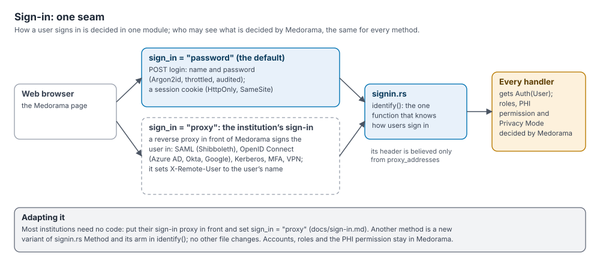

# Sign-in and institutional authentication

This page explains how users sign in to Medorama, and how an institution connects Medorama to
its own sign-in: single sign-on through OpenID Connect or SAML (for example Microsoft Entra ID,
Okta, Google or Shibboleth), Kerberos, multi-factor authentication or a VPN. It is written for
administrators who deploy Medorama and for integrators who adapt it. What users may see once
signed in is explained in [protecting-patient-data.md](protecting-patient-data.md); the
security review is [security.md](security.md).

## Contents

- [Two ways to sign in](#two-ways-to-sign-in)
- [Settings](#settings)
- [Sign-in with Medorama's passwords](#sign-in-with-medoramas-passwords)
- [Sign-in through the institution's proxy](#sign-in-through-the-institutions-proxy)
- [Security requirements for proxy sign-in](#security-requirements-for-proxy-sign-in)
- [Set up proxy sign-in](#set-up-proxy-sign-in)
- [Example proxy configurations](#example-proxy-configurations)
- [Accounts, roles and the PHI permission](#accounts-roles-and-the-phi-permission)
- [Adding another sign-in method in code](#adding-another-sign-in-method-in-code)
- [The viewers' own sign-in](#the-viewers-own-sign-in)

## Two ways to sign in

Medorama separates two questions:

- **Who is asking?** This is the sign-in method's job. All of it lives in one module,
  [`medorama/src/signin.rs`](../medorama/src/signin.rs).
- **What may that user do and see?** Medorama decides this the same way for every method,
  from the user's account: the role (viewer, analyst or administrator), the PHI permission and
  Privacy Mode.



The setting `sign_in` in `medorama.toml` chooses the method.

| `sign_in` | Who the user is | Typical use |
|---|---|---|
| `password` (the default) | The account whose name and password were entered on Medorama's sign-in form. | A single team, a test installation, a server reached through an SSH tunnel or a VPN. |
| `proxy` | The account named in a request header by the institution's authenticating reverse proxy, on requests that come from that proxy. | Single sign-on (OpenID Connect, SAML), Kerberos, multi-factor authentication, an access gateway. |

With `proxy`, the institution's own sign-in, including any multi-factor authentication, is done
by the proxy, and Medorama never sees a password. Accounts, roles and the PHI permission still
live in Medorama, named as the proxy names the users. In both cases, every request handler
receives the signed-in user in the same form (`server::Auth(User)`), so the rest of Medorama
does not depend on the method.

## Settings

The settings below are read from `medorama.toml` in the catalog's home folder
(`config.rs`, `sign_in_method`). Medorama reads them when it starts; restart it after a change.

| Setting | Default | Meaning |
|---|---|---|
| `sign_in` | `"password"` | `"password"` or `"proxy"`. |
| `proxy_user_header` | `"X-Remote-User"` | The request header in which the proxy sends the user's account name. Proxy mode only. |
| `proxy_addresses` | `["127.0.0.1", "::1"]` | The IP addresses the proxy connects from. The header is believed only on requests from these addresses. Each entry is one address; ranges are not accepted. Proxy mode only. |
| `proxy_logout_url` | `""` | Where the page's **Sign out** leads: the proxy's own sign-out address. Empty: the page shows its signed-out screen. Proxy mode only. |
| `secure_cookies` | `false` | Marks Medorama's cookies `Secure`. Set it to `true` whenever users reach Medorama over HTTPS, in either mode. Medorama warns at start when it listens on another address than this computer's, or signs users in through a proxy, with `secure_cookies = false`. |
| `session_hours` | `12` | Password mode: how long a sign-in lasts. Proxy mode: how long a visit's Privacy Mode choice is kept at most. |
| `session_idle_minutes` | `60` | Password mode: a session unused this long ends (0: only `session_hours` ends it). Proxy mode: the gap after which a user's next request counts as a new visit in the audit log. |

Medorama refuses to start when these settings are inconsistent, so that a half-made change is
not silently ignored. The messages are:

| Mistake | Message (after the file's path) |
|---|---|
| A `proxy_…` setting without `sign_in = "proxy"` | `proxy_user_header, proxy_addresses and proxy_logout_url need sign_in = "proxy"` |
| An unknown method | `sign_in: "saml" is not a sign-in method (password, proxy)` |
| A header name with spaces or other invalid characters | `proxy_user_header: "bad header" is not a header name` |
| A host name, or a range, instead of an IP address | `proxy_addresses: "proxy.example.org" is not an IP address` |
| An empty list of addresses | `proxy_addresses: name the address the proxy connects from` |

The page asks the server which method is in use through the public endpoint
`GET api/v1/sign-in`, which answers, for example, `{"method": "proxy", "logout_url":
"/oauth2/sign_out"}`.

## Sign-in with Medorama's passwords

With `sign_in = "password"`, users sign in on Medorama's own form.

- **Passwords** have at least 10 characters and are stored as Argon2id hashes (the `argon2`
  crate's defaults: 19 MiB of memory, 2 iterations, 1 lane, a random salt per password).
- **Throttling.** Each attempt is counted before its password is checked, so attempts sent at
  once count too. After 5 failed attempts within 60 seconds, an account name is locked for 60
  seconds from the address they came from; others, elsewhere, can still sign in under that
  name, so nobody can lock a known account out. After 30 failed attempts within 60 seconds from
  one address, whatever the names, that address is refused for 60 seconds. (Behind a reverse
  proxy, every request comes from the proxy's address: the limits are then the whole site's.)
  At most 4 passwords are checked at once. Every failure waits one second before the answer. A
  sign-in with an unknown name takes as long as one with a wrong password, so the timing does
  not reveal which names exist; a name no account can have (over 64 characters, or with other
  characters than letters, digits and `. _ - @`) is refused at once. Failures are written to
  the audit log (`login_failed`, with at most 64 characters of the name).
- **Sessions.** A successful sign-in creates a 256-bit random token; only its SHA-256 hash is
  stored. The cookie (`medorama_<port>`) is `HttpOnly`, `SameSite=Strict`, `Path=/`, and
  `Secure` when `secure_cookies = true`. A session ends after `session_hours`, or when unused
  for `session_idle_minutes`. The page's automatic checks for new data do not count as use, so
  an unattended page signs out.
- **Privacy Mode.** The session keeps its Privacy Mode choice (in its row in the database):
  a new sign-in starts in the user's default mode.
- **Signing out.** **Sign out** ends the session, and the page loads again, empty, for whoever
  signs in next. **Sign out everywhere** ends all of the user's
  sessions on every device; an administrator can do the same for a user (Admin › Users ›
  **Sign out**). A new password or a disabled account also ends the user's sessions.
- **Changing a password.** Users change their own password from the user menu; administrators
  reset others' in Admin › Users or with `medorama user set NAME --password`.

## Sign-in through the institution's proxy

With `sign_in = "proxy"`, an authenticating reverse proxy stands in front of Medorama. The
proxy signs the user in with the institution's method and then passes each request to Medorama
with a header naming the user. Proxies that do this include oauth2-proxy, Apache httpd with
mod_auth_openidc, mod_shib (Shibboleth) or mod_auth_gssapi (Kerberos), and nginx with
`auth_request`.

Medorama then behaves as follows (`signin.rs`, `identify`).

| Situation | Result |
|---|---|
| The request comes from an address in `proxy_addresses` and the header names an enabled account | The user is signed in. Names are compared ignoring case: `JDoe@Hospital.org` matches the account `jdoe@hospital.org`. |
| The header names no account, a disabled account, or two accounts that differ only in case | HTTP 403 with the reason: "your institution's sign-in names you *name*, and Medorama has no account of that name: ask an administrator". The page shows this explanation. |
| The header is missing or empty | Not signed in (HTTP 401). The page says that the institution's sign-in has not signed the user in. |
| The request comes from any other address | The header is ignored: not signed in (HTTP 401). An IPv4 address and IPv6's form of it (`::ffff:10.0.0.5`) are the same address. |
| The header is given more than once | Not signed in (HTTP 401): a copy sent by the client was not removed. |
| `POST api/v1/login` (the password form) | Refused (HTTP 400): the institution's sign-in names the user. |
| A password change (`POST api/v1/me/password`) | Refused (HTTP 400). The page hides **Change password** and **Sign out everywhere**. |
| **Sign out** | Medorama ends the visit and forgets its Privacy Mode choice, and the page goes to `proxy_logout_url`, the proxy's own sign-out. |
| Privacy Mode | The choice made with the switch lasts the visit (at most `session_hours`), kept in the memory of the Medorama server that was asked; a new visit starts in the user's default mode. With several servers behind the proxy, another server answers in the user's default mode. |

**Audit log.** Medorama writes one `login` entry per visit, with the detail `proxy`, rather than
one per request. A visit starts when the user has not been seen for `session_idle_minutes` (at
least one minute). An unknown name produces one `login_failed` entry per visit, with the name
and the detail `proxy: no such account`.

**Sessions.** In proxy mode, Medorama keeps no session of its own: the proxy's session is the
user's session. Its lifetime and idle timeout are set at the proxy or the identity provider.
To stop a user's access at once, disable the account in Medorama (it takes effect at the next
request) or end the user's session at the identity provider.

## Security requirements for proxy sign-in

In proxy mode, Medorama trusts the proxy to say who the user is. That trust is only safe when
the following conditions hold.

1. **Medorama is reachable only through the proxy.** Keep `host = "127.0.0.1"` and run the
   proxy on the same host, or, if the proxy runs on another host, bind Medorama to an internal
   address and allow connections to its port only from the proxy (a host firewall or a network
   security group). Anyone who can connect to Medorama's port from an address in
   `proxy_addresses` can name any user.
2. **No untrusted accounts on Medorama's host.** With the default `proxy_addresses`, any
   program on the host can connect to 127.0.0.1 and send the header. Run Medorama on a host
   whose local accounts are trusted (a dedicated server or virtual machine), as
   [the deployment checklist](security.md#16-deployment-checklist) recommends.
3. **The proxy removes any incoming copy of the header.** A user must not be able to send
   `X-Remote-User` themselves and have the proxy pass it on. Most proxies replace the header
   they set; the examples below also remove it explicitly. Check this after setup (step 6 of
   the procedure).
4. **TLS at the proxy.** The proxy terminates HTTPS. Set `secure_cookies = true` in
   `medorama.toml`.
5. **The right address list.** `proxy_addresses` names the address the proxy's connections come
   from, as Medorama sees it. When Medorama listens on an IPv6 socket, an IPv4 proxy may appear
   as an IPv4-mapped address (`::ffff:10.0.0.5`); Medorama compares it with the IPv4 address
   listed (`10.0.0.5`).

Cross-site request forgery remains blocked in proxy mode: every request that changes something
must carry the header `X-Medorama: 1`, which a page on another site cannot add
([security.md, Web application security](security.md#10-web-application-security)).

## Set up proxy sign-in

1. **Choose the account names.** Decide which value the proxy will send: usually the user's
   e-mail address, user principal name or eduPersonPrincipalName, such as
   `jdoe@hospital.org`. Medorama's account names may contain letters, digits and the
   characters `.`, `_`, `-` and `@`, up to 64 characters; a value such as `HOSPITAL\jdoe` must
   be mapped by the proxy to an allowed form.
2. **Create the accounts** under those names ([Accounts, roles and the PHI
   permission](#accounts-roles-and-the-phi-permission)), including at least one administrator.
3. **Configure the proxy** to authenticate users, remove any incoming copy of the header, set
   the header to the user's name, and pass requests to Medorama
   ([examples](#example-proxy-configurations)).
4. **Change `medorama.toml`.** For a proxy on the same host:

   ```toml
   host = "127.0.0.1"
   secure_cookies = true
   sign_in = "proxy"
   proxy_user_header = "X-Remote-User"
   proxy_addresses = ["127.0.0.1", "::1"]
   proxy_logout_url = "/oauth2/sign_out"
   ```

5. **Restart Medorama**, and confirm the method with the following command on the host:

   ```bash
   curl -s http://127.0.0.1:8090/api/v1/sign-in
   ```

   The answer names the method (`"method":"proxy"`) and the sign-out address.
6. **Check that the header cannot be forged.** From a computer other than the server, send the
   header that Medorama reads (here `X-Remote-User`) through the proxy without signing in. The proxy must redirect to the sign-in or
   refuse the request; it must not return a user:

   ```bash
   curl -s -i -H 'X-Remote-User: admin' https://medorama.hospital.org/api/v1/me
   ```

   Then try Medorama's port directly from that computer (`http://<server>:8090/`): the
   connection must fail.
7. **Sign in through the browser** as a user, and check Admin › Audit for the `login` entry.

## Example proxy configurations

The configurations below are examples to adapt, not complete deployments. They show the parts
that matter to Medorama: authenticating the user, setting the header, and passing requests to
Medorama on 127.0.0.1:8090. Names in angle brackets, host names and file paths are
placeholders. Register Medorama with the identity provider as described in the proxy's
documentation, keep secrets out of configuration files where the proxy allows it, and test
each configuration with step 6 above.

### oauth2-proxy with an OpenID Connect provider

[oauth2-proxy](https://oauth2-proxy.github.io/oauth2-proxy/) signs users in with an OpenID
Connect provider and passes requests on to Medorama. Here nginx terminates TLS in front of it.
The issuer URL depends on the provider:

| Provider | `oidc_issuer_url` |
|---|---|
| Microsoft Entra ID (Azure AD) | `https://login.microsoftonline.com/<tenant-id>/v2.0` |
| Okta | `https://<your-okta-domain>/oauth2/default` |
| Google | `https://accounts.google.com` |

The oauth2-proxy configuration file:

```toml
# oauth2-proxy.cfg (an example to adapt)
http_address  = "127.0.0.1:4180"
reverse_proxy = true                       # behind nginx, which terminates TLS
upstreams     = ["http://127.0.0.1:8090/"] # Medorama

provider        = "oidc"
oidc_issuer_url = "https://login.microsoftonline.com/<tenant-id>/v2.0"
client_id       = "<application (client) ID>"
redirect_url    = "https://medorama.hospital.org/oauth2/callback"
scope           = "openid email profile"
email_domains   = ["hospital.org"]
# client_secret and cookie_secret: in the environment, as OAUTH2_PROXY_CLIENT_SECRET and
# OAUTH2_PROXY_COOKIE_SECRET, rather than in this file

cookie_secure        = true
pass_user_headers    = true                # send X-Forwarded-User and X-Forwarded-Email
prefer_email_to_user = true                # X-Forwarded-User holds the e-mail address
```

The nginx server in front of it:

```nginx
server {
    listen 443 ssl;
    server_name medorama.hospital.org;
    ssl_certificate     /etc/ssl/certs/medorama.pem;
    ssl_certificate_key /etc/ssl/private/medorama.key;
    client_max_body_size 1g;               # Medorama accepts imports up to 1 GiB

    location / {
        proxy_pass http://127.0.0.1:4180;  # oauth2-proxy
        proxy_set_header Host $host;
        proxy_set_header X-Forwarded-Proto $scheme;
        proxy_set_header X-Forwarded-For $remote_addr;
        proxy_set_header X-Forwarded-User "";   # never a client's own copy
        proxy_set_header X-Forwarded-Email "";
    }
}
```

The matching settings in `medorama.toml`:

```toml
sign_in = "proxy"
proxy_user_header = "X-Forwarded-User"
proxy_addresses = ["127.0.0.1"]
proxy_logout_url = "/oauth2/sign_out"
secure_cookies = true
```

`/oauth2/sign_out` ends the oauth2-proxy session. To end the session at the identity provider
too, see oauth2-proxy's documentation of the sign-out endpoint. If the provider does not put the
user's address in the `email` claim, see oauth2-proxy's documentation for choosing the claim.

### nginx with auth_request

nginx can ask an authentication service whether each request is signed in (`auth_request`)
and pass requests to Medorama itself. With oauth2-proxy as that service, start oauth2-proxy as
above but with `upstreams = ["static://202"]` and `set_xauthrequest = true`, so that it answers
nginx's checks with the user's address in `X-Auth-Request-Email`.

```nginx
server {
    listen 443 ssl;
    server_name medorama.hospital.org;
    ssl_certificate     /etc/ssl/certs/medorama.pem;
    ssl_certificate_key /etc/ssl/private/medorama.key;
    client_max_body_size 1g;

    location /oauth2/ {
        proxy_pass http://127.0.0.1:4180;
        proxy_set_header Host $host;
        proxy_set_header X-Scheme $scheme;
        proxy_set_header X-Auth-Request-Redirect $request_uri;
    }
    location = /oauth2/auth {
        proxy_pass http://127.0.0.1:4180;
        proxy_set_header Host $host;
        proxy_set_header X-Scheme $scheme;
        proxy_set_header Content-Length "";
        proxy_pass_request_body off;
    }
    location / {
        auth_request /oauth2/auth;
        error_page 401 =403 /oauth2/sign_in;
        auth_request_set $user $upstream_http_x_auth_request_email;
        proxy_set_header X-Remote-User $user;   # replaces any copy the client sent
        proxy_pass http://127.0.0.1:8090;       # Medorama
    }
}
```

In `medorama.toml`, keep the default header (`X-Remote-User`), with
`proxy_addresses = ["127.0.0.1"]` and `proxy_logout_url = "/oauth2/sign_out"`.

### Apache httpd with mod_auth_openidc

[mod_auth_openidc](https://github.com/OpenIDC/mod_auth_openidc) adds OpenID Connect sign-in to
Apache httpd. It sets the user's name (`REMOTE_USER`) from the claim named by
`OIDCRemoteUserClaim`, and mod_headers passes it to Medorama.

```apache
<VirtualHost *:443>
    ServerName medorama.hospital.org
    SSLEngine on
    SSLCertificateFile    /etc/pki/tls/certs/medorama.pem
    SSLCertificateKeyFile /etc/pki/tls/private/medorama.key

    OIDCProviderMetadataURL https://login.microsoftonline.com/<tenant-id>/v2.0/.well-known/openid-configuration
    OIDCClientID            <application (client) ID>
    OIDCClientSecret        <client secret>
    OIDCRedirectURI         https://medorama.hospital.org/redirect_uri
    OIDCCryptoPassphrase    <a long random string>
    OIDCScope               "openid email profile"
    OIDCRemoteUserClaim     email

    <Location />
        AuthType openid-connect
        Require valid-user
    </Location>

    RequestHeader unset X-Remote-User early
    RequestHeader set X-Remote-User expr=%{REMOTE_USER}
    ProxyPass        / http://127.0.0.1:8090/
    ProxyPassReverse / http://127.0.0.1:8090/
</VirtualHost>
```

For Okta or Google, use their discovery documents
(`https://<your-okta-domain>/oauth2/default/.well-known/openid-configuration`,
`https://accounts.google.com/.well-known/openid-configuration`). If the provider sends no
`email` claim, name another one in `OIDCRemoteUserClaim`, such as `preferred_username`. The
`expr=` form of
`RequestHeader` needs Apache httpd 2.4.10 or later. For sign-out, mod_auth_openidc accepts a
`logout` parameter on its redirect URI, for example
`proxy_logout_url = "/redirect_uri?logout=https%3A%2F%2Fmedorama.hospital.org%2F"`; see its
documentation for the addresses it allows.

### Shibboleth (SAML) with Apache httpd

The Shibboleth Service Provider (mod_shib) signs users in through a SAML identity provider,
such as an institution's or a research federation's. The attribute that becomes `REMOTE_USER`
is chosen in `shibboleth2.xml` (the `REMOTE_USER` attribute of `ApplicationDefaults`, for
example `eppn`).

```apache
<VirtualHost *:443>
    ServerName medorama.hospital.org
    SSLEngine on
    SSLCertificateFile    /etc/pki/tls/certs/medorama.pem
    SSLCertificateKeyFile /etc/pki/tls/private/medorama.key

    <Location />
        AuthType shibboleth
        ShibRequestSetting requireSession 1
        Require shib-session
    </Location>

    RequestHeader unset X-Remote-User early
    RequestHeader set X-Remote-User expr=%{REMOTE_USER}
    # the Service Provider's own handlers stay in Apache httpd
    ProxyPass        /Shibboleth.sso !
    ProxyPass        / http://127.0.0.1:8090/
    ProxyPassReverse / http://127.0.0.1:8090/
</VirtualHost>
```

Keep mod_shib's default of passing attributes as environment variables rather than headers.
Set `proxy_logout_url = "/Shibboleth.sso/Logout"` in `medorama.toml`.

### Kerberos with Apache httpd and mod_auth_gssapi

On a network where users' computers hold Kerberos tickets (for example an Active Directory
domain), mod_auth_gssapi signs them in without a password prompt.

```apache
<Location />
    AuthType GSSAPI
    AuthName "Medorama"
    GssapiCredStore keytab:/etc/httpd/medorama.keytab
    # jdoe@HOSPITAL.ORG becomes jdoe
    GssapiLocalName On
    Require valid-user
</Location>

RequestHeader unset X-Remote-User early
RequestHeader set X-Remote-User expr=%{REMOTE_USER}
ProxyPass        / http://127.0.0.1:8090/
ProxyPassReverse / http://127.0.0.1:8090/
```

Put these lines in a TLS virtual host, as in the examples above. Without `GssapiLocalName`, the
name is the full principal, such as `jdoe@HOSPITAL.ORG`, which is also a valid Medorama account
name. Kerberos has no sign-out: leave `proxy_logout_url` empty.

### A VPN or an access gateway

A VPN restricts who can reach Medorama, but most VPNs do not tell a web application who the
user is. Behind a VPN, either keep `sign_in = "password"`, so users sign in to Medorama inside
the VPN, or add one of the proxies above. An access gateway or identity-aware proxy that adds a
header naming the user works like the proxies above, provided that the header holds exactly the
account name. Medorama compares the whole value, so a value with a prefix (such as a provider
name and a colon) must be rewritten by a proxy step first. List the gateway's addresses in
`proxy_addresses`.

## Accounts, roles and the PHI permission

Accounts live in Medorama in both modes. In proxy mode, create each account under the exact
name the proxy sends (case does not matter).

- **The first administrator** is created by `medorama init`. In proxy mode, give it the name the
  proxy will send, for example `medorama init --results DIR --admin jdoe@hospital.org`.
- **More accounts** are created in Admin › Users, or on the server with `medorama user add`.
  The following command adds an analyst with the PHI permission:

  ```bash
  medorama user add jdoe@hospital.org --role analyst --phi --display-name "Jane Doe"
  ```

  The command asks for a password. In proxy mode Medorama's passwords are not used, so give
  `--no-password` instead: the account gets a random password that nobody knows.

  ```bash
  medorama user add jdoe@hospital.org --role viewer --no-password
  ```

  In Admin › Users, the password field and the **Reset password** buttons are hidden while
  `sign_in = "proxy"`, and new accounts get such a password too.

- **Changes** are made in Admin › Users or with `medorama user set NAME` (`--role`,
  `--phi true|false`, `--disabled true|false`, `--display-name`); `medorama user list` lists
  the accounts and `medorama user remove NAME` deletes one. Each change is written to the audit
  log.

| Role | May |
|---|---|
| `viewer` | Look at patients, encounters, recordings and databases; build and keep cohorts. |
| `analyst` | Everything a viewer may do, and run actions (indexing, plug-ins). |
| `admin` | Everything, including importing and removing databases, managing users and settings, reviewing identities and reading the audit log. |

The **PHI permission** is separate from the role. It decides whether a user may leave Privacy
Mode and see identifiers ([protecting-patient-data.md, Privacy Mode and the PHI
permission](protecting-patient-data.md#privacy-mode-and-the-phi-permission)). Medorama does not
read groups or roles from the identity provider: an administrator assigns them in Medorama.

## Adding another sign-in method in code

Most institutions need no code: a proxy in front of Medorama connects it to any sign-in that
the proxy supports. If a method must be built into Medorama instead (for example, verifying a
signed token that a gateway adds to each request), the change is confined to the sign-in code.

1. **Add a variant to `signin::Method`** in [`medorama/src/signin.rs`](../medorama/src/signin.rs),
   holding the method's settings, and give it a name in `Method::name`.
2. **Add its arm to `signin::identify`.** From the request's headers, its peer address and the
   database, return `Who::User(user, choice)` for a signed-in user (with the session's Privacy
   Mode choice, `None` if none was made: kept by `signin::set_privacy`), `Who::Nobody` when the request is
   not signed in, or `Who::NoAccount(name)` when the method names someone without an account.
   Look the account up with `users::get_by_login`.
3. **If users sign in through Medorama's page** (a form, or a redirect that returns to
   Medorama), handle it in `signin::login`, and in `signin::logout` if signing out needs more
   than forgetting the Privacy Mode choice. If the method needs its own sign-in screen, the
   page's `showLogin` in `medorama/web/js/main.js` changes too.
4. **Read the method's settings** in `config.rs`: add its value to `sign_in_method` and its keys
   to `Config::load`, so that a mistake stops Medorama at start.
5. **Test it.** Add a test to [`medorama/tests/signin.rs`](../medorama/tests/signin.rs) that
   signs in, is refused from the wrong place, and checks the audit log, and extend
   `config.rs` `sign_in_settings` with the new settings and their errors.

Nothing else changes: every handler receives the signed-in user as `server::Auth(User)`, and
roles, the PHI permission, Privacy Mode and the privacy gate apply as before. Document the new
method on this page.

## The viewers' own sign-in

The viewers can also run alone, without Medorama, on a researcher's workstation or a server.

**VitalStream** (`vitalstream-py`, `vitalstream-rs`, `vitalstream-cpp`) listens on 127.0.0.1 by
default (ports 8050, 8060 and 8070).

- **An optional password.** `vitalstream-rs --set-password` (or the same option of the other two
  viewers) sets a password that the page then asks for. It is stored as a salted scrypt hash
  with a random signing key in `~/.config/vitalstream/auth.json`, readable only by its owner,
  and serves all three viewers. A sign-in lasts 30 days, and signing out ends it on the server
  too. After wrong passwords from one address, the next one is checked only after 1, 3, 7, 15 …
  up to 30 s. Set a password on any computer that other people use.
- **Building without password support.** `viewers/vitalstream/install.sh --no-password` builds a
  viewer with no password code at all (for the Rust viewer
  `cargo build --no-default-features --features wfdb`; for the C++ viewer the CMake option
  `-DVS_PASSWORD=OFF`). Such a build refuses to run where a password is required, as under
  Medorama.
- **A root folder fixed when it is built.** The viewer never opens anything outside its root:
  `install.sh --root DIR` fixes it (default `~`, the home folder of whoever runs the viewer).
  The `data_roots` setting can narrow it, never widen it, and symbolic links are resolved
  before the check.

**The ECG and PACS viewers** are web pages. Opened from disk, they read only the files the user
chooses in the browser and need no sign-in. Served from a computer with `muse-py serve` or
`dicom-py serve`, they list and open files under a root (`--root`, inside the root fixed at
installation with `VIEWER_ROOT`), listen on 127.0.0.1 (ports 8080 and 8081), and accept the
same optional password (`--set-password`; a package installed with `VIEWER_PASSWORD=0` has no
password support). For `muse-py serve` and `dicom-py serve`, a sign-in lasts 30 days, until the
server stops, or until a browser signs out, which ends every sign-in; after a wrong password the
next try, from any browser, waits 1 s, then 2, 4 … up to 60 s.

To reach a viewer on a server from another computer, use an SSH tunnel, for example
`ssh -N -L 8060:127.0.0.1:8060 user@server`. Build options are described in
[building.md](building.md).

**Inside Medorama**, the viewers sit behind Medorama's sign-in. The ECG and PACS pages are served
by Medorama and read a patient's files through its API, like every other request. The
VitalStream viewer runs as a separate program on a private port of 127.0.0.1, with a password
file (`<home>/viewer/auth.json`, mode 0600) whose signing key only Medorama knows. Medorama's
gateway signs every request it passes on; users never see the viewer's sign-in, and the
viewer's port is of no use to other accounts on the host
([architecture.md, The gateway](architecture.md#the-gateway)).
