# User's guide

This guide explains how to find patients and work with their data in Medorama's web page. It is
written for clinicians, researchers and data managers who use Medorama once it is running. To
install Medorama and take a first tour, see [getting-started.md](getting-started.md). To set it
up for others, import data and manage users, see the
[administrator's guide](administration.md). Programs that talk to Medorama directly use the
[HTTP API](api.md).


## Contents

- [Terms used in this guide](#terms-used-in-this-guide)
- [The page at a glance](#the-page-at-a-glance)
- [Privacy Mode](#privacy-mode)
- [Cohorts](#cohorts)
- [The Patient Catalog and the patient page](#the-patient-catalog-and-the-patient-page)
- [The Databases tab](#the-databases-tab)
- [Encounters and recordings](#encounters-and-recordings)
- [Searching](#searching)
- [The viewers](#the-viewers)
- [Actions and jobs](#actions-and-jobs)
- [History](#history)

## Terms used in this guide

| Term | Meaning |
|---|---|
| Catalog | Medorama's database of patients, their encounters and their data, and the links to their files. |
| Patient | A person, known in the catalog by a `patient_id`. Identifiers such as the name, the medical record number (MRN) and the date of birth are kept apart from the clinical data. |
| Encounter | One hospital stay or visit of a patient, known by an `encounter_id`. |
| Bed stay | Where the patient was during an encounter: the care unit, the bed, and the start and end times. |
| Item | One piece of a patient's data: a laboratory result, a vital sign, a drug, a diagnosis code, a note or report, an ECG, an image. Every item belongs to a **category**, such as Labs, Vitals, ECG or ICU. |
| Recording | A waveform recording, such as ICU bedside monitoring, a Holter ECG, an EEG or a sleep study. It can be a WFDB record (single- or multi-segment), a folder of WFDB records read as one session, a WFDB collection, an EDF, EDF+, BDF or BDF+ file, or a file that an installed add-on reads. Each recording is linked to an encounter of its patient. |
| Database | A table imported into the catalog (a CSV file, a Parquet file or a spreadsheet), or a **connected database**: one that Medorama reads where it is, such as an OMOP instance or a research warehouse. |
| Cohort | A named set of patients, found across every database by criteria, and kept. |
| Action | Work done on recordings in the background: `index` (prepares a recording for the viewers), `identify` (reads what the recording's file says about the patient), and any plug-ins your institution installs. |
| PHI | Protected health information: names, MRNs, dates of birth, account numbers and other data that identify a patient. |
| Privacy Mode | The mode in which Medorama sends no identifier to your browser. It is described [below](#privacy-mode). |

## The page at a glance

The top bar has three groups of tabs:
- **Cohorts, Patient Catalog and Databases** are three ways to reach patients. Medorama opens
  on the Cohorts tab.
- **ECG, PACS and VitalStream** are the viewers. The ECG and PACS tabs are always shown, and
  they stay dimmed until a patient's page sends something to them.
- **History, Actions, Jobs, Review, Import and Admin**, at the right, are for work on the data.
  Some of them are shown only to the roles that may use them.

| Tab | What it shows |
|---|---|
| Cohorts | Find patients across every database by criteria, with the reason each one matched. Save them as named cohorts; create, edit, clone, merge and refine cohorts; refresh, share and export them; run actions on their recordings. |
| Patient Catalog | Every patient, the one with the latest encounter first, with the kinds of data each has. A patient's page shows their whole journey. |
| Databases | Every database in use. Each one unfolds to show its rows as they were imported, with the patient and the file of each row. |
| ECG, PACS, VitalStream | The viewers: 12-lead ECGs; DICOM studies, pictures and videos; waveform recordings. |
| History | The encounters you opened in the encounter panel, the most recent first. Only you see your history. |
| Actions, Jobs | Run actions on recordings, and follow the queue of jobs. |
| Review (administrators) | Rows held back because they contradict the catalog, possible duplicate patients, and recordings whose files name another patient. |
| Import (administrators) | Add databases; see the imports and sources with what each one added; see the recordings. |
| Admin (administrators) | Users, settings, add-ons, Privacy Mode's settings, the format of dates and times, and the audit log. |

**Roles.** Every user has one of three roles. A `viewer` searches and looks at the data and can
make cohorts. An `analyst` can also run and cancel actions. An `admin` can also add and remove
data and manage users. The **PHI permission** is given separately, per user, and lets a user
leave Privacy Mode. The [administrator's guide](administration.md#users-roles-and-the-phi-permission)
describes both.

**Every screen has its own address**, such as `#/patients`, `#/patient/12?item=labs:…`,
`#/viewer?path=…&t0=…&t1=…`, `#/ecg?src=…` or `#/pacs?list=…`. The browser's Back and Forward
buttons move between a patient's page and the viewers, and you can reload a screen or send its
address to a colleague who may see it.

**The page follows changes as they happen.** Every import or removal advances the catalog's data
version, which every open page checks every few seconds. Patient pages, lists and tabs then
redraw, and a viewer that shows a file that was removed closes with a note.

**Light and dark themes.** The page follows your system's light or dark setting. The **◐** button
in the top bar switches between the two, and the viewers inside the page switch with it. The
pictures in this guide use the dark theme.

## Privacy Mode

**Privacy Mode** is the mode in which no identifier reaches your browser. The catalog keeps every
identifier as it was imported. When Medorama answers a request, a part of the server called the
**privacy gate** decides what may leave, and in Privacy Mode it replaces or withholds every
identifier before the answer is sent. The page can only show what it receives. How the gate
works, and how it is tested, is explained in
[protecting-patient-data.md](protecting-patient-data.md).

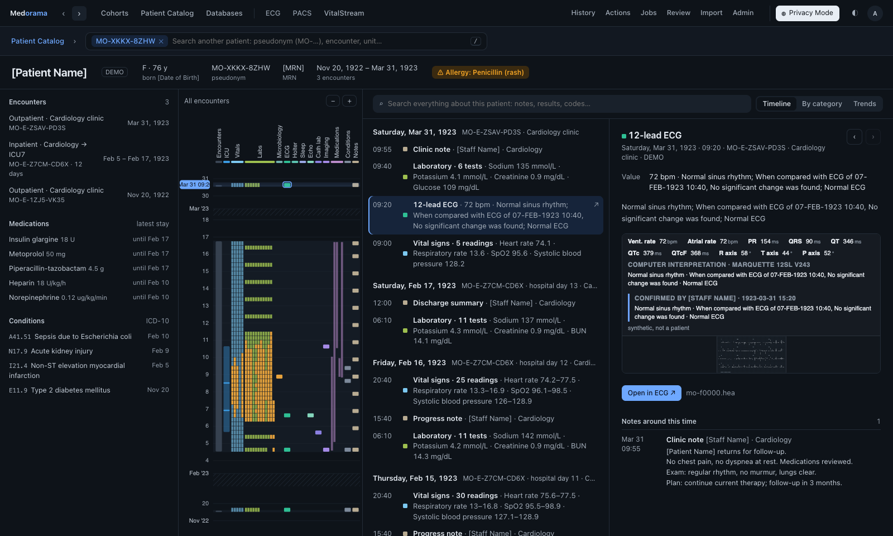

Whether you are in Privacy Mode depends on your PHI permission:

| User | Privacy Mode |
|---|---|
| Without the PHI permission | Always on. |
| With the PHI permission | On when you sign in. The **Privacy Mode** switch in the top bar turns it off. Administrators with the PHI permission start with it off. Your choice lasts until you sign out. |

In Privacy Mode you see the following:

| Data | What you see |
|---|---|
| Names | `[Patient Name]`; the names of staff, such as the authors of notes and physicians, as `[Staff Name]`. |
| MRNs, account numbers, dates of birth | `[MRN]`, `[CSN]`, `[Date of Birth]`. |
| Patient and encounter IDs | **Pseudonyms**: stable stand-in identifiers of the form `MO-XXXX-XXXX` for patients and `MO-E-XXXX-XXXX` for encounters. |
| Dates and times | Moved back by an offset that applies to the whole catalog, plus a number of days that is fixed for each patient. Every user therefore sees the same dates for a given patient, and the intervals between that patient's events are kept. |
| Ages | Ages above 89 are shown as `90+`. |
| Recordings and files | Named by tokens such as `mo-rec:12` or `mo-f0003.dcm`. Their paths and file names are never sent. |
| Imported columns | Identifying columns as placeholders. Columns that Medorama does not recognize are shown as `[Withheld]`. Measurements are shown. |
| The text of notes | Shown by default, with the patient's own names and date of birth replaced. An administrator can withhold notes entirely (Admin › Privacy Mode, *The text of notes and reports*); they are then shown as `[Withheld]`. |
| Files | WFDB headers, GE MUSE XML, DICOM files and EDF files are de-identified on the server before they are sent. Pictures, videos and PDFs are sent as they are, because they may show text burned into the image, and the viewer tab that shows one is marked with an amber warning triangle. Other kinds of files are not sent. |

In Privacy Mode, a search for a name, an MRN, a date of birth, an account number or a withheld
column is refused; you find patients by their pseudonyms instead. Every search, filter and sort
uses only what you are shown: pseudonyms, tokens and placeholders, and each patient's dates as
they are shown. A search for a real identifier or a real date therefore finds nothing, and lists
are ordered by the dates you see. Dates that you type (in a filter, or in a cohort's criteria)
are dates as shown: the server compares them with each patient's shown dates, so the page never
needs to know the offset. Searches in Privacy Mode are recorded in the audit log
(`privacy_search`). Exports made in Privacy Mode pass through the same gate, and their file names
end in `-privacy`.

## Cohorts

A **cohort** is a named set of patients, found across every database by criteria and kept. The
Cohorts tab searches as you change the criteria and shows why each patient matched. You can save
all the patients found, or only the ones you tick, as a new cohort, or add them to an existing
one.

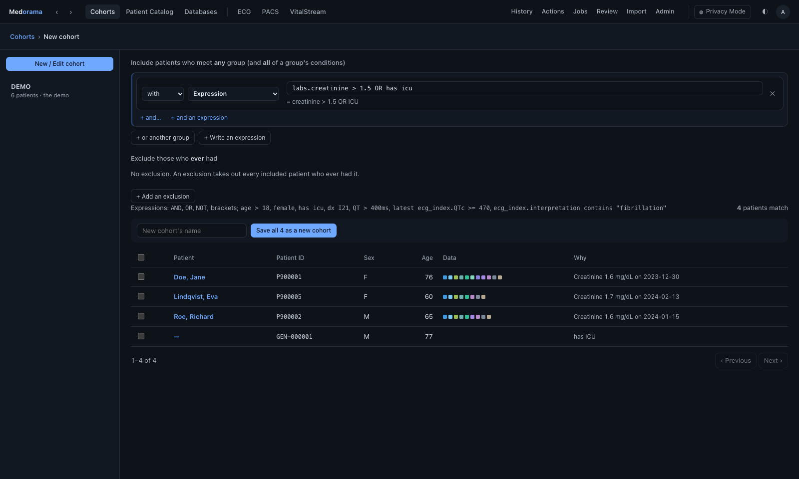

### Write the criteria

Criteria say who is **included** and who is **excluded**:
- A patient is included when they meet *any one* group of conditions. To meet a group, the
  patient must meet *all* of its conditions.
- An exclusion removes every included patient who *ever* met it. The tab lists who was excluded,
  and why.

The criteria builder draws conditions as rows of fields. Any row can also be an **expression**,
written as text and checked as you type, for example:

```text
(age > 18 AND age < 85 AND female) OR (age > 18 AND age < 65 AND male AND QT > 400ms)
```

| You write | It means |
|---|---|
| `AND`, `OR`, `NOT`, parentheses | `AND` binds before `OR`. The words can be in any case, and `&&`, `\|\|` and `!` also work. Two conditions written side by side must both hold. |
| `female`, `male` (or `F`, `M`) | The patient's sex. |
| `age > 18`, `age > 18 years` | The patient's age today. You can also write `y`, `yr` or `yrs`, and use `<`, `>=`, `<=`, `=` and `!=`. Age needs the PHI permission and Privacy Mode turned off; otherwise the builder grays out Age. |
| `has ecg`, or a category alone: `icu`, `holter`, `sleep` | The patient has data of that category. |
| `dx I21`, `diagnosis "sepsis"` | A condition whose code starts with the text, or whose name contains it. |
| `medication heparin` | A drug whose name contains the text. |
| `text "pulmonary edema"` | An item whose text contains the words. |
| `in ecg_index` | The named database holds data about the patient. |
| `QT > 400ms`, `"R axis" < -30`, `ecg_index.QT > 0.4 s` | A column of a database, or results of that name, compared in its unit. Units of the same kind are converted, such as ms and s, or µV and mV. |
| `latest QTc >= 470` | Only each patient's latest value of that exact name counts (`latest QT` never reads a QTc), across the catalog and the connected databases. Without `latest`, any value at any time counts. |
| `ecg_index.interpretation contains "fibrillation"` (or `~`) | A column's text contains the words. |
| `omop.lactate > 4` | A measurement in a connected database, found by a word of its name. |

**Units must compare.** A value written with a unit is compared with the values in units of the
same kind, converted (ms and s, µV and mV, g/dL and g/L, mmol/L and µmol/L). Values in a unit
that does not compare, such as mg/dL against `glucose > 7 mmol/L`, or values without a unit, are
left out, and the search says how many. When none of the values compares, the search reports an
error instead. A value written without a unit is compared as it is, and only when the data hold
one unit: when they hold several, write the unit. After a number, `m` is read as *male*, not as
metres.

**Saved criteria keep their meaning.** When a cohort is saved, each expression is kept together
with what its names meant at that time, such as which database's `QT` column. A database imported
later that would make a name ambiguous, or give it another meaning, does not change the cohort: a
search of its criteria says so, and the cohort keeps the meaning it was saved with.

**Dates in Privacy Mode.** In Privacy Mode, the dates of a condition (an encounter's, a result's,
a drug's) are dates as shown. Each patient's own dates are compared with them, so the cohort finds
the patients whose shown dates fall in the range. The criteria keep that meaning for every user
who refreshes them.

**Without data.** `NOT`, and *Without* in the builder, include the patients who have no data of
that kind at all: `NOT QT > 450 ms` also finds the patients without a QT.

**Encounters.** An encounter without a discharge time counts as continuing until now.

**Columns are never merged across databases.** A column name written alone, such as `QT`, refers
to the one database that has a column of that name. When two databases have a `QT` column, for
example an ECG database and a Holter database, the expression must name the database
(`ecg_index.QT`), and the error message lists the candidates.

**Connected databases are searched too.** A condition, a drug, a text, a stay or a result found
in any connected database counts. A cohort records the version of each connected database at the
time its members were found, and a refresh tells you which ones have new data.

### How a cohort keeps its members

A cohort's page states its **definition** in words: where its members come from (the whole
catalog, a parent cohort, or the cohorts that a merge combined), its criteria, the patients
**added manually** and **removed manually** (identified by patient ID, never by name or MRN), and
how the cohort was made.

A cohort is a snapshot. New data change nothing until someone **refreshes** it. A refresh first
shows who would join and who would leave. **Apply these changes** applies the changes shown:
the new patients you ticked join, and the members shown as leaving leave. Changes that appeared
since the preview are not applied, and the message says how many: refresh again to see them.
Patients added manually stay in the cohort, and patients removed manually stay out. A cohort's
page tells you when the catalog has new data since its members were found.

A refresh reads the data as the criteria were written. Criteria on notes' text, ages, columns or
expressions select other patients for a user who reads the data differently, for example in
Privacy Mode instead of with the PHI permission. Such a refresh is refused, and the message says
how the criteria were written. A subcohort or a merge follows the cohorts that it is made from
only while you may still read them; when one is no longer shared with you, a refresh is refused.

### What you can do with a cohort

| Action | What it does |
|---|---|
| New cohort | Opens the criteria builder. Saves all the patients found, or only the ones you tick. |
| Edit | Changes the name, the description and the criteria. Changed criteria take effect at the next refresh, which shows its result first. Criteria that the builder cannot draw (made through the API) are shown read-only and kept as they are, unless you remove them with ✕. |
| Members | Adds patients found by the Patient Catalog's search; ✕ removes a member. |
| Clone… | Makes a copy that you own. |
| Subcohort… | Opens the criteria builder, searching only among this cohort's members. |
| Merge… | Makes a new cohort from this one and others: their union, intersection or difference. |
| Share… | The owner chooses who may see the cohort and who may edit it. |
| Delete… | The owner deletes the cohort. Its patients stay in the catalog (the cohort DEMO, below, is the one exception). |
| Open in Patient Catalog | Shows the members as a list. |
| Run actions… | Runs actions on the members' recordings. |
| Export | Exports the members (CSV), the definition (JSON), the members' data (CSV), or all of these (Excel). Every member is exported, however many. Times are written in UTC, marked `Z` (ISO 8601). A cell that a spreadsheet would run as a formula (text starting with `=`, `+`, `-` or `@`) is written after a `'`, so that it opens as text. |

Every change is recorded in the cohort's **History** and in the audit log. Each user sees a
cohort's members as their own permissions allow.

### The cohort DEMO

The cohort **DEMO** exists when Medorama was installed with its demo: invented patients, with
their data, recordings and files, for trying the system. Every user sees it, read-only, and each
of its patients' pages is marked DEMO. It is the one cohort whose deletion also removes its
patients. An administrator deletes it with **Delete…**, which first shows what will be removed;
the demo's patients and everything about them then leave the catalog, and nothing else changes
([administrator's guide, The demo](administration.md#the-demo)).

## The Patient Catalog and the patient page

### Find a patient

The **Patient Catalog** lists the patients, the one with the latest encounter first.

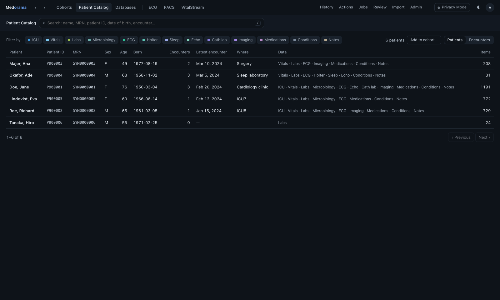

- **Search** by name, MRN, patient ID, date of birth or encounter. Identifiers are searched only
  for users with the PHI permission, out of Privacy Mode.
- **Filter by kind of data.** After **Filter by**, click a category once to keep the patients who
  have it (✓), a second time to keep those who have none of it (✕), and a third time to clear
  it.
- **Add to cohort…** adds every patient that the search finds to a cohort.

### Read a patient's page

A patient's page shows everything known about the patient on one time line.

| Part | What it shows |
|---|---|
| Patient bar | The name, sex, age and date of birth, the patient ID, the MRNs, the span of the data, and the allergies ("not recorded" when no database holds allergies). |
| Patient column | The encounters (click one to show only that encounter), the latest stay's medications, and the conditions. |
| Journey | Every item on one time line, the newest on top, with one column per category. ICU stays are drawn as light bars, with their recordings over them. Abnormal values are amber and critical values orange; red is used only for alarms. Months without data are folded. Hover over a mark to see what it is, and click it to open it. |
| Report | The entries, newest first, grouped by day with the encounter, the hospital day and the unit. Laboratory results taken at the same moment form one panel, and vital signs form one entry per day. The report can also be grouped by category, or show the trends. |
| Detail | The selected entry: a panel's values with their ranges, previous values and trend; a note; a 12-lead ECG on paper, a picture, a PDF or a video, with **Open in ECG** or **Open in PACS**; a recording's main vital signs over its whole length (click to open VitalStream at that moment); and the notes written around that time. |

The journey's columns follow the clinical categories: ICU, Vitals, Labs, Microbiology,
Pathology, ECG, Holter, **EEG**, **Sleep**, Echo, Cath lab, Imaging, Procedures, Medications,
Transfusions, Life support, Conditions, Assessments and Notes. Allergies are shown in the patient
bar instead. EEG recordings and sleep studies (polysomnography) are recordings like ICU
monitoring and Holter ECGs: they open in VitalStream.

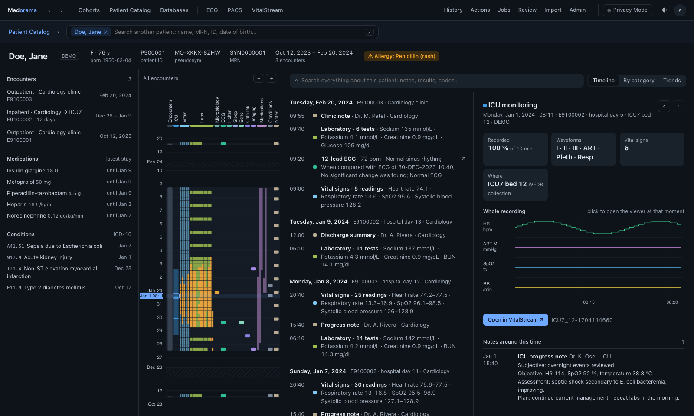

**Heart rate from the ECG.** When a recording has an ECG signal but no heart rate of its own, as a
Holter ECG or a sleep study usually does, the index job derives one; it is not a separate action.
It detects the QRS complexes with a Pan–Tompkins detector and, for each minute, takes the median
of the beat-to-beat rates and their 5th to 95th percentile range. The detail then shows this
heart rate over the whole recording.

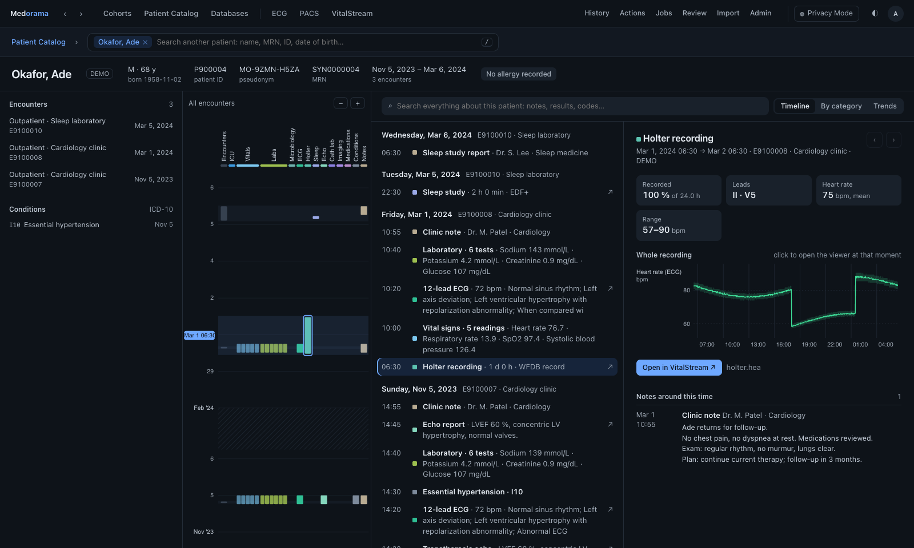

**EDF recordings.** Sleep studies, EEGs and many research recordings come as EDF, EDF+, BDF or
BDF+ files. Medorama reads them without an add-on. In VitalStream, EDF+ annotations, such as
sleep stages, apneas and arousals, appear as events in the **Annotations** lane, and an
interrupted recording (EDF+D) shows a break between its parts. The patient and recording fields
of an EDF header can identify the patient, so the viewers never show them. A folder of EDF files
is not yet opened as one session, and a file that holds only annotations (some scoring files do)
is not yet shown. [edf.md](edf.md) describes EDF in detail.

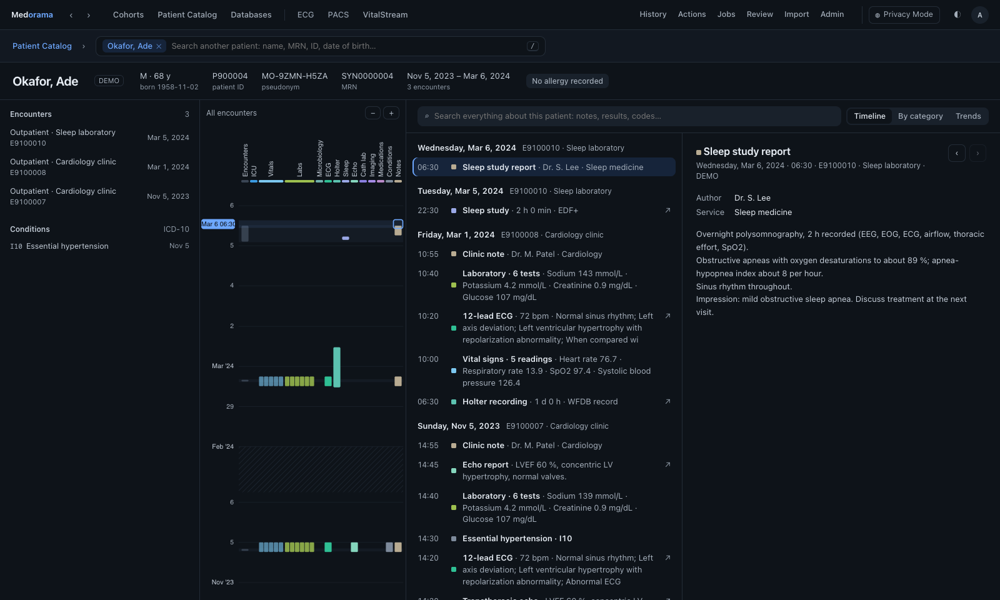

### Search a patient's data

The report's search box looks through every text the patient has: the names of tests, drugs and
codes, values, results, notes and reports.

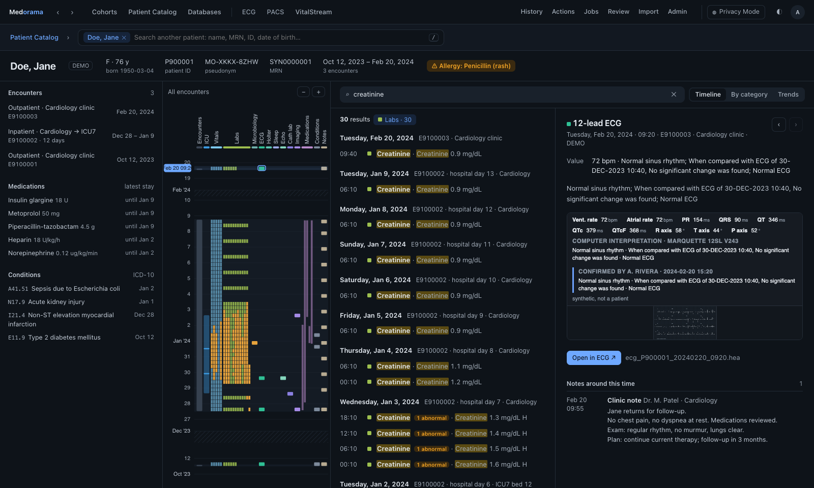

- Words are alternatives: `ecg icu` finds the ECGs and the ICU monitoring.
- A category's name finds all of that category: `labs`, `notes`, `ecg`, `holter`, `sleep`,
  `micro`, `imaging` and so on.
- Any part of a word matches (`lactat`), ignoring case. Quotes keep words together: `"two words"`.
- `lactate > 4` and `hb<8` find values above or below a number.
- A word found nowhere is matched to the closest word in the patient's data (`sepsys` finds
  `sepsis`), and the report says so.
- The search does not understand negation: `no signs of sepsis` is found by `sepsis`.
- Notes are searched and shown for users with the PHI permission out of Privacy Mode. In Privacy
  Mode they are searched and shown unless an administrator withholds them (Admin › Privacy Mode,
  *The text of notes and reports*). In Privacy Mode an entry is found only by its text as you are
  shown it: not by the patient's name, an identifier or a staff name that the page replaces.

## The Databases tab

The Databases tab shows the same data as the patient pages, organized by database. It lists every
database in use, the newest first, with what it holds, its number of rows, the patients it
reached, and what is held back or waiting. The ▸ button unfolds a database's table in place, and
**Full page ↗** shows one database alone.

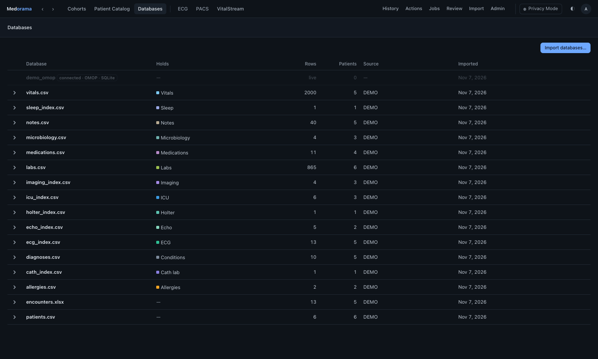

- The rows are shown **as they were imported**, with the file's own column names. You can sort by
  any column, filter each column and search all of them.
- Each row links to **its patient**, and its **file** opens in the matching viewer: an ECG in the
  ECG viewer, a DICOM study or a picture in PACS, and a recording in VitalStream at its start.
- In Privacy Mode, every column is listed, but the cells of identifying columns are sent as
  placeholders (`[MRN]`, `[Patient ID]`, `[File Name]`, `[Staff Name]` and so on), and the cells
  of columns that Medorama does not recognize are sent as `[Withheld]`. Measurements are shown.
  The search, the filters and the sort use the cells as you are shown them: pseudonyms in place
  of identifiers, each patient's dates moved back, notes without the patient's names. The search
  skips placeholders, and the text of notes when notes are withheld; a filter on a placeholder
  column compares with the placeholder. A sort by a placeholder column is ignored.
- A sort puts numbers in numeric order before text, and empty cells last, whichever the direction
  and whichever database (SQLite or PostgreSQL) holds the catalog. The search and the filters
  take `%` and `_` as written.

Administrators can **export** a database as CSV and **delete** one, after a preview of what will
be removed, from the list or from the database's own page.

## Encounters and recordings

The **Encounters** view, beside Patients in the Patient Catalog, is the table of encounters: one
row per encounter, with a status dot for its recordings and its source. You can search it with
words or `field:value` terms ([Searching](#searching)) and filter it by unit, dates and status. A
row opens the encounter panel, which shows the bed stays, the recordings (with **View**, **Copy
path** and **Index now**), the results, the items by domain, and the patient's other encounters.

| Status | Dot | Meaning |
|---|---|---|
| `ready` | Green | Indexed, and the index matches the recording as it is now. |
| `queued` | Amber | Indexing is waiting for a worker. |
| `indexing` | Amber, pulsing, with a percentage | Being indexed. |
| `new` | Gray | Never indexed. |
| `stale` | Purple ring | Changed since it was indexed. |
| `failed` | Amber | Indexing failed, or was cancelled; the error (or *indexing was cancelled*) is shown. A cancelled recording is not indexed again on its own: **Index now** indexes it. |
| `missing` | Amber | Not found at the last check. |

An encounter shows the most urgent status among its recordings, in this order: `missing`,
`failed`, `indexing`, `queued`, `stale`, `new`, `ready`. An encounter without recordings has a
dashed ring.

**Identifiers in recordings.** Bedside monitors and EDF files often store patient identifiers
inside the recordings themselves. For users with the PHI permission, out of Privacy Mode, the
Encounters list shows what the encounter's recordings say (**In the files**): ✓ when it agrees
with the databases, and ⚠ when it differs or names another patient. The encounter panel shows
these values beside the databases' values. The
[administrator's guide](administration.md#identifiers-in-recordings) explains where they come
from.

## Searching

The Encounters table, Import › Recordings and the command-line tool (`list --q`,
`recordings --q`, `--search`) share one search syntax:

| You write | It finds |
|---|---|
| `smith` | Entries in which some field contains "smith". |
| `name:smith` | Entries in which that field contains it. |
| `source:"ICU pilot"` | Quotes hold a value with spaces. |
| `name:doe dob:1950 source:pilot` | Entries that match every term. |

- Searches never depend on letter case, and a value matches anywhere in the field: `name:smi`
  finds Smith, and `dob:1950-03` finds March 1950.
- An unknown field is an error, and the message lists the fields.
- Without the PHI permission, or in Privacy Mode, a word never matches an identifier, and an
  identifier field (`name:`, `dob:` and so on) is an error. In Privacy Mode every field holds
  what you are shown: `encounter:` and `patient:` the pseudonyms, `file:` and `path:` the
  recordings' tokens (`mo-rec:12`), `admit:`, `discharge:` and `start:` the dates as shown.

| List | Fields (fields in italics need the PHI permission) |
|---|---|
| Encounters | `encounter`, `patient`, `source`, `unit`, `bed`, `admit`, `discharge` (local time, for example `admit:2025-08`), `disposition`, `sex`, `status`, `file` (the names of the linked recordings); *`name`, `first`, `last`, `dob`, `mrn`, `csn`*; *`file-name`, `file-id`, `file-dob`* (what the linked recordings' files say) |
| Recordings | `file`, `path`, `kind`, `format`, `unit`, `bed`, `start`, `status`, `source`, `encounter`; *`file-name`, `file-id`, `file-dob`* |

Searches made by users with the PHI permission are recorded in the audit log (`phi_search`), and
so are searches made in Privacy Mode (`privacy_search`).

## The viewers

Medorama shows three viewers in its own tabs. Inside Medorama they run behind its sign-in and its
privacy gate: they show no patient identity, and in Privacy Mode they receive de-identified files
only. Each viewer also exists as a standalone program for use without Medorama, and each has a
light and a dark theme that follows the page.

| Viewer | What it shows | Opened from |
|---|---|---|
| [VitalStream](../viewers/vitalstream) | Waveform recordings: every channel, the vital signs, the alarms, EDF+ annotations and the breaks in the data on one time axis, from days down to single samples. | **View** beside a recording, a recording's entry on the patient page (at its moment), or a database row. |
| [ECG viewer](../viewers/ecg) | 12-lead ECGs on standard paper (3 × 4 with a rhythm strip, 6 × 2, 12 × 1), with calipers. It reads WFDB, GE MUSE XML, DICOM ECG, EDF and JSON ECGs, and shows PNG, JPEG and PDF printouts. | **Open in ECG** on the patient page, or a database row. |
| [PACS viewer](../viewers/pacs) | DICOM studies (echo and angiography loops at their frame rate, CT, MR, X-ray, structured reports), videos, pictures and PDFs, with calipers in millimeters. | **Open in PACS** on the patient page, or a database row. |

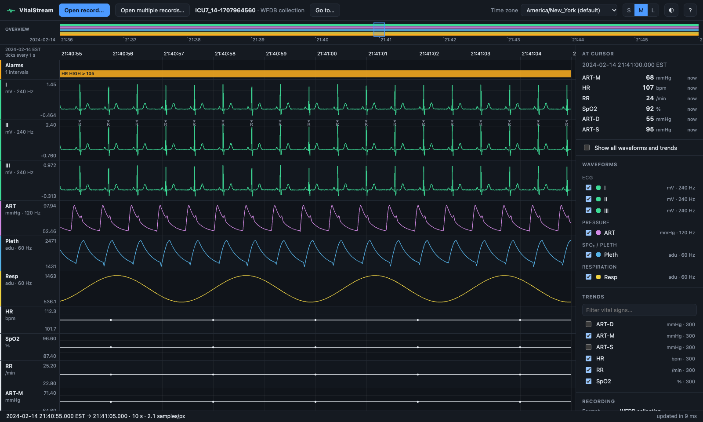

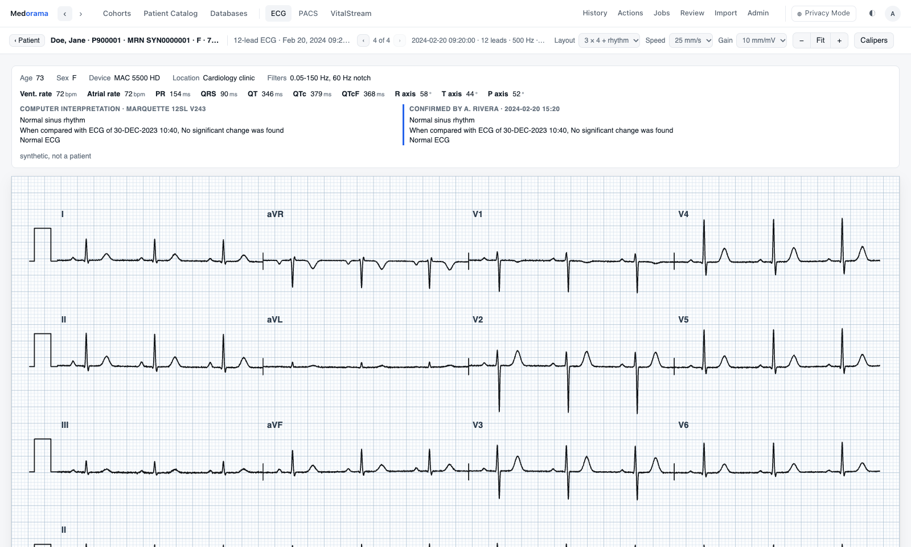

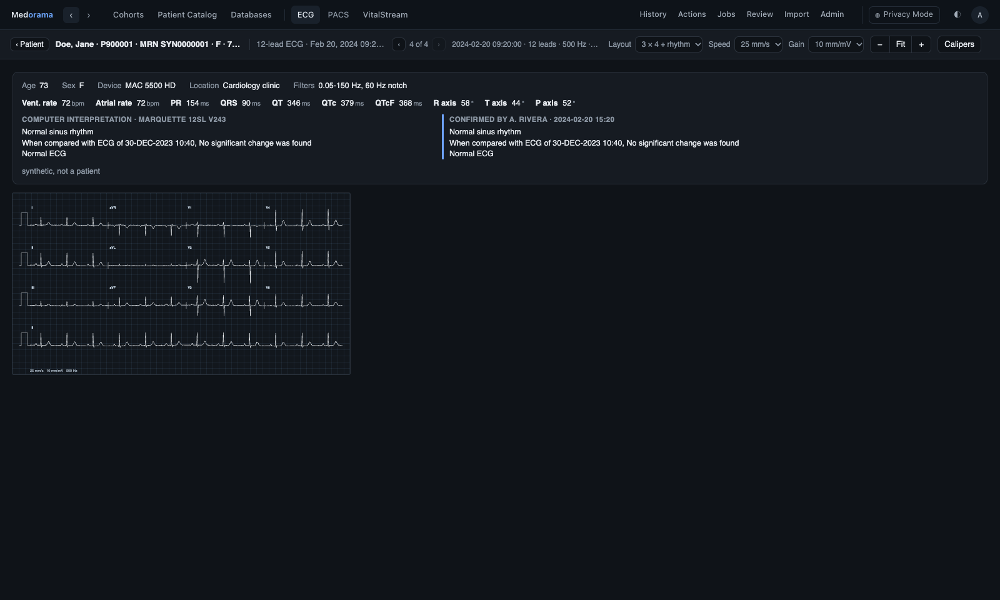

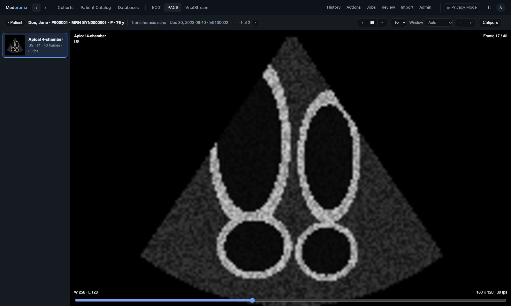

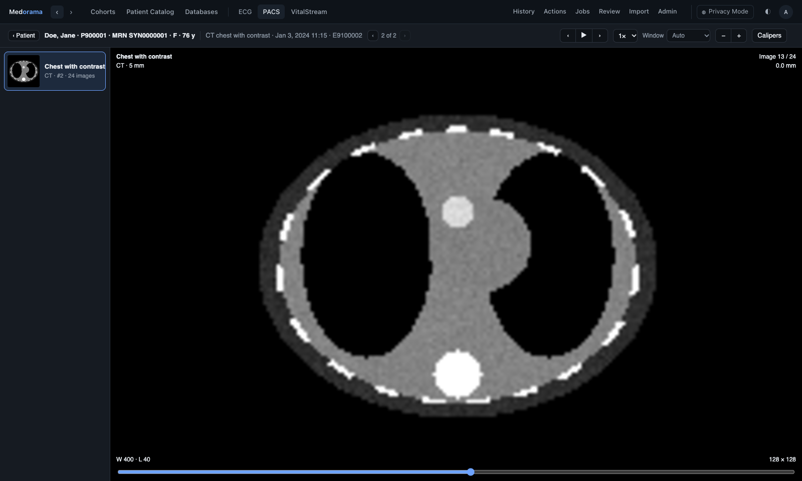

**The amber warning triangle.** In Privacy Mode, a viewer tab that shows a picture, a video or a
PDF carries an amber warning triangle. These files are sent as they are, and they may show a name
or another identifier burned into the image. Red is reserved for alarms, so the warning is amber.

## Actions and jobs

**Actions** are for analysts and administrators. Tick the actions to run (**Index** is ticked by
default), choose what to run them on (the selected encounters, the current search, a cohort or
everything) and start the run. A run makes one **job** per action and recording. A job already
done on the recording as it is now is not done again; tick *Run again where already done* to run
it anyway.

The **Jobs** tab shows the queue (running, queued, failed and done jobs) with a **Cancel** button.
A failed job shows its error. The page does not show a job's result (its summary); the API
returns it with the encounter's recordings (`GET encounters/{id}`, see [api.md](api.md)).

Two actions are built in:
- **Index** (`index`) builds the index that the viewers draw from. When a recording has an ECG
  signal but no heart rate, it also derives the heart rate from the ECG.
- **Read identifiers** (`identify`) reads the identifiers that the recording's file states. An
  add-on reads them for the formats it handles, and Medorama reads them from the header of EDF
  and BDF files.

Plug-ins add other actions ([actions.md](actions.md)).

## History

The History tab lists the encounters you opened in the encounter panel (from the Encounters
table, History or Review), the most recent first, with the number of times you opened each.
Patient pages are not recorded here. You can remove one entry or clear the whole list, and nobody
else sees it.
