# User's guide

This guide explains how to find patients and work with their data in Medorama's web page. It is
written for clinicians, researchers and data managers who use Medorama once it is running. To
install Medorama and take a first tour, see [getting-started.md](getting-started.md). To set it
up for others, connect databases and manage users, see the
[administrator's guide](administration.md). Programs that talk to Medorama directly use the
[HTTP API](api.md).


## Contents

- [Terms used in this guide](#terms-used-in-this-guide)
- [The page at a glance](#the-page-at-a-glance)
- [Privacy Mode](#privacy-mode)
- [Cohorts](#cohorts)
- [The Patient Catalog and the patient page](#the-patient-catalog-and-the-patient-page)
- [The Databases tab](#the-databases-tab)
- [Recordings](#recordings)
- [Searching](#searching)
- [The viewers](#the-viewers)
- [Actions and jobs](#actions-and-jobs)
- [History](#history)

## Terms used in this guide

| Term | Meaning |
|---|---|
| Database | A **connected database**: one that Medorama reads where it is, read-only, and never writes. It can be an OMOP instance, a research warehouse read through SQL views, or a SQLite file made by [db-builder](../db-builder/README.md) from tables, exports and folders of recordings. Medorama imports nothing. |
| Recording database | A connected database that lists recordings: each one's file, its patient, its start and its format. The files stay where they are. |
| Patient | A person, known in Medorama by a patient number and a **pseudonym** (`MO-XXXX-XXXX`). A patient found in two databases under the same identifier, given by the same issuer (an MRN and its hospital, a study ID and its study), is one patient. Identifiers such as the name, the medical record number (MRN) and the date of birth stay in the databases. |
| Visit | One hospital stay or visit of a patient, as a database records it. Each database's visits are shown with that database's name. |
| Entry | One piece of a patient's data: a laboratory result, a vital sign, a drug, a diagnosis code, a note or report, an ECG, an image. Every entry belongs to a **category**, such as Labs, Vitals, ECG or ICU. |
| Recording | A waveform recording, such as ICU bedside monitoring, a Holter ECG, an EEG or a sleep study, listed by a recording database. It can be a WFDB record (single- or multi-segment), a folder of WFDB records read as one session, a WFDB collection, an EDF, EDF+, BDF or BDF+ file, or a file that an installed add-on reads. |
| Grant | What a user may do with one database or one cohort. On a database: `search` (its patients are found by criteria), `view` (also its data on patient pages, its recordings and the viewers), `phi` (also its identifiers, for a user with the PHI permission outside Privacy Mode) and `manage` (also checking, refreshing, granting and removing it). On a cohort: `view`, `edit` and `manage`. Each grant includes the weaker ones. |
| Cohort | A named set of patients, found by criteria in the databases you choose, and kept. |
| Action | Work done on recordings in the background: `index` (prepares a recording for the viewers), and any plug-ins your institution installs. |
| PHI | Protected health information: names, MRNs, dates of birth, account numbers and other data that identify a patient. |
| Privacy Mode | The mode in which Medorama sends no identifier to your browser. It is described [below](#privacy-mode). |

## The page at a glance

The top bar has three groups of tabs:
- **Cohorts, Patient Catalog and Databases** are three ways to reach patients. Medorama opens
  on the Cohorts tab.
- **ECG, PACS and VitalStream** are the viewers. The ECG and PACS tabs are always shown, and
  they stay dimmed until a patient's page sends something to them. Until a recording is opened
  from a patient's page, the VitalStream tab says "Open a recording (ICU monitoring, a Holter, a
  sleep study, an EEG …) from a patient's page." and starts no viewer: started empty, it would
  open again the recording it showed last, perhaps another user's patient on a shared computer.
- **History, Actions, Jobs and Admin**, at the right, are for work on the data. Some of them are
  shown only to the roles that may use them.

| Tab | What it shows |
|---|---|
| Cohorts | Find patients by criteria in the databases you tick, with the reason each one matched, and which databases were searched and which were left out. Save them as named cohorts; create, edit, clone, merge and refine cohorts; refresh, share and export them; run actions on their recordings. |
| Patient Catalog | Every patient of the databases you may view, the one with the latest encounter first, with the kinds of data each has. A patient's page shows their whole journey. |
| Databases | The databases granted to you, each with its status (online or offline) and what it holds; a database's own page; connecting a database, and creating one with db-builder (administrators). Its **Recordings** subtab lists the recordings opened or indexed of the recording databases you may view. |
| ECG, PACS, VitalStream | The viewers: 12-lead ECGs; DICOM studies, pictures and videos; waveform recordings. |
| History | The patients whose page you opened, the most recent first. Only you see your history. |
| Actions, Jobs | Run actions on recordings, and follow the queue of jobs. |
| Admin (administrators) | Users, settings, add-ons, Privacy Mode's settings, the format of dates and times, and the audit log. |

**Roles and grants.** Every user has one of three roles. A `viewer` searches and looks at the
data and can make cohorts. An `analyst` can also run and cancel actions. An `admin` can also
connect databases and manage users. The **PHI permission** is given separately, per user, and
lets a user leave Privacy Mode. What a user may do with each database is set by its **grants**
(see [Terms](#terms-used-in-this-guide)): a database that is not granted to you is not searched
for you, and nothing of it is shown to you. The
[administrator's guide](administration.md#users-roles-and-the-phi-permission) describes roles,
the PHI permission and grants.

**Every screen has its own address**, such as `#/patients`, `#/patient/12?item=labs:…`,
`#/databases/3`, `#/viewer?path=…&t0=…&t1=…`, `#/ecg?src=…` or `#/pacs?list=…`. The browser's
Back and Forward buttons move between a patient's page and the viewers, and you can reload a
screen or send its address to a colleague who may see it.

**The page follows changes as they happen.** Connecting, refreshing or removing a database, and
linking new patients, advance Medorama's data version, which every open page checks every few
seconds. Patient pages, lists and tabs then redraw, and a viewer that shows a file that is no
longer available closes with a note.

**Light and dark themes.** The page follows your system's light or dark setting. The **◐** button
in the top bar switches between the two, and the viewers inside the page switch with it. The
pictures in this guide use the dark theme.

## Privacy Mode

**Privacy Mode** is the mode in which no identifier reaches your browser. The identifiers stay in
the connected databases. When Medorama answers a request, a part of the server called the
**privacy gate** decides what may leave, and in Privacy Mode it replaces or withholds every
identifier before the answer is sent. The page can only show what it receives. How the gate
works, and how it is tested, is explained in
[protecting-patient-data.md](protecting-patient-data.md).

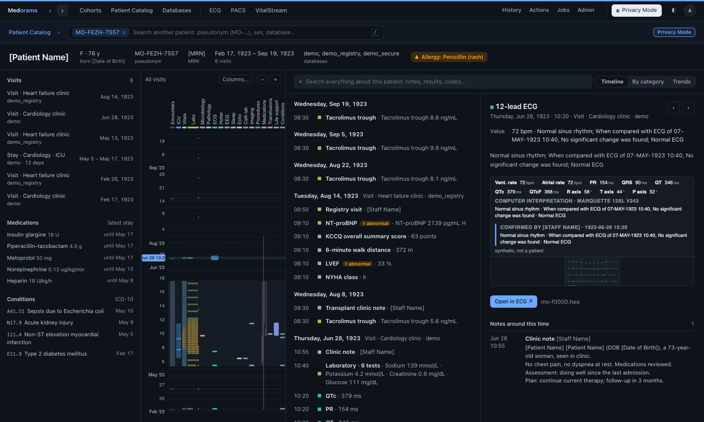

Whether you are in Privacy Mode depends on your PHI permission:

| User | Privacy Mode |
|---|---|
| Without the PHI permission | Always on. |
| With the PHI permission | On when you sign in. The **Privacy Mode** switch in the top bar turns it off. Administrators with the PHI permission start with it off. Your choice lasts until you sign out. |

**You can always tell which mode you are in.** In Privacy Mode the switch is filled, a line of
the accent colour runs along the top of the page, and each screen's search line ends with the
mark **Privacy Mode**. Out of it, an amber mark **identifiers shown** stands beside the switch.
In a narrow window the switch reads **Privacy**.

Out of Privacy Mode, you see a patient's identifiers only from the databases granted to you with
`phi`. A database granted to you with `view` only shows its data, never its identifiers.

In Privacy Mode you see the following:

| Data | What you see |
|---|---|
| Names | `[Patient Name]`; the names of staff, such as the authors of notes and physicians, as `[Staff Name]`. |
| MRNs, account numbers, dates of birth | `[MRN]`, `[CSN]`, `[Date of Birth]`. |
| Patient and visit IDs | **Pseudonyms**: stable stand-in identifiers of the form `MO-XXXX-XXXX` for patients and `MO-E-XXXX-XXXX` for visits. |
| Dates and times | Moved back by an offset that applies to every patient, plus a number of days that is fixed for each patient. Every user therefore sees the same dates for a given patient, and the intervals between that patient's events are kept. |
| Ages | Ages above 89 are shown as `90+`. |
| Recordings and files | Named by tokens such as `mo-rec:12` or `mo-f0003.dcm`. Their paths and file names are never sent. |
| The text of notes | Shown by default, with the patient's own names and date of birth replaced. An administrator can withhold notes entirely (Admin › Privacy Mode, *The text of notes and reports*); they are then shown as `[Withheld]`. |
| Files | WFDB headers, GE MUSE XML, DICOM files and EDF files are de-identified on the server before they are sent. Pictures, videos and PDFs are sent as they are, because they may show text burned into the image, and the viewer tab that shows one is marked with an amber warning triangle; on a patient's page, the line "May show identifiers as recorded" stands above it. Other kinds of files are not sent. |

In Privacy Mode, a search for a name, an MRN or a date of birth is refused; you find patients by
their pseudonyms instead. Every search, filter and sort uses only what you are shown: pseudonyms,
tokens and placeholders, and each patient's dates as they are shown. A search for a real
identifier or a real date therefore finds nothing, and lists are ordered by the dates you see.
Dates that you type (in a filter, or in a cohort's criteria) are dates as shown: the server
compares them with each patient's shown dates, so the page never needs to know the offset.
Searches in Privacy Mode are recorded in the audit log (`privacy_search`). Exports made in
Privacy Mode pass through the same gate, and their file names end in `-privacy`.

## Cohorts

A **cohort** is a named set of patients, found by criteria in the databases you choose and kept.
The Cohorts tab searches as you change the criteria and shows why each patient matched. You can
save all the patients found, or only the ones you tick, as a new cohort, or add them to an
existing one. Results come a page at a time: after you tick a page (the box above it), **Tick all
N** ticks every patient found, and **Untick all** unticks them. With none ticked, saving saves all
the patients found.

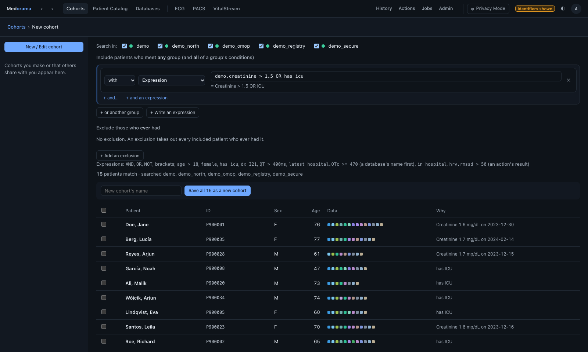

### Choose the databases to search

Above the criteria, **Search in** lists the databases granted to you for `search`, each with its
status dot. Tick the ones to search; with none ticked, every one is searched. An offline
database is greyed and cannot be ticked: it is never searched, and never searched silently
either.

Every result says what it searched, after the number of patients found, for example
*searched hospital, omop · left out: holter (offline)*. A database is left out when it is not
ticked or is offline. A criterion is sent only to the databases whose variables may hold it (a
measurement's name, a diagnosis, a drug); the others are not asked.

Each patient a cohort keeps records the databases whose answers put them there (its
**provenance**). For `hospital.lactate > 4 AND omop.troponin > 100`, a member's provenance holds
both databases. When a database is removed, every member it contributed to leaves every cohort.

### Write the criteria

Criteria say who is **included** and who is **excluded**:
- A patient is included when they meet *any one* group of conditions. To meet a group, the
  patient must meet *all* of its conditions.
- An exclusion removes every included patient who *ever* met it. The tab lists who was excluded,
  and why.

The criteria builder draws conditions as rows of fields. Any row can also be an **expression**,
written as text and checked as you type, for example:

```text
(age > 18 AND age < 85 AND female) OR (age > 18 AND age < 65 AND male AND QT > 400ms)
```

**While a search runs**, the place of the count shows *Searching… please wait* in an amber
pill with a pulsing dot, in light and dark mode alike; the count replaces it when the answer
arrives. A search over large databases may take a few seconds: wait for the count before
reading the list.

**No condition is left out silently.** While a condition cannot be read (an expression with an
error, or a row not complete, such as a measurement without its name or **Sex** not chosen),
the tab does not search: in place of the count it says, for example, *1 condition cannot be
read: "QT >": …*, and saving and adding are disabled until you correct the condition or remove
it with ✕. A new expression row left empty is no condition. Screen readers read the count and
each expression's meaning or error as they change.

| You write | It means |
|---|---|
| `AND`, `OR`, `NOT`, parentheses | `AND` binds before `OR`. The words can be in any case, and `&&`, `\|\|` and `!` also work. Two conditions written side by side must both hold. |
| `female`, `male` (or `F`, `M`) | The patient's sex. |
| `age > 18`, `age > 18 years` | The patient's age today, not at a visit or a result: `age > 65 AND QT > 470` finds patients over 65 now who once had a long QT, perhaps at 50. You can also write `y`, `yr` or `yrs`, and use `<`, `>=`, `<=`, `=` and `!=`. Age needs the PHI permission and Privacy Mode turned off; otherwise the builder grays out Age. A date of birth known only by its year (OMOP's `year_of_birth`) is read as 1 July of that year, and by its year and month as the 15th: such ages are within six months. |
| `has ecg`, or a category alone: `icu`, `holter`, `sleep` | The patient has data of that category, or a recording of that category in a recording database (each database is asked, whether or not its recordings were opened). `has icu`: a visit the database marks as an intensive-care stay, in a unit named like an intensive-care unit (ICU, MICU, CCU …; not a step-down, post-ICU or intermediate-care unit), or with a stay in one. |
| `dx I21`, `diagnosis "sepsis"` | A condition whose code starts with the text, compared without dots and in any case (`I21.4`, `I214` and `i21` all find `I21.4`), or, for a word (three characters or more, with a letter, not shaped like a code), whose name contains it. Codes of every vocabulary are compared alike: `dx 410` finds an ICD-9 `410.1`. |
| `medication heparin` | A drug whose name contains the text. |
| `text "pulmonary edema"` | An entry whose text contains the words. |
| `in hospital` | The named database links the patient. |
| `QT > 400ms`, `"R axis" < -30`, `muse.QT > 0.4 s` | A measurement (a result, a vital sign), compared in its unit. A name written alone refers to the one database that holds it; `muse.QT` names the database. Units of the same kind are converted, such as ms and s, or µV and mV. |
| `omop.lactate > 4` | A measurement of a named database, found by a word of its name when no measurement has that exact name. |
| `hrv.rmssd > 50` | A result of an action run on recordings (the action `hrv`, its field `rmssd`), searched like a measurement. When a database's name begins with `hrv`, the word names that database: write the result in quotes (`"hrv.rmssd"`), or after the database's name (`icu."hrv.rmssd"`). |
| `latest QTc >= 470` | Only each patient's latest value of that exact name counts (`latest QT` never reads a QTc). Without `latest`, any value at any time counts. |

**Measurements are never merged across databases.** A name written alone, such as `QT`, refers
to the one database that holds a measurement of that name. When two databases hold a `QT`, for
example an ECG database and a Holter database, the expression must name the database
(`muse.QT`), and the error message lists the candidates. A name that matches several
measurements of one database, such as `lactate` for *Lactate, arterial* and *Lactate, venous*,
must be written in full, in quotes: `omop."Lactate, arterial"`.

**Units must compare.** A value written with a unit is compared with the values in units of the
same kind, converted (ms and s, µV and mV, g/dL and g/L, mmol/L and µmol/L, µg, ug and mcg;
mmHg, kPa and cmH2O; °C and °F; cell counts in 10^9/L, G/L, 10^3/µL and K/µL). mEq/L is read as
mmol/L, which holds for monovalent ions (sodium, potassium, chloride, bicarbonate) only. Values in a unit
that does not compare, such as mg/dL against `glucose > 7 mmol/L`, or values without a unit, are
left out, and the search says how many. When none of the values compares, the search reports an
error instead. A value written without a unit is compared as it is, and only when the data hold
one unit: when they hold several, write the unit. After a number, `m` is read as *male*, not as
metres.

**Saved criteria keep their meaning.** When a cohort is saved, each expression is kept together
with what its names meant at that time, such as which database's `QT`. A database connected later
that would make a name ambiguous does not change the cohort.

**Dates in Privacy Mode.** In Privacy Mode, the dates of a condition (a visit's, a result's,
a drug's) are dates as shown. Each patient's own dates are compared with them, so the cohort finds
the patients whose shown dates fall in the range. The criteria keep that meaning for every user
who refreshes them.

**Without data.** `NOT`, and *Without* in the builder, include the patients who have no data of
that kind at all: `NOT QT > 450 ms` also finds the patients without a QT. `NOT` and the criteria
on the patient alone (sex, age, `in`) apply among the patients that the searched databases link.

**Visits.** A visit without an end time counts as continuing until now.

**Large databases.** Each row a criterion reads is tested as it is read, and only those that hold
are kept, so a criterion such as `muse.QTc > 450 ms` reads every ECG of a database of millions of
them. A criterion that more than `max_rows` rows hold (1,000,000 by default) is refused, with a
message saying to narrow it; the patients behind `has …` are never bounded. A threshold is
sent to the database, which reads only the values that may pass, and a search repeated while a
database's data stay the same is answered from what was read
([performance.md, What a criterion reads](performance.md#what-a-criterion-reads)).

**The ID column** of the patients found shows, with the PHI permission out of Privacy Mode, the
patient ID, or the MRN when there is no patient ID; otherwise the pseudonym.

### How a cohort keeps its members

A cohort's page states its **definition** in words: where its members come from (the databases
it searches, a parent cohort, or the cohorts that a merge combined), its criteria, the patients
**added manually** and **removed manually** (identified by pseudonym, never by name or MRN), and
how the cohort was made. Its header line says which databases it searches, and the version of
each database when its members were found.

A cohort is a snapshot, kept in its own encrypted file of Medorama's workspace. New data change
nothing until someone **refreshes** it. A refresh first shows who would join and who would leave.
**Apply these changes** applies the changes shown: the new patients you ticked join, and the
members shown as leaving leave. Changes that appeared since the preview are not applied, and the
message says how many: refresh again to see them. Patients added manually stay in the cohort, and
patients removed manually stay out. A cohort's page tells you when a database it searches has a
new version since its members were found.

When the data change while you work on the Cohorts tab, it redraws the lists, the databases and
the members, and searches again, but what you are doing stays: the criteria (and the field you
are typing in), the patients you ticked, the page of results, and an open panel such as a
refresh's preview.

A refresh reads the data as the criteria were written. Criteria on notes' text, ages or
expressions select other patients for a user who reads the data differently, for example in
Privacy Mode instead of with the PHI permission. Such a refresh is refused, and the message says
how the criteria were written. A subcohort or a merge follows the cohorts that it is made from
only while you may still read them; when one is no longer shared with you, a refresh is refused.

### What you can do with a cohort

| Action | What it does |
|---|---|
| New cohort | Opens the criteria builder. Saves all the patients found, or only the ones you tick, with the databases ticked. |
| Edit | Changes the name, the description, the criteria and the databases it searches. Changed criteria take effect at the next refresh, which shows its result first. Criteria that the builder cannot draw (made through the API) are shown read-only and kept as they are, unless you remove them with ✕. |
| Members | Adds patients found by the Patient Catalog's search; ✕ removes a member. |
| Clone… | Makes a copy that you own. |
| Subcohort… | Opens the criteria builder, searching only among this cohort's members. |
| Merge… | Makes a new cohort from this one and others: their union, intersection or difference. |
| Share… | Who manages the cohort (its owner) chooses who may see it and who may edit it. Sharing gives those users a grant on the cohort (`view` or `edit`). |
| Delete… | Who manages the cohort deletes it. Its key is destroyed, then its file; its patients stay in their databases. Cohorts made from it keep its last members. |
| Open in Patient Catalog | Shows the members as a list. |
| Run actions… | Runs actions on the members' recordings. |
| Export | Exports the members (CSV), the definition (JSON), the members' data (CSV), or all of these (Excel). Every member is exported, however many. Times are written in UTC, marked `Z` (ISO 8601). A cell that a spreadsheet would run as a formula (text starting with `=`, `+`, `-` or `@`) is written after a `'`, so that it opens as text. |

Every change is recorded in the cohort's **History** and in the audit log. Each user sees a
cohort's members as their own permissions and grants allow: identifiers only with the PHI
permission and the `phi` grant on the database that holds them.

## The Patient Catalog and the patient page

### Find a patient

The **Patient Catalog** lists the patients of the databases you may view, the one with the latest
data first (the latest encounter, or the latest data a database gives the dates of, such as an
ECG archive without visits): the pseudonym (or, with the PHI permission out of Privacy Mode, the
name, the patient ID, the MRN and the date of birth of the databases granted to you with `phi`; the
**ID** column shows the patient ID only, and a faint dash when there is none, the MRN having its
own column), the sex, the age, the number of visits, the latest time, the databases that hold the patient, the kinds of
data (**Data**) and the number of entries (**Entries**). The patients and their encounters are
kept by Medorama for each database, so a patient of a database that is offline is still listed.
The **Data** and **Entries** columns are read from the online databases for the page shown only;
**Entries** shows "—" when nothing was read for the patient (their databases offline, or
holding nothing of theirs), and a database offline adds nothing to either.

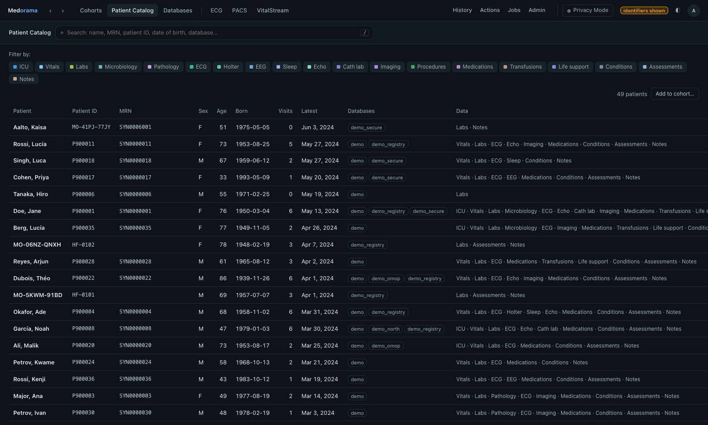

- **Search** by pseudonym, sex, kind of data (`has:ecg`) or database (`database:omop`)
  ([Searching](#searching)). With the PHI permission, out of Privacy Mode, also by name, MRN,
  patient ID and date of birth, as the databases granted to you with `phi` hold them.
- **Filter by kind of data.** After **Filter by**, click a category once to keep the patients who
  have it (✓), a second time to keep those who have none of it (✕), and a third time to clear
  it. Each online database is asked which of its patients have it; a database offline answers
  for none.
- **Add to cohort…** adds every patient that the search finds to a cohort.

### Read a patient's page

A patient's page shows everything known about the patient on one time line. It is read when you
open it, from each database you may view that links the patient. A database that does not answer
is named in the patient bar (*not available*), and the page shows the others.

The page has four columns, from left to right: **1. Visits** (the patient's current status),
**2. Journey** (where and when their data are), **3. What was done** (by name) and **4. Detail**
(the one thing done chosen, in full). Each fact is shown once: a value only in the detail, the
number of visits only in the visits column. Conditions and medications appear twice, as two
facts: in column 1 as the current status, and in column 3 as their history, on their dates
([design/patient-page.md, Each fact once](design/patient-page.md#each-fact-once)).

| Part | What it shows |
|---|---|
| Patient bar | The name, sex, age and date of birth, the patient ID and the MRNs (identity only from the databases granted to you with `phi`, out of Privacy Mode), and the dates of the first and latest data; at the row's end, the databases that hold the patient, and any that does not answer now. |
| 1. Visits | The current status: the allergies first (in amber; the section only when one of the patient's databases can hold allergies, so that *No allergy recorded* means what it says), the visits, each with the name of its database (click one to show only that visit), the latest stay's medications, and the conditions, labelled by the vocabularies of their codes (ICD-10-CM, ICD-9 …). A section with nothing to show is left out, and the whole column for a patient with none (one known to an ECG archive alone), so that the journey and the report get its room. |
| 2. Journey | Every entry on one time line, the newest on top, with one column per category. ICU stays are drawn as light bars, with their recordings over them: the stays in intensive-care units when the database gives them (db-builder's bed stays, OMOP's `visit_detail`), else the whole intensive-care visit. A result flagged normal (`N`, `WNL`) is shown normal whatever its range says. Abnormal values are amber and critical values orange, a critical mark also outlined when it is wide enough; red is used only for alarms. Months without data are folded. Hover over a mark to see what it is, and click it to open it. A column's name hides or shows that column: click it, or reach it with Tab and press Enter or Space; **Columns…** above the journey lists the columns with a box for each. For a screen reader, the journey is a picture whose text says its span and columns; every mark is also a line of **What was done**. |
| 3. What was done | One line per thing done, newest first, grouped by day with the visit, the hospital day and the unit; each line by name only, with no value and no flag (abnormal, high). Laboratory results taken at the same moment form one line named by their tests (*Lactate, Sodium, Potassium*; past three, the first three and *+N more*); vital signs one line a day, *Vital signs · N readings* (the day in Medorama's time zone); an ECG with its measurements one line (*12-lead ECG*). The list can also be grouped by category, or show the trends. |
| 4. Detail | Everything about the thing done chosen in column 3 or the journey: a panel's values with their ranges, previous values and trend (a critical value also named *critical*); a note; an ECG ([below](#an-ecg)); a picture, a PDF or a video, with **Open in ECG** or **Open in PACS**; a recording's main vital signs over its whole length (click to open VitalStream at that moment); and the notes written around that time. |

**Widths.** Column 4, the detail, has the most room; column 3 about a third of what the
detail and it share. Drag the thin line between two columns to change their widths (or focus it
with Tab and press ← or →); double-click it, or press Home, for the default. Your widths are
kept in this browser.

**The keyboard.** ↑ and ↓ move to the line above or below in column 3, and the detail follows;
Enter or Space selects the line that has the focus; Escape clears the selection. The page's
address keeps the selection: reload it, go back, or share the link, and the same entry opens.
While a detail is read from a slow database its outline is shown; the previous and next of the
same kind are read ahead, so that stepping through them is at once.

**On a tablet.** In a window narrower than 1100 pixels, columns 3 and 4 go below the visits
and the journey, and the page scrolls, so that each keeps room to read; the widths are then
fixed.

#### An ECG

An ECG's detail shows, in order:
- **Its drawing**, on paper, with **Open in ECG** for layouts, gain and calipers.
- **Its statements**, one a line. Those that the patient's previous ECG did not say are marked
  **new**; the previous ECG's statements this one no longer says follow, under **no longer**.
  Statements are compared as written: one reworded counts as new. In Privacy Mode, when the text
  of notes is withheld, an ECG's statements are withheld too, and nothing is compared.
- **Its measurements**, each once, as a tile: its value and unit; its change since the previous
  ECG (▲ 25, ▼ 3, or = when unchanged; none when the previous ECG has no such value), in neutral
  colours, since a change is neither good nor bad here; and a small trend line over the patient's
  ECGs, this one marked. The previous ECG's date is said once, above the tiles.

The previous ECG is the patient's latest ECG before this one, from any database. ‹ and › step
from one ECG of the patient to the next.

**Recordings and files.** The recordings and files of a patient come from the recording
databases you may view. A 12-lead ECG, a picture, a PDF, an echo or a cath lab study is shown in
the detail and opens in the ECG or PACS viewer; an ICU recording, a Holter ECG, an EEG or a sleep
study opens in VitalStream.

The journey's columns follow the clinical categories: ICU, Vitals, Labs, Microbiology,
Pathology, ECG, Holter, **EEG**, **Sleep**, Echo, Cath lab, Imaging, Procedures, Medications,
Transfusions, Life support, Conditions, Assessments and Notes. Allergies are shown in the patient
bar instead. EEG recordings and sleep studies (polysomnography) are recordings like ICU
monitoring and Holter ECGs: they open in VitalStream.

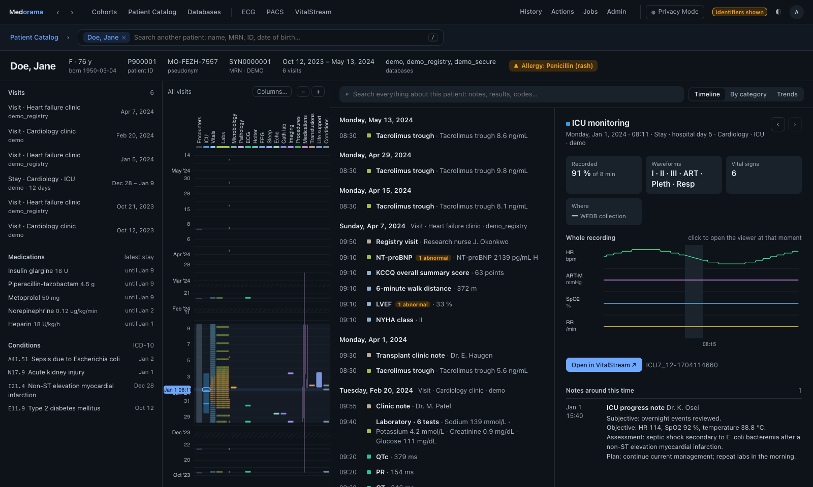

**Heart rate from the ECG.** When a recording has an ECG signal but no heart rate of its own, as a
Holter ECG or a sleep study usually does, the index job derives one; it is not a separate action.
It detects the QRS complexes with a Pan–Tompkins detector and, for each minute, takes the median
of the beat-to-beat rates and their 5th to 95th percentile range. The detail then shows this
heart rate over the whole recording.

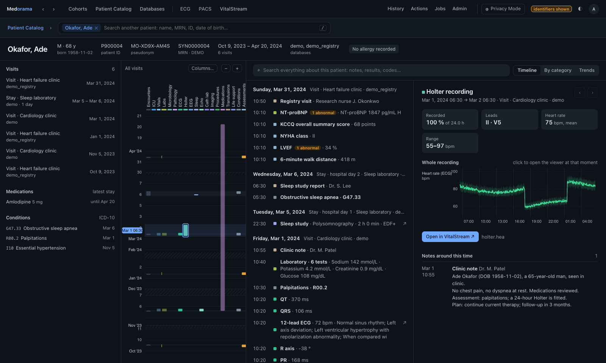

**EDF recordings.** Sleep studies, EEGs and many research recordings come as EDF, EDF+, BDF or
BDF+ files. Medorama reads them without an add-on. In VitalStream, EDF+ annotations, such as
sleep stages, apneas and arousals, appear as events in the **Annotations** lane, and an
interrupted recording (EDF+D) shows a break between its parts. The patient and recording fields
of an EDF header can identify the patient, so the viewers never show them. A folder of EDF files
is not yet opened as one session, and a file that holds only annotations (some scoring files do)
is not yet shown. [edf.md](edf.md) describes EDF in detail.

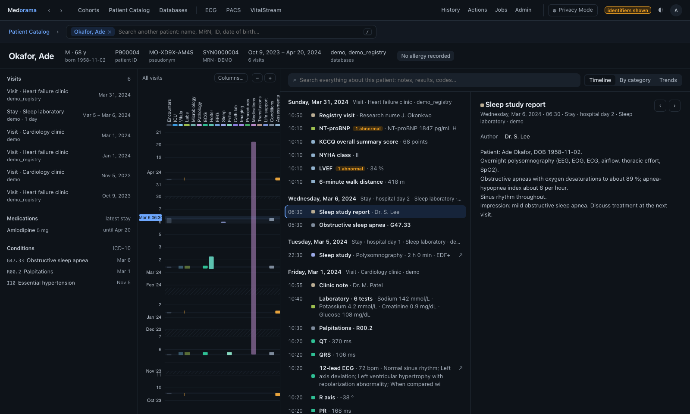

### Search a patient's data

The search box above **What was done** looks through every text the patient has: the names of tests, drugs and
codes, values, results, notes and reports.

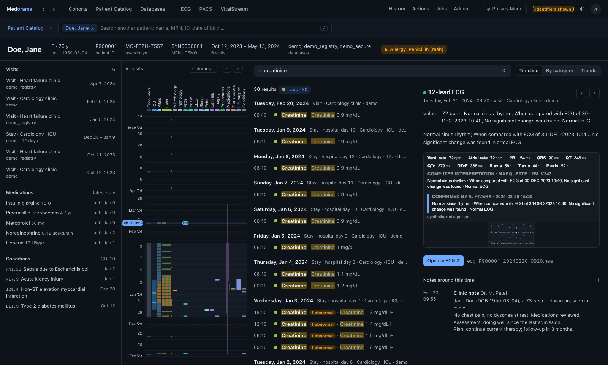

- Words are alternatives: `ecg icu` finds the ECGs and the ICU monitoring.
- A category's name finds all of that category: `labs`, `notes`, `ecg`, `holter`, `sleep`,
  `micro`, `imaging` and so on.
- Any part of a word matches (`lactat`), ignoring case. Quotes keep words together: `"two words"`.
- `lactate > 4` and `hb<8` find values above or below a number.
- A word found nowhere is matched to the closest word in the patient's data (`sepsys` finds
  `sepsis`), and the list says so.
- The search does not understand negation: `no signs of sepsis` is found by `sepsis`.
- Notes are searched and shown for users with the PHI permission out of Privacy Mode. In Privacy
  Mode they are searched and shown unless an administrator withholds them (Admin › Privacy Mode,
  *The text of notes and reports*). In Privacy Mode an entry is found only by its text as you are
  shown it: not by the patient's name, an identifier or a staff name that the page replaces.

## The Databases tab

The Databases tab lists the databases granted to you, the online ones first, each with its kind
(db-builder, OMOP or SQL views) and engine, its status, what it holds (its patients, variables,
the recordings opened and identity conflicts) and your grant on it (**Yours**). Administrators also see the
databases that are not granted to them, so that they can grant them.

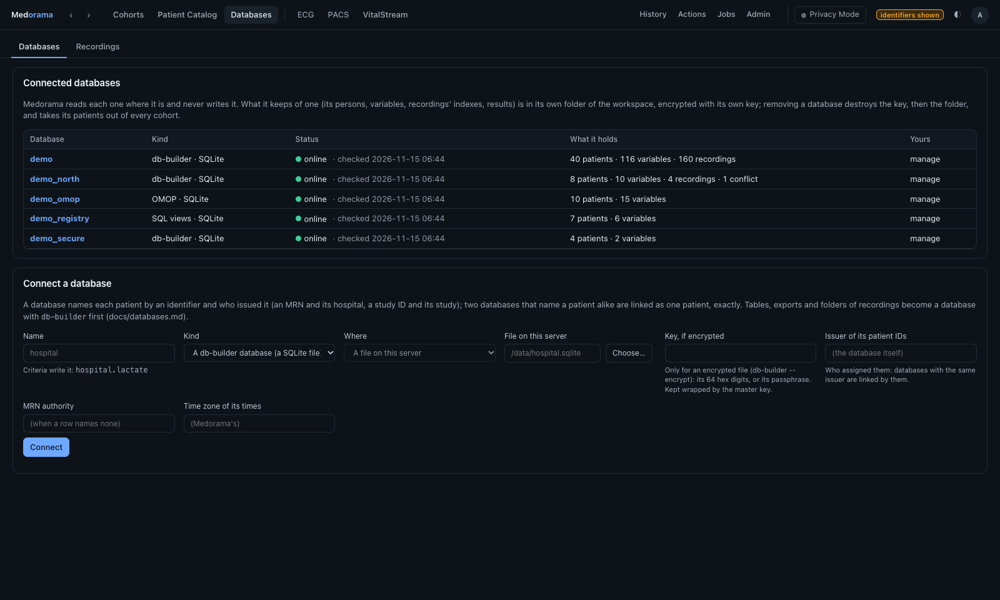

**Status.** Medorama checks each database when it starts, every minute, and when someone asks: a
SQLite file must be there, and each of its views must answer. A **green dot** means online. A
**grey dot** means offline, with the time it was last checked; who manages the database also sees
why (red is used only for alarms). An offline database keeps everything Medorama holds of it: its
variables, its patients on the Patient Catalog and its grants. It is not searched, and the
Cohorts tab greys it.

### A database's page

Click a database's name to open its page (`#/databases/3`). It shows its kind, its engine, its
data version and when it was connected, and then:

| Part | What it does | Who |
|---|---|---|
| **Check now** | Checks whether the database answers. When its version changed, what Medorama keeps of it (its persons, their encounters and its catalog of variables) is read again. | Granted |
| **Refresh** | Reads its persons, their encounters and its catalog again now. No recording is read. | Who manages it |
| **Count now** | Counts how many entries and persons hold each variable: one pass over all its entries, which takes a while on a large database. The counts are kept until the catalog is read again (a new version, **Refresh**). | Who manages it |
| **Index all recordings** | A recording database: reads every recording it lists, checks its files, and indexes the new or changed ones in the background. Otherwise a patient's recordings are read, checked and indexed when the patient is opened. | Who manages it |
| **Remove…** | Removes the database and every trace of it from Medorama (below). You confirm by typing its name. | Who manages it |
| Variables | What it holds: each measurement, diagnosis, drug or other name by category, with its unit, its code and vocabulary; once counted (**Count now**), its number of entries and its number of persons, with when they were counted ("—" before). A count from 1 to 10 is shown as "< 11". | Granted |
| Who may use it | The users granted the database and their permissions; a form to grant a user `search`, `view`, `phi` or `manage`; **Revoke all** to take a user's grants away. | Who manages it |
| Identity conflicts | Persons of the database whose identifiers name two different patients, by the database's own key. They are not linked until the database is corrected; Medorama never merges patients. | Who manages it |
| **Grant it to me** | An administrator is not granted a database by being an administrator. One who is not granted it can grant it to themselves; this is recorded in the audit log (`grant_self`). | Administrators |

**Removing a database** destroys its key first, then its folder of Medorama's workspace (its
persons, encounters, variables, the recordings opened, indexes and results), and then takes its patients out of every cohort that
they were in because of it. Patients that no other database links leave Medorama, with their
pseudonyms. The database itself is not touched, and nothing of it can be found afterwards in
Medorama. This cannot be undone.

### Connect a database

Administrators connect a database with **Connect a database**, below the list. Tables, exports
and folders of recordings become a database with [db-builder](../db-builder/README.md) first.

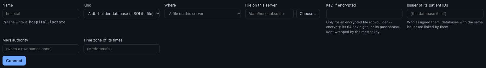

| Field | What to give |
|---|---|
| Name | The name criteria use, such as `hospital` in `hospital.lactate`. |
| Kind | A db-builder database (a SQLite file), OMOP CDM 5.3 or 5.4, or any layout through SQL views. |
| Where | A file on this server (**Choose…** opens a dialog of the server's folders, inside the folders data may come from), or a PostgreSQL server (its address, without a password). |
| Password | For a server: kept wrapped by Medorama's master key, and never shown again. |
| Schema, Vocabulary schema | For OMOP: where its tables are. |
| Its patients are named by | For OMOP: the MRN, the patient ID, or nothing another database knows. |
| Issuer of its patient IDs | Who assigned them. Two databases with the same issuer are linked by them; left empty, the database's patient IDs link only its own persons. |
| MRN authority | The authority of its MRNs, when a row names none. |
| Time zone of its times | When it is not Medorama's. |
| SQL views | For any layout: the queries for persons, visits, entries, stays (optional: the stays in units, such as ICU stays, within visits), recordings (a recording database) and its version. |

Medorama checks the database, reads the names and units of its variables, links its patients
(with their encounters) and grants it to you. It counts nothing and reads no recording, so a
database of millions of rows connects in minutes. What
every database must provide, and how to build one, is described in [databases.md](databases.md).

**Create a database…**, at the top of the card, opens db-builder's own page in a browser tab of
its own (named `db-builder`: a second click shows the same tab), when an administrator has set
Medorama up to run it ([administration.md, db-builder](administration.md#db-builder)); otherwise
the button is not shown. There, sign in with db-builder's own account (not your Medorama
account), make a database, preview what your tables would add, add them, and come back here to
connect the file it made ([databases.md, Build it in the browser](databases.md#build-it-in-the-browser-db-builders-page)).
When db-builder is set up but not running, the reason is written beside the button.

## Recordings

The **Recordings** subtab of the Databases tab lists the recordings Medorama keeps of the
recording databases you may view: those opened (a patient's page, a job or a cohort's selection
read them) or indexed (**Index all recordings** on the database's page), the newest first: their status, name, kind and format, start, length, patient,
database and path, with **View** (opens VitalStream), **Copy path** and **Index now** (analysts
and administrators). You can search it by words in a recording's name, format, status or
database. Administrators can **Re-check the files**: whether every listed recording's file is
still there, unchanged. A recording the database lists but no one has opened is not listed yet.

| Status | Dot | Meaning |
|---|---|---|
| `ready` | Green | Indexed, and the index matches the recording as it is now. |
| `queued` | Amber | Indexing is waiting for a worker. |
| `indexing` | Amber, pulsing, with a percentage | Being indexed. |
| `new` | Gray | Never indexed. |
| `stale` | Purple ring | Changed since it was indexed. |
| `failed` | Amber | Indexing failed, or was cancelled; the error (or *indexing was cancelled*) is shown. A cancelled recording is not indexed again on its own: **Index now** indexes it. |
| `missing` | Amber | Not found at the last check (or outside `data_roots`, inside the workspace, unreadable). |
| `file` | Gray ring | A file no reader indexes (a 12-lead ECG in DICOM or XML, a picture, a PDF): opened by its viewer from its entry on the patient's page, never indexed. |

Medorama only reads recordings: a recording leaves when its database is removed or no longer
lists it.

## Searching

The Patient Catalog and the command-line tool (`list --q`) share one search syntax:

| You write | It finds |
|---|---|
| `mo-ab4c` | Patients in which some field contains it. |
| `sex:f` | Patients in which that field contains it. |
| `database:"study one"` | Quotes hold a value with spaces. |
| `sex:f has:ecg database:omop` | Patients that match every term. |

- Searches never depend on letter case, and a value matches anywhere in the field: `name:smi`
  finds Smith, and `dob:1950-03` finds March 1950.
- An unknown field is an error, and the message lists the fields.
- Without the PHI permission, or in Privacy Mode, a word never matches an identifier, and an
  identifier field (`name:`, `dob:` and so on) is an error. In Privacy Mode `patient:` holds the
  pseudonyms.

| Fields (fields in italics need the PHI permission) |
|---|
| `patient` (the pseudonym; with the PHI permission, also the patient ID), `sex`, `has` (a kind of data), `database`; *`name`, `first`, `last`, `mrn`, `dob`* (of the databases granted to you with `phi`) |

The Recordings subtab and the command `recordings --q` take plain words: each must appear in a
recording's name, format, status or database.

Searches made by users with the PHI permission are recorded in the audit log (`phi_search`), and
so are searches made in Privacy Mode (`privacy_search`).

## The viewers

Medorama shows three viewers in its own tabs. Inside Medorama they run behind its sign-in and its
privacy gate: they show no patient identity, and in Privacy Mode they receive de-identified files
only. They open only the recordings and files of the databases granted to you with `view`. Each
viewer also exists as a standalone program for use without Medorama, and each has a light and a
dark theme that follows the page.

| Viewer | What it shows | Opened from |
|---|---|---|
| [VitalStream](../viewers/vitalstream) | Waveform recordings: every channel, the vital signs, the alarms, EDF+ annotations and the breaks in the data on one time axis, from days down to single samples. | **View** beside a recording, or a recording's entry on the patient page (at its moment). |
| [ECG viewer](../viewers/ecg) | 12-lead ECGs on standard paper (3 × 4 with a rhythm strip, 6 × 2, 12 × 1), with calipers. It reads WFDB, GE MUSE XML, DICOM ECG, EDF and JSON ECGs, and shows PNG, JPEG and PDF printouts. | **Open in ECG** on the patient page. |
| [PACS viewer](../viewers/pacs) | DICOM studies (echo and angiography loops at their frame rate, CT, MR, X-ray, structured reports), videos, pictures and PDFs, with calipers in millimeters. | **Open in PACS** on the patient page. |

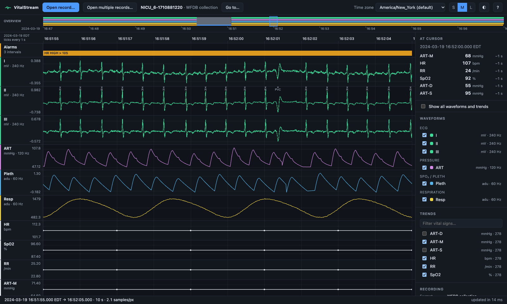

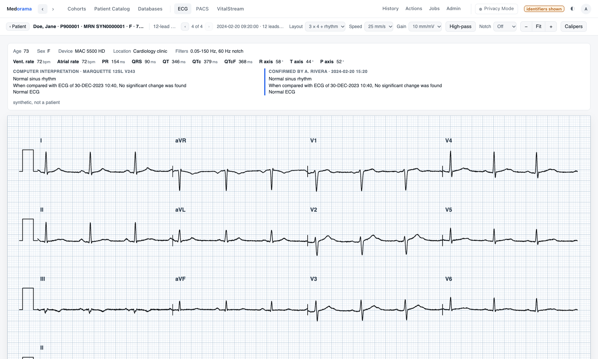

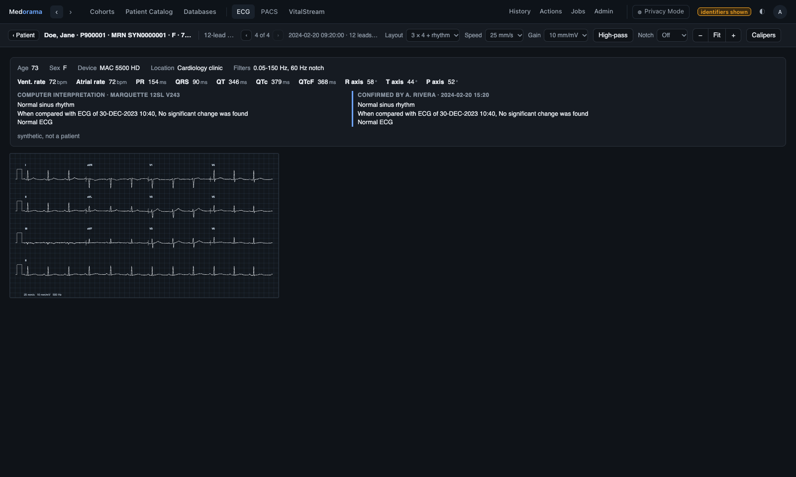

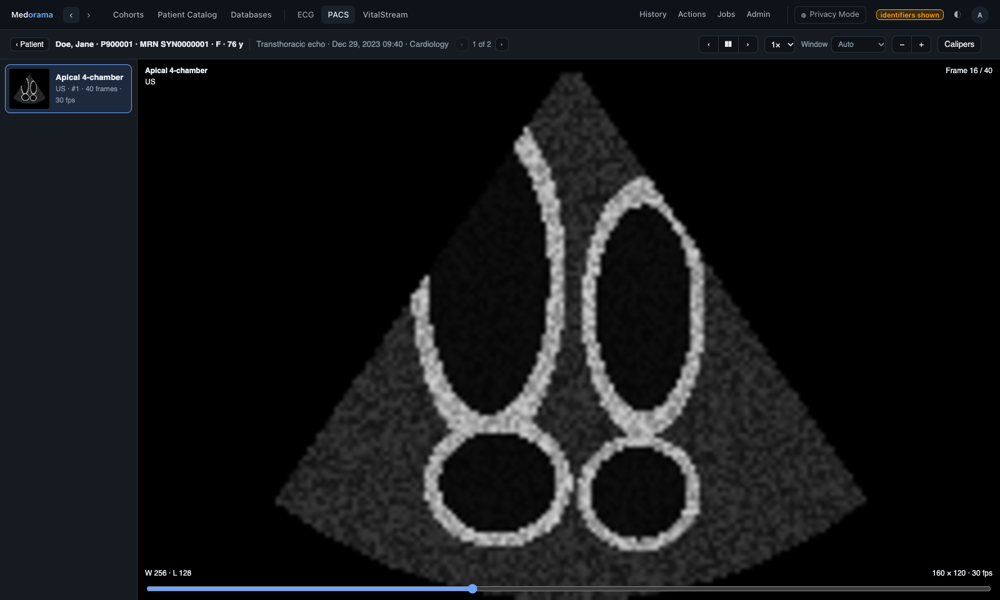

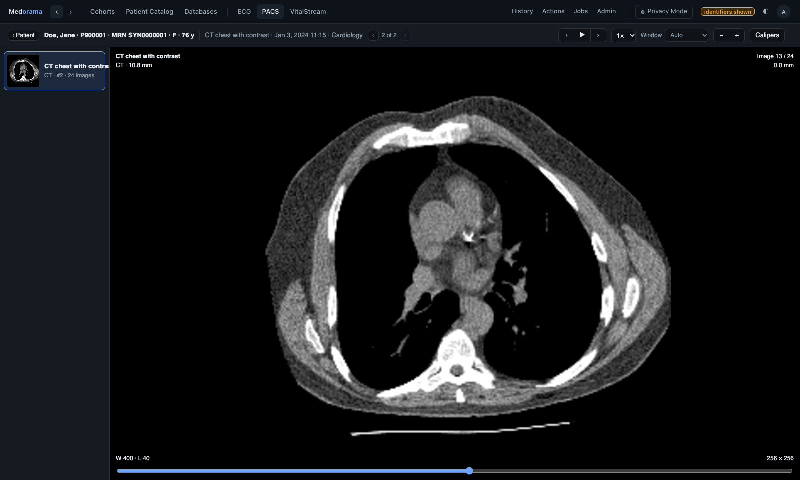

**The amber warning triangle.** In Privacy Mode, a viewer tab that shows a picture, a video or a
PDF carries an amber warning triangle. These files are sent as they are, and they may show a name
or another identifier burned into the image. Red is reserved for alarms, so the warning is amber.

## Actions and jobs

**Actions** are for analysts and administrators. Tick the actions to run (**Index** is ticked by
default), choose what to run them on (the recordings of a cohort's members, or every recording
of the databases you may view) and start the run. A run makes one **job** per action and
recording. A job already done on the recording as it is now is not done again; tick *Run again
where already done* to run it anyway.

The **Jobs** tab shows the queue (running, queued, failed and done jobs) with a **Cancel** button.
A failed job shows its error. The page does not show a job's result (its summary); the API
returns it with the recording (`GET recordings/{id}`, see [api.md](api.md)). The numbers of a
summary can be searched in a cohort's criteria, such as `hrv.rmssd > 50`
([actions.md](actions.md)).

One action is built in: **Index** (`index`) builds the index that the viewers draw from. When a
recording has an ECG signal but no heart rate, it also derives the heart rate from the ECG.
Plug-ins add other actions ([actions.md](actions.md)).

## History

The History tab lists the patients whose page you opened, the most recent first, with when you
first and last opened each and how many times. You can remove one entry or clear the whole list,
and nobody else sees it.
