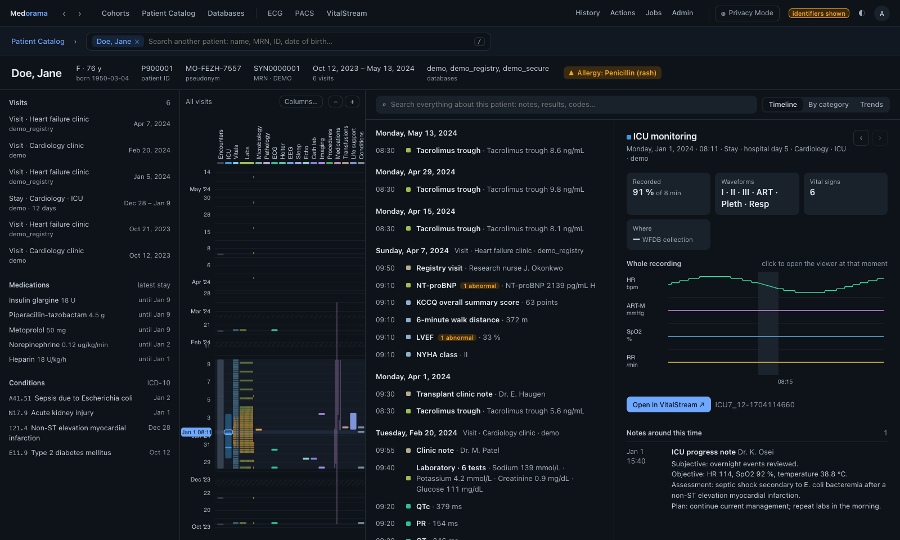

# Medorama server

This page describes `medorama`, the server at the center of [Medorama](../README.md): what it
does, how to install and run it, how it is tested, and how its source is organized. It is for
administrators and developers; users of the web page should read the
[user guide](../docs/user-guide.md).

The server connects databases and reads them in place, read-only: OMOP databases, any SQL
database through views, and the SQLite databases that [db-builder](../db-builder/README.md) makes
from tables, exports and folders of recordings. It imports nothing. It links the databases'
persons into patients by exact identifiers, keeps what it generates for each database in an
encrypted *workspace*, decides who may use each database by *grants*, and builds the patient
pages and cohorts across the databases; every answer it sends passes through the privacy gate. It runs background actions on recordings, and offers a web page, an HTTP API and
a command-line tool. Its page opens the [viewers](../viewers/README.md) as tabs: VitalStream for
waveforms, and the ECG and PACS viewers.

| | |
|---|---|
| Command | `medorama`; the web page is served at <http://127.0.0.1:8090> by default. |
| Language | Rust. One binary contains the server, the web page and the ECG and PACS viewers. Recordings are indexed with VitalStream's engine ([`libs/engine`](../libs/engine)). |
| Control store | Medorama's own database (users, grants, the audit log, the list of databases, cohort definitions, wrapped keys; no patient data): SQLite in Medorama's home folder (optionally encrypted), or PostgreSQL. |
| Workspace | One folder per connected database and one file per cohort, every SQLite file encrypted with SQLCipher by its own data key, wrapped by the master key. Removing a database destroys its key, then its folder. |
| Connected databases, files and recordings | Only read: never written, copied, moved, deleted or written next to. |
| Identifiers (MRNs, names, dates of birth) | Read from the connected databases; kept only in each database's encrypted `persons.sqlite`. They are shown only to users with the PHI permission and the database's `phi` grant who switch Privacy Mode off, and never sent to the viewers or to actions ([security](../docs/security.md)). |
| Sign-in | Medorama's own accounts, or an institution's authenticating proxy ([sign-in](../docs/sign-in.md)). |
| Themes | Light and dark, switched with the ◐ button in the header; the system setting is used until the user chooses. The viewers in its tabs follow the page. |


*A patient's page, with the Patient Journey, the report and an ECG.*



*The same page on a patient's ICU stay, with the recording's vital signs in the detail. Every
picture shows synthetic data made by `tools/make-demo-data.py`.*

## Install and run

These steps install Medorama from a clone of the repository, make two tables into a database and
connect it. To try it on invented patients first, follow
[Get started](../docs/getting-started.md) instead.

1. Build Medorama, db-builder and one VitalStream viewer into `.venv`. Run the installer once, and again
   after each `git pull`. The option `--viewer rs`, `py` or `none` chooses another viewer than
   the default C++ one; on Windows, run `tools\install-medorama.ps1`:

   ```bash
   tools/install-medorama.sh
   ```

2. Activate the environment in every new terminal (on Windows, `.venv\Scripts\Activate.ps1`):

   ```bash
   source .venv/bin/activate
   ```

3. Set Medorama up once. The command asks twice for the first administrator's password, and
   makes the master key (`master.key` in Medorama's home folder, outside the workspace). Put the
   workspace on a local disk, outside every folder of data:

   ```bash
   medorama init --workspace /path/to/workspace
   ```

4. Make tables into a database with db-builder, and connect it, here or in the page's
   **Databases** tab (**Connect a database**). A table whose rows name a patient and a file makes
   those files recordings of the database:

   ```bash
   db-builder add /data/study.sqlite patients.csv icu_index.csv --issuer HOSPITAL
   medorama databases connect study --kind dbb --url sqlite:/data/study.sqlite
   ```

5. Start the server, then open <http://127.0.0.1:8090> and sign in as `admin`:

   ```bash
   medorama serve
   ```

`medorama --help` lists every command, and `medorama COMMAND --help` describes one. With the
installer's `--demo` option (Windows: `-Demo`), `init --demo` makes a demo installation that
connects the demo's six databases; it never becomes a site's installation, so give it its own home,
workspace and port (`medorama --home ~/medorama-demo init --workspace ~/medorama-demo-workspace
--demo`, then `medorama --home ~/medorama-demo serve --port 8095`), and delete its home and
workspace to be rid of it ([the demo](../docs/administration.md#the-demo),
[design/demo.md](../docs/design/demo.md)).

**Without WFDB support.** The installer's `--no-wfdb` option (Windows: `-NoWfdb`), or
`cargo build --release --locked -p medorama --no-default-features` (the Cargo feature `wfdb` left
out), builds Medorama without wfdb-x. Such a build reads every other format, and refuses a WFDB
recording: the Recordings subtab shows it with "this build has no WFDB support (built without
the `wfdb` feature)", and it is not indexed
([building.md, Without WFDB](../docs/building.md#without-wfdb)).

## Documentation

| Topic | Page |
|---|---|
| Building on every system, offline, without administrator rights | [Building](../docs/building.md) |
| Setting up, settings, PostgreSQL, the workspace and keys, connecting databases, grants, add-ons, users, deployment, services, backups, troubleshooting | [Administration](../docs/administration.md) |
| Using the web page | [User guide](../docs/user-guide.md) |
| What a connected database must provide; making one with db-builder | [Databases](../docs/databases.md), [db-builder](../db-builder/README.md) and its input, [importing](../docs/importing.md) |
| Sign-in, and connecting institutional sign-in | [Sign-in](../docs/sign-in.md) |
| The HTTP API | [HTTP API](../docs/api.md) and [`openapi.yaml`](openapi.yaml) |
| Actions and plug-ins | [Actions](../docs/actions.md) |
| Security review | [Security and privacy](../docs/security.md) and [protecting patient data](../docs/protecting-patient-data.md) |
| The code | [Developing](../docs/developing.md) and [architecture](../docs/architecture.md) |
| Changes between versions | [CHANGELOG.md](CHANGELOG.md) |

## Tests

The tests use synthetic data only. The following commands run them from the repository root:

```bash
cargo test --release --locked -p medorama                        # or: make test-medorama
cargo test --release --locked -p medorama --no-default-features  # without WFDB support (the tests on WFDB recordings are ignored)
MEDORAMA_TEST_POSTGRES=postgres://user@host/db cargo test --release --locked -p medorama   # every test again on PostgreSQL
node --test medorama/tests/web/                                  # the page's scripts
```

On PostgreSQL, each test uses a schema of its own in the given database, which should be empty.
Create the trigram extension there once with `CREATE EXTENSION pg_trgm`.

| Test | Checks |
|---|---|
| `tests/databases.rs` | Connected databases: exact linking, identity conflicts, status, a new version read again, grants, a search naming the databases left out, removal leaving no trace (also after a crash), a deleted cohort's key, databases refused inside the workspace or outside `data_roots`. |
| `tests/privacy.rs` | Privacy Mode end to end: identifiers seeded in a connected database, in every format Medorama serves, must not appear in any byte sent to a user in Privacy Mode; every GET route is walked. |
| `tests/signin.rs` | Both sign-in methods: passwords, and an authenticating proxy. |
| `tests/gateway.rs` | The gateway with a real VitalStream viewer: `$MEDORAMA_TEST_VIEWER`, or else the first viewer built; a non-admin opens only the recordings of the databases granted to them. Without a viewer, the test says so and passes. |
| `tests/browser.rs` | The page in headless Chrome (`$MEDORAMA_TEST_CHROME`), with an accessibility check, including connecting, granting and removing a database through the page. |
| `tests/openapi.rs` | `openapi.yaml` against the server's routes. |
| `tests/audit_queue.rs`, `tests/dicom_samples.rs` | Audit entries the database refuses are kept and written later; DICOM rewriting on local samples, when present. |
| `tests/common/` | The shared helpers: `Setup` (Medorama in a temporary folder, with its workspace and two users) and `Dbb` (a db-builder database written row by row). |

The parsers are also fuzzed, with the targets in [`fuzz/`](fuzz) (`make fuzz`).

## Source layout

| Path | Contents |
|---|---|
| `src/main.rs` | The command-line tool. |
| `src/config.rs` | The settings (`medorama.toml`). |
| `src/db.rs`, `src/sql/` | The control store, SQLite and PostgreSQL behind one interface, and copying it to PostgreSQL. |
| `src/schema/` | The control store's schema, one file per database engine (`sqlite/001_schema.sql`, `postgres/001_schema.sql`): version 1, with no migration from earlier stores (pre-release). A later change is added as the next numbered file in each. |
| `src/signin.rs`, `src/users.rs` | Sign-in (passwords or an authenticating proxy), users, roles and sessions. |
| `src/audit.rs` | The tamper-evident audit log. |
| `src/gate.rs`, `src/deid.rs`, `src/dicom.rs`, `src/pseudonyms.rs` | The privacy gate: what leaves the server in Privacy Mode, de-identified files, and pseudonyms. |
| `src/server.rs` | The HTTP API, the pages, and the layer that refuses answers the gate did not clear. |
| `src/databases.rs` | The connected databases: connecting, status checks, refreshing, removing every trace. |
| `src/sources/` | Reading a connected database through its views: OMOP's, a site's, db-builder's tables. |
| `src/workspace.rs` | The workspace: data keys wrapped by the master key, the encrypted files of each database and cohort. |
| `src/grants.rs` | Who may search, view, see the identifiers of, or manage each database and cohort. |
| `src/persons.rs`, `src/variables.rs` | The patient index (exact identifiers and their issuers, conflicts) and what each database holds. |
| `src/recordings.rs`, `src/categories.rs` | The recordings of recording databases, and the clinical categories. |
| `src/patient/` | The patient pages: journey, report, detail, trends and files. |
| `src/cohorts/`, `src/expr.rs` | Cohorts and their expressions. |
| `src/actions.rs`, `src/jobs.rs`, `src/derived.rs` | Actions, the job queue, derived series and the results of actions. |
| `src/addons.rs` | Installed adapters (add-ons). |
| `src/viewer.rs`, `src/gateway.rs` | The VitalStream viewer that Medorama runs, and the gateway to it under `/viewer/`. |
| `openapi.yaml` | The HTTP API for tools (OpenAPI 3.1). |
| `web/` | The web page, with no external resources; it is built into the binary. |
| `actions/examples/` | An example plug-in. |
| `tests/` | End-to-end tests, the gateway's contract test, the browser test, shared helpers (`common/`) and the page's script tests (`web/`). |
| `fuzz/` | Fuzz targets for the parsers (cargo-fuzz), with synthetic seeds. |
