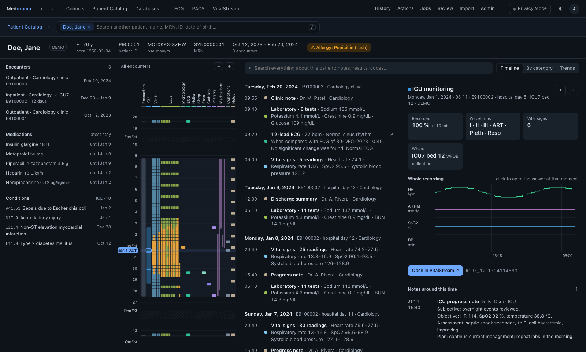

# Medorama server

This page describes `medorama`, the server at the center of [Medorama](../README.md): what it
does, how to install and run it, how it is tested, and how its source is organized. It is for
administrators and developers; users of the web page should read the
[user guide](../docs/user-guide.md).

The server keeps the *catalog*, a database of patients, their encounters, their data from any
number of imported and connected databases, and links to their files and recordings. From the
catalog it builds the patient pages and cohorts, and every answer it sends passes through the
privacy gate. It runs background actions on recordings, and offers a web page, an HTTP API and
a command-line tool. Its page opens the [viewers](../viewers/README.md) as tabs: VitalStream for
waveforms, and the ECG and PACS viewers.

| | |
|---|---|
| Command | `medorama`; the web page is served at <http://127.0.0.1:8090> by default. |
| Language | Rust. One binary contains the server, the web page and the ECG and PACS viewers. Recordings are indexed with VitalStream's engine ([`libs/engine`](../libs/engine)). |
| Database | SQLite in the catalog's home folder (optionally encrypted), or PostgreSQL. |
| Files and recordings | Only read: never copied, moved, deleted or written next to. |
| Identifiers (MRNs, names, dates of birth) | Kept in the catalog's database only. They are shown only to users with the PHI permission who switch Privacy Mode off, and never sent to the viewers or to actions ([security](../docs/security.md)). |
| Sign-in | Medorama's own accounts, or an institution's authenticating proxy ([sign-in](../docs/sign-in.md)). |
| Themes | Light and dark, switched with the ◐ button in the header; the system setting is used until the user chooses. The viewers in its tabs follow the page. |


*A patient's page, with the Patient Journey, the report and an ECG.*



*The same page on a patient's ICU stay, with the recording's vital signs in the detail. Every
picture shows synthetic data made by `tools/make-demo-data.py`.*

## Install and run

These steps install Medorama from a clone of the repository and import two tables. To try it on
invented patients first, follow [Get started](../docs/getting-started.md) instead.

1. Build Medorama and one VitalStream viewer into `.venv`. Run the installer once, and again
   after each `git pull`. The option `--viewer rs`, `py` or `none` chooses another viewer than
   the default C++ one; on Windows, run `tools\install-medorama.ps1`:

   ```bash
   tools/install-medorama.sh
   ```

2. Activate the environment in every new terminal (on Windows, `.venv\Scripts\Activate.ps1`):

   ```bash
   source .venv/bin/activate
   ```

3. Create the catalog once. The command asks twice for the first administrator's password. Put
   the results folder on a local disk:

   ```bash
   medorama init --results /path/to/results
   ```

4. Import databases, in any order, here or in the page's **Import** tab. A table whose rows name
   a patient and a file brings those files into the catalog:

   ```bash
   medorama import-table patients.csv
   medorama import-table icu_index.csv
   ```

5. Start the server, then open <http://127.0.0.1:8090> and sign in as `admin`:

   ```bash
   medorama serve
   ```

`medorama --help` lists every command, and `medorama COMMAND --help` describes one. With the
installer's `--demo` option (Windows: `-Demo`), `init` also loads the demo into a cohort named
DEMO, which an administrator deletes when done
([the demo](../docs/administration.md#the-demo)).

**Without WFDB support.** The installer's `--no-wfdb` option (Windows: `-NoWfdb`), or
`cargo build --release --locked -p medorama --no-default-features` (the Cargo feature `wfdb` left
out), builds Medorama without wfdb-x. Such a build reads every other format, and refuses a WFDB
recording: an import lists it among the skipped files with "this build has no WFDB support
(built without the `wfdb` feature)", and does not add it
([building.md, Without WFDB](../docs/building.md#without-wfdb)).

## Documentation

| Topic | Page |
|---|---|
| Building on every system, offline, without administrator rights | [Building](../docs/building.md) |
| Setting up, settings, PostgreSQL, importing, add-ons, users, deployment, services, backups, troubleshooting | [Administration](../docs/administration.md) |
| Using the web page | [User guide](../docs/user-guide.md) |
| The tables to export and the columns recognized | [Importing](../docs/importing.md) and [databases](../docs/databases.md) |
| Sign-in, and connecting institutional sign-in | [Sign-in](../docs/sign-in.md) |
| The HTTP API | [HTTP API](../docs/api.md) and [`openapi.yaml`](openapi.yaml) |
| Actions and plug-ins | [Actions](../docs/actions.md) |
| Security review | [Security and privacy](../docs/security.md) and [protecting patient data](../docs/protecting-patient-data.md) |
| The code | [Developing](../docs/developing.md) and [architecture](../docs/architecture.md) |
| Changes between versions | [CHANGELOG.md](CHANGELOG.md) |

## Tests

The tests use synthetic data only. The following commands run them from the repository root:

```bash
cargo test --release --locked -p medorama                        # or: make test-medorama
cargo test --release --locked -p medorama --features encryption  # adds the database encryption test
cargo test --release --locked -p medorama --no-default-features  # without WFDB support (the tests on WFDB recordings are ignored)
MEDORAMA_TEST_POSTGRES=postgres://user@host/db cargo test --release --locked -p medorama   # every test again on PostgreSQL
node --test medorama/tests/web/                                  # the page's scripts
```

On PostgreSQL, each test uses a schema of its own in the given database, which should be empty.
Create the trigram extension there once with `CREATE EXTENSION pg_trgm`.

| Test | Checks |
|---|---|
| `tests/privacy.rs` | Privacy Mode end to end: identifiers seeded in every format the catalog serves must not appear in any byte sent to a user in Privacy Mode. |
| `tests/signin.rs` | Both sign-in methods: passwords, and an authenticating proxy. |
| `tests/gateway.rs` | The gateway with a real VitalStream viewer: `$MEDORAMA_TEST_VIEWER`, or else the first viewer built. Without a viewer, the test says so and passes. |
| `tests/browser.rs` | The page in headless Chrome (`$MEDORAMA_TEST_CHROME`). |
| `tests/openapi.rs` | `openapi.yaml` against the server's routes. |
| the other files in `tests/` | Importing and identity, linking, cohorts, the patient pages, removal, connected OMOP databases, add-ons, users and the API's permissions. |

The parsers are also fuzzed, with the targets in [`fuzz/`](fuzz) (`make fuzz`).

## Source layout

| Path | Contents |
|---|---|
| `src/main.rs` | The command-line tool. |
| `src/config.rs` | The settings (`medorama.toml`). |
| `src/db.rs`, `src/sql/` | The database and its migrations, SQLite and PostgreSQL behind one interface, and copying a catalog to PostgreSQL. |
| `src/schema/` | The database schema, one file per database (`sqlite/001_schema.sql`, `postgres/001_schema.sql`). A later change is added as the next numbered file in each. |
| `src/signin.rs`, `src/users.rs` | Sign-in (passwords or an authenticating proxy), users, roles and sessions. |
| `src/audit.rs` | The tamper-evident audit log. |
| `src/gate.rs`, `src/deid.rs`, `src/dicom.rs`, `src/pseudonyms.rs` | The privacy gate: what leaves the server in Privacy Mode, de-identified files, and pseudonyms. |
| `src/server.rs` | The HTTP API, the pages, and the layer that refuses answers the gate did not clear. |
| `src/tables.rs`, `src/imports.rs`, `src/formats/` | Imported databases, and the import formats (built-in converters and TOML descriptions). |
| `src/sources/` | Connected databases (OMOP, mapped SQL) and the person registry. |
| `src/identity.rs`, `src/linkage.rs`, `src/review.rs` | Patients across databases, linking recordings to encounters, and the Review tab. |
| `src/recordings.rs`, `src/identify.rs`, `src/categories.rs` | Recordings, the identifiers stated in their files, and the clinical categories. |
| `src/patient/` | The patient pages: journey, report, detail, trends and files. |
| `src/cohorts/`, `src/expr.rs` | Cohorts and their expressions. |
| `src/actions.rs`, `src/jobs.rs`, `src/derived.rs` | Actions, the job queue and derived series. |
| `src/addons.rs` | Installed adapters (add-ons). |
| `src/demo.rs` | The demo (the cohort DEMO). |
| `src/viewer.rs`, `src/gateway.rs` | The VitalStream viewer that Medorama runs, and the gateway to it under `/viewer/`. |
| `openapi.yaml` | The HTTP API for tools (OpenAPI 3.1). |
| `web/` | The web page, with no external resources; it is built into the binary. |
| `actions/examples/` | An example plug-in. |
| `tests/` | End-to-end tests, the gateway's contract test, the browser test, shared helpers (`common/`), synthetic fixtures (`fixtures/`) and the page's script tests (`web/`). |
| `fuzz/` | Fuzz targets for the parsers (cargo-fuzz), with synthetic seeds. |
