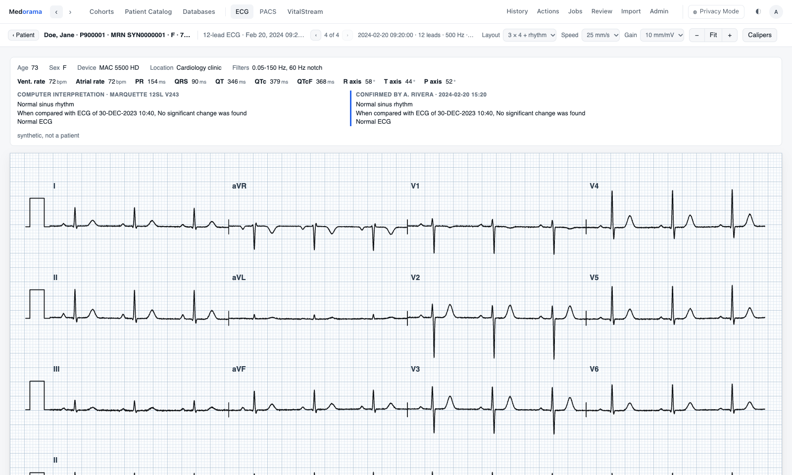

# Viewers

Medorama has three viewers: VitalStream for waveform recordings, the ECG viewer for 12-lead
ECGs, and the PACS viewer for DICOM studies. This page explains what each viewer shows, how to
try and install each one on its own, how they work inside Medorama, and the addresses another
program uses to open them. Each viewer's own page covers installing, running, using and
deploying it in full.

- [The three viewers](#the-three-viewers)
- [Try them](#try-them)
- [On their own, or inside Medorama](#on-their-own-or-inside-medorama)
- [Opening records](#opening-records)
- [Light and dark themes](#light-and-dark-themes)
- [Addresses](#addresses)
- [Privacy](#privacy)
- [Tests](#tests)

## The three viewers

Each viewer is a program of its own, in its own folder, and is useful without Medorama: it opens
the files given to it. Medorama serves the same viewers and opens them as tabs of its page, at
an address that names the file to show.

| Viewer | Shows | Opens | Runs as |
|---|---|---|---|
| [VitalStream](vitalstream/README.md) | Waveform recordings: ICU monitoring (every channel, vital signs, alarms), Holter ECGs of days or weeks, and EEG and sleep studies. | WFDB records (single- and multi-segment), folders of records as one session, WFDB collections, and EDF, EDF+ and BDF files ([EDF](../docs/edf.md)); other formats, such as BedMasterEx `.Stp` files, through an installed adapter. | A server: `vitalstream-cpp`, `vitalstream-rs` or `vitalstream-py`. |
| [ECG viewer](ecg/README.md) | 12-lead ECGs on standard paper (25 mm/s, 10 mm/mV, 1 mm and 5 mm grid) in the 3 × 4 and 6 × 2 layouts, each with a lead II rhythm strip, and 12 × 1; calipers. | WFDB records (single- and multi-segment), GE MUSE XML, DICOM ECGs, EDF and EDF+, the [JSON form](ecg/README.md#json), PNG, JPEG and PDF; a folder of ECGs, one at a time. | A page: `ecg/index.html` from disk, [on the website](https://medorama.org/viewers/ecg/), or served by `muse-py serve`. |
| [PACS viewer](pacs/README.md) | Cardiology and other DICOM studies: echo and angiography loops at their frame rate, stacks of slices (CT, MR, NM, X-ray) with window and level, structured reports and PDF documents; calipers in cm or mm. | DICOM (native, RLE, JPEG baseline, extended and lossless), MP4, WebM, MOV, PNG, JPEG and PDF; a folder of studies. | A page: `pacs/index.html` from disk, [on the website](https://medorama.org/viewers/pacs/), or served by `dicom-py serve`. |

The ECG and PACS viewers are static pages made of HTML, CSS and plain scripts, with no
dependencies and no build step. They work from disk (`file://`) and from any web server. Their
Python tools, `muse-py` and `dicom-py`, serve the pages from a computer's folders and build
databases of ECGs and DICOM studies for Medorama to import.

The BedMasterEx `.Stp` adapter (stp-adapter) is private and available to institutions under
agreement; it is not part of this repository ([adapters](../docs/adapters.md)).

## Try them

The ECG and PACS viewers run live on the website, in your browser. The files you open there are
read on your own computer and never leave it.

| Viewer | Live | Synthetic examples |
|---|---|---|
| ECG | <https://medorama.org/viewers/ecg/> | [`ecg/examples/`](ecg/examples/README.md): a WFDB record, a GE MUSE XML file, a DICOM ECG, an EDF+ file, a PDF and a PNG printout |
| PACS | <https://medorama.org/viewers/pacs/> | [`pacs/examples/`](pacs/examples/README.md): an echo loop, a coronary angiography run and a chest X-ray |
| VitalStream | Not available: it is a server. [Install it](vitalstream/README.md#install) on your computer. | [`vitalstream/testdata/`](vitalstream/testdata): a WFDB collection, plain records, and a folder of records to open as one session |

On the examples pages, each file has a link that opens it in the live viewer. Every value in the
examples is invented. The ECG and PACS examples are written by
[`tools/make-viewer-examples.py`](../tools/make-viewer-examples.py), and VitalStream's by
[`vitalstream/testdata/generate.py`](vitalstream/testdata/generate.py).

## On their own, or inside Medorama

A viewer on its own serves one person's files on one computer. Inside Medorama, the same viewer
serves what Medorama allows each signed-in user to read.

| | On its own | Inside Medorama |
|---|---|---|
| Install | VitalStream: `viewers/vitalstream/install.sh` (Windows: `install.ps1`) builds one viewer into `~/.local/bin`. ECG and PACS: nothing to install (open the page), or `pip install` their Python package to use `serve`. The commands for each operating system are in [Install](../docs/install.md). | `tools/install-medorama.sh` builds Medorama and one VitalStream viewer. The ECG and PACS pages are built into Medorama. |
| Files it opens | VitalStream: files under its *root folder* and its `data_roots`. `muse-py serve` and `dicom-py serve`: files under their `--root`. The pages from disk or on the website: the files the user picks. | What Medorama lets each user read for a patient, from its catalog and connected databases. |
| Root folder | Fixed when VitalStream is built (`install.sh --root DIR`; by default the home folder of whoever runs it). The viewer never opens anything outside it. | The whole file system, since Medorama's own rules and its gateway decide what is read ([architecture](../docs/architecture.md)). |
| Who may use it | Whoever can reach its port; with a password set (`--set-password`), only those who know it. | Medorama's users, after Medorama's sign-in, with roles and permissions per user. |
| Patient identity | Never shown by a viewer, whatever the file contains. | The same. In Privacy Mode, Medorama also de-identifies the files on its server before the viewer receives them. |

Databases, users, roles, sign-in, audit and de-identification belong to Medorama only. A viewer
on its own has none of them beyond an optional password
([administration: the waveform viewer](../docs/administration.md#the-waveform-viewer)).

### Ports

All the programs listen on 127.0.0.1 (this computer only) by default, so that nothing on the
network can reach them unless you decide otherwise. To use one from another computer, open an
SSH tunnel to its port; each viewer's page explains how.

| Program | Default port |
|---|---|
| `vitalstream-py`, `vitalstream-rs`, `vitalstream-cpp` | 8050, 8060, 8070 |
| `muse-py serve` (ECG), `dicom-py serve` (PACS) | 8080, 8081 |
| Medorama (`medorama serve`) | 8090; it starts its own VitalStream viewer on a free port |

### The optional password

The viewers on their own share one optional password file, `~/.config/vitalstream/auth.json`:
one password protects VitalStream, `muse-py serve` and `dicom-py serve`. Set it with
`--set-password` on any of them.

A VitalStream viewer can also be built without password support (`install.sh --no-password`).
Such a viewer never asks for a password, even when the shared file holds one, so it is open to
anyone who reaches its port: keep it on 127.0.0.1 or behind a tunnel. It refuses to start where
a password is required (`require_password`, as under Medorama).
A VitalStream viewer can be built without WFDB support as well (`install.sh --no-wfdb`): it then
contains no wfdb-x code, refuses a WFDB record or folder with a message, and reads every other
format ([building.md, Without WFDB](../docs/building.md#without-wfdb)).

## Opening records

The three viewers have the same two buttons:

| Button | VitalStream | ECG | PACS |
|---|---|---|---|
| **Open record…** | One recording: a WFDB record (its `.hea`; a multi-segment record whole, or one segment), an EDF or BDF file, or a file an adapter reads. | One ECG: a WFDB record (its `.hea` with its signal files), MUSE XML, DICOM, EDF, JSON, PNG, JPEG or PDF. | One record: a study's or a series' DICOM files, a video, a picture or a PDF. |
| **Open multiple records…** | A folder: every record in it and its subfolders on one time axis (one session), or a WFDB collection. A summary is shown first, then **Open as one session**. | A folder: every ECG in it and its subfolders, stepped through one at a time (‹ › or ← →). | A folder: every study in it and its subfolders, listed by series. |
| Limits | 5000 header files, 20 folder levels, and 10 s to count them (adjustable in the settings). | 5000 ECGs. | 5000 files and 4 GB. |

VitalStream opens the files of the computer it runs on, through its own file browser. The ECG
and PACS pages open the files of the computer the browser runs on. When they are served by
`muse-py serve` or `dicom-py serve`, they can also open the serving computer's files with
**Server folders…**.

**WFDB headers that leave values out.** The ECG viewer applies WFDB's own defaults: 250 Hz, a
gain of 200 adu/mV (also for a stated gain of 0), millivolts, and the baseline at the ADC zero.
VitalStream reads only what a header states: a record without a sampling frequency is left out,
and a signal without a gain is shown in `adu`.

## Light and dark themes

Every viewer has a light and a dark theme, switched with a button at the top right (VitalStream:
◐; ECG and PACS: ☾ or ☀). The browser remembers the choice. Until a choice is made, VitalStream
and the ECG viewer follow the system setting, and the PACS viewer starts dark.

A host program can set the theme of any of the three viewers with `theme=` in the address
([Addresses](#addresses)). The theme is then applied without being remembered as the viewer's
own choice. Medorama passes its page's theme to every viewer tab, when the tab opens and whenever
the theme changes.

## Addresses

Another program opens a viewer at a file by writing what to show in the address's fragment
(after `#`). Changing the fragment shows another file without reloading the page.

| Viewer | Fragment | Meaning |
|---|---|---|
| ECG | `src=URL` | The file: a WFDB header (its signal files, and a multi-segment record's segments, are read beside it, at `URL`'s folder plus their names), a MUSE XML or DICOM ECG, an EDF file, a JSON ECG, a picture or a PDF. |
| PACS | `src=URL` | One file. |
| PACS | `list=URL` | A folder: `URL` answers `{"files": ["IM0001.dcm", …]}`, and each file is read at `URL` plus its name. |
| PACS | `mm=…`, `fps=…` | Millimeters per pixel of pictures and videos; the frame rate of pictures shown as one loop. |
| ECG | `shift=…`, `cap90=1` | For a host that de-identifies in the page: the report's dates moved back, and ages above 89 shown as 90+. Medorama de-identifies on its server instead. |
| ECG, PACS | `name=…` | The name to show. |
| all three | `theme=light\|dark` | The theme, matching the host's (applied without being saved as the viewer's own choice). |
| all three | `who=…`, `what=…`, `pos=…`, `nav=back,prev,next` | The host's context ([`host.js`](ecg/host.js)): whose file it is and what it is, shown in place of the file's name, with ‹ Patient and ‹ › buttons that the viewer only reports to the host page (`postMessage`, same origin). Without them, the file's name is shown. |
| ECG | `compact=1` | The paper alone, fitted to the frame, for display inside another page. |
| VitalStream | `path=…&t0=…&t1=…` (and the host's context above); `browse=FOLDER` | A recording on the server at a time span (Unix seconds), or the file browser open at a folder ([VitalStream](vitalstream/README.md#opened-by-another-program)). |

The viewers fetch files with the page's own credentials (same origin), so a viewer served by
Medorama reads exactly what Medorama lets that user read, through
`api/v1/patients/{id}/file/{item}/…` ([HTTP API](../docs/api.md)).

## Privacy

The viewers show no patient identity. They read identifying fields of a file, such as a DICOM
header's patient name or a WFDB comment, only to group what belongs together, never to display
them. The ECG and PACS pages send nothing anywhere: everything is read and drawn in the browser.
VitalStream's server reads recordings where they lie and sends the page their samples, never a
name, an identifier or a date of birth.

A file's path and its values may still identify a patient, so keep recordings, and the indexes
made from them, on protected storage ([PRIVACY.md](../PRIVACY.md)).

## Tests

`make test-viewers`, run at the repository root, tests the ECG and PACS viewers with Node's
built-in test runner and no packages: the ECG viewer's WFDB, JSON, MUSE and EDF readers and its
paper drawing, and the PACS viewer's DICOM reader and JPEG decoders (the ECG viewer keeps a copy
of the PACS viewer's `dicom.js` for DICOM ECGs). `pytest viewers/ecg/python/muse/tests viewers/pacs/python/dicom/tests` tests the
Python packages `muse-py` and `dicom-py`, including `serve`; `make test-python` runs them with
VitalStream's. VitalStream has its own suites ([VitalStream: testing](vitalstream/README.md#testing)).
