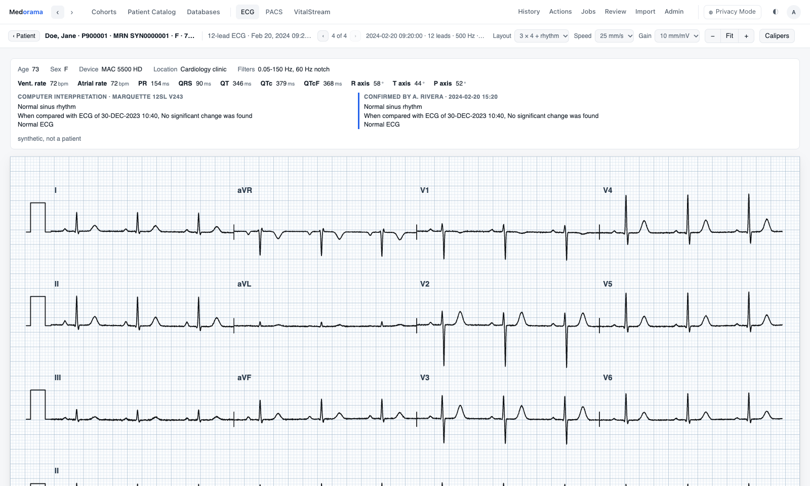
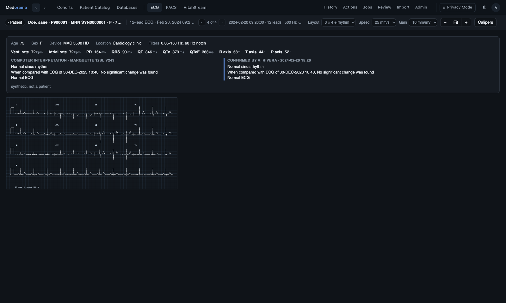

# ECG viewer

The ECG viewer shows resting 12-lead ECGs as clinicians read them: on standard ECG paper, with
the device's report (measurements, the computer's interpretation, the physician's confirmed
statements) above the traces, and calipers to measure intervals and voltages. It reads WFDB
records, GE MUSE XML, DICOM ECGs, EDF and BDF files, a simple JSON form, and scanned or exported
ECGs (PDF, PNG, JPEG). It is one of [Medorama](../../README.md)'s [viewers](../README.md), and
also a web page of its own that needs no installation. This page is for anyone who uses the
viewer by itself or deploys it; developers will find its code layout and tests at the end.

**Try it now: [open the ECG viewer](https://medorama.org/viewers/ecg/)**
in your browser, with the synthetic examples below or your own files. The page reads the files
you choose inside your browser: they never leave your computer.





- [Features](#features)
- [Try it](#try-it)
- [What it reads](#what-it-reads)
- [Open ECGs](#open-ecgs)
- [Read an ECG](#read-an-ecg)
- [Run it](#run-it)
- [Serve it from a computer: muse-py serve](#serve-it-from-a-computer-muse-py-serve)
- [Deploy it](#deploy-it)
- [JSON](#json)
- [MUSE XML](#muse-xml)
- [Opened by another program](#opened-by-another-program)
- [For developers](#for-developers)
- [Privacy](#privacy)

## Features

- **Standard ECG paper:** 25 or 50 mm/s, 5, 10 or 20 mm/mV, a 1 mm and 5 mm grid and a
  calibration pulse on each row, in the 3 × 4 and 6 × 2 layouts with a lead II rhythm strip, or
  12 × 1.
- **The device's report** above the paper: the details of the test, the measurements, the
  computer's statements (for example Marquette 12SL) and the physician's confirmed or edited
  ones.
- **Calipers** that snap to the trace and show the interval in milliseconds and the voltage
  difference in microvolts.
- **Many formats:** WFDB records (single- and multi-segment), GE MUSE XML, DICOM ECGs, EDF,
  EDF+, BDF and BDF+, the viewer's JSON form, and PDF, PNG and JPEG pictures of ECGs
  ([What it reads](#what-it-reads)).
- **Open record…** for one ECG, **Open multiple records…** for a folder of them, stepped through
  one at a time, and drag and drop.
- **Nothing to install:** the page runs in any modern browser, from the website, from a clone
  opened from disk, or from any web server. The files stay in the browser.
- **Light and dark themes.** The page starts in the system's theme; the ☾ / ☀ button switches
  it, and the choice is remembered.
- **Served from a server** with `muse-py serve`, for ECGs that should not be copied, with a root
  folder fixed at install time and an optional password.
- **No patient identity** is ever shown, even when the file holds it.

## Try it

The [`examples/`](examples/README.md) folder holds synthetic ECGs: every value is invented. Each
link opens one in the live viewer.

| Example | Open |
|---|---|
| A WFDB record of twelve leads: sinus rhythm with inferolateral ST depression, with the cart's report in the header's comments | [open](https://medorama.org/viewers/ecg/#src=examples/sinus_st_depression.hea) |
| A GE MUSE XML file: atrial fibrillation with a rapid ventricular response, with the 12SL statements | [open](https://medorama.org/viewers/ecg/#src=examples/atrial_fibrillation_muse.xml) |
| A DICOM 12-lead ECG: normal sinus rhythm | [open](https://medorama.org/viewers/ecg/#src=examples/normal_dicom.dcm) |
| An EDF+ file of twelve leads: normal sinus rhythm, with two annotations | [open](https://medorama.org/viewers/ecg/#src=examples/normal_edf.edf) |
| A PDF printout, and the same ECG as a PNG picture | [PDF](https://medorama.org/viewers/ecg/#src=examples/normal_printout.pdf), [PNG](https://medorama.org/viewers/ecg/#src=examples/normal_printout.png) |

From a clone of the repository, open `viewers/ecg/index.html`, choose **Open multiple
records…** and select the `examples/` folder.

## What it reads

| File | How it is shown |
|---|---|
| A WFDB record: the `.hea` header with its signal files (choose them together) | Drawn on paper. Signal formats 8, 16, 24, 32, 61, 80, 160 and 212 are read, and the first 10 seconds are shown. A skewed signal (`16:3`) is read that many frames later, as the WFDB library reads it. The header's comments (`# QT: 410 ms`, `# Dx: …`) become the report. Where the header leaves a value out, WFDB's own defaults apply: 250 Hz, a gain of 200 adu/mV (also for a gain of 0), millivolts, and the baseline at the ADC zero. (VitalStream, unlike this viewer, reads only what a header states.) |
| A WFDB multi-segment record: the master header with its segments' headers and signal files | The same. The segments follow each other from the record's start; a null segment, and a lead that a segment does not hold, are gaps. |
| GE MUSE XML (resting ECG) | Drawn on paper: the rhythm strip, with leads III, aVR, aVL and aVF derived from I and II. The report holds the test's details, the measurements, the Marquette 12SL statements and the confirmed or edited ones. |
| A DICOM ECG (a 12-lead, Holter or other waveform object) | Drawn on paper, with its annotations as the report. Any other DICOM file is refused, with a pointer to the [PACS viewer](../pacs/README.md). |
| An EDF, EDF+, BDF or BDF+ file (`.edf`, `.bdf`) | Drawn on paper: the first 10 seconds of the signals at the sampling rate of the first ECG signal (`I` … `V6`, `ECG …`, `EKG …`), or, without one, of the signals at the most common rate. Of an interrupted EDF+D recording, the first uninterrupted part is shown. The annotations within the span shown, and the signals left out, are listed in the report's notes. The rules are those of [docs/edf.md](../../docs/edf.md). |
| The viewer's [JSON form](#json) | Drawn on paper. |
| PNG, JPEG (also GIF, WebP) | Shown as it is, as a scanned or exported ECG. Layout, speed, gain and calipers are grayed out. |
| PDF | Shown as it is, in the browser's PDF viewer. Layout, speed, gain and calipers are grayed out. |

The viewer recognizes a file by its extension, and otherwise by its content. A file it does not
read is refused with a message that lists the formats it reads.

## Open ECGs

| Control | Opens |
|---|---|
| **Open record…** | One ECG: choose its file, or a WFDB record's `.hea` together with its signal files (and a multi-segment record's segments). |
| **Open multiple records…** | A folder: every ECG in it and in its subfolders, one at a time. ‹ and › (or `←` and `→`) step through them, and the list between them picks one. The title shows the ECG's path in the folder and its place (`3 of 12`). |
| Drop | The files dropped onto the page, as with **Open record…**. |
| **Server folders…** | The folders of the computer serving the page. The button is shown only when the page is served by `muse-py serve` ([below](#serve-it-from-a-computer-muse-py-serve)). |

A folder's ECGs are its files in a format the viewer reads (`.hea`, `.xml`, `.dcm`, `.dicom`,
`.edf`, `.bdf`, `.json`, `.pdf`, `.png`, `.jpg`, `.jpeg`, `.gif`, `.webp`), in the order of their
folder and name:
- Hidden files and folders (names that start with `.`) are passed over.
- The segments of a multi-segment record belong to that record, and a WFDB record's signal files
  are taken from its own folder.
- A folder of more than 5000 ECGs is refused, so that a large folder chosen by mistake cannot
  overwhelm the page: open a subfolder instead.

## Read an ECG

**The paper.** The paper runs at 25 mm/s and 10 mm/mV by default (50 mm/s, and 5 or 20 mm/mV,
are available), with a 1 mm and 5 mm grid, a 1 mV calibration pulse at the start of each row,
the lead's name at the start of each segment, and a mark where the lead changes. A record with
the twelve standard leads (I, II, III, aVR, aVL, aVF and V1–V6, by these names or close ones
such as `ECG II`, `avr` or `MLII`) is laid out 3 × 4 or 6 × 2, each with a lead II rhythm strip,
or 12 × 1. Any other record shows each lead in full.

**The report.** Above the paper, the viewer shows what the file says about the ECG:
- the details: time, device, site, status, age, sex and filters, and a MUSE file's reason for
  the test;
- the measurements: rates, PR, QRS, QT, QTc and axes, per lead when the file gives them;
- the computer's interpretation, and the physician's confirmed or edited statements.

In a WFDB header's comments, the lines that start with `Dx:`, `Diagnosis:`, `Interpretation:`,
`Statement:`, `Comment:`, `12SL:` or `Reason:` are the computer's statements; `Dx confirmed:`
(with `Confirmed by:` and `Confirmed at:`) and `Dx edited:` are the physician's. A line whose
key names the patient anywhere in it (`Name`, `Full name`, `Patient ID`, `Subject ID`, `MRN`,
`Medical record number`, `Accession number`, `NHS number`, `Date of birth`, `Born`, `Address`,
`Zip`, `Phone`, `Email` …) is never shown, even when the file holds it. Free text, a comment line
without a key and the statements, is shown as written.

**Controls.**

| Control | Effect |
|---|---|
| **Layout**, **Speed**, **Gain** | Choose the layout (3 × 4 + rhythm, 6 × 2 + rhythm, 12 × 1), the paper speed and the gain. The choices are remembered. |
| **−**, **Fit**, **+** | Make the paper smaller, fit it to the window's width, or make it larger. |
| **Calipers**, then click two points | Each point snaps to the nearest point of the trace. The viewer shows the interval (ms) and the voltage difference (µV) between them. |
| `Esc` | Clears the calipers. |
| ‹ ›, `←` `→` | Step through the ECGs of a folder. |
| ☾ / ☀ | Switches between the light and dark themes. |

## Run it

The page needs no build and no dependencies: it uses nothing but the browser, on Linux, macOS
and Windows alike.

| How | What it opens |
|---|---|
| [The website](https://medorama.org/viewers/ecg/) | The files you choose or drop, read in your browser. They never leave your computer. |
| `index.html` from a clone, opened from disk (`file://`) | The same, offline. |
| Any web server: copy the page's files (`index.html`, `style.css` and the `.js` files of this folder). For a quick look, `python3 -m http.server --directory viewers/ecg` serves them. | The same, and also files on that server, by address (`#src=URL`, [below](#opened-by-another-program)). |
| `muse-py serve` on the computer where the ECGs are | The same, and also the folders of that computer, under a root folder you choose (**Server folders…**). |
| Inside Medorama | A patient's ECGs, in the ECG tab of the patient's page ([Deploy it](#deploy-it)). |

## Serve it from a computer: muse-py serve

The Python package [`python/muse`](python/muse/README.md) (the command `muse-py`) serves the page
together with the folders of the computer it runs on, so that ECGs on a server can be read
without copying them. `serve` uses only the Python standard library.

1. Install the package. This copies the page into it:

   ```bash
   pip install ./viewers/ecg/python/muse
   ```

2. On a shared computer, set a password once. It is the same password file VitalStream and
   `dicom-py serve` use:

   ```bash
   muse-py serve --set-password
   ```

3. Start it. This opens <http://127.0.0.1:8080/browse> on your home folder, or on another folder
   with `--root`:

   ```bash
   muse-py serve
   muse-py serve --root /data/ecg
   ```

`browse` lists the folders and the ECG files of a folder. A click on a file opens it in the
viewer (with `#src=`, where the page hides its **Server folders…** button), and the browser's
Back button returns to the list.

Files are sent as they are read, in part when a browser asks for a range (`Range`), under a
policy that runs nothing in them (`Content-Security-Policy: sandbox`); a kind of file the
viewers do not read is sent as a download. A folder listing holds at most 5000 entries, and
says so when there are more. The sign-in cookie is signed with a key of the running server too:
browsers send a cookie to every port of a host, and another server on 127.0.0.1 cannot use it.

| Option | Default | Effect |
|---|---|---|
| `--root DIR` | the home folder | The folder served. Only files and folders under it are listed and served, with every symbolic link resolved; a link that leads outside is refused and not listed. It must lie inside the root the package was installed with. |
| `--host`, `--port` | `127.0.0.1`, `8080` | Where it listens. A request must name the server by a loopback name (`localhost`), an IP address or `--host` itself; any other name is refused (a web page elsewhere cannot reach it by DNS rebinding). |
| `--auth-file FILE` | `~/.config/vitalstream/auth.json` | The password file, shared with VitalStream and `dicom-py serve`. |
| `--set-password`, `--clear-password` | | Set (or change), or remove, the password the page asks for, then exit. A sign-in lasts 30 days, until the server stops, or until a browser signs out, which ends every sign-in. After a wrong password, the next try, from any browser, waits 1 s, then 2, 4 … up to 60 s. |
| `--no-auth` | | Runs without asking for the password. |
| `--no-browser` | | Does not open a browser window. |

### Root folder and password, fixed at install time

Two options are fixed when the package is installed, from environment variables, so that
whoever runs `serve` cannot change them:

| Variable | Default | Effect |
|---|---|---|
| `VIEWER_ROOT` | the whole file system | The most that `serve` ever serves; `~` is the home folder of whoever runs it. A `--root` that contains it is narrowed to it, and one outside it is refused (`… is not a folder inside this viewer's root`). |
| `VIEWER_PASSWORD` | `1` | `0` installs the package without password support: `--set-password` fails, and the page never asks for a password. |

This command installs a package that serves at most `/data/ecg`, with password support:

```bash
VIEWER_ROOT=/data/ecg VIEWER_PASSWORD=1 pip install ./viewers/ecg/python/muse
```

An editable install (`pip install -e`, as `tools/install-medorama.sh` makes) serves the page
from the clone instead of a copy. The two variables still apply when they are given at install
time: they are written into the clone, in a file git ignores. Without them, the root is the
whole file system, with password support.

## Deploy it

### On a server, through an SSH tunnel

1. Install the package with a `VIEWER_ROOT` that holds the ECGs, and set a password once with
   `muse-py serve --set-password`.
2. Start it without a browser, in `tmux` or as a service:

   ```bash
   muse-py serve --root /data/ecg --no-browser
   ```

3. On your computer, open a tunnel, then open <http://127.0.0.1:8080/>:

   ```bash
   ssh -N -L 8080:127.0.0.1:8080 user@server
   ```

Without a password, anyone who can connect to the port can read the files under the root.

### For a group, behind a TLS reverse proxy

Keep `muse-py serve` on 127.0.0.1 with a password, and let a reverse proxy (nginx, Apache,
Caddy) provide HTTPS and forward to it; the server speaks plain HTTP. Its links are relative, so
the proxy may serve it under a path prefix. The page itself, without `serve`, can also be
published as static files on any web server: it then reads only the files each user chooses.

`serve` has one password shared by everyone, and no user accounts or audit log. When users need
their own accounts, permissions and de-identified views, use the viewer inside Medorama.

### Inside Medorama

Medorama builds the page's files into its own program and shows the viewer in the ECG tab of a
patient's page, behind Medorama's sign-in. The viewer receives each ECG from Medorama's server.
In Privacy Mode, Medorama's de-identified view, the server's privacy gate de-identifies each
file before it reaches the page (WFDB headers, MUSE XML, DICOM and EDF files), so the page never
needs to.

- How users sign in: [docs/sign-in.md](../../docs/sign-in.md).
- How patient data are protected: [docs/protecting-patient-data.md](../../docs/protecting-patient-data.md) and [docs/security.md](../../docs/security.md).

## JSON

The viewer's JSON form is a simple form of an ECG that any program can write, for example to
convert a format the page does not read. It holds the samples per lead, in the lead's units
(`mV`, `uV` or `V`), with `null` where a sample is missing:

```json
{
  "name": "ECG 2024-01-02 09:30",
  "start": "2024-01-02T09:30:00Z",
  "fs": 500,
  "leads": [
    { "name": "I", "units": "uV", "samples": [12, 15, 19] },
    { "name": "II", "units": "uV", "samples": [20, 24, 30] }
  ]
}
```

- `start` is ISO 8601 text, Unix seconds, or `null`.
- `fs` is the record's sampling rate; a lead may also give its own `fs`.
- An optional `meta` is the report: `fields` (`[[label, text]]`), `measurements`
  (`[{name, value, unit, lead?}]`), `statements`
  (`[{source: "computer" | "confirmed" | "edited", program?, by?, time?, lines}]`) and `notes`.
  Unknown parts, and fields that name the patient, are dropped.

The complete definition is the header comment of [`readers.js`](readers.js).

## MUSE XML

[`muse.js`](muse.js) reads GE MUSE resting ECG XML in the page. Its Python twin,
[`python/muse`](python/muse/README.md) (the package `muse_reader_py` and the command `muse-py`),
reads the same files outside the browser. It converts them to the JSON form, to a WFDB record
whose header comments carry the report, or to an **ECG database**: one row per file, with the
MRN, the time, every measurement as a column, the statements and the file, ready to import into
Medorama, whose cohorts search those columns. Both readers are tested on the same synthetic file
(`tests/fixtures/`, made by `make_muse.py`) and give the same result.

## Opened by another program

`index.html#src=URL` shows the file at `URL`; a WFDB header's signal files (and a multi-segment
record's segments) are read beside it. The fragment may also hold:

| Parameter | Effect |
|---|---|
| `name=…` | The name shown in the title. |
| `theme=light\|dark` | The theme. |
| `compact=1` | Shows the paper alone, fitted to the frame. |
| `shift=SECONDS` | Moves the report's dates, and the record's start in the header line, back by that many seconds, for a host that de-identifies in the page. |
| `cap90=1` | Shows ages above 89 years as 90+ (an `Age` or `<age>` field; in days, weeks or months when its unit says so), for a host that de-identifies in the page. |

Medorama does not need `shift` and `cap90`: its server de-identifies the files themselves. The
parameters a host passes to every viewer are described in
[viewers/README.md, Addresses](../README.md#addresses).

## For developers

### Code layout

The page is plain JavaScript with no dependencies and no build step. Each file is a classic
script, so the page works from `file://`, and also a CommonJS module, for the tests.

| File | Contents |
|---|---|
| [`readers.js`](readers.js) | The registry of formats. Its header comment documents the ECG record every reader gives, the JSON form, the reader interface (`Readers.add`) and how to add a format. |
| [`wfdb.js`](wfdb.js) | The WFDB reader: headers and signal files, single- and multi-segment. |
| [`muse.js`](muse.js) | The GE MUSE XML reader, with its own small XML parser. |
| [`dicom-ecg.js`](dicom-ecg.js) | The DICOM ECG reader, built on `dicom.js`. |
| [`dicom.js`](dicom.js) | The DICOM reader, a byte-identical copy of the [PACS viewer](../pacs/README.md)'s; a test checks that the two are the same. |
| [`edf.js`](edf.js) | The EDF, EDF+, BDF and BDF+ reader, by the reading rules of [docs/edf.md](../../docs/edf.md). |
| [`ecg.js`](ecg.js) | The record model and its helpers: units to millivolts, metadata from "key: value" lines, the JSON form, the twelve standard leads, de-identified reports. |
| [`paper.js`](paper.js) | The paper: SVG drawn in millimeters, and the layouts. |
| [`host.js`](host.js) | A host's context (`who`, `what`, `pos`, `nav`), shown in place of the file's name; the same file in each viewer. |
| [`app.js`](app.js), [`index.html`](index.html), [`style.css`](style.css) | The page. |
| [`python/muse/`](python/muse/README.md) | `muse-py`: the MUSE reader in Python (`json`, `wfdb`, `index`) and `serve`. |
| [`examples/`](examples/README.md) | Synthetic ECGs to try the viewer with. |
| `website.md` | Publishes this README as the website's page, since the folder's own page is the viewer. |
| `tests/` | The tests (below). |

**Adding a format** takes one new file: a reader that maps the format to the ECG record, ends
with `Readers.add({...})`, is loaded in `index.html` after `readers.js`, is listed in Medorama's
built-in page files (`page!("ecg", …)` in `medorama/src/server.rs`), and is tested in `tests/`.
The steps are in the header comment of [`readers.js`](readers.js); how the readers of all of
Medorama's formats fit together is in [docs/readers.md](../../docs/readers.md).

### Tests

These commands run the page's tests (with Node.js) and the Python package's tests:

```bash
node --test viewers/ecg/tests/*.test.js
pytest viewers/ecg/python/muse/tests
```

| Test | Checks |
|---|---|
| `readers.test.js` | The registry: what a file is, by its extension or its content, and which reader reads it. |
| `ecg.test.js` | WFDB records (single- and multi-segment), the JSON form, the report read from header comments (never the identity), and the calipers' snapping to the trace. |
| `muse.test.js` | The JavaScript MUSE reader against the Python one, on the same synthetic file. |
| `dicom.test.js` | A DICOM ECG waveform read into the viewer. |
| `edf.test.js` | EDF, EDF+, BDF and BDF+ files as ECG records. |
| `host.test.js` | A host's context. |

## Privacy

The viewer never shows a patient's identity: its readers do not read names, identifiers or
dates of birth into the record, and the report drops fields whose key names the patient
(free text is shown as written). An EDF
header's patient and recording fields are never read, except for the four-digit year of an EDF+
start date. The ECG viewer is research software, not a medical device, and is not intended for
diagnosis.
