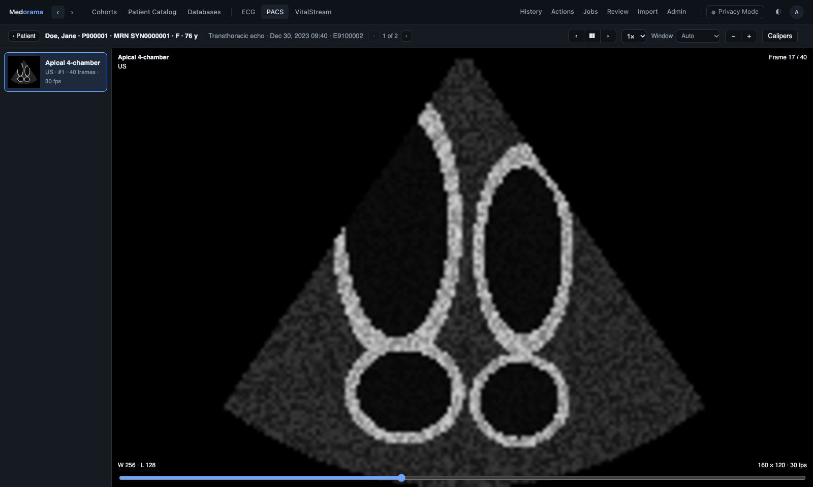
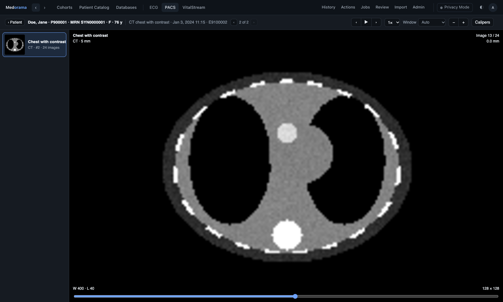

# PACS viewer

The PACS viewer shows DICOM studies in a web browser, with a focus on cardiology: echo and other
ultrasound loops, coronary angiography (XA), CT, MR, nuclear medicine and X-ray images,
structured reports and PDF documents, as well as pictures and videos. It plays loops at their
own frame rate, steps through stacks of slices, sets the window of gray images and measures
with calipers in real units. It is one of [Medorama](../../README.md)'s [viewers](../README.md),
and also a web page of its own that needs no installation. This page is for anyone who uses the
viewer by itself or deploys it; developers will find its code layout and tests at the end.

**Try it now: [open the PACS viewer](https://medorama.org/viewers/pacs/)**
in your browser, with the synthetic examples below or your own files. The page reads the files
you choose inside your browser: they never leave your computer.



The PACS viewer is research software. It is not a medical device and is not intended for
diagnosis: a PACS used to make diagnoses is a regulated medical device.

- [Features](#features)
- [Try it](#try-it)
- [What it shows](#what-it-shows)
- [Files it reads](#files-it-reads)
- [Open studies](#open-studies)
- [Read a study](#read-a-study)
- [Run it](#run-it)
- [Serve it from a computer: dicom-py serve](#serve-it-from-a-computer-dicom-py-serve)
- [Deploy it](#deploy-it)
- [Opened by another program](#opened-by-another-program)
- [Databases of DICOM studies: dicom-py](#databases-of-dicom-studies-dicom-py)
- [For developers](#for-developers)
- [Privacy](#privacy)

## Features

- **Cine loops** (ultrasound, angiography, IVUS, OCT) played at their own frame rate, frame by
  frame, from ¼× to 2×.
- **Stacks** of CT, MR, nuclear medicine and X-ray images, ordered along the slice direction.
- **Window presets** for gray images (soft tissue, lung, bone, brain, liver, cardiac), and a
  drag to set the window.
- **Calipers** in centimeters on ultrasound (from the ultrasound regions' scale), in millimeters
  from the pixel spacing, or in pixels.
- **Structured reports** as tables of measurements with their units, and **PDF documents**.
- **Compressed images:** native, RLE and JPEG pixel data, including lossless and 12-bit JPEG,
  which browsers do not decode themselves ([Files it reads](#files-it-reads)).
- **Open record…** for a study's or a series' files, **Open multiple records…** for a folder of
  studies, and drag and drop of files or a whole folder.
- **Nothing to install:** the page runs in any modern browser, from the website, from a clone
  opened from disk, or from any web server. The files stay in the browser.
- **Light and dark themes.** The page starts in the dark theme, the usual choice for reading
  images; the ☾ / ☀ button switches it, and the choice is remembered.
- **Served from a server** with `dicom-py serve`, for studies that should not be copied, with a
  root folder fixed at install time and an optional password.
- **No patient identity** in the corners or the reports: the viewer never shows the patient's or
  the observer's name.

## Try it

The [`examples/`](examples/README.md) folder holds synthetic DICOM objects: every value and every
image is invented. Each link opens one in the live viewer.

| Example | Open |
|---|---|
| An echocardiography loop (ultrasound, apical four-chamber view, 30 frames): a dilated, poorly contracting left ventricle | [open](https://medorama.org/viewers/pacs/#src=examples/echo_a4c.dcm) |
| A coronary angiography run (XA) of the left coronary artery | [open](https://medorama.org/viewers/pacs/#src=examples/angio_lca.dcm) |
| A frontal chest radiograph (DX) with a right lower-lobe opacity | [open](https://medorama.org/viewers/pacs/#src=examples/chest_xray.dcm) |

From a clone of the repository, open `viewers/pacs/index.html`, choose **Open multiple
records…** and select the `examples/` folder.



## What it shows

The viewer lists what it opened by series, and shows each item of the list in its own way. When
the files come from several studies, the list groups them by study.

| Item | Made from | How it is shown |
|---|---|---|
| **Cine loop** | A multi-frame DICOM file (ultrasound, angiography, IVUS, OCT …), a video (MP4, WebM, MOV), or pictures given a frame rate | Played at its own rate (from `FrameTime`, `CineRate` or the frame time vector; for pictures, `fps=`), or frame by frame, at ¼× to 2×. |
| **Stack** | The single-frame DICOM images of one series (CT, MR, NM, X-ray), or a multi-frame file that is not a cine | Ordered along the slice direction (otherwise by instance number). The wheel or `↑` `↓` move through it, and it can be played too. |
| **Still** | One image or picture | As it is. |
| **Report** | A DICOM structured report (echo, cath, others) | Its measurements with their units, and its text, in its sections. The observer's and the patient's names are never shown, nor the subject context's items (the subject's name, ID, UID and birth date, the mother of a fetus, the accession number). |
| **Document** | A DICOM encapsulated PDF, or a PDF file | In the browser's PDF viewer. A DICOM document is shown only when its MIME type is `application/pdf`, and always as a PDF: a document of another type (HTML, XML, a 3D model) is shown elsewhere. |
| Shown elsewhere | A DICOM ECG or Holter waveform, a DICOM document that is not a PDF | The viewer says where: a 12-lead ECG opens in the [ECG viewer](../ecg/README.md). VitalStream does not read DICOM, so a Holter is first converted to a WFDB record (`dicom-py wfdb FILE.dcm OUT/`) and that record opened in [VitalStream](../vitalstream/README.md). |

## Files it reads

The viewer reads DICOM Part 10 files and bare datasets, in the explicit or implicit VR little
endian transfer syntaxes. Pixel data may be native (8, 16 or 32 bits, signed or unsigned, gray
or RGB, planar or interleaved), RLE-compressed, or JPEG-compressed:

| JPEG transfer syntax | Decoded by |
|---|---|
| Baseline and extended, 8 bits (1.2.840.10008.1.2.4.50 and .51) | The browser. |
| Extended, 12 bits, as used by CT (1.2.840.10008.1.2.4.51) | `jpeg.js`. |
| Lossless (process 14, any predictor, 2 to 16 bits; 1.2.840.10008.1.2.4.57 and .70) | `jpeg.js`. |

A file has no more frames than its pixel data hold: a `NumberOfFrames` larger than that (a
damaged or crafted header) is cut to the frames present.

These are recognized but not decoded:
- **JPEG-LS, JPEG 2000 and the video transfer syntaxes** (MPEG-2, MPEG-4, HEVC). The viewer
  names the transfer syntax and says the file must be read another way: in a desktop DICOM
  viewer, or after converting it to an uncompressed transfer syntax (for example with
  `gdcmconv --raw`).
- **Big-endian and deflated files**, which are refused with a message.

Besides DICOM, the viewer opens videos (MP4, WebM, MOV), pictures (PNG, JPEG) and PDF files. In
a folder, it passes over `DICOMDIR`, text files, and hidden files and folders.

## Open studies

| Control | Opens |
|---|---|
| **Open record…** | The files chosen: a study's or a series' DICOM files, a video, a picture or a PDF. |
| **Open multiple records…** | A folder: every file in it and in its subfolders, grouped by study and listed by series. |
| Drop | The files or the folder dropped onto the page. |
| **Server folders…** | The folders of the computer serving the page. The button is shown only when the page is served by `dicom-py serve` ([below](#serve-it-from-a-computer-dicom-py-serve)). |

Files and folders whose names start with `.` are passed over. Every file is held in memory at
once, so at most 5000 files and 4 GB are read together. A larger folder is refused, with the
advice to open one study's folder, so that a folder chosen by mistake cannot exhaust the
browser's memory.

## Read a study

**Window and zoom.** Rescale slope and intercept are applied (CT values are in Hounsfield
units), MONOCHROME1 images are inverted, non-square pixels are drawn to scale, and 8-bit images
(display-ready ultrasound and angiography) show their whole range.

| Control | Effect |
|---|---|
| Drag (gray images) | Sets the window: right widens it, down raises the level. |
| **Window** presets | Set the window at once: soft tissue, lung, bone, brain, liver, cardiac. |
| Double-click | Resets the window, the zoom and the pan. |
| `Ctrl` + wheel, or **−** and **+** | Zoom. |
| `Shift` + drag, or drag with the middle button | Pans. On color images, pictures and videos, which have no window, a plain drag pans. |
| Wheel (a stack) | Moves through the images. |
| `←` `→` `↑` `↓`, `Page Up` `Page Down` (a stack) | Move one image. |
| `Home`, `End` (a stack) | Go to the first or the last image. |
| `Space`, or ▶ | Plays or pauses. |
| `←` `→`, or ‹ › (a cine loop) | Step one frame. |
| `↑` `↓` (a cine loop) | Go to the previous or next loop. |
| Speed (¼×, ½×, 1×, 2×) | Sets the playing speed. |
| **Calipers**, then click two points | Measures a distance. `Esc` clears it. |
| ☾ / ☀ | Switches between the light and dark themes. |

The corners show the series, the frame or slice, the window and the size, and never the
patient.

**Calipers** measure in the best unit the file allows:

| Distance in | When |
|---|---|
| cm | The image has an ultrasound region with a physical scale (`PhysicalDeltaX`, `PhysicalDeltaY`) at the first point. |
| mm | The image has a pixel spacing (`PixelSpacing`). For projection images, `ImagerPixelSpacing` is used and the distance is marked "at the detector". |
| mm | Pictures and videos opened with `mm=` (millimeters per pixel). |
| pixels | Otherwise. |

## Run it

The page needs no build and no dependencies: it uses nothing but the browser, on Linux, macOS
and Windows alike.

| How | What it opens |
|---|---|
| [The website](https://medorama.org/viewers/pacs/) | The files you choose or drop, read in your browser. They never leave your computer. |
| `index.html` from a clone, opened from disk (`file://`) | The same, offline. |
| Any web server: copy the page's files (`index.html`, `style.css` and the `.js` files of this folder). For a quick look, `python3 -m http.server --directory viewers/pacs` serves them. | The same, and also files on that server, by address (`#src=`, `#list=`, [below](#opened-by-another-program)). |
| `dicom-py serve` on the computer where the studies are | The same, and also the folders of that computer, under a root folder you choose (**Server folders…**). |
| Inside Medorama | A patient's studies, in the PACS tab of the patient's page ([Deploy it](#deploy-it)). |

## Serve it from a computer: dicom-py serve

The Python package [`python/dicom`](python/dicom/README.md) (the command `dicom-py`) serves the
page together with the folders of the computer it runs on, so that studies on a server can be
read without copying them. `serve` uses only the Python standard library.

1. Install the package. This copies the page into it:

   ```bash
   pip install ./viewers/pacs/python/dicom
   ```

2. On a shared computer, set a password once. It is the same password file VitalStream and
   `muse-py serve` use:

   ```bash
   dicom-py serve --set-password
   ```

3. Start it. This opens <http://127.0.0.1:8081/browse> on your home folder, or on another folder
   with `--root`:

   ```bash
   dicom-py serve
   dicom-py serve --root /data/echo
   ```

`browse` lists the folders, and the files of a folder that the viewer reads: DICOM files (with
or without an extension), videos, pictures and PDFs. A click on a file opens it, and **Open the
records in this folder** opens every file of the folder (`#list=`, at most 5000; the listing
says `"truncated": true`, and `browse` says so, when there are more). A file or folder opened
from `browse` is shown with `#src=` (or `#list=`), where the page hides its **Server folders…**
button, and the browser's Back button returns to the list.

Files are sent as they are read, in part when a browser asks for a range (`Range`), under a
policy that runs nothing in them (`Content-Security-Policy: sandbox`); a kind of file the
viewers do not read is sent as a download. The sign-in cookie is signed with a key of the
running server too: browsers send a cookie to every port of a host, and another server on
127.0.0.1 cannot use it.

| Option | Default | Effect |
|---|---|---|
| `--root DIR` | the home folder | The folder served. Only files and folders under it are listed and served, with every symbolic link resolved; a link that leads outside is refused and not listed. It must lie inside the root the package was installed with. |
| `--host`, `--port` | `127.0.0.1`, `8081` | Where it listens. A request must name the server by a loopback name (`localhost`), an IP address or `--host` itself; any other name is refused (a web page elsewhere cannot reach it by DNS rebinding). |
| `--auth-file FILE` | `~/.config/vitalstream/auth.json` | The password file, shared with VitalStream and `muse-py serve`. |
| `--set-password`, `--clear-password` | | Set (or change), or remove, the password the page asks for, then exit. A sign-in lasts 30 days, until the server stops, or until a browser signs out, which ends every sign-in. After a wrong password, the next try, from any browser, waits 1 s, then 2, 4 … up to 60 s. |
| `--no-auth` | | Runs without asking for the password. |
| `--no-browser` | | Does not open a browser window. |

### Root folder and password, fixed at install time

Two options are fixed when the package is installed, from environment variables, so that
whoever runs `serve` cannot change them:

| Variable | Default | Effect |
|---|---|---|
| `VIEWER_ROOT` | the whole file system | The most that `serve` ever serves; `~` is the home folder of whoever runs it. A `--root` that contains it is narrowed to it, and one outside it is refused (`… is not a folder inside this viewer's root`). |
| `VIEWER_PASSWORD` | `1` | `0` installs the package without password support: `--set-password` fails, and the page never asks for a password. |

This command installs a package that serves at most `/data/echo`, with password support:

```bash
VIEWER_ROOT=/data/echo VIEWER_PASSWORD=1 pip install ./viewers/pacs/python/dicom
```

An editable install (`pip install -e`, as `tools/install-medorama.sh` makes) serves the page
from the clone instead of a copy. The two variables still apply when they are given at install
time: they are written into the clone, in a file git ignores. Without them, the root is the
whole file system, with password support.

## Deploy it

### On a server, through an SSH tunnel

1. Install the package with a `VIEWER_ROOT` that holds the studies, and set a password once with
   `dicom-py serve --set-password`.
2. Start it without a browser, in `tmux` or as a service:

   ```bash
   dicom-py serve --root /data/echo --no-browser
   ```

3. On your computer, open a tunnel, then open <http://127.0.0.1:8081/>:

   ```bash
   ssh -N -L 8081:127.0.0.1:8081 user@server
   ```

Without a password, anyone who can connect to the port can read the files under the root.

### For a group, behind a TLS reverse proxy

Keep `dicom-py serve` on 127.0.0.1 with a password, and let a reverse proxy (nginx, Apache,
Caddy) provide HTTPS and forward to it; the server speaks plain HTTP. Its links are relative, so
the proxy may serve it under a path prefix. The page itself, without `serve`, can also be
published as static files on any web server: it then reads only the files each user chooses.

`serve` has one password shared by everyone, and no user accounts or audit log. When users need
their own accounts, permissions and de-identified views, use the viewer inside Medorama.

### Inside Medorama

Medorama builds the page's files into its own program and shows the viewer in the PACS tab of a
patient's page, behind Medorama's sign-in. The viewer receives each study from Medorama's
server. In Privacy Mode, Medorama's de-identified view, the server's privacy gate de-identifies
each DICOM file before it reaches the page.

- How users sign in: [docs/sign-in.md](../../docs/sign-in.md).
- How patient data are protected, including DICOM de-identification: [docs/protecting-patient-data.md](../../docs/protecting-patient-data.md) and [docs/security.md](../../docs/security.md).

## Opened by another program

Another program can open the viewer at a file or a folder through the page's address. The
fragment, after `#`, may hold:

| Parameter | Effect |
|---|---|
| `src=URL` | Opens one file. |
| `list=URL` | Opens a folder: `URL` answers `{"files": [...]}`, and each file is read beside it. |
| `mm=0.2` | Sets the millimeters per pixel of pictures and videos, for the calipers. |
| `fps=30` | Sets the frame rate of pictures, which are then played as one loop. |
| `name=…` | The name shown in the title. |
| `theme=light\|dark` | The theme. |

Medorama fills `mm` and `fps` from the columns of the table row that linked the file (`pixel
spacing (mm)`, `frame rate (fps)` …). The parameters a host passes to every viewer are described
in [viewers/README.md, Addresses](../README.md#addresses).

## Databases of DICOM studies: dicom-py

The package [`python/dicom`](python/dicom/README.md) (`dicom_index_py`, the command `dicom-py`)
builds a database to import into Medorama from a folder of DICOM files. It reads the headers
only. Each row links a loop, a run, a series, a report, a PDF or an ECG to its patient, and the
measurements of structured reports and of ECGs become columns of their own, which Medorama's
cohorts can search. The package also converts DICOM ECGs (12-lead and Holter) to WFDB records.

## For developers

### Code layout

The page is plain JavaScript with no dependencies and no build step. Each file is a classic
script, so the page works from `file://`, and also a CommonJS module, for the tests.

| File | Contents |
|---|---|
| [`dicom.js`](dicom.js) | The DICOM reader: elements, sequences, pixel data (native, RLE, and JPEG through the browser or `jpeg.js`), windows, frame rates, ultrasound regions, structured reports, encapsulated documents and waveforms. [`../ecg/dicom.js`](../ecg/dicom.js) is a byte-identical copy, and a test checks that the two are the same. |
| [`jpeg.js`](jpeg.js) | A decoder for the JPEG that browsers do not decode: lossless JPEG (process 14, every predictor, 2 to 16 bits) and 12-bit sequential DCT. Progressive, arithmetic-coded and hierarchical JPEG are refused. |
| [`host.js`](host.js) | A host's context (`who`, `what`, `pos`, `nav`), shown in place of the file's name; the same file in each viewer. |
| [`app.js`](app.js), [`index.html`](index.html), [`style.css`](style.css) | The page: the series list, the cine, stack, still, report and document views, the window, the calipers, and opening files and folders. |
| [`python/dicom/`](python/dicom/README.md) | `dicom-py`: databases of DICOM studies, DICOM ECGs as WFDB records (with pydicom), and `serve`. |
| [`examples/`](examples/README.md) | Synthetic DICOM objects to try the viewer with. |
| `website.md` | Publishes this README as the website's page, since the folder's own page is the viewer. |
| `tests/` | The tests (below). |

### Tests

These commands run the page's tests (with Node.js) and the Python package's tests:

```bash
node --test viewers/pacs/tests/*.test.js
pytest viewers/pacs/python/dicom/tests
```

| Test | Checks |
|---|---|
| `dicom.test.js` | Explicit and implicit VR files, signed and RGB pixel data, rescale, window, an ultrasound region, and encapsulated JPEG, in DICOM files made by the tests (`make.js`). |
| `objects.test.js` | RLE images, structured reports, encapsulated documents and waveforms; that `dicom.js` is the same file in both viewers. |
| `jpeg.test.js` | Lossless JPEG (every predictor, point transforms, restarts, color) and 12-bit DCT, against streams encoded in the test, and damaged streams. |
| `robustness.test.js` | The readers on damaged and random input: each answers quickly, with a result or an error, and never hangs. |
| `drop.test.js` | A dropped folder: every batch of entries is read, and hidden files and folders are passed over. |

## Privacy

The viewer never shows a patient's identity: the corners show the series, frame, window and
size only, and reports never show the observer's or the patient's name. The files themselves may
hold PHI; when the viewer runs alone, keep them on protected storage, and use Medorama's Privacy
Mode to de-identify them for users who may not see identities.
