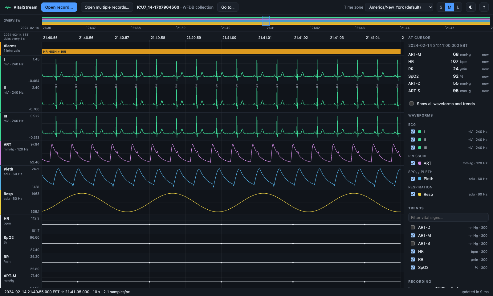
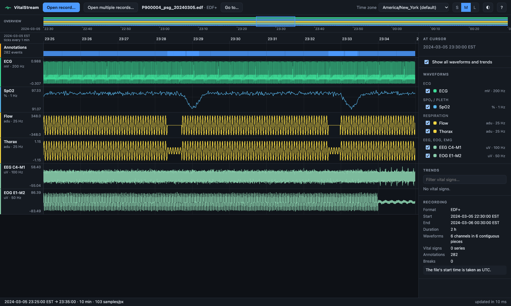
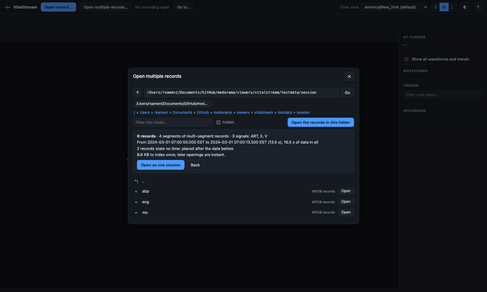
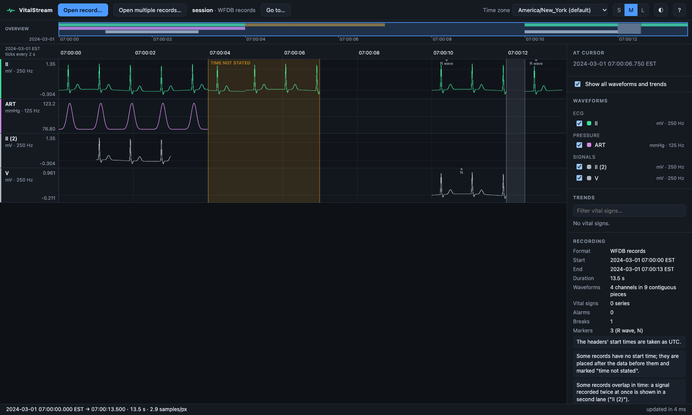

# VitalStream

**A web viewer for long physiological recordings**

VitalStream shows waveform recordings in a web browser: every channel, the vital-sign trends,
the alarms, annotations and breaks in the data, on one time axis, from weeks down to single
samples. It is built for long, high-frequency recordings, such as ICU bedside monitoring, Holter
ECGs of several days and overnight sleep studies: they open at once and stay fluid while you
zoom. VitalStream is the waveform viewer of [Medorama](../../README.md), which opens recordings
in it from a patient's page, and it is also a complete program on its own that needs nothing
else from this repository. This page is for anyone who installs, runs, uses or deploys
VitalStream by itself; developers will find the code layout and tests at the end.

VitalStream adds nothing that is not in the recording. It never resamples, interpolates or
stitches samples, and where the recording is ambiguous (the length of a break, a record without
a start time), the page says so.



- [Features](#features)
- [What it reads](#what-it-reads)
- [Three implementations, one specification](#three-implementations-one-specification)
- [Install](#install)
- [Run](#run)
- [Open a recording](#open-a-recording)
- [Navigate a recording](#navigate-a-recording)
- [Deploy](#deploy)
- [Settings](#settings)
- [Opened by another program](#opened-by-another-program)
- [For developers](#for-developers)
- [Testing](#testing)
- [Privacy](#privacy)
- [Author and license](#author-and-license)

## Features

- **Long recordings at full resolution.** Days or weeks of waveforms open at once. Zoomed out,
  each pixel column shows the minimum and maximum of the samples behind it, so no peak is lost;
  zoomed in, the samples themselves are drawn.
- **Everything on one time axis:** waveforms, vital-sign trends, alarms, EDF+ annotations,
  markers (R waves, pacing spikes), breaks in the data and spans whose time the recording does
  not state.
- **Several formats:** WFDB records (single- and multi-segment), folders of WFDB records opened
  as one session, WFDB collections, EDF, EDF+, BDF and BDF+ files, and further formats through
  add-ons ([What it reads](#what-it-reads)).
- **Open record…** and **Open multiple records…**, with a file browser of the computer the
  viewer runs on, path completion, recent folders and recordings, and a summary of a folder
  before it is opened.
- **Safe on large folders.** Limits on how many records a folder may hold and how long counting
  them may take keep a folder opened by mistake from overwhelming the viewer, and indexing can
  be cancelled at any time ([Limits on a large folder](#limits-on-a-large-folder)).
- **Fast after the first opening.** The first opening builds an **index** of the recording (its
  structure and envelopes, kept in an index folder); later openings are instant. The three
  implementations and Medorama write the same index and can share it.
- **Light and dark themes.** The page follows the system's setting until you choose one with the
  ◐ button.
- **Bookmarkable views.** The address keeps the recording and the time span shown, so a reload
  or a bookmark returns to the same place.
- **Runs anywhere:** Linux, macOS and Windows, in three implementations (C++, Rust and Python)
  with the same page and the same behavior.
- **A fixed root and an optional password.** The folder the viewer may open at most is fixed when
  it is built, and a password can be set once, or left out of the build entirely
  ([Build options](#build-options-root-password-and-wfdb)).

## What it reads

| Recordings | How they are read |
|---|---|
| One WFDB record (PhysioNet's format): its `.hea` header file, single- or multi-segment | By the viewer itself, with [wfdb-x](https://github.com/alphanumericslab/wfdb-x) ([docs/wfdb-collection.md](../../docs/wfdb-collection.md#one-record)). |
| A folder of WFDB records, its subfolders included, read as **one session** on one time axis | By the viewer itself ([docs/wfdb-collection.md](../../docs/wfdb-collection.md#a-folder-of-records-one-session)). |
| A WFDB collection: records in time order, with their vital signs, alarms and breaks described in an `index.csv` | By the viewer itself ([docs/wfdb-collection.md](../../docs/wfdb-collection.md)). |
| An EDF, EDF+, BDF or BDF+ file (`.edf`, `.bdf`): sleep studies, EEG, long-term ECG | By the viewer itself. EDF+ annotations appear in an **Annotations** lane, and the interruptions of an EDF+D file are breaks ([docs/edf.md](../../docs/edf.md)). |
| Other formats, such as BedMasterEx `.Stp` files | Through an installed **adapter**, an add-on program for one format ([docs/adapters.md](../../docs/adapters.md)). The adapter for `.Stp` files, the stp-adapter, is private and available to institutions under agreement. |

A viewer built without WFDB support ([Build options](#build-options-root-password-and-wfdb))
contains no wfdb-x code: it lists WFDB records and folders, refuses to open them with the message
"this build has no WFDB support", and reads every other format.



How Medorama and its viewers organize the readers of every format, and how to add one, is
described in [docs/readers.md](../../docs/readers.md).

## Three implementations, one specification

VitalStream exists in three implementations. They serve the same page ([`web/`](web)), answer
the same API with the same JSON ([docs/viewer-api.md](docs/viewer-api.md)), write the same index
byte for byte ([docs/index-format.md](docs/index-format.md)), and share one settings file, one
password, one index folder and one adapter folder. Use whichever fits the machine; several can
run side by side.

| | C++ | Rust | Python |
|---|---|---|---|
| Command | `vitalstream-cpp` | `vitalstream-rs` | `vitalstream-py` |
| Default port | 8070 | 8060 | 8050 |
| Folder | [`cpp/`](cpp) | [`rust/`](rust) | [`python/vitalstream`](python/vitalstream) |
| Needs to run | the C++ runtime only (one file) | nothing (one file) | Python 3.9 or later |
| Indexing a day of ICU data | a few seconds | a few seconds | about a minute |

The names of every command, package, option and file across the three are listed in
[docs/naming.md](docs/naming.md).

## Install

You can install VitalStream alone from a clone of the repository, without administrator rights
beyond having a compiler. [docs/building.md](../../docs/building.md) covers every system and
situation, including machines without internet access.

### Linux and macOS

1. Clone the repository:

   ```bash
   git clone https://github.com/alphanumericslab/medorama.git && cd medorama
   ```

2. Build and install a viewer with `install.sh`. The first command installs the C++ viewer into
   `~/.local/bin`; the others choose another implementation, a root, or a build without
   password or WFDB support:

   ```bash
   viewers/vitalstream/install.sh                       # the C++ viewer
   viewers/vitalstream/install.sh --viewer rs           # the Rust viewer (or --viewer py)
   viewers/vitalstream/install.sh --root /data/icu      # a viewer that opens nothing outside /data/icu
   viewers/vitalstream/install.sh --no-password         # a viewer without password support
   viewers/vitalstream/install.sh --no-wfdb             # a viewer without WFDB support (no wfdb-x)
   ```

The script ends by printing the program's path and its root, for example
`Installed ~/.local/bin/vitalstream-cpp (root: ~)`. Run it again to change either.

### Windows

Run `install.ps1` in PowerShell. For the C++ viewer, run it from a "Developer PowerShell for
VS"; this command installs the Rust viewer with `D:\data` as its root:

```powershell
powershell -ExecutionPolicy Bypass -File viewers\vitalstream\install.ps1 -Viewer rs -Root D:\data
```

### Installer options

| `install.sh` | `install.ps1` | Default | Effect |
|---|---|---|---|
| `--viewer cpp\|rs\|py` | `-Viewer` | `cpp` | The viewer to build. The C++ viewer needs a C++20 compiler, CMake and Ninja; `install.sh` installs CMake and Ninja into a build environment when they are missing. The Rust viewer needs Rust; `install.sh` installs it in your account when `cargo` is missing. The Python viewer needs Python 3.9 or later. |
| `--prefix DIR` | `-Prefix` | `~/.local` (Windows: `%LOCALAPPDATA%\vitalstream`) | The program goes into `DIR/bin`, and the Python viewer's environment into `DIR/share/vitalstream/venv` (Windows: `DIR\venv`). |
| `--root DIR` | `-Root` | `~` | The viewer's **root**, fixed in the program: its page never lists or opens anything outside `DIR`. `~` is the home folder of whoever runs the viewer; `/` is the whole file system. |
| `--no-password` | `-NoPassword` | password support | Builds the viewer without password support: no password can be set (`--set-password` fails), and the viewer refuses to run where a password is required. |
| `--no-wfdb` | `-NoWfdb` | WFDB support | Builds the viewer without WFDB support: it contains no wfdb-x code, refuses a WFDB record or folder with a message, and reads every other format ([docs/building.md](../../docs/building.md#without-wfdb)). |
| `--no-rustup` | | | Fails, rather than installing Rust, when `cargo` is missing (Rust viewer). |

### Build options: root, password and WFDB

Three options are fixed when a viewer is built, so that they cannot be changed by whoever runs it:

- **The viewer's root** is the folder the viewer may open at most. Its own `--root` option and
  `data_roots` setting can only narrow it each time it starts ([Settings](#settings)).
- **Password support** can be left out of the build entirely. A viewer built without it has no
  password code at all.
- **WFDB support** can be left out too. A viewer built without it has no wfdb-x code at all, and
  refuses WFDB records ([docs/building.md](../../docs/building.md#without-wfdb)).

The installers set all three. A build by hand sets them as follows:

| Viewer | Root | Without password support | Without WFDB support |
|---|---|---|---|
| `vitalstream-cpp` | CMake `-DVS_ROOT=DIR` | CMake `-DVS_PASSWORD=OFF` | CMake `-DVS_WFDB=OFF` (the preset `nowfdb`) |
| `vitalstream-rs` | the environment variable `VITALSTREAM_ROOT=DIR` when it is compiled | `--no-default-features --features wfdb` (the Cargo feature `password` left out) | `--no-default-features --features password` (the Cargo feature `wfdb` left out) |
| `vitalstream-py` | the environment variable `VITALSTREAM_ROOT=DIR` when the package is installed | the environment variable `VITALSTREAM_PASSWORD=0` when it is installed | installed without its `[wfdb]` extra (no wfdb-x in its environment) |

A build without these options (a developer's `cargo build`, `cmake --preset release`,
`pip install '.[wfdb]'`) has the whole file system as its root, supports a password and reads
WFDB records. Each
implementation's README gives the details: [C++](cpp/README.md#build-options),
[Rust](rust/README.md#build-options), [Python](python/vitalstream/README.md#build-options).

The standalone builds go into folders of their own (`target/standalone`,
`viewers/vitalstream/cpp/build/standalone`), so that Medorama's viewer in the same clone keeps
its own build.

### With Medorama

`tools/install-medorama.sh` builds Medorama and one viewer together. That viewer has the whole
file system as its root and password support, because Medorama applies its own rules: it starts
the viewer itself, with settings that require a password
([docs/administration.md, The waveform viewer](../../docs/administration.md#the-waveform-viewer)).

## Run

Start the viewer with its command. These examples use `vitalstream-cpp`; `vitalstream-rs` and
`vitalstream-py` take the same options.

```bash
vitalstream-cpp                       # opens http://127.0.0.1:8070 in your browser
vitalstream-cpp --set-password        # sets a password once (one password for the three viewers)
vitalstream-cpp --no-browser          # on a server: then connect through an SSH tunnel
vitalstream-cpp --root ~/icu          # opens nothing outside ~/icu (inside the viewer's root)
vitalstream-cpp --index RECORDING     # indexes a recording ahead of time, then exits
vitalstream-cpp --help                # lists every option
```

| Option | Effect |
|---|---|
| `--config FILE` | Reads the settings from `FILE` ([Settings](#settings)). |
| `--host`, `--port` | The address and port to listen on. The default address, 127.0.0.1, accepts connections from this computer only. |
| `--timezone ZONE` | The display time zone, for example `America/New_York`. |
| `--root DIR` | A folder the viewer may open, inside its root. Repeat it for several folders. Default: the viewer's root. |
| `--cache-dir DIR` | The index folder. |
| `--adapters-dir DIR` | The adapter folder. |
| `--qc-verbose` | Also marks the data a reader repaired, such as data blocks it put back in order. |
| `--no-browser` | Does not open a browser window. |
| `--set-password`, `--clear-password` | Sets (or changes), or removes, the password the page asks for, then exits. |
| `--no-auth` | Runs without asking for the password. |
| `--index PATH` | Indexes `PATH` into the index folder, then exits. |
| `-V`, `--version` | Prints the program's name and version (`vitalstream-py 0.1.0`), then exits. |

When it starts, the viewer prints its address, its root, its data roots, the index folder, the
time zone, and whether a password protects it. A data root outside the viewer's root is left
out, with a warning.

## Open a recording

Two buttons at the top of the page, repeated on the empty page, open recordings:

| Button | Key | Opens |
|---|---|---|
| **Open record…** | `O` | One recording: a WFDB record (its `.hea` file; a multi-segment record whole, or one of its segments alone through the segment's own header), an EDF or BDF file, or a file in a format an installed adapter reads. |
| **Open multiple records…** | `Shift`+`O` | A folder: every WFDB record in it and in its subfolders, on one time axis (**one session**), or a WFDB collection. |

### The file browser

Both buttons open a browser of the files of the computer the viewer runs on, at the last folder
used:
- Type or paste a path: `Tab` completes it, `Enter` goes there, and `Alt`+`↑` goes up one
  folder.
- Click a folder to enter it. Click a record (∿) or a recording file (◆, such as an EDF file,
  shown with its format and size) to open it. Folders that hold records themselves are marked ≋.
- Signal files, files no reader reads, and the segments of multi-segment records are not
  listed. Tick **hidden** to list the segments and hidden files.
- Nothing outside the data roots is listed, including symbolic links that lead outside them.
- A folder shows at most 5000 entries. Beyond them, the browser says it shows the first ones;
  type a path or use the filter to narrow the list.
- Beside the places (⌂ Home and the data roots) are the last 6 folders opened, and below the
  list the last 8 recordings opened. Both are kept in your browser.

### Open a folder as one session

In **Open multiple records…**, each folder has an **Open** button, and **Open the records in
this folder** opens the folder being shown. Before anything is read, the viewer shows a summary
of the folder, from its headers alone: the records, the segments of multi-segment records, the
signals, the time span, the records that state no time, those that cannot be read, and the size
to index. **Open as one session** opens it; **Back** returns to the browser.



The records of a folder are put together as follows
([docs/wfdb-collection.md](../../docs/wfdb-collection.md#a-folder-of-records-one-session)):

- **Records** are the `.hea` files below the folder, at every level, in the order of their
  paths. Hidden entries (names that start with `.`) and symbolic links are skipped. The segments
  of a multi-segment record belong to that record.
- A record starts at its header's base date and time, taken as UTC. A record without one is
  placed after the data before it and shaded **time not stated**. A single record without a time
  starts at 0 (1970-01-01).
- A record that cannot be read, or whose header states no sampling frequency, is left out. The
  recording's notes say how many were left out.
- A **signal recorded twice at the same time** (two records of lead II that overlap) is never
  drawn on top of itself: the second goes into a lane of its own, `II (2)`.
- The segments of a **multi-segment record** follow each other from the record's start. A null
  segment is a break of known length, and a signal that a segment does not hold is a break in
  that channel only.



A folder of EDF files is not yet opened as one session: open EDF files one at a time with
**Open record…** ([docs/edf.md, Limits](../../docs/edf.md#limits)).

### Indexing and cancelling

The first opening of a recording builds its index. A progress bar shows how far it is, and
**Cancel** stops it; nothing of a cancelled index is kept. Later openings are instant, until the
recording's files change.

### Limits on a large folder

So that a large folder opened by mistake cannot overwhelm the viewer, a folder of plain records
is opened only within these limits:

| Limit | Setting | Default |
|---|---|---|
| Header files below the folder (segments and layout headers counted) | `max_records` | 5000 |
| Folder levels below the folder | `max_depth` | 20 |
| Seconds to count the records for the summary | `max_scan_s` | 10 |

Over a limit, the viewer says which limit was reached and what to do instead: open a subfolder,
or describe the records in an `index.csv` (a WFDB collection, which these limits do not apply
to). The details are in [docs/wfdb-collection.md, Limits](../../docs/wfdb-collection.md#limits).

### Try it

The repository's [`testdata/`](testdata) folder holds synthetic recordings (no patient data).
Choose **Open multiple records…**, then one of these folders:
- `viewers/vitalstream/testdata/session`: the session shown above;
- `viewers/vitalstream/testdata/collection`: a WFDB collection with vital signs, alarms and
  breaks;
- `viewers/vitalstream/testdata/plain`: plain WFDB records.

Or choose **Open record…** and one of the EDF, EDF+ and BDF files of
`viewers/vitalstream/testdata/edf`. The clone must lie inside the viewer's root, which by
default is your home folder.

## Navigate a recording

### Mouse and keyboard

The **?** button (or the `?` key) shows these controls on the page.

| Action | Effect |
|---|---|
| Wheel, or trackpad pinch, over the traces | Zooms at the pointer. |
| Horizontal scroll over the traces (a trackpad's sideways swipe) | Pans. |
| Drag | Pans. |
| `Shift` + drag | Zooms to the selected time span. |
| Double-click, or `Home` | Shows the whole recording. |
| Click or drag in the overview strip | Moves the view. |
| Wheel over the overview strip | Zooms about the view's center. |
| `←` `→` | Pans by 10 % of the view. |
| `PgUp` `PgDn` | Pans by one screen. |
| `+` (or `=`) and `−` | Zoom in and out. |
| `1` `2` `3` | Show 10 s, 1 min or 10 min around the cursor. |
| **Go to…**, or `G` | Opens a calendar of the recording's days (days with waveforms are marked) and a time, to the millisecond. **Show** keeps the current span, or shows 10 s, 1 min, 10 min or 1 h around that time; **Start** and **End** go to either end. |
| `O`, `Shift`+`O` | Open a record; open multiple records. |
| `?` | Shows the controls. |
| Wheel over the lane labels | Scrolls the lanes. |

### What the page shows

- **Waveform lanes** show, in long views, the minimum and maximum of the samples behind each
  pixel column, and the samples themselves when zoomed in. The y-axis fits the visible data, and
  the value under the cursor is shown at the right of each lane.
- **Waveforms are grouped and colored by what they measure**: ECG, pressure, SpO2 and pleth,
  respiration, CO2, and EEG, EOG and EMG. A WFDB collection states each signal's group; for a
  plain WFDB record or an EDF file, the page infers it from the signal's label (`II`, `ECG`,
  `ART`, `SpO2`, `Flow`, `Thorax`, `EEG C4-M1`, `Fp1` …), and signals it does not recognize are
  listed under **Signals**. The index itself is not changed.
- **At most 64 waveform lanes** show at once. A recording with more opens with the first 64; to
  show another, untick one under **Waveforms** and tick the one you want. **Show all waveforms
  and trends** in the sidebar ticks every waveform (up to 64) and every trend; unticking it
  returns to the selection the recording opened with.
- **Trend lanes** show the vital signs as stored. A gap of more than 15 minutes breaks a trend's
  line, and the value under the cursor is shown only when a stored value lies within the 15
  minutes before it. **At cursor** lists the latest value of each vital sign at the cursor's
  time, no older than 10 minutes.
- **Alarms** are bands colored by severity, with their text on hover. Alarms are the only red on
  the page.
- **Annotations** of EDF+ files are shown the same way, in an **Annotations** lane, with their
  text and duration on hover. They have no severity and are never red.
- **Markers** (R waves, pacing spikes) are ticks on their channel, in views of up to 2 minutes.
- **Breaks** are shaded gray, with their reason and length on hover. **Data without a stated
  time** is shaded amber: it is placed after the data before it, and its timing within the
  shaded span is exact.
- **Values** are in the units the file states; `adu` means the file states no calibration.
- **The display:** the ◐ button switches between the light and dark themes (until you use it,
  the page follows the system's setting); **S M L** set the lanes' height; the time zone is
  chosen at the top right.
- **Errors** are written in bold in the status bar.

## Deploy

### On your computer

Install the viewer, then run its command: the page opens in your browser. On a computer that
other people can log in to, set a password once with `--set-password`; otherwise anyone who can
connect to the viewer's port can read the files under its root.

### On a server, through an SSH tunnel

The recordings do not need to be copied anywhere: run the viewer where they are.

1. Install the viewer with a root that holds the recordings, and set a password once:

   ```bash
   viewers/vitalstream/install.sh --root /data/icu
   vitalstream-cpp --set-password
   ```

2. Start it without a browser, in `tmux` or as a service ([below](#run-as-a-service)):

   ```bash
   vitalstream-cpp --no-browser
   ```

3. On your computer, open a tunnel to the server's port, then open <http://127.0.0.1:8070>:

   ```bash
   ssh -N -L 8070:127.0.0.1:8070 user@server
   ```

The viewer listens on 127.0.0.1 by default, so that it is reachable only from the server itself
and through the tunnel, which SSH encrypts and authenticates. A sign-in lasts 30 days.

### For a group, behind a TLS reverse proxy

A group can share one viewer through a reverse proxy (nginx, Apache, Caddy) that provides HTTPS:

1. Install the viewer with a root that holds only the recordings the group may see, and set a
   password.
2. Keep the viewer on 127.0.0.1 and let the proxy forward to it. The viewer speaks plain HTTP;
   TLS is the proxy's job. Every path the page uses is relative, so the proxy may also serve the
   viewer under a path prefix. For example, in nginx:

   ```nginx
   location /vitalstream/ {
       proxy_pass http://127.0.0.1:8070/;
   }
   ```

3. Optionally, let the proxy require your institution's sign-in (a VPN, single sign-on) in front
   of the viewer's password.

A standalone viewer has a single password shared by everyone, and no user accounts, roles or
audit log. When users need their own accounts, permissions, an audit of what they open, or
de-identified views, run VitalStream inside Medorama instead.

### Run as a service

On Linux, systemd can run the viewer as your user. These commands write the service file,
enable it and start it:

```bash
mkdir -p ~/.config/systemd/user
cat > ~/.config/systemd/user/vitalstream.service <<'EOF'
[Unit]
Description=VitalStream viewer

[Service]
ExecStart=%h/.local/bin/vitalstream-cpp --no-browser
Restart=on-failure

[Install]
WantedBy=default.target
EOF
systemctl --user daemon-reload && systemctl --user enable --now vitalstream
loginctl enable-linger "$USER"        # keeps it running after you log out (may need an administrator)
```

On macOS and Windows, follow the steps for Medorama in
[docs/administration.md, Run as a service](../../docs/administration.md#run-as-a-service), with
the viewer's command.

### Inside Medorama

Medorama runs one VitalStream viewer for its users and shows it in its **VitalStream** tab. The
viewer is the standard program, unchanged, started by Medorama on 127.0.0.1 with settings that
require a password only Medorama knows. Users never reach the viewer directly: Medorama's
gateway passes on only the requests the page needs, after Medorama's own sign-in, with rules per
user and an entry in the audit log for every recording opened. In Privacy Mode (Medorama's
de-identified view), recordings are opened by token rather than by path, folders cannot be
browsed, and times are shifted.

- How Medorama runs the viewer: [docs/administration.md, The waveform viewer](../../docs/administration.md#the-waveform-viewer).
- How users sign in, including through an institution's single sign-on: [docs/sign-in.md](../../docs/sign-in.md).
- How patient data are protected, and what Privacy Mode hides: [docs/protecting-patient-data.md](../../docs/protecting-patient-data.md) and [docs/security.md](../../docs/security.md).

## Settings

A settings file, `vitalstream.toml`, changes the defaults. The viewer reads `--config FILE`, or
else the first it finds of `viewers/vitalstream/vitalstream.toml` (only when the viewer runs
from the build folder of a clone of the repository) and `~/.config/vitalstream/vitalstream.toml`. A
`vitalstream.toml` in the folder the viewer is started from is never read unless `--config`
names it: a shared data folder could hold one that runs programs (`adapters_dir`) or opens the
viewer to the network (`host`, `auth_file`). On start, the viewer says which settings file it
read. One file serves the three viewers: top-level keys apply to all of them, and the `[py]`,
`[rs]` and `[cpp]` sections to one. Command-line options override the file. Relative paths in
the file are relative to its folder. A key of the wrong type is an error, and the viewer does
not start: `data_roots` and `allowed_hosts` are lists of strings, `port` an integer from 0 to
65535, `index_workers`, `max_records` and `max_depth` integers of at least 0, `max_scan_s` a
number of at least 0, the switches `true` or `false`, the others strings; an unknown key is an
error too. Start from [`vitalstream.example.toml`](vitalstream.example.toml).

| Key (option) | Default | Effect |
|---|---|---|
| `data_roots` (`--root`) | the viewer's root | The folders the viewer may open, inside its root. A folder that contains the root is narrowed to it, and one outside it is left out, so the settings can narrow the root but never widen it. A path is allowed when the file or folder it leads to, with every symbolic link resolved, lies inside a data root; a link that leads outside is refused and not listed. |
| `max_records`, `max_depth`, `max_scan_s` | 5000, 20, 10 | The [limits on a folder of records](#limits-on-a-large-folder): header files, folder levels, and seconds to count them. |
| `require_password` | `false` | Refuses to start without a password. Medorama sets it for the viewer it runs; a viewer built without password support then never starts. |
| `timezone` (`--timezone`) | `America/New_York` | The display time zone. Data are stored in UTC. |
| `host`, `port` (`--host`, `--port`) | `127.0.0.1`; 8070, 8060 or 8050 | Where the viewer listens. |
| `allowed_hosts` | `[]` | The host names the viewer answers for besides `localhost`, `127.0.0.1`, `::1` and `host`: the names this machine is reached by when `host` is `0.0.0.0`, or a reverse proxy's public name; `["*"]` allows any. A request naming another host is refused, which defeats DNS rebinding ([docs/viewer-api.md, Requests](docs/viewer-api.md#requests)). |
| `secure_cookie` | `false` | Marks the sign-in cookie `Secure`, so that the browser sends it over HTTPS only: set it for a viewer behind an HTTPS proxy. |
| `index_workers` | 2 | The number of recordings indexed at the same time. |
| `cache_dir` (`--cache-dir`) | `~/.cache/vitalstream` (in a clone, `viewers/vitalstream/sample_data/outputs/index`) | The index folder. It is shared by the three viewers, and with Medorama when it is set to Medorama's `index_dir`. |
| `adapters_dir` (`--adapters-dir`) | `~/.local/share/medorama/adapters` (Windows: `%LOCALAPPDATA%\medorama\adapters`) | The adapter folder. |
| `auth_file` | `~/.config/vitalstream/auth.json` | The password, stored as a salted scrypt hash readable only by you. |
| `qc_verbose` (`--qc-verbose`) | `false` | When `true`, data the reader repaired (blocks stored out of order and put back in order) is outlined with a dashed line, with details on hover. Breaks are shaded either way. |

## Opened by another program

Another program can open the viewer at a recording and a time span through the page's address.
The address keeps what the page shows in its fragment, after `#`:

| Fragment | Meaning |
|---|---|
| `path=…&t0=…&t1=…` | A recording on the server (its path), at a time span (Unix seconds). |
| `browse=FOLDER` | The file browser, open at a folder. |
| `who=…`, `what=…`, `pos=…`, `nav=…` | A host's context, shown in place of the recording's name ([viewers/README.md](../README.md#addresses)). |
| `theme=light\|dark` | The host's theme. It is applied but not saved as the viewer's own choice; the ◐ button still switches it. |

The requests the page sends to its server are specified in [docs/viewer-api.md](docs/viewer-api.md).

## For developers

### Code layout

```
viewers/vitalstream/
├── README.md, vitalstream.example.toml, install.sh, install.ps1
├── docs/                 the specifications: data model, index format, viewer API, names
├── web/                  the page, shared by the three viewers
├── cpp/                  vitalstream-cpp: the C++ viewer, its engine (vs_engine) and core library (vs_core)
├── rust/                 vitalstream-rs: the Rust viewer (its engine is libs/engine)
├── python/vitalstream/   vitalstream-py: the Python viewer
├── testdata/             synthetic recordings for the tests and to try the viewer (generate.py)
├── tests/parity/         the three viewers tested against each other
├── analysis_tools/       analysis scripts (MATLAB)
└── sample_data/          local recordings and outputs (never in git)
```

The three implementations follow one specification ([docs/](docs/README.md)): the
[data model](docs/data-model.md), the [index format](docs/index-format.md) and the
[viewer API](docs/viewer-api.md). Each implementation's README describes its modules:
[C++](cpp/README.md), [Rust](rust/README.md), [Python](python/vitalstream/README.md). Each has
two built-in readers, WFDB and EDF, and reaches other formats through adapters; adding a
built-in reader means adding the same reader to all three, checked by the parity tests
([docs/readers.md](../../docs/readers.md)).

## Testing

Run these commands from the repository root:

| Command | Checks |
|---|---|
| `cargo test -p vitalstream-rs -p recording-engine` | The Rust viewer and engine on the synthetic recordings of [`testdata/`](testdata): one record, a folder read as one session, the limits, a record's index key, cancelling, EDF, EDF+ and BDF files; the viewer's root; the adapter protocol with a mock adapter. |
| `(cd viewers/vitalstream/cpp && ctest --preset release)` | The C++ viewer and engine on the same recordings and adapter, EDF files included. |
| `pytest viewers/vitalstream/python/vitalstream/tests` | The Python viewer on the same recordings and adapter, EDF files included; sign-in, the file browser, and a build without password support. |
| `make parity` | The viewers that are built, against each other: byte-identical indexes under the specified key, and the same API answers ([`tests/parity`](tests/parity)). |

[`testdata/generate.py`](testdata/generate.py) writes the synthetic recordings deterministically,
with the Python standard library only:
- a WFDB collection with three stretches, a break of stated length, a record without a start
  time, vital signs from two sources, alarms and markers;
- plain WFDB records, among them an uncalibrated signal and a record without a sampling
  frequency;
- a folder of records in subfolders to open as one session: two overlapping ECG records, a
  record without a start time, multi-segment records with a null segment and a variable layout,
  and a hidden folder that is not read;
- EDF, EDF+ and BDF files: an EDF+C file of three signals at different rates with annotations
  and an invented identity in its patient field, an EDF+D file with breaks, a plain EDF file of
  1999 whose last record is cut short, and a BDF+C file of 24-bit samples
  ([docs/edf.md, Test files](../../docs/edf.md#test-files)).

## Privacy

The viewers never read or show a patient's identity: no name, identifier or date of birth is
read from a recording, kept in an index or sent to the page. This includes the patient and
recording identification fields of EDF headers. A recording's path may still identify a patient
(bedside-monitor systems name files by unit, bed and time), and its values are patient data, so
keep recordings, and the index folders made from them, on protected storage. In a clone,
`sample_data/` is the place for them; git ignores it.

A viewer alone has no user accounts, database or de-identification; those are Medorama's
([docs/protecting-patient-data.md](../../docs/protecting-patient-data.md),
[docs/security.md](../../docs/security.md), [PRIVACY.md](../../PRIVACY.md)).

VitalStream is research software, not a medical device, and is not intended for diagnosis.

## Author and license

VitalStream is written by Reza Sameni. To cite it, see [CITATION.cff](../../CITATION.cff).

VitalStream is licensed, like the rest of the repository, under the PolyForm Noncommercial
License 1.0.0 ([LICENSE](../../LICENSE)): free for noncommercial use, with commercial licenses by
agreement ([COMMERCIAL.md](../../COMMERCIAL.md)). The three viewers read WFDB records with
[wfdb-x](https://github.com/alphanumericslab/wfdb-x), a separate project whose library is under
the GNU LGPL v2.1 or later. Every dependency and its license is listed in
[THIRD_PARTY_LICENSES.md](../../THIRD_PARTY_LICENSES.md).
